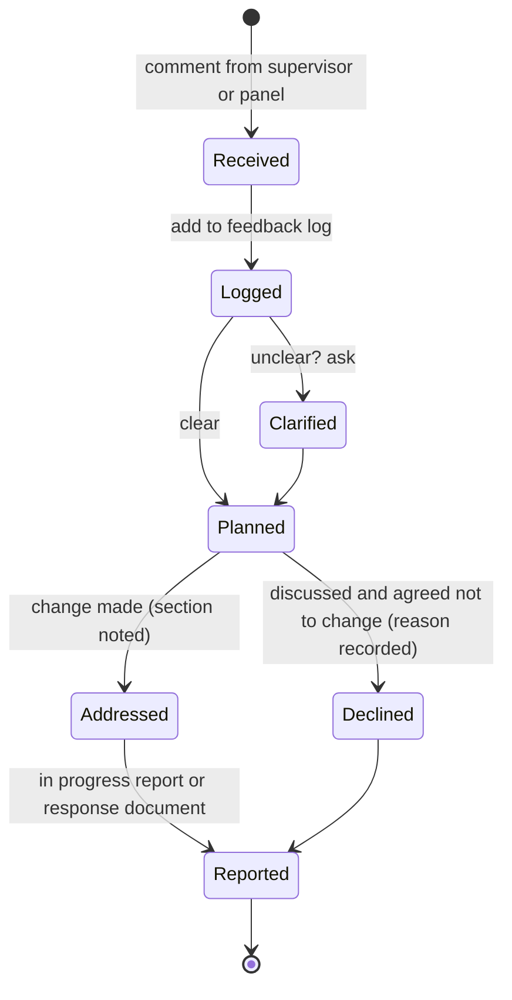

# FYP-12 Presentation, Defense and Working with Supervisor Feedback

> [!info] Topic card
> **Unit:** U6 · **Time:** 3 h (plus rehearsals) · **Template:** [[FYP-T15 Presentation and Defense Preparation]] · **Calculator:** `word_budget` in `04 - Final Year Project I/code/fyp_tools.py` (it splits seconds as well as words). The timing example is asserted in `test_fyp12_defence_timing`. **Mock:** [[MOCK-FYP-01 Mock Proposal Defense]].

> [!warning] Format not supplied
> The defence length, panel composition, question time and marking criteria weren't supplied. The 15-minute presentation below is a **hypothetical** example. Use your department's format.

## 1. Learning objectives
1. **Design** a presentation that makes the proposal's argument in the time allowed.
2. **Deliver** it clearly, with slides that support rather than replace you.
3. **Answer** panel questions honestly and concisely, including the ones you can't fully answer.
4. **Manage** supervisor feedback: log it, act on it, and report back.
5. **Turn** the panel's required corrections into a revised proposal and an FYP II plan.

## 2. Why it matters
The panel often decides in the first few minutes whether you understand your own project. A clear presentation and calm, honest answers can carry a proposal with weaknesses; a confused one can sink a strong document.

## 3. Prerequisites
[[FYP-11 Writing the Research Proposal]] (a complete draft) · [[FYP-09 Project Scheduling, Milestones and Risk Assessment]] (your plan) · [[PM-12 Stakeholder and Communication Management]] (your supervisor and panel are stakeholders).

## 4. Intuition
The presentation is the **proposal's argument, compressed**: problem → gap → method → design → plan. The defence questions test whether you **own** each link: can you justify it, and do you know its weaknesses?

## 5. Rigorous explanation

### 5.1 Structure and timing
Allocate time by importance, in the same order as the argument. `word_budget` divides a duration in seconds just as it divides words.
| Section | Weight | 15 min (900 s) | 10 min (600 s) |
|---|---|---|---|
| Problem and RQs | 2 | 150 s | 100 s |
| Literature and gap | 2 | 150 s | 100 s |
| Methodology | 3 | 225 s | 150 s |
| Design plan | 2 | 150 s | 100 s |
| Work plan and ethics | 2 | 150 s | 100 s |
| Summary | 1 | 75 s | 50 s |

A rule of thumb is roughly one slide per minute; complex slides take longer.

### 5.2 Slide design
- **One message per slide**, stated in the slide title as a sentence ("Paper requests are lost and can't be prioritised").
- **Visuals over text:** the problem in a process diagram; the gap in a comparison table; the method as the DSR cycle; the architecture as one diagram; the plan as a Gantt chart.
- **Readable:** large fonts, high contrast, no paragraphs. If the panel is reading, it isn't listening.
- **Evidence on the slide:** cite sources briefly (Author, year); show your preliminary data with n.
- **Backup slides** after the summary, for expected questions (detailed requirements, sampling calculations, a risk table).

### 5.3 Delivery
- Rehearse aloud, with a timer, at least three times; once in front of others.
- Speak to the panel, not the slides; use notes, not a script.
- Point to what matters on each slide.
- Finish on time. Running over signals poor planning, and cuts your question time.
- Have a plan for technical failure: a PDF copy, on a second device or memory stick.

### 5.4 Answering questions
A reliable pattern:
1. **Listen** to the whole question; ask for clarification if needed.
2. **Pause**, then answer the question that was asked, briefly (20–60 s).
3. **Support** the answer with your evidence or reasoning ("because the interviews showed…").
4. **Acknowledge** limitations honestly: "That's a limitation; I've addressed it by…" or "I'll consider that in FYP II."
5. If you don't know: say so, and say how you'd find out. Never invent an answer, a source, or a number.

**Common question types:**
| Type | Example | What they're checking |
|---|---|---|
| Significance | "Why does this matter?" | You can link the problem to consequences and beneficiaries |
| Gap | "How is this different from existing systems?" | Your review was critical, not descriptive |
| Methodology | "Why design science? Why not a survey?" | You understand your strategy, and the alternatives |
| Sampling | "Why 12 interviews?" | Your choice is justified (saturation, the population, feasibility) |
| Feasibility | "Can you finish this by the deadline?" | Your plan is realistic; you know the risks |
| Ethics | "How will you protect residents' data?" | Consent, minimisation, storage |
| Technical | "Why this framework?" | Choices follow from the requirements |
| Evaluation | "How will you know it worked?" | Measures linked to RQs |

### 5.5 Handling criticism
Treat criticism as information about how your work is read. Don't argue with the panel's perception; clarify where they misunderstood, and accept where they're right. Write down every comment, including the ones you disagree with: you'll discuss them with your supervisor afterwards.

### 5.6 Working with your supervisor
- **Meet regularly** (e.g. every 1–2 weeks); bring an agenda and send notes afterwards.
- **Send work in advance**, with specific questions ("Is the scope of SO3 realistic?"), not just "please check".
- **Keep a feedback log:** comment → your response → where in the document it was addressed → status. Report it in [[FYP-T14 Progress Report]].
- **Disagree professionally:** explain your reasoning and evidence, and let your supervisor decide on matters of the department's expectations.
- **Own your project:** your supervisor guides; you decide and do the work.

### 5.7 After the defence
1. Get the required corrections in writing (or write them down and confirm them).
2. Add them to your feedback log, with deadlines.
3. Revise the proposal; write a response document mapping each correction to the change.
4. Update your FYP II schedule and risk register in light of the feedback.
5. Submit the corrected proposal by the deadline.

## 6. Terminology
| Term | Meaning |
|---|---|
| Panel | The examiners at the defence |
| Backup slide | A slide after the summary, kept for expected questions |
| Feedback log | A table tracking each comment and how it was addressed |
| Response document | A list of corrections and the changes made for each |
| Minor / major corrections | Common categories of revision a panel may require (terms vary by institution) |

## 7. Step-by-step: preparing your defence
1. Get the format (length, panel, question time, criteria) from your handbook or coordinator.
2. Compute your timing with `word_budget`.
3. Write slide titles as sentences; check that they tell the story on their own.
4. Build the visuals; add backup slides.
5. Rehearse three times with a timer; adjust.
6. Write 15 likely questions (§5.4) and your answers; practise them with a peer.
7. Run [[MOCK-FYP-01 Mock Proposal Defense]].
8. On the day: arrive early, test the equipment, keep a PDF copy.

## 8. Diagram: the feedback loop

*Text version: each comment is received and logged. If it's unclear, you ask; once it's clear, you plan the change. Then it's either addressed (with the section noted) or declined after discussion (with the reason recorded). Either way it's reported in the progress report or the response document.*

## 9. Worked examples

### Example 1 (basic): timing (tested)
For a 15-minute slot with weights 2, 2, 3, 2, 2, 1: problem 150 s, literature 150 s, methodology 225 s, design 150 s, plan and ethics 150 s, summary 75 s. Cut to 10 minutes: methodology 150 s, summary 50 s, the rest 100 s each.

### Example 2 (intermediate): answering a sampling question
*Question:* "You plan about 8 interviews with wardens and technicians. Isn't that too few?"

*Answer:* "The interviews are qualitative, so the aim is thematic saturation, not statistical representativeness. I'll keep interviewing until two consecutive interviews produce no new codes, and I'll report the new codes per interview as evidence; about 8 is my estimate for a small group with closely related roles, not a fixed target. The resident survey is where I need a statistically sized sample, and I calculated that separately. The limitation is that the findings reflect one institution, which I've noted in the scope."

(Short, factual, uses the design's logic, and acknowledges the limitation.)

### Example 3 (intermediate): a feedback log
| # | Comment (source, date) | Response | Where | Status |
|---|---|---|---|---|
| 1 | "RQ3 and SO3 don't match" (supervisor, week 9) | Reworded SO3 to "design and implement…" | §1.4 | Done |
| 2 | "Justify the choice of framework" (panel, week 15) | Added a requirements-based comparison of three options | §4.3 | Done |
| 3 | "Add a pilot evaluation" (panel, week 15) | Agreed with the supervisor to do it in FYP II, week 3 | FYP II plan | Planned |
| 4 | "Use an experiment instead of a usability test" (panel member, week 15) | Discussed: a controlled experiment isn't feasible with the available participants; kept the usability study and added it as a limitation; the supervisor agreed | §3.6, response document | Declined, with reason |

### Example 4 (challenging): an unexpected hard question
*Question:* "If the hostel administration refuses access, what happens to your project?"

*Answer:* "That's one of my highest-impact risks, and it's in my risk register. I have a provisional gatekeeper letter, and I'll get formal permission alongside ethics approval. If access were refused, the fallback is to run elicitation and evaluation with student residents only, recruited through the student organisation, and to evaluate the prototype with simulated warden tasks. The contribution would then be weaker on the warden side, and I'd report that as a limitation."

(It shows the risk was planned for, gives a concrete fallback, and is honest about the cost.)

## 10. Application: your defence kit
- The slide deck (and a PDF copy).
- The backup slides.
- A one-page summary of the RQs, objectives, methods and plan, for your own reference.
- Your list of 15 likely questions and your answers.
- A notebook for the panel's comments.

## 11. Common mistakes
| Mistake | Fix |
|---|---|
| Reading slides of paragraphs | Sentence titles, visuals, notes |
| Running over time | Rehearse with a timer; plan cuts in advance |
| Spending 5 minutes on the background | Allocate by weight (§5.1) |
| Defensive or argumentative answers | Listen, answer, support, acknowledge |
| Inventing an answer | "I don't know yet; I'd find out by…" |
| Not writing down the panel's comments | A notebook, or ask a friend to take notes |
| Feedback only addressed in your head | A feedback log, and a response document |

## 12. Comparison: presentation vs proposal document
| | Proposal document | Presentation |
|---|---|---|
| Detail | Full | Key points only |
| Evidence | Every claim cited | Headline evidence; detail in backup slides |
| Audience | Reads at their own pace | Listens once, at your pace |
| Strength | Completeness | Clarity and conviction |

## 13. Practice
**L1** 1. List the five steps for answering a question. 2. What goes on a backup slide?

**L2** 3. Compute your timing with `word_budget` for your department's slot. 4. Rewrite three of your slide titles as sentences.

**L3** 5. Write answers to the eight question types in §5.4 for your project. 6. Start a feedback log with your last three supervisor comments.

**L4** 7. A panel member says your gap "already exists in commercial products". Answer. 8. Your supervisor and a panel member give conflicting advice. What do you do?

**L5** 9. Run [[MOCK-FYP-01 Mock Proposal Defense]] with peers acting as the panel; record your timing and the questions you struggled with; revise.

## 14. Hints
> [!tip]- Hints
> 7: acknowledge the products; what do they cost, what do they need, have they been evaluated in your context? 8: record both, then discuss with your supervisor; they know the department's expectations.

## 15. Worked solutions
> [!success]- Solutions 1–2
> 1. Listen; pause; answer briefly; support with evidence; acknowledge limitations (and say how you'd find out, if you don't know). 2. Detail you expect to be asked about: requirement lists, the sampling calculation, the risk register, technology comparisons.

> [!success]- Solution 7
> "That's right: commercial facilities-management products do offer request tracking, and I reviewed [the ones you actually reviewed] in §2.3. My comparison found they [the specific limitations you documented, with citations: e.g. licensing costs, connectivity requirements, no evaluation in a comparable university setting]. My contribution is a design suited to this context, and its evaluation with residents and wardens. If a product meeting those needs exists that I missed, I'd want to review it, and the evaluation could include it as a comparison." Every claim must come from your own review; don't invent product limitations.

> [!success]- Solution 8
> Log both comments with their sources. Don't choose silently. Discuss with your supervisor, bringing the two views and your own evidence-based recommendation. Agree a decision, record it with the reason in your feedback log, and explain it in your response document if the comment came from the panel.

## 16. Self-test (pass ≥ 4/5)
1. How should you answer a question you can't answer? 2. Why sentence slide titles? 3. What does a feedback log contain? 4. How long would a summary weighted 1 of 12 be in a 15-minute slot? 5. What should you do in the first step after the defence?
> [!success]- Answers
> 1. Say you don't know yet, and how you'd find out; never invent. 2. The titles alone tell the story, and each slide has one clear message. 3. The comment and its source, your response, where it was addressed, and its status. 4. 75 seconds. 5. Get the required corrections in writing (or confirm your notes).

## 17. Flashcards
#flashcards/fyp
Question-answer pattern?::Listen, pause, answer briefly, support with evidence, acknowledge limitations.
Can't answer a question?::Say so, and say how you'd find out; never invent.
Slide title rule?::A sentence stating the slide's one message.
Feedback log columns?::Comment and source, response, where addressed, status.
After the defence?::Get the corrections in writing, log them, revise, write a response document, update the FYP II plan.

## 18. Blank-page recall
Sketch your defence: the sections with timings, one sentence title per slide, and the three hardest questions you expect, with answers.

## 19. Revision summary
- The presentation compresses the proposal's argument; allocate time by weight and rehearse with a timer.
- Sentence titles, visuals, backup slides, and a PDF copy.
- Answers: listen, answer, support, acknowledge; never invent.
- Log every comment; respond in a feedback log and a response document; update the FYP II plan.

## 20. Links
Prev: [[FYP-11 Writing the Research Proposal]] · Mock: [[MOCK-FYP-01 Mock Proposal Defense]] · Template: [[FYP-T15 Presentation and Defense Preparation]] · Related: [[PM-12 Stakeholder and Communication Management]], [[FYP 02 Idea-to-Defense Workflow]]

## 21. Sources
- Dawson, C. W., *Projects in Computing and Information Systems: A Student's Guide*, 3rd ed., Pearson, 2015 (presentations and vivas).
- Your department's FYP handbook (the defence format and criteria).
- *(Not checked online during the build, because there was no network access.)*

## 22. Mastery checklist
- [ ] My presentation fits the time, with sentence titles and backup slides
- [ ] I've rehearsed three times and answered 15 likely questions aloud
- [ ] I keep a feedback log and write response documents
- [ ] I completed the mock defence
- [ ] Reviews scheduled
