# FYP-T10 Project Schedule

> [!info] How to use
> Copy this note into your own project folder (or duplicate it) and replace every `____` with your content. Lesson: [[FYP-09 Project Scheduling, Milestones and Risk Assessment]]. Compute the critical path with `cpm` in `05 - Information System Project Management/code/pm_tools.py`. The example rows use the vault's fictional running case (a hostel maintenance request system at "[University X]"): replace them with your own evidence. **Your department's handbook and supervisor override this template.**

## 1. Real deadlines (from the handbook)
| Event | Date / week | Source |
|---|---|---|
| Topic approval | ____ | Handbook § ____ |
| Proposal submission | ____ | ____ |
| Defence | ____ | ____ |
| Ethics committee meeting dates | ____ | ____ |
| My other modules' exam weeks | ____ | Timetable |

## 2. Activity table
| ID | Activity | Duration (weeks) | Predecessors | WBS code |
|---|---|---|---|---|
| A | ____ | ____ | — | ____ |
| ____ | ____ | ____ | ____ | ____ |

## 3. CPM result
- Project duration: ____ weeks (available: ____)
- Critical path: ____
- Float on non-critical activities: ____
- If it doesn't fit: compression options agreed with the supervisor: ____

## 4. Gantt chart

```mermaid
gantt
    title FYP I plan (replace with yours)
    dateFormat X
    axisFormat %s
    section Proposal
    Topic approval        :a, 0, 2
    Problem and RQs       :b, after a, 1
    section Approvals
    Ethics application    :f, after b, 1
    Ethics review         :g, after f, 3
```

## 5. Milestones
| Milestone | Planned week | Actual week |
|---|---|---|
| ____ | ____ | ____ |

## Quality checklist
- [ ] Durations are estimated with my real availability (exam weeks at reduced capacity)
- [ ] The ethics review is in the network, with a realistic duration
- [ ] A 10–20% buffer exists before the hard deadlines
