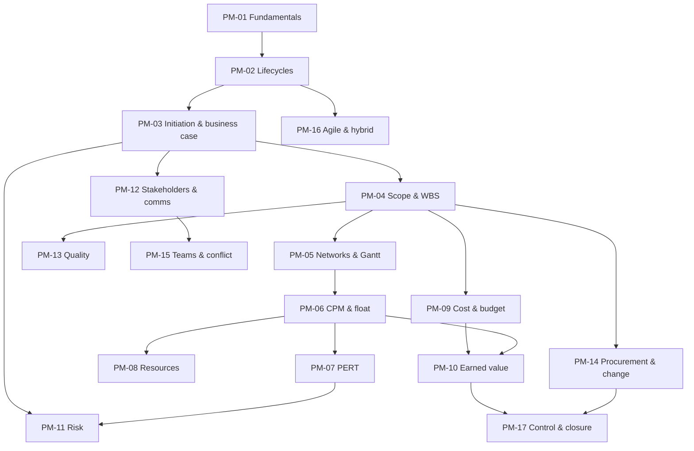

# IS Project Management: Curriculum Map

Back to [[PM 00 Dashboard]]

## 1. Units
| Unit | Lessons | Artefacts |
|---|---|---|
| U1 Foundations | PM-01, PM-02 | — |
| U2 Initiation | PM-03 | A01 Charter |
| U3 Planning | PM-04 to PM-09 | A02 Scope, A03 WBS, A04 Schedule, A05 Budget |
| U4 Execution and control | PM-10 to PM-14 | A06 Risk register, A07 Stakeholder register, A08 Comms plan, A09 Status report, A10 Change request |
| U5 People and delivery approaches | PM-15, PM-16 | (RACI inside A08) |
| U6 Closing | PM-17 | A11 Closure report |

## 2. Prerequisite graph

*Text version: fundamentals and lifecycles lead to initiation. Initiation leads to scope (WBS), which drives scheduling (network → CPM → PERT and resources) and cost (→ earned value). Risk, stakeholders, quality and procurement build on initiation and scope. Teams follow stakeholders. Agile builds on lifecycles. Control and closure come last.*

## 3. Review alerts
| Before… | Review | Why |
|---|---|---|
| PM-05/06 | [[DM-15 Graphs, Representations, Paths and Connectivity]] | Networks as directed acyclic graphs; longest path |
| PM-07 | [[DM-18 Introductory Discrete Probability]] | Expected value, variance, the normal approximation |
| PM-03 | [[DM-08 Sequences and Summations]] | Discounting as a geometric-style sum |
| PM-04 | [[SD-04 Use Cases, User Stories and Traceability]] | Requirements traceability |
| PM-11 | [[CS-16 Risk Analysis, Policy, Governance and Compliance]] | The same risk vocabulary in security |
| PM-16 | [[SD-02 Software Process Models]] | Scrum and Kanban from the engineering side |

## 4. Cross-module links
[[X-02 Graph Theory in Algorithms, Networks and Scheduling]] · [[X-05 Security Risk in Project Management]] · [[X-07 Scheduling Your Own Semester with CPM]] · [[FYP-09 Project Scheduling, Milestones and Risk Assessment]] · [[X-CASE-02 SME Inventory Rollout]]
