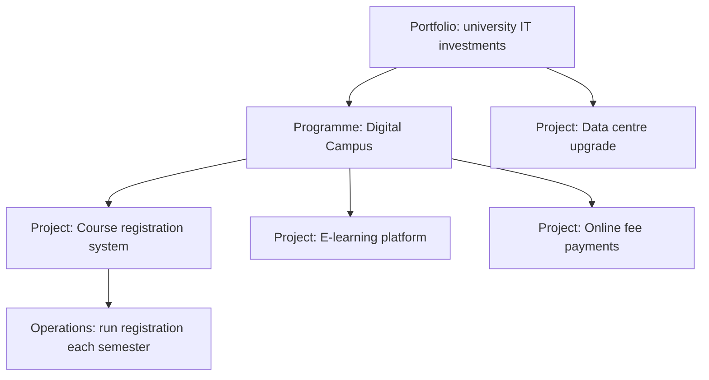

# PM-01 Project Fundamentals and Organizational Context

> [!info] Topic card
> **Unit:** U1 · **Time:** 3 h · **Running case:** [[PM-CASE-01 University Course Registration System]]

## 1. Learning objectives
1. **Define** a project, and **distinguish** it from operations, programmes and portfolios.
2. **Explain** the triple constraint (scope, time, cost), with quality and risk, and how the constraints trade off.
3. **Describe** the project manager's role, competencies and key stakeholders.
4. **Compare** organisational structures (functional, matrix, projectised) and their effect on project authority.
5. **Explain** why IS projects are distinctive and why they often fail.

## 2. Why it matters
Most IS work in organisations is delivered as projects: a new registration system, an ERP rollout, a mobile app. Good engineers who don't understand projects find themselves in endless "90% done" work, with unhappy sponsors. Understanding constraints, stakeholders and organisational structure lets you plan realistically and communicate clearly.

## 3. Prerequisites
None. [[SD-01 Software Engineering Fundamentals]] gives useful background on software lifecycles.

## 4. Intuition
A project is a **journey with a destination, a budget and a deadline**. Operations are the daily commute. Projects are temporary and unique, so they need planning that operations don't: you've never taken *this* trip before.

## 5. Rigorous explanation

### 5.1 Definitions
- **Project:** a temporary endeavour undertaken to create a unique product, service or result (PMI). *Temporary* means it has a defined beginning and end. *Unique* means the outcome hasn't been delivered in exactly this form before. It's **progressively elaborated**: detail emerges as it proceeds.
- **Operations:** ongoing, repetitive work that sustains the organisation (running the registration system each semester).
- **Programme:** related projects managed together for benefits that can't be achieved separately (a "digital campus" programme: registration, e-learning and finance projects).
- **Portfolio:** all the projects and programmes an organisation selects to meet its strategy.
- **Project management:** applying knowledge, skills, tools and techniques to project activities to meet the project's requirements.

### 5.2 Constraints
- **The triple constraint:** scope, time and cost. Changing one affects the others. **Quality** sits in the middle; **risk**, **resources** and **benefits** are also commonly listed.
- **Trade-off examples:**
  - Fixed deadline (registration must open in week 1) + fixed budget → reduce scope (MoSCoW).
  - Fixed scope + earlier deadline → more cost (crashing, PM-06) or more risk.

### 5.3 Roles
- **Sponsor:** owns the business case, provides funding, makes key decisions.
- **Project manager:** plans, coordinates, monitors and communicates; accountable for delivery within the constraints.
- **Team:** does the work.
- **Steering committee:** governance and escalation.
- **Users and customers:** use the result.
- **Functional managers:** provide the resources.

**PM competencies:** technical project management, leadership, and strategic and business awareness (the PMI "talent triangle" idea), plus communication, negotiation and problem-solving.

### 5.4 Organisational structures
| Structure | PM authority | Resource availability | Typical issues |
|---|---|---|---|
| Functional | Low (a coordinator) | Part-time, from departments | Slow decisions; staff loyal to their department |
| Weak matrix | Low–moderate | Shared | Conflicting priorities |
| Balanced matrix | Moderate | Shared | Two bosses |
| Strong matrix | Moderate–high | Mostly dedicated | Functional managers' resistance |
| Projectised | High | Dedicated | Staff have "no home" after the project; duplication |

A university is often functional (faculties, ICT, registry), so a cross-departmental IS project usually runs as a weak or balanced matrix. The PM must influence without much formal authority.

### 5.5 Why IS projects are distinctive and why they fail
- **Distinctive:** intangible products; requirements discovered while building; rapidly changing technology; integration with existing systems; organisational change (new business processes).
- **Common failure causes:**
  - unclear objectives and requirements;
  - lack of executive support;
  - poor user involvement;
  - unrealistic schedules;
  - scope creep;
  - weak risk management;
  - technology chosen before the problem is understood.
- Surveys of IT project outcomes (e.g. the long-running Standish Group CHAOS reports) are widely cited, but their methods have been criticised. Treat specific percentages with caution, and focus on the causes.

## 6. Terminology
| Term | Meaning |
|---|---|
| Deliverable | A verifiable product, result or capability |
| Milestone | A significant point or event (zero duration) |
| Scope creep | Uncontrolled expansion of scope |
| Sponsor | The person or group providing resources and support |
| PMO | Project management office: standards, support and governance |
| Benefits realisation | Achieving the business value after delivery |

## 7. Step-by-step: is it a project?
Check each criterion:
1. A defined start and end?
2. A unique output?
3. A specific objective?
4. Dedicated (or allocated) resources and budget?
5. Uncertainty that needs planning?

Then name the sponsor, the main constraints, and the organisational structure it will run in.

## 8. Diagram: project, programme, portfolio

## 9. Worked examples

### Example 1 (basic): project or operations?
| Work | Classification |
|---|---|
| Building an online course-registration system | Project |
| Running registration each semester | Operations |
| Upgrading every lab PC to a new OS over the summer | Project |
| The help desk answering password-reset requests | Operations |
| A "Digital Campus" initiative with 5 related systems | Programme |

### Example 2 (intermediate): a trade-off decision
CASE-01: the registration system must be live for semester 1 (fixed time). The budget is fixed at TZS 60,000,000. The vendor estimate exceeds the time available by 3 weeks. Options:
- (a) cut scope: defer timetable-clash detection to release 2;
- (b) add cost: an extra developer, if the budget allows;
- (c) accept risk: compress testing (dangerous).

**Recommendation:** (a), with the sponsor's approval documented. Time and cost are fixed, so scope must give. Quality shouldn't be silently sacrificed.

### Example 3 (challenging): structure and authority
The project team: 2 developers from ICT, 1 business analyst from the registry, 1 tester from ICT, all part-time. The PM reports to the deputy vice-chancellor's office. That's a **weak/balanced matrix**: staff answer to their functional managers, and the PM has little authority.

**Strategies:**
- a signed resource agreement with the ICT and registry heads (named people and hours per week);
- a steering committee chaired by the sponsor, to resolve conflicts;
- visible status reporting;
- recognition of team members to their line managers.

## 10. Application: IS project success criteria
Define success beyond "on time, on budget":
- **Project success:** scope, time, cost and quality met.
- **Product success:** the system works and is used (e.g. 95% of students register online in semester 1).
- **Business success:** benefits realised (registry queue time cut by 80%, fewer timetable clashes).

Write all three for CASE-01 in the charter ([[PM-A01 Project Charter]]).

## 11. Common mistakes
| Mistake | Fix |
|---|---|
| Treating ongoing work as a project | Use the temporary + unique test |
| "On time and budget = success" | Add product and business success criteria |
| Ignoring the organisational structure | Plan the authority, resource agreements and escalation |
| Fixing scope, time and cost all at once | Agree which constraint is flexible |
| Technology first, problem second | Business case and requirements first |

## 12. Comparison: projects vs operations
| | Project | Operations |
|---|---|---|
| Duration | Temporary (start and end) | Ongoing |
| Output | Unique | Repetitive |
| Goal | Achieve an objective, then stop | Sustain the organisation |
| Change | Introduces change | Resists change (stability) |
| Example | Build the registration system | Run registration every semester |

## 13. Practice
**L1** 1. Define a project, and give two characteristics. 2. Programme vs portfolio?

**L2** 3. Classify five activities at your institution as project or operations. 4. Which structure gives the PM the most authority?

**L3** 5. For CASE-01, describe what happens to the other constraints if scope increases by 20%. 6. Write three success criteria (project, product, business) for an e-learning rollout.

**L4** 7. A PM in a functional organisation can't get developer time. Propose 4 strategies. 8. Explain why IS projects involve organisational change, and the risk if it's ignored.

**L5** 9. Analyse an IS project you know of (or a published case). Identify its type, constraints, structure, stakeholders, and the likely reasons for its success or failure, with evidence.

## 14. Hints
> [!tip]- Hints
> 2: related projects for combined benefits, vs all investments aligned to strategy. 5: time and/or cost rise unless quality is cut. 7: sponsor support, resource agreements, escalation, visibility.

## 15. Worked solutions
> [!success]- Solutions 1–2
> 1. A temporary endeavour creating a unique product, service or result. Characteristics: temporary (a defined start and end), unique, progressively elaborated, with allocated resources. 2. A programme groups related projects to achieve coordinated benefits. A portfolio is the collection of all projects and programmes (related or not) chosen to meet strategic objectives.

> [!success]- Solution 4
> Projectised (and strong matrix, to a lesser degree).

> [!success]- Solution 5
> More scope means more work. If time and cost stay fixed, the only remaining variable is quality (or risk), which is dangerous. Realistically, time and/or cost must increase (around 20% more effort if the extra scope is similar in nature), or some lower-priority scope must be removed. The sponsor must decide through change control ([[PM-14 Procurement and Change Management]]).

> [!success]- Solution 6
> **Project:** delivered by week 12, within TZS 40 M, with all Must requirements. **Product:** 90% of courses have content online by mid-semester; 99% availability in teaching hours. **Business:** student satisfaction with access to course material improves by 20 points on the annual survey; printing costs fall by 30% within one year.

> [!success]- Solution 7
> 1. Get **sponsor** backing, and a written **resource agreement** (named staff and hours) with the functional manager. 2. Put resource conflicts on the **steering committee** agenda. 3. Make work **visible**: a schedule showing the impact of missing resources on the go-live date. 4. Build **relationships**: involve functional managers in planning, credit their staff, and plan around their peak periods.

> [!success]- Solution 8
> New systems change how people work: their processes, roles and power (e.g. registry staff lose manual control of registration). If change management is ignored, users resist or work around the system, data quality suffers, and the benefits aren't realised, even when the software works perfectly. Plan training, communication, process redesign and support as part of the project scope.

## 16. Self-test (pass ≥ 4/5)
1. Name the triple constraint. 2. Is running the help desk a project? 3. Who owns the business case? 4. What's a milestone? 5. Name two common causes of IS project failure.
> [!success]- Answers
> 1. Scope, time, cost (with quality at the centre). 2. No: it's operations. 3. The sponsor. 4. A significant point or event with zero duration. 5. Unclear requirements, lack of user involvement, unrealistic schedules, scope creep, lack of executive support (any two).

## 17. Flashcards
#flashcards/project-management
Project (PMI)?::A temporary endeavour undertaken to create a unique product, service or result.
Triple constraint?::Scope, time and cost (with quality affected by all three).
Programme?::Related projects managed together for combined benefits.
Weak matrix PM authority?::Low: functional managers control the resources.
Three levels of success?::Project (scope/time/cost), product (works and is used), business (benefits realised).

## 18. Blank-page recall
Draw the portfolio/programme/project diagram and the structures table from memory.

## 19. Revision summary
- Projects are temporary and unique; operations are ongoing.
- Programmes group related projects; portfolios align everything with strategy.
- The triple constraint trades scope, time and cost; agree which one flexes.
- The organisational structure determines the PM's authority; plan around it.
- IS projects fail mostly through requirements, people and change issues. Define success at three levels.

## 20. Links
Next: [[PM-02 Project Lifecycles, Process Groups and Methodologies]] · Case: [[PM-CASE-01 University Course Registration System]] · Related: [[SD-01 Software Engineering Fundamentals]], [[FYP 00 Dashboard]]

## 21. Sources
- Project Management Institute, *A Guide to the Project Management Body of Knowledge (PMBOK® Guide)*, 7th ed., 2021 (and the 6th ed., 2017, for process-based terminology).
- Schwalbe, K., *Information Technology Project Management*, 9th ed., Cengage, 2019.
- AXELOS, *Managing Successful Projects with PRINCE2®*, 7th ed., 2023.
- *(Not checked online during the build, because there was no network access. PMBOK editions change; use the edition your course specifies.)*

## 22. Mastery checklist
- [ ] I can distinguish project, programme, portfolio and operations
- [ ] I can analyse trade-offs among the constraints
- [ ] I can explain the structures and the PM's authority
- [ ] Reviews scheduled
