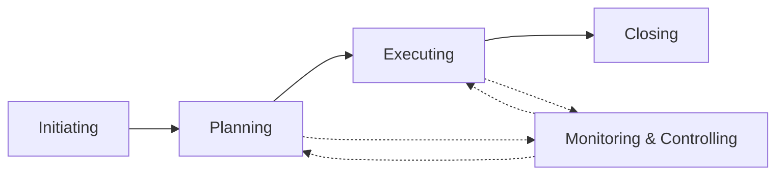

# PM-02 Project Lifecycles, Process Groups and Methodologies

> [!info] Topic card
> **Unit:** U1 · **Time:** 3 h · Engineering view of the same topic: [[SD-02 Software Process Models]]

## 1. Learning objectives
1. **Describe** the project lifecycle phases, and **distinguish** predictive, iterative, incremental, adaptive and hybrid lifecycles.
2. **Explain** the five process groups and how they interact throughout a project.
3. **Outline** the PMBOK knowledge areas (6th ed.), plus the principles and performance domains (7th ed.), and PRINCE2's principles, practices and processes.
4. **Select** a lifecycle and methodology for an IS project, and **justify** the choice.
5. **Explain** phase gates and governance.

## 2. Why it matters
Exams and employers expect fluency in the standard frameworks. More importantly, choosing the wrong lifecycle (for example, fully predictive for a system whose users don't yet know what they want) is a common root cause of failure.

## 3. Prerequisites
[[PM-01 Project Fundamentals and Organizational Context]] · [[SD-02 Software Process Models]].

## 4. Intuition
A lifecycle is the **shape of the journey** (one long road, or many short loops). Process groups are the **things you always do on any journey**: decide to go, plan, travel, check that you're on course, and arrive. Methodologies (PMBOK guidance, PRINCE2, Scrum) are **guidebooks** with different levels of detail.

## 5. Rigorous explanation

### 5.1 Lifecycle types
| Type | Scope defined | Delivery | Suits |
|---|---|---|---|
| Predictive (waterfall) | Up front | Once, at the end | Stable requirements, regulated work |
| Iterative | Refined through iterations | At the end, refined repeatedly | Learning by prototyping |
| Incremental | Early, for each increment | Usable pieces, frequently | Early value from a clear core |
| Adaptive (agile) | Emerges, re-prioritised often | Every iteration | High uncertainty, engaged users |
| Hybrid | A mix (e.g. predictive infrastructure + agile software) | Mixed | Most real IS projects |

**Generic phases:** starting → organising and preparing → carrying out the work → closing. **Phase gates** (stage reviews) decide whether to continue, change or stop.

### 5.2 Process groups (PMBOK 6th ed.)
1. **Initiating:** define and authorise the project or phase (business case, charter, stakeholder identification).
2. **Planning:** scope, schedule, cost, quality, resources, communication, risk and procurement plans.
3. **Executing:** do the work, manage the team, engage stakeholders.
4. **Monitoring and controlling:** track performance, manage changes, control scope, schedule and cost (EVM).
5. **Closing:** formal acceptance, release resources, lessons learned, archive.

These aren't phases: they **overlap and repeat** in every phase. Monitoring and controlling runs throughout.

**Knowledge areas (6th ed., 10):**
- integration;
- scope;
- schedule;
- cost;
- quality;
- resource;
- communications;
- risk;
- procurement;
- stakeholder.

### 5.3 PMBOK 7th edition (2021)
The 7th edition shifted from processes to **12 principles**. Among them:
- stewardship;
- team;
- stakeholders;
- value;
- systems thinking;
- leadership;
- tailoring;
- quality;
- complexity;
- risk;
- adaptability and resilience;
- change.

It also introduced **8 performance domains**:
- stakeholders;
- team;
- development approach and lifecycle;
- planning;
- project work;
- delivery;
- measurement;
- uncertainty.

Many courses still teach the 6th edition's process groups and knowledge areas. Know both, and use your course's edition.

### 5.4 PRINCE2 (7th edition, 2023)
- **7 principles:**
  - ensure continued business justification;
  - learn from experience;
  - define roles, responsibilities and relationships;
  - manage by stages;
  - manage by exception;
  - focus on products;
  - tailor to suit the project.
- **7 practices** (called "themes" before the 7th edition): business case, organising, plans, quality, risk, issues, progress.
- **7 processes:** starting up, directing, initiating, controlling a stage, managing product delivery, managing a stage boundary, closing.
- **Distinctive features:** manage by **exception** (tolerances delegated to each level) and **product-based planning**.

### 5.5 Choosing an approach
Factors:
- requirement certainty;
- the need for early value;
- regulatory and documentation needs;
- stakeholder availability;
- team experience;
- contract type;
- organisational culture.

Tailor the approach: use the parts of a method that add value at this project's size and risk.

## 6. Terminology
| Term | Meaning |
|---|---|
| Phase gate / stage boundary | A decision point between phases |
| Process group | A logical grouping of PM processes (initiating … closing) |
| Knowledge area | A field of PM practice (scope, risk…) |
| Tailoring | Adapting a method to the project's context |
| Management by exception | Escalate only when forecasts exceed the agreed tolerances |
| Product-based planning | Planning from the deliverables (products) first |

## 7. Step-by-step: tailoring for CASE-01
1. Requirements: registration rules are well known, but the UI and usability are uncertain.
2. The deadline is fixed (semester start) and the budget is fixed.
3. Choose a **hybrid**:
   - predictive phases for procurement, infrastructure and data migration;
   - agile sprints for the student-facing features, with a product owner from the registry;
   - a stage gate before go-live.
4. Light PRINCE2-style governance: a steering committee, stage tolerances (±1 week, ±5% budget), and exception reports.

## 8. Diagram: process groups across phases

*Text version: initiating leads to planning, then executing, then closing. Monitoring and controlling interacts with planning and executing continuously, feeding corrections back.*

## 9. Worked examples

### Example 1 (basic): which process group?
| Activity | Group |
|---|---|
| Write the project charter | Initiating |
| Build the WBS | Planning |
| Develop the registration module | Executing |
| Compare actual cost with planned cost | Monitoring and controlling |
| Hold the lessons-learned meeting | Closing |
| Approve a change request | Monitoring and controlling (integrated change control) |

### Example 2 (intermediate): lifecycle choice
A ministry needs a payroll system matching new tax regulations that take effect on 1 July, with fixed rules defined in law. Recommendation: **predictive**, with careful requirements and verification (V-model-style testing against the regulations), because the requirements are fixed and the compliance evidence matters. An incremental rollout by department reduces deployment risk.

### Example 3 (challenging): manage by exception
The steering committee sets stage tolerances of ±2 weeks and ±10% cost. The PM forecasts the stage finishing 3 weeks late. That's beyond tolerance, so the PM must raise an **exception report** with options (cut scope, add resources, accept the delay) and a recommendation. A 1-week forecast slip stays within tolerance: the PM handles it and reports it routinely.

## 10. Application: governance for your FYP
- Phases: proposal → design → build → evaluation → report.
- Phase gates: supervisor approval at each stage (a stage boundary).
- Tolerances: ±1 week per milestone before you notify your supervisor.

Link to [[FYP-09 Project Scheduling, Milestones and Risk Assessment]].

## 11. Common mistakes
| Mistake | Fix |
|---|---|
| Treating process groups as sequential phases | They repeat within every phase |
| Using a full methodology for a tiny project | Tailor it |
| Agile without governance | Keep the business case, roles and stage reviews |
| Mixing up PMBOK editions in exams | Use your course's edition and terms |
| Predictive for highly uncertain work | Iterate where uncertainty is high |

## 12. Comparison: PMBOK vs PRINCE2 vs Scrum
| | PMBOK Guide | PRINCE2 | Scrum |
|---|---|---|---|
| Nature | A body of knowledge / a standard (what) | A process method (how) | A lightweight framework for product development |
| Focus | Knowledge areas, principles, domains | Business justification, stages, products, roles | Sprints, a backlog, a self-managing team |
| Governance | Described in general terms | Strong (project board, tolerances) | Minimal (product owner) |
| Best for | Any project, as a reference | Organisations needing control and justification | Software with uncertain requirements |

## 13. Practice
**L1** 1. Name the five process groups. 2. Name four PRINCE2 principles.

**L2** 3. Classify 6 activities into process groups. 4. Predictive vs adaptive: two differences.

**L3** 5. Recommend a lifecycle for a mobile-money integration for a university fee system, and justify it. 6. Explain manage-by-exception with a numeric example.

**L4** 7. Design a hybrid approach for CASE-02 (inventory system: a hardware rollout to 3 warehouses plus custom software). 8. Compare PMBOK 6th-edition process groups with PMBOK 7th-edition performance domains.

**L5** 9. Write a 1-page "project approach" section for CASE-03 (point-of-sale), covering the lifecycle, governance, stage gates, tolerances and tailoring decisions.

## 14. Hints
> [!tip]- Hints
> 5: external API constraints (predictive integration) plus a UI that suits agile; security testing gates. 7: predictive hardware with agile software, synchronised at integration milestones. 8: processes (how) vs outcomes and principles (what matters).

## 15. Worked solutions
> [!success]- Solutions 1–2
> 1. Initiating, planning, executing, monitoring and controlling, closing. 2. Any four of: continued business justification; learn from experience; defined roles and responsibilities; manage by stages; manage by exception; focus on products; tailor to suit.

> [!success]- Solution 4
> Predictive: scope is defined up front, and delivery comes at the end. Adaptive: scope emerges and is re-prioritised, with working increments delivered frequently. Predictive plans in detail early; adaptive plans just in time for each iteration.

> [!success]- Solution 5
> **Hybrid:**
> - the integration with the mobile-money provider's API is predictive (fixed interface specification, a contract, a certification test);
> - the student-facing payment and receipt screens are agile (2-week sprints with student feedback);
> - security and reconciliation testing are mandatory gates before go-live.
>
> **Why:** the external interface is fixed and high-risk, while the user experience is uncertain.

> [!success]- Solution 6
> The board sets a cost tolerance of ±10% on a TZS 20 M stage (TZS 18–22 M). The PM forecasts TZS 21 M: within tolerance, so it's managed and reported routinely. A later forecast of TZS 23.5 M (+17.5%) is beyond tolerance, so the PM sends an exception report to the board with options. The board doesn't micromanage within tolerance.

> [!success]- Solution 8
> PMBOK 6 is organised around **processes** (49 of them), grouped into 5 process groups × 10 knowledge areas, with inputs, tools and outputs. It tells you *how* to perform PM work. PMBOK 7 is organised around **12 principles** and **8 performance domains** (stakeholders, team, development approach, planning, project work, delivery, measurement, uncertainty). These describe *outcomes* to achieve, and support any lifecycle, including agile. The process content moved to a separate resource. Both are useful: 6th for structured planning exams, 7th for tailoring and value focus.

## 16. Self-test (pass ≥ 4/5)
1. Which process group runs throughout the project? 2. What's a phase gate? 3. PRINCE2's "manage by exception" means? 4. Which lifecycle defines scope up front? 5. How many knowledge areas are there in PMBOK 6?
> [!success]- Answers
> 1. Monitoring and controlling. 2. A decision point at the end of a phase: continue, change or stop. 3. Escalate only when forecasts exceed the agreed tolerances. 4. Predictive. 5. Ten.

## 17. Flashcards
#flashcards/project-management
Five process groups?::Initiating, planning, executing, monitoring & controlling, closing.
PMBOK 6 knowledge areas?::Integration, scope, schedule, cost, quality, resource, communications, risk, procurement, stakeholder.
PMBOK 7 structure?::12 principles and 8 performance domains.
PRINCE2 structure?::7 principles, 7 practices (themes), 7 processes.
Hybrid lifecycle?::Combining predictive and adaptive approaches in one project.

## 18. Blank-page recall
List the process groups with two outputs each, and the PRINCE2 principles.

## 19. Revision summary
- Lifecycles: predictive, iterative, incremental, adaptive, hybrid. Choose them by uncertainty and context.
- Process groups repeat within phases. Knowledge areas organise PM practice (PMBOK 6). PMBOK 7 uses principles and performance domains.
- PRINCE2: business justification, stages, exceptions, products, roles, tailoring.
- Tailor every method to the project.

## 20. Links
Prev: [[PM-01 Project Fundamentals and Organizational Context]] · Next: [[PM-03 Project Initiation, Business Case and Charter]] · Related: [[SD-02 Software Process Models]], [[PM-16 Agile, Scrum and Hybrid Delivery]]

## 21. Sources
- PMI, *PMBOK® Guide*, 6th ed. (2017) and 7th ed. (2021).
- AXELOS, *Managing Successful Projects with PRINCE2®*, 7th ed., 2023.
- Schwaber, K. & Sutherland, J., *The Scrum Guide*, 2020.
- *(Not checked online during the build, because there was no network access.)*

## 22. Mastery checklist
- [ ] I can classify activities into process groups
- [ ] I can explain PMBOK and PRINCE2 structures
- [ ] I can choose and justify a lifecycle, including hybrid
- [ ] Reviews scheduled
