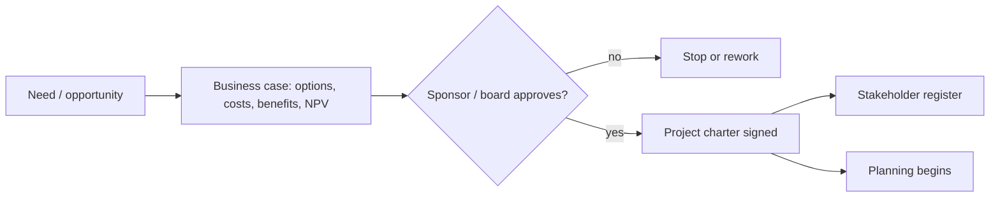

# PM-03 Project Initiation, Business Case and Charter

> [!info] Topic card
> **Unit:** U2 · **Time:** 4 h · **Calculator:** `npv`, `irr`, `payback_period`, `discounted_payback` and `roi` in `code/pm_tools.py`. Every figure below is asserted in `tests/test_pm_tools.py`. Amounts are **illustrative** (TZS), not real project data. · **Artefact:** [[PM-A01 Project Charter]]

## 1. Learning objectives
1. **Explain** how projects are selected and authorised: strategic alignment, the business case, feasibility, the charter.
2. **Calculate** NPV, IRR, simple and discounted payback, and ROI, and **interpret** them correctly.
3. **Compare** project options using financial and non-financial criteria (a weighted scoring model).
4. **Write** a project charter with objectives, success criteria, high-level scope, milestones, budget, risks and authority.
5. **Identify** stakeholders at initiation.

## 2. Why it matters
The business case answers "should we do this at all?" A project without one has nothing to measure benefits against, and nothing to stop it when it no longer makes sense. The charter formally authorises the project and the PM. Examiners love NPV and payback questions, which are easy marks if you're careful with signs and discounting.

## 3. Prerequisites
[[PM-02 Project Lifecycles, Process Groups and Methodologies]] · [[DM-08 Sequences and Summations]] (summing discounted terms).

## 4. Intuition
A shilling today is worth more than a shilling in three years: you could invest it, and inflation erodes it. **Discounting** converts future benefits into today's money, so you can compare them fairly with today's cost. NPV > 0 means that, at your required rate of return, the project creates more value than it costs.

## 5. Rigorous explanation

### 5.1 Selection and feasibility
- **Strategic alignment:** does it support the organisation's goals?
- **Feasibility:**
  - technical: can it be built?
  - economic: is it worth it?
  - operational: will people use it?
  - schedule: in time?
  - legal: data protection, procurement rules.
- **Business case contents:**
  - the problem or opportunity;
  - the options, including "do nothing";
  - costs and benefits (tangible and intangible);
  - financial appraisal;
  - risks;
  - a recommendation.

### 5.2 Financial measures
Cash flows $C_0, C_1, \dots, C_n$ (with $C_0$ usually negative), at discount rate $r$:
- **NPV** $= \sum_{t=0}^{n} \dfrac{C_t}{(1+r)^t}$. Accept if NPV > 0. Prefer the higher NPV.
- **IRR:** the rate at which NPV = 0. Accept if IRR > the required rate (the hurdle rate). Computed iteratively (`irr` uses bisection).
- **Simple payback:** the time until cumulative undiscounted cash flow reaches 0. **Discounted payback** uses discounted flows, so it's always longer.
- **ROI** $= \dfrac{\text{total benefits} - \text{total costs}}{\text{total costs}}$ (undiscounted here; state the convention you use).

**Interpretation cautions:**
- NPV is the most reliable for ranking.
- IRR can mislead when comparing projects of different sizes, or when cash flows change sign more than once.
- Payback ignores everything after the payback point.
- Benefits are *estimates*: run a sensitivity analysis.

### 5.3 Weighted scoring
Score options against criteria (strategic fit, NPV, risk, ease of implementation) on, say, a 1–5 scale, multiply by weights that sum to 1, and add up. This makes non-financial factors explicit and debatable.

### 5.4 The project charter
It authorises the project and gives the PM authority to apply resources. Typical contents:
- the purpose and business justification (linked to the business case);
- measurable objectives and success criteria;
- the high-level scope and requirements, with key exclusions;
- the summary milestones and budget;
- high-level risks, assumptions and constraints;
- key stakeholders;
- the PM's name and authority;
- the sponsor's signature.

## 6. Terminology
| Term | Meaning |
|---|---|
| Discount rate / hurdle rate | The required rate of return used to discount cash flows / the minimum acceptable IRR |
| Present value (PV) | A future amount discounted to today |
| Tangible / intangible benefit | Measurable in money / not easily measured (reputation, satisfaction) |
| Do-nothing option | The baseline that every option is compared with |
| Charter | The document that formally authorises the project and the PM |
| Sensitivity analysis | Testing how results change when the inputs vary |

## 7. Step-by-step: computing NPV by hand
Option A for CASE-01: investment TZS 45,000,000 at $t = 0$; net benefits TZS 18,000,000 per year for 4 years; discount rate 12%.

| Year $t$ | Cash flow | Factor $1/1.12^t$ | Present value |
|---|---|---|---|
| 0 | −45,000,000 | 1 | −45,000,000 |
| 1 | 18,000,000 | 0.8929 | 16,071,429 |
| 2 | 18,000,000 | 0.7972 | 14,349,490 |
| 3 | 18,000,000 | 0.7118 | 12,812,044 |
| 4 | 18,000,000 | 0.6355 | 11,439,325 |
| **NPV** | | | **9,672,288** |

(The PVs come from `pm_tools`. Hand calculations with rounded factors differ by a few shillings.)

## 8. Diagram: initiation flow

## 9. Worked examples

### Example 1 (basic): the four measures for Option A (tested)
- **NPV** at 12% = **TZS 9,672,288** > 0, so it's financially worthwhile.
- **IRR** = **21.86%** > the 12% hurdle.
- **Simple payback:** cumulative after year 2 = −45 + 36 = −9 M; year 3 adds 18 M, so the payback is 2 + 9/18 = **2.5 years**.
- **Discounted payback** = **3.15 years** (longer, as expected).
- **ROI** = (72 − 45) / 45 = **60%** (undiscounted).

### Example 2 (intermediate): comparing options (tested)
Option B: a cheaper, partial system. Investment 30 M; benefits 8, 10, 12 and 12 M.

| Measure | A | B |
|---|---|---|
| NPV @12% | 9,672,288 | 1,282,376 |
| IRR | 21.86% | 13.87% |
| Payback | 2.5 years | 3.0 years |
| Discounted payback | 3.15 years | 3.83 years |
| ROI | 60% | 40% |

A dominates B on every measure, so recommend A, if the extra 15 M of capital is available. If capital is limited to 30 M, B is still acceptable (NPV > 0, IRR > 12%), and "do nothing" has an NPV of 0.

### Example 3 (challenging): sensitivity
How sensitive is A to the discount rate? At 18%, NPV = **3,421,112** (still positive). At 25%, NPV = **−2,491,200** (negative). This is consistent with IRR = 21.86%: the NPV changes sign there. If benefits are 20% lower (14.4 M a year), recompute (Practice 7). If NPV is still positive, the decision is robust. Present the sponsor with the break-even values, not one point estimate.

## 10. Application: CASE-01 charter summary
**Purpose:** replace paper and queue-based course registration. **Objectives:**
- online registration for 100% of courses by semester 1;
- registry queue time cut by 80%;
- zero timetable clashes for registered students.

**Budget:** TZS 60 M (the investment plus contingency). **Milestones:** charter week 0, design week 7, UAT week 16, go-live week 19 (from the CPM in PM-06). **Authority:** the PM may reallocate up to 5% between work packages. **Sponsor:** the deputy vice-chancellor (Academic). The full version is in [[PM-A01 Project Charter]].

## 11. Common mistakes
| Mistake | Fix |
|---|---|
| Discounting year 0 | $t = 0$ isn't discounted (factor 1) |
| Using IRR to rank projects of very different sizes | Rank by NPV; use IRR as a check |
| Ignoring the do-nothing option | Always include the baseline |
| Treating intangible benefits as zero | List them; use weighted scoring |
| A charter with vague objectives | SMART objectives with measurable criteria |
| The PM writes and approves the charter alone | The sponsor approves and signs |

## 12. Comparison: appraisal methods
| Method | Uses time value? | Considers all cash flows? | Decision rule | Weakness |
|---|---|---|---|---|
| NPV | Yes | Yes | > 0 | Needs a discount rate |
| IRR | Yes | Yes | > hurdle rate | Multiple IRRs; scale problems |
| Simple payback | No | No (stops at payback) | < the target period | Ignores later benefits and timing |
| Discounted payback | Yes | No | < the target | Ignores later benefits |
| ROI | Usually no | Yes | Higher is better | Conventions vary; no timing |

## 13. Practice
**L1** 1. Write the NPV formula. 2. Why is discounted payback longer than simple payback?

**L2** 3. Compute the simple payback of [−20 M, 6 M, 8 M, 10 M]. 4. Compute the NPV of that project at 10%, by hand, then check it with `npv`.

**L3** 5. Build a weighted scoring model for options A and B with 4 criteria and weights, and recommend one. 6. List 3 tangible and 3 intangible benefits of CASE-01.

**L4** 7. Recompute Option A's NPV with benefits 20% lower. Is the decision robust? 8. Explain why an IS project with a negative NPV might still be approved.

**L5** 9. Write a complete 2-page business case for CASE-03 (point-of-sale for a small shop), with options, costs, benefits, NPV/IRR/payback (using `pm_tools`), risks and a recommendation.

## 14. Hints
> [!tip]- Hints
> 3: cumulative −20, −14, −6, +4, so the payback falls during year 3. 4: −20 + 6/1.1 + 8/1.21 + 10/1.331. 7: `npv(0.12, [-45e6] + [14.4e6]*4)`. 8: regulatory compliance, strategic or mandatory requirements, risk reduction.

## 15. Worked solutions
> [!success]- Solutions 1–2
> 1. $\text{NPV} = \sum_{t=0}^{n} C_t/(1+r)^t$. 2. Discounting shrinks future inflows, so it takes longer for their cumulative value to recover the initial investment.

> [!success]- Solution 3
> Cumulative: −20 → −14 (year 1) → −6 (year 2) → +4 (year 3). Payback = 2 + 6/10 = **2.6 years**.

> [!success]- Solution 4
> −20 + 6/1.1 + 8/1.21 + 10/1.331 = −20 + 5.4545 + 6.6116 + 7.5131 = **−0.4208 M**, i.e. about **TZS −420,736**. At 10%, this project doesn't quite pay. Check: `round(npv(0.10, [-20e6, 6e6, 8e6, 10e6]))` gives `-420736`.

> [!success]- Solution 5 (sample)
> | Criterion | Weight | A score | B score |
> |---|---|---|---|
> | NPV | 0.4 | 5 | 2 |
> | Strategic fit (full online registration) | 0.3 | 5 | 3 |
> | Implementation risk | 0.2 | 3 | 4 |
> | Capital required (lower is better) | 0.1 | 2 | 4 |
> | **Weighted total** | 1.0 | **4.3** | **2.9** |
>
> A: 0.4·5 + 0.3·5 + 0.2·3 + 0.1·2 = 2.0 + 1.5 + 0.6 + 0.2 = **4.3**. B: 0.4·2 + 0.3·3 + 0.2·4 + 0.1·4 = 0.8 + 0.9 + 0.8 + 0.4 = **2.9**. **Recommend A.** Always re-add weighted totals: it's the commonest arithmetic slip in scoring questions.

> [!success]- Solution 7
> `npv(0.12, [-45e6] + [14.4e6]*4)` gives **TZS −1,262,169**. With 20% lower benefits, the NPV turns **negative**, so the decision is **not robust** to benefit shortfalls. Validate the benefit estimates (e.g. by measuring the current registry staff hours), or phase the investment to reduce risk.

> [!success]- Solution 8
> When the project is **mandatory** (legal or regulatory compliance, such as data-protection requirements), **strategic** (positioning the institution, enabling future projects with positive NPV), or a **risk reduction** (replacing an unsupported system that could fail catastrophically), or when it has large **intangible** benefits that aren't in the cash flows. The business case should state these reasons explicitly.

## 16. Self-test (pass ≥ 4/5)
1. Decision rule for NPV? 2. What's IRR? 3. A weakness of payback? 4. Who signs the charter? 5. What must every option list include?
> [!success]- Answers
> 1. Accept if NPV > 0; prefer the higher NPV. 2. The discount rate that makes NPV = 0. 3. It ignores cash flows after the payback point (and the time value, if simple). 4. The sponsor (or the initiating authority). 5. The "do nothing" baseline.

## 17. Flashcards
#flashcards/project-management
NPV formula?::Sum of C_t / (1 + r)^t from t = 0 to n.
IRR?::The discount rate at which NPV equals zero.
Simple payback?::The time until cumulative undiscounted cash flow reaches zero.
ROI?::(Benefits − costs) / costs.
Project charter purpose?::Formally authorises the project and gives the PM authority over resources.
Feasibility types?::Technical, economic, operational, schedule, legal.

## 18. Blank-page recall
Redo the NPV table for Option A and the A-vs-B comparison from memory.

## 19. Revision summary
- Initiation: alignment → business case (with options, including do-nothing) → approval → charter → stakeholder identification.
- NPV (best for ranking), IRR (versus the hurdle rate), payback (simple and discounted), ROI. Option A: NPV 9.67 M, IRR 21.86%, payback 2.5 years.
- Do sensitivity analysis: A is robust to the discount rate up to the IRR, but not to 20% lower benefits.
- The charter: objectives, success criteria, scope, milestones, budget, risks, authority, the sponsor's signature.

## 20. Links
Prev: [[PM-02 Project Lifecycles, Process Groups and Methodologies]] · Next: [[PM-04 Scope Management, Requirements Traceability and WBS]] · Artefact: [[PM-A01 Project Charter]] · Related: [[PM-CASE-01 University Course Registration System]], [[DM-08 Sequences and Summations]], [[FYP-06 Requirements Gathering, Stakeholder and Feasibility Analysis]]

## 21. Sources
- PMI, *PMBOK® Guide*, 6th ed., 2017 (Develop Project Charter); 7th ed., 2021.
- Schwalbe, K., *Information Technology Project Management*, 9th ed., Cengage, 2019, chapter 4 (project selection, NPV, ROI, payback, weighted scoring).
- Brealey, R., Myers, S. & Allen, F., *Principles of Corporate Finance*, 13th ed., McGraw-Hill, 2020 (NPV and IRR).
- *(Not checked online during the build, because there was no network access.)*

## 22. Mastery checklist
- [ ] I can compute NPV, IRR, payback and ROI by hand and check them with `pm_tools`
- [ ] I can compare options and do sensitivity analysis
- [ ] I can write a charter
- [ ] Reviews scheduled
