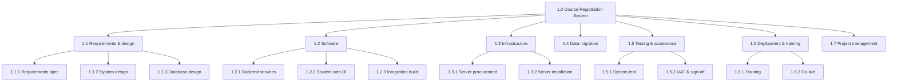

# PM-04 Scope Management, Requirements Traceability and WBS

> [!info] Topic card
> **Unit:** U3 · **Time:** 4 h · **Artefacts:** [[PM-A02 Scope Statement]], [[PM-A03 Work Breakdown Structure]] · **Case:** [[PM-CASE-01 University Course Registration System]]

## 1. Learning objectives
1. **Describe** the scope management processes: plan, collect requirements, define scope, create the WBS, validate scope, control scope.
2. **Write** a scope statement with deliverables, acceptance criteria, exclusions, constraints and assumptions.
3. **Build** a deliverable-oriented WBS that follows the 100% rule, with work packages and a WBS dictionary.
4. **Maintain** a requirements traceability matrix linking requirements to deliverables, work packages and tests.
5. **Control** scope creep and gold-plating through change control.

## 2. Why it matters
Scope is where most IS project trouble starts: "small" additions that nobody costed, and deliverables nobody defined clearly enough to accept. The WBS is the backbone of planning. Schedule, cost, resources and risk are all estimated and tracked against it.

## 3. Prerequisites
[[PM-03 Project Initiation, Business Case and Charter]] · [[SD-03 Requirements Engineering]] · [[SD-04 Use Cases, User Stories and Traceability]].

## 4. Intuition
The WBS is how you **eat an elephant**: one bite at a time. Break the whole deliverable into smaller deliverables, until each piece is small enough to estimate, assign and check. The **100% rule** says the pieces must add up to the whole, nothing more and nothing less.

## 5. Rigorous explanation

### 5.1 Scope processes (PMBOK 6)
1. **Plan scope management:** how scope will be defined, validated and controlled.
2. **Collect requirements:** elicitation ([[SD-03 Requirements Engineering]]), requirements documentation, the **RTM**.
3. **Define scope:** the project **scope statement**.
4. **Create the WBS:** decomposition. The **scope baseline** = scope statement + WBS + WBS dictionary.
5. **Validate scope:** the customer formally **accepts** deliverables against the acceptance criteria.
6. **Control scope:** monitor, and manage changes via integrated change control.

**Product scope** means the features of the result. **Project scope** means the work needed to deliver it (including training, migration and project management).

### 5.2 Scope statement
It contains:
- the product scope description;
- the deliverables, each with **acceptance criteria**;
- **exclusions** (out of scope, stated explicitly);
- constraints;
- assumptions.

### 5.3 WBS rules
- **Deliverable-oriented:** nouns (things) rather than verbs (activities). Activities come later, in PM-05.
- **The 100% rule:** the children of each element contain 100% of the parent's work. Nothing is missing, and nothing is extra.
- **Mutually exclusive:** no overlap between elements, which avoids double counting of cost.
- **Work package:** the lowest level. It can be estimated, assigned to one owner, and scheduled; often 8–80 hours of effort.
- **Numbering:** 1.0, 1.1, 1.1.1 …
- **Include project management** as a branch (it's work too).
- **The WBS dictionary** gives each work package a description, owner, deliverable, acceptance criteria, estimate, dependencies and risks.

Decomposition options: by phase, by deliverable or component, by location. Be consistent within a level.

### 5.4 Requirements traceability matrix (RTM)
Columns: requirement ID, description, source, priority, WBS element, design reference, test case, status. Uses (as in [[SD-04 Use Cases, User Stories and Traceability]]):
- completeness (every requirement has a deliverable and a test);
- impact analysis for changes;
- scope control (work without a requirement is gold-plating).

### 5.5 Scope creep vs controlled change
- **Scope creep:** uncontrolled additions (an "extra report" agreed in a corridor).
- **Gold-plating:** the team adds features nobody asked for.
- **Control:** every change goes through a **change request**: impact analysis on scope, time, cost and risk; approval by the change control board or sponsor; baseline updates ([[PM-14 Procurement and Change Management]], [[PM-A10 Change Request]]).

## 6. Terminology
| Term | Meaning |
|---|---|
| Scope baseline | Approved scope statement + WBS + WBS dictionary |
| Work package | The lowest WBS level: estimated, assigned, controlled |
| Control account | A management point combining scope, budget and schedule for EVM |
| 100% rule | Each WBS level fully represents its parent's work, and no more |
| Planning package | A future work package with known content but no detailed activities yet |
| Rolling-wave planning | Detail near-term work; keep later work at a higher level |

## 7. Step-by-step: building the CASE-01 WBS
1. **Level 0:** 1.0 Course Registration System.
2. **Level 1:** the major deliverables, plus project management:
   - 1.1 Requirements & design;
   - 1.2 Software;
   - 1.3 Infrastructure;
   - 1.4 Data migration;
   - 1.5 Testing & acceptance;
   - 1.6 Deployment & training;
   - 1.7 Project management.
3. **Decompose** each one into work packages (below).
4. **Check the 100% rule:** is anything needed for go-live missing? (Training materials? User support? A security review?)
5. **Write dictionary entries** for each work package.
6. **Map to activities** for scheduling: work packages → activities A–K (PM-05).

## 8. Diagram: CASE-01 WBS (top levels)

## 9. Worked examples

### Example 1 (basic): WBS element or activity?
| Item | Type |
|---|---|
| "Student web UI" | WBS deliverable (a noun) |
| "Code the login page" | An activity (a verb) for the schedule |
| "Training manual" | A deliverable |
| "Hold a training session" | An activity |

### Example 2 (intermediate): a 100% rule check
Draft branch 1.5 Testing contains only "1.5.1 System test". Missing pieces: "UAT and sign-off", "performance test on registration day load", "security review" (see [[X-05 Security Risk in Project Management]]). Each one is needed for go-live, so add them. Conversely, "1.2.4 Mobile app" appears in the draft but is **excluded** by the scope statement (release 2): remove it, because it's gold-plating.

### Example 3 (challenging): mapping requirements → WBS → schedule → tests (RTM extract)
| Req | Description | Priority | WBS | Activity (PM-05) | Test |
|---|---|---|---|---|---|
| R-01 | Students register online for their courses | Must | 1.2.1, 1.2.2 | E, F | ST-01, UAT-01 |
| R-02 | Prevent timetable clashes | Must | 1.2.1 | E | ST-04 |
| R-03 | Migrate current enrolments | Must | 1.4 | I | MIG-01 |
| R-04 | Peak load of 2,000 concurrent users | Must | 1.3, 1.5.1 | D, H, G | PERF-01 |
| R-05 | SMS reminders | Could | — | — | — (excluded, release 2) |

The RTM shows R-05 has no WBS element. That's correct, because it's excluded, and the scope statement must list it as an exclusion, so stakeholders aren't surprised.

## 10. Application: scope statement exclusions for CASE-01
Explicitly out of scope:
- mobile app (release 2);
- fee payment integration (a separate project in the Digital Campus programme);
- SMS reminders;
- the timetable-creation tool (the registry keeps its existing process);
- hardware for faculties.

Writing exclusions prevents "I assumed it was included" disputes at acceptance ([[PM-A02 Scope Statement]]).

## 11. Common mistakes
| Mistake | Fix |
|---|---|
| A WBS of activities (verbs) | Deliverables (nouns); activities are defined in the schedule |
| Missing project management, training or migration | Apply the 100% rule, including project work |
| Overlapping elements | Mutually exclusive elements |
| Too much or too little detail | Work packages estimable and assignable (roughly 8–80 h) |
| No exclusions in the scope statement | List what's out of scope |
| Accepting changes informally | Change requests, every time |

## 12. Comparison: WBS vs schedule vs RTM
| | WBS | Schedule | RTM |
|---|---|---|---|
| Content | Deliverables (what) | Activities, durations, dependencies (when) | Requirements and links (why, and how it's verified) |
| Structure | A hierarchy | A network | A table |
| Used for | Scope, cost, responsibility | Time, critical path | Completeness, impact, acceptance |

## 13. Practice
**L1** 1. State the 100% rule. 2. What makes up the scope baseline?

**L2** 3. Convert these to deliverables: "write tests", "install servers", "train users". 4. Write 3 acceptance criteria for "1.6.1 Training".

**L3** 5. Build a 3-level WBS for CASE-02 (inventory system across 3 warehouses). 6. Write a WBS dictionary entry for 1.4 Data migration.

**L4** 7. A dean asks the developers directly for "one extra report". Describe the correct process and its impact analysis. 8. Critique a WBS that's organised by department (ICT, Registry, Finance) rather than by deliverable.

**L5** 9. Produce the full scope baseline (statement + WBS + dictionary for 6 work packages) and an RTM for CASE-03.

## 14. Hints
> [!tip]- Hints
> 3: "Test suite and results", "installed server environment", "trained users / training materials". 7: a change request, impact on scope, schedule, cost and risk, the change control board. 8: deliverables shared between departments; accountability is unclear; the 100% rule is hard to check.

## 15. Worked solutions
> [!success]- Solutions 1–2
> 1. The WBS (and every level of it) includes 100% of the work defined by the project scope (product and project work), and nothing outside it. Each parent's children sum to exactly the parent's work. 2. The approved scope statement, the WBS and the WBS dictionary.

> [!success]- Solution 4
> 1. Training materials (a user guide and 10-minute videos) approved by the registry. 2. At least 90% of registry staff and 100% of faculty registration officers attend a session and pass a 10-question practical check. 3. A help page is live on the portal before go-live. (These must be measurable and agreed with the sponsor.)

> [!success]- Solution 6
> **1.4 Data migration.** **Deliverable:** current-semester enrolments and course catalogue migrated into the new database, with a reconciliation report. **Owner:** the database developer (with the registry data officer). **Acceptance criteria:** record counts match the source by faculty; 100% of sampled records (n = 200) correct; migration rehearsed twice. **Estimate:** 2 weeks, 2 people. **Dependencies:** database design (1.1.3) and installed servers (1.3.2). **Risks:** poor source-data quality, so schedule a data-cleansing sub-package.

> [!success]- Solution 7
> 1. The developers politely decline to start, and refer the dean to the PM. 2. The PM logs a **change request** ([[PM-A10 Change Request]]). 3. **Impact analysis:** effort (e.g. 3 days), schedule (is the reporting module on the critical path?), cost, risk, and the requirement's priority. 4. The **change control board** (or the sponsor) decides: approve, reject or defer. 5. If approved, update the scope baseline, the schedule, the budget and the RTM, and communicate the change. This prevents scope creep while respecting the stakeholder.

> [!success]- Solution 8
> A department-based WBS describes **who**, not **what**. Deliverables that span departments (e.g. data migration needs ICT and the registry) are split or duplicated, and the 100% rule becomes impossible to check. There's no clear link to acceptance criteria. Responsibility belongs in a RACI chart or the resource assignment, not in the WBS structure.

## 16. Self-test (pass ≥ 4/5)
1. Nouns or verbs in a WBS? 2. What's a work package? 3. Product vs project scope? 4. What's gold-plating? 5. Which process formally accepts deliverables?
> [!success]- Answers
> 1. Nouns (deliverables). 2. The lowest WBS element, which can be estimated, assigned and controlled. 3. The features of the result vs all the work needed to deliver it. 4. Adding unrequested features. 5. Validate scope.

## 17. Flashcards
#flashcards/project-management
WBS?::A deliverable-oriented hierarchical decomposition of the total project scope.
100% rule?::Children contain exactly all of the parent's work: nothing missing, nothing extra.
Scope baseline?::Scope statement + WBS + WBS dictionary.
Validate scope vs control quality?::Customer acceptance of deliverables vs checking correctness internally.
Scope creep?::Uncontrolled growth of scope without change control.

## 18. Blank-page recall
Draw the CASE-01 WBS to level 2, and write two RTM rows.

## 19. Revision summary
- Scope processes: plan, collect requirements, define, WBS, validate, control.
- Scope statement: deliverables, acceptance criteria, exclusions, constraints, assumptions.
- WBS: deliverables, the 100% rule, mutually exclusive elements, work packages, a dictionary; include PM, training and migration.
- The RTM links requirements to the WBS, the schedule and tests. Changes go through change requests.

## 20. Links
Prev: [[PM-03 Project Initiation, Business Case and Charter]] · Next: [[PM-05 Activity Sequencing, Network Diagrams and Gantt Charts]] · Artefacts: [[PM-A02 Scope Statement]], [[PM-A03 Work Breakdown Structure]] · Related: [[SD-04 Use Cases, User Stories and Traceability]], [[FYP-T09 Work Breakdown Structure]]

## 21. Sources
- PMI, *PMBOK® Guide*, 6th ed., 2017, chapter 5 (Project Scope Management); PMI, *Practice Standard for Work Breakdown Structures*, 3rd ed., 2019.
- Schwalbe, K., *Information Technology Project Management*, 9th ed., Cengage, 2019, chapter 5.
- *(Not checked online during the build, because there was no network access.)*

## 22. Mastery checklist
- [ ] I can write a scope statement with exclusions
- [ ] I can build a deliverable-oriented WBS that satisfies the 100% rule, with a dictionary
- [ ] I can maintain an RTM and handle change requests
- [ ] Reviews scheduled
