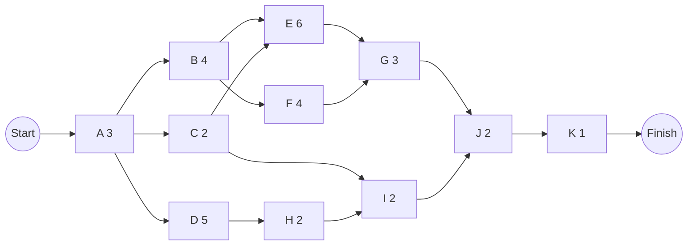
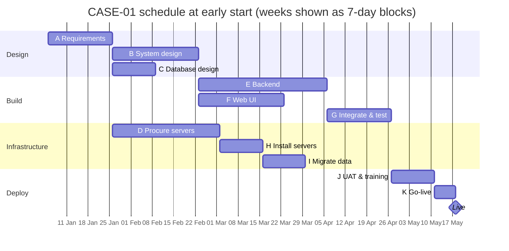

# PM-05 Activity Sequencing, Network Diagrams and Gantt Charts

> [!info] Topic card
> **Unit:** U3 · **Time:** 4 h · **Calculator:** `Activity`, `topological_order` and `all_paths` in `code/pm_tools.py`. The CASE-01 path lengths below are asserted in `test_cpm_registration_case`. · **Artefact:** [[PM-A04 Project Schedule]]

## 1. Learning objectives
1. **Define** activities from work packages, and **estimate** durations.
2. **Identify** dependency types (finish-to-start, start-to-start, finish-to-finish, start-to-finish), leads and lags, and dependency sources (mandatory, discretionary, external).
3. **Draw** activity-on-node (AON) network diagrams, and **recognise** activity-on-arrow (AOA) diagrams with dummy activities.
4. **Enumerate** paths and identify the longest one.
5. **Draw** and **read** Gantt charts with milestones and dependencies.

## 2. Why it matters
The network diagram is how a project manager sees which work can run in parallel and which work holds everything else up. Without it, schedules are wish lists. With it, the critical path (PM-06) and realistic dates follow almost mechanically. This is also a standard exam question.

## 3. Prerequisites
[[PM-04 Scope Management, Requirements Traceability and WBS]] · [[DM-15 Graphs, Representations, Paths and Connectivity]]: a project network is a **directed acyclic graph** (DAG), and schedule order is a **topological order** of it.

## 4. Intuition
Some things must happen in order (you can't test before you build); some can happen at the same time (frontend and backend after design). A network diagram is a map of "must happen before". The project can't finish faster than its **longest chain** of must-happen-befores.

## 5. Rigorous explanation

### 5.1 From WBS to activities
Each work package is decomposed into **activities** (verbs) with an owner, a duration estimate and resources. **Milestones** have zero duration (e.g. "Design approved").

**Duration estimation methods:**
- analogous (from similar past projects);
- parametric (rate × quantity, e.g. 0.5 days per screen × 20 screens);
- three-point/PERT (PM-07);
- expert judgement.

Estimate **duration** (elapsed working time), not effort, and record the assumptions.

### 5.2 Dependencies
| Type | Meaning | Example |
|---|---|---|
| **FS** finish-to-start (most common) | B can't start until A finishes | Test after build |
| **SS** start-to-start | B can't start until A starts | Write the user manual once development starts (often with a lag) |
| **FF** finish-to-finish | B can't finish until A finishes | Documentation finishes when development finishes |
| **SF** start-to-finish (rare) | B can't finish until A starts | The old system can't be switched off until the new one starts |

- **Lag:** a delay (FS + 2 days: wait for concrete to cure, or for vendor delivery).
- **Lead:** an overlap (FS − 3 days: start testing 3 days before the build completes).
- **Mandatory (hard logic):** inherent in the work. **Discretionary (soft logic):** best practice, which can be changed to fast-track. **External:** depends on outside parties (vendor delivery, a regulator).

### 5.3 Network diagrams
- **AON / precedence diagramming method (PDM):** activities are boxes and arrows are dependencies. This is the modern standard, and it supports all four dependency types.
- **AOA / arrow diagramming:** activities are arrows between event nodes, with FS only. It needs **dummy activities** (dashed arrows of zero duration) to show some dependencies without creating false ones. You'll see it in older textbooks and exams.
- Paths run from start to finish. Path length = the sum of the durations (with FS and no lags). **The longest path determines the minimum project duration.**

### 5.4 Gantt charts
Bars on a timeline, one per activity, showing start, duration and finish. Also:
- milestones (diamonds);
- dependencies (arrows);
- progress (shaded bars);
- the baseline vs the current plan.

They're excellent for communication, but they hide the logic unless the dependencies are drawn. Use the network for analysis and the Gantt chart for reporting.

## 6. Terminology
| Term | Meaning |
|---|---|
| Activity | A scheduled unit of work, with a duration |
| Milestone | A significant zero-duration event |
| Predecessor / successor | An activity before / after in the logic |
| Merge / burst activity | An activity with several predecessors / several successors |
| Dummy (AOA) | A zero-duration arrow that only shows a dependency |
| Lead / lag | Overlap / delay applied to a dependency |
| Path | A chain of dependent activities from start to end |

## 7. Step-by-step: CASE-01 activity list and network
| ID | Activity (from the WBS) | Duration (weeks) | Predecessors |
|---|---|---|---|
| A | Gather and approve requirements (1.1.1) | 3 | — |
| B | System design (1.1.2) | 4 | A |
| C | Database design (1.1.3) | 2 | A |
| D | Procure servers (1.3.1) | 5 | A |
| E | Develop backend (1.2.1) | 6 | B, C |
| F | Develop student web UI (1.2.2) | 4 | B |
| G | Integrate and system test (1.2.3, 1.5.1) | 3 | E, F |
| H | Install servers (1.3.2) | 2 | D |
| I | Migrate data (1.4) | 2 | C, H |
| J | UAT and training (1.5.2, 1.6.1) | 2 | G, I |
| K | Go-live (1.6.2) | 1 | J |

Steps:
1. Place A (no predecessors) at the left.
2. Draw B, C and D after A (a burst).
3. E merges B and C. F follows B. G merges E and F. H follows D. I merges C and H. J merges G and I. K ends the network.
4. **Enumerate the paths** (the `all_paths` output):

| Path | Length |
|---|---|
| A-B-E-G-J-K | **19** |
| A-B-F-G-J-K | 17 |
| A-C-E-G-J-K | 17 |
| A-D-H-I-J-K | 15 |
| A-C-I-J-K | 10 |

The longest path is 19 weeks: the project can't finish sooner than 19 weeks, whatever else happens.

## 8. Diagrams

### 8.1 AON network for CASE-01


### 8.2 Gantt chart (early starts, week 0 = Monday 5 January 2026)

*Weeks are drawn as 7-day blocks for simplicity. A real plan uses working days and a calendar (holidays, the semester break).*

## 9. Worked examples

### Example 1 (basic): identify the dependency type
| Situation | Type |
|---|---|
| UAT can start only when system testing finishes | FS |
| Writing the user manual can start 1 week after development starts | SS + 1 week lag |
| Data migration can't finish until the final data freeze finishes | FF |
| The old registration desk can't close until the new system starts | SF |

### Example 2 (intermediate): leads and lags by hand
A (4 days) → B (3 days) with **FS − 1** (a 1-day lead): B starts on day 3 (A's finish of 4, minus 1) and finishes on day 6. With **SS + 2**: B starts on day 2 and finishes on day 5. If **FF + 0** is also required (B can't finish before A), B finishing on day 5 ≥ A's finish on day 4 is OK. (`pm_tools.cpm` handles FS with zero lag only, so do these by hand.)

### Example 3 (challenging): an AOA diagram that needs a dummy
Activities: P (no predecessor), Q (no predecessor), R after P, S after P and Q. In AOA, P and Q can't both end at the node where S starts without also making R depend on Q. **Solution:**
- P ends at node 2, and R starts from node 2;
- Q ends at node 3;
- a **dummy** (dashed arrow) runs from node 2 to node 3;
- S starts from node 3.

S therefore waits for both P (via the dummy) and Q, while R depends only on P. AON needs no dummy: just draw the two arrows into S.

## 10. Application: fast-tracking via discretionary dependencies
The team wonders whether F (the web UI) could start before B (system design) finishes. If the UI design depends only on the approved requirements and a style guide, then F's dependency on B is **discretionary**, and it could be changed to **SS + 2 weeks** (start the UI 2 weeks after design starts). This shortens path A-B-F-G… but **not the critical path** (A-B-E-G-J-K), so it doesn't shorten the project. It only increases F's float. Always check whether a change touches the critical path (PM-06).

## 11. Common mistakes
| Mistake | Fix |
|---|---|
| Activities copied straight from the WBS without decomposition | Decompose work packages into activities |
| Missing dependencies (dangling activities) | Every activity except the first and last has a predecessor and a successor |
| Loops in the network | It must be acyclic (`pm_tools` raises "network contains a cycle") |
| Effort estimates used as durations | Convert using the resources available |
| A Gantt chart with no dependencies | Draw the logic, or keep the network alongside it |
| Treating discretionary dependencies as mandatory | Question them when you need to compress the schedule |

## 12. Comparison: AON vs AOA vs Gantt
| | AON (PDM) | AOA | Gantt |
|---|---|---|---|
| Activities shown as | Nodes | Arrows | Bars |
| Dependency types | FS, SS, FF, SF, with lags | FS only | Usually FS (arrows) |
| Dummies | Not needed | Sometimes needed | — |
| Best for | Analysis (CPM) | Older exams and texts | Communication, tracking |

## 13. Practice
**L1** 1. Name the four dependency types. 2. What's a dummy activity?

**L2** 3. Draw the AON network for: A (2), B (3, after A), C (4, after A), D (2, after B and C), E (1, after D). List the paths and their lengths. 4. Classify these as mandatory, discretionary or external: (a) the vendor ships the servers; (b) code review before merging; (c) test after build.

**L3** 5. Draw the Gantt chart for question 3, starting on Monday 2 February 2026, in working days. 6. Explain how an SS dependency with a lag can shorten a schedule.

**L4** 7. CASE-02 (inventory, 3 warehouses): write an activity list with 10 activities, durations and predecessors, and draw the network. 8. Draw the AOA version of question 3. Is a dummy needed?

**L5** 9. Take your FYP plan, decompose it into 12–20 activities with dependencies, enter them as `Activity(...)` objects, run `all_paths`, and present the network and Gantt chart.

## 14. Hints
> [!tip]- Hints
> 3: paths A-B-D-E and A-C-D-E. 4: external, discretionary, mandatory. 6: overlap instead of waiting. 8: B and C both end before D; in AOA, use separate end nodes and a dummy, or end both at D's start node (no false dependency arises here).

## 15. Worked solutions
> [!success]- Solutions 1–2
> 1. Finish-to-start, start-to-start, finish-to-finish, start-to-finish. 2. A zero-duration, zero-resource arrow in AOA diagrams, used only to show a logical dependency (or to keep activity identities unique) without implying extra work.

> [!success]- Solution 3
> Paths: A-B-D-E = 2 + 3 + 2 + 1 = **8**; A-C-D-E = 2 + 4 + 2 + 1 = **9** (the longest). Check:
> ```python
> from pm_tools import Activity, all_paths
> acts = [Activity("A", 2), Activity("B", 3, ("A",)), Activity("C", 4, ("A",)),
>         Activity("D", 2, ("B", "C")), Activity("E", 1, ("D",))]
> print(all_paths(acts))     # [(['A', 'C', 'D', 'E'], 9), (['A', 'B', 'D', 'E'], 8)]
> ```

> [!success]- Solution 4
> (a) External. (b) Discretionary (good practice, but the team chose it). (c) Mandatory (you can't test what hasn't been built).

> [!success]- Solution 6
> FS makes the successor wait for the whole predecessor. SS + lag lets it start once part of the predecessor is done, so the two overlap, and the path through them gets shorter by the overlap. This is **fast-tracking**: it adds risk (rework if early outputs change) in exchange for time.

> [!success]- Solution 8
> AOA: node 1 →(A)→ node 2. From node 2, B goes to node 3, and C goes to node 3 directly. That gives two arrows between the same pair of nodes, which is ambiguous in AOA (activities are identified by their node pairs). So: B ends at node 3, C ends at node 4, a **dummy** runs from node 3 to node 4, then D goes from node 4 to node 5, and E from node 5 to node 6. A dummy **is** needed here, to keep B and C uniquely identified.

## 16. Self-test (pass ≥ 4/5)
1. What does the longest path determine? 2. Which dependency type is most common? 3. Lead or lag: "start testing 2 days before the build ends"? 4. Can a network have a cycle? 5. What's a merge activity?
> [!success]- Answers
> 1. The minimum project duration. 2. Finish-to-start. 3. A lead (negative lag). 4. No: it must be a DAG. 5. An activity with two or more predecessors.

## 17. Flashcards
#flashcards/project-management
AON vs AOA?::Activities on nodes (any dependency type) vs on arrows (FS only, may need dummies).
Four dependency types?::FS, SS, FF, SF.
Lead vs lag?::Overlap (start earlier) vs delay (wait longer).
Mandatory vs discretionary dependency?::Inherent in the work vs a preferred practice that can be changed.
CASE-01 longest path?::A-B-E-G-J-K = 19 weeks.

## 18. Blank-page recall
Redraw the CASE-01 AON network and list its five paths with lengths.

## 19. Revision summary
- Decompose work packages into activities, estimate durations, record assumptions.
- Dependencies: FS/SS/FF/SF with leads and lags; mandatory, discretionary or external.
- AON for analysis; AOA needs dummies; Gantt charts for communication.
- The longest path sets the minimum duration (CASE-01: 19 weeks).

## 20. Links
Prev: [[PM-04 Scope Management, Requirements Traceability and WBS]] · Next: [[PM-06 Critical Path Method and Float]] · Related: [[DM-15 Graphs, Representations, Paths and Connectivity]], [[X-02 Graph Theory in Algorithms, Networks and Scheduling]], [[PM-A04 Project Schedule]]

## 21. Sources
- PMI, *PMBOK® Guide*, 6th ed., 2017, chapter 6 (Project Schedule Management); PMI, *Practice Standard for Scheduling*, 3rd ed., 2019.
- Schwalbe, K., *Information Technology Project Management*, 9th ed., Cengage, 2019, chapter 6.
- Mermaid Gantt syntax: https://mermaid.js.org/syntax/gantt.html
- *(Not checked online during the build, because there was no network access.)*

## 22. Mastery checklist
- [ ] I can draw AON networks from activity lists and list their paths
- [ ] I can apply the dependency types with leads and lags
- [ ] I can draw AOA networks with dummies, and Gantt charts
- [ ] Reviews scheduled
