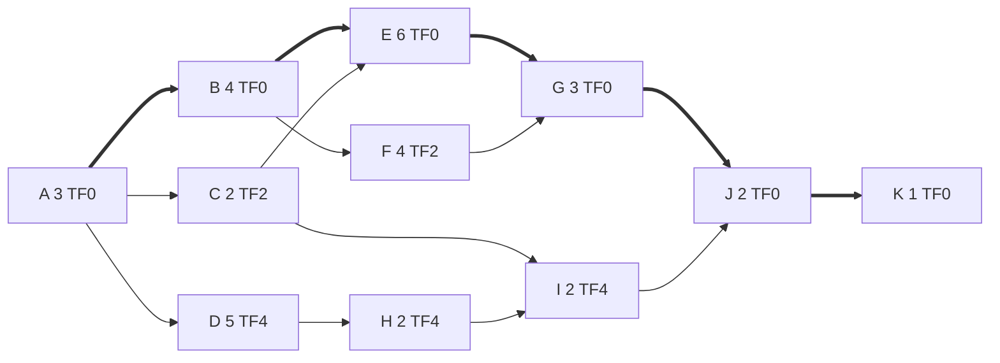

# PM-06 Critical Path Method and Float

> [!info] Topic card
> **Unit:** U3 · **Time:** 5 h · **Calculator:** `cpm` (forward and backward pass, total and free float) and `crash_schedule` in `code/pm_tools.py`. Every value in the tables below is asserted in `test_cpm_registration_case` and `test_crashing_pm06`. · **Case:** [[PM-CASE-01 University Course Registration System]]

## 1. Learning objectives
1. **Perform** the forward pass (ES, EF) and backward pass (LS, LF) on an AON network by hand.
2. **Calculate** total float and free float, and **identify** the critical path(s).
3. **Interpret** float for schedule management (what can slip, and by how much).
4. **Compress** schedules by crashing (cheapest cost per period on the critical path) and fast-tracking, and **recognise** when compression stops working.
5. **Explain** the near-critical paths and the limitations of CPM.

## 2. Why it matters
CPM tells the project manager where to focus: a one-week delay on a critical activity delays go-live by one week, while a one-week delay on an activity with four weeks of float changes nothing. It's the most frequently examined calculation in project management, and the basis of every scheduling tool.

## 3. Prerequisites
[[PM-05 Activity Sequencing, Network Diagrams and Gantt Charts]] (the CASE-01 activity list and network) · Longest paths in DAGs from [[DM-15 Graphs, Representations, Paths and Connectivity]].

## 4. Intuition
- The **forward pass** asks: "if everything starts as early as possible, when does each activity finish?"
- The **backward pass** asks: "to finish the project on time, what's the latest each activity can finish?"
- The gap between the two answers is **float**: how much an activity can slip without delaying the project.
- **Zero float** means the activity is on the critical path.

## 5. Rigorous explanation

### 5.1 Definitions and rules (finish-to-start, no lags; time 0 = project start)
- **Forward pass:** $ES = \max(EF \text{ of predecessors})$ (0 for start activities), and $EF = ES + d$.
- **Project duration** $T = \max EF$.
- **Backward pass:** $LF = \min(LS \text{ of successors})$ ($T$ for end activities), and $LS = LF - d$.
- **Total float** $TF = LS - ES = LF - EF$: the delay possible **without delaying the project**.
- **Free float** $FF = \min(ES \text{ of successors}) - EF$: the delay possible **without delaying any successor's early start**.
- **The critical path** is the chain of activities with $TF = 0$ (when the target equals the calculated duration). It's the longest path. There can be more than one.

This "time 0" convention (ES of the first activity = 0) matches `pm_tools`. Some textbooks use "day 1" conventions, with ±1 adjustments. Use your course's convention consistently.

### 5.2 Box notation for AON
```text
+--------+--------+--------+
|   ES   |  dur   |   EF   |
+--------+--------+--------+
|        |  name  |        |
+--------+--------+--------+
|   LS   |  TF    |   LF   |
+--------+--------+--------+
```

### 5.3 Schedule compression
- **Crashing:** add resources to shorten critical activities, at extra cost. Choose the activity with the **lowest crash cost per period** that lies on **every** current critical path. Shorten by one period, recompute (new critical paths can appear), and repeat until the target is met or no further compression is possible.
- **Fast-tracking:** overlap activities that were in sequence (change FS to SS with a lag). There's no direct cost, but it increases the risk of rework.
- **Limits:**
  - each activity has a minimum (crash) duration;
  - as parallel paths become critical, you must shorten several activities at once, so costs rise;
  - an uncrashable path sets a floor.
- Crashing isn't free in quality terms either: Brooks's law warns that "adding manpower to a late software project makes it later", because of ramp-up and communication overhead.

### 5.4 Limitations of CPM
- Durations are treated as deterministic. PERT and Monte Carlo methods address uncertainty (PM-07).
- Resources are ignored. Levelling can extend the schedule (PM-08).
- **Merge bias:** where paths merge, the probability of finishing on time is lower than for the critical path alone.
- The result is only as good as the logic and the estimates.

## 6. Terminology
| Term | Meaning |
|---|---|
| ES / EF | Earliest start / earliest finish |
| LS / LF | Latest start / latest finish (without delaying the project) |
| Total float (slack) | LS − ES: the delay possible without delaying project completion |
| Free float | Delay possible without delaying any successor's early start |
| Critical path | The longest path; activities with zero total float |
| Near-critical path | A path with small total float |
| Crashing / fast-tracking | Shortening with resources / overlapping activities |

## 7. Step-by-step: the CASE-01 passes by hand
Durations in weeks (activity list in [[PM-05 Activity Sequencing, Network Diagrams and Gantt Charts]] §7).

**Forward pass:**
- A: ES 0, EF 3.
- B: ES 3, EF 7. C: ES 3, EF 5. D: ES 3, EF 8.
- E: ES = max(EF B, EF C) = max(7, 5) = 7, EF 13.
- F: ES 7, EF 11.
- G: ES = max(13, 11) = 13, EF 16.
- H: ES 8, EF 10.
- I: ES = max(EF C, EF H) = max(5, 10) = 10, EF 12.
- J: ES = max(16, 12) = 16, EF 18.
- K: ES 18, EF **19**. So **T = 19 weeks**.

**Backward pass:**
- K: LF 19, LS 18.
- J: LF 18, LS 16.
- G: LF 16, LS 13. I: LF 16, LS 14.
- E: LF 13, LS 7. F: LF 13, LS 9.
- H: LF = LS I = 14, LS 12.
- D: LF = LS H = 12, LS 7.
- C: LF = min(LS E, LS I) = min(7, 14) = 7, LS 5.
- B: LF = min(LS E, LS F) = min(7, 9) = 7, LS 3.
- A: LF = min(LS B, LS C, LS D) = min(3, 5, 7) = 3, LS 0.

**Results** (identical to `cpm(REG)`):

| Act | d | ES | EF | LS | LF | TF | FF |
|---|---|---|---|---|---|---|---|
| A | 3 | 0 | 3 | 0 | 3 | **0** | 0 |
| B | 4 | 3 | 7 | 3 | 7 | **0** | 0 |
| C | 2 | 3 | 5 | 5 | 7 | 2 | 2 |
| D | 5 | 3 | 8 | 7 | 12 | 4 | 0 |
| E | 6 | 7 | 13 | 7 | 13 | **0** | 0 |
| F | 4 | 7 | 11 | 9 | 13 | 2 | 2 |
| G | 3 | 13 | 16 | 13 | 16 | **0** | 0 |
| H | 2 | 8 | 10 | 12 | 14 | 4 | 0 |
| I | 2 | 10 | 12 | 14 | 16 | 4 | 4 |
| J | 2 | 16 | 18 | 16 | 18 | **0** | 0 |
| K | 1 | 18 | 19 | 18 | 19 | **0** | 0 |

**Critical path: A-B-E-G-J-K (19 weeks).**

## 8. Diagram: critical path highlighted

*Thick arrows mark the critical path A-B-E-G-J-K. The other activities show their total float.*

## 9. Worked examples

### Example 1 (basic): reading float
- C has TF = 2 and FF = 2. It can slip 2 weeks without affecting E's early start or the project.
- D has TF = 4 but **FF = 0**. Any slip in D delays H's early start (but not the project, until the 4 weeks are used up).
- **D, H and I share** the 4 weeks of float along the chain D-H-I. If D uses 3 weeks, only 1 remains for H and I. (`shifts_feasible` confirms that delaying D by 1 forces H and then I to move: see `test_resource_profile_and_levelling`.)

### Example 2 (intermediate): impact of a delay
The server vendor delivers 3 weeks late, so D takes 8 weeks instead of 5. TF(D) = 4 ≥ 3, so the project still finishes in 19 weeks, but path A-D-H-I-J-K now has 1 week of float (it's near-critical). If D slips 5 weeks, the project finishes in 20 weeks, and the critical path changes to A-D-H-I-J-K. Monitor near-critical paths, not just the critical path.

### Example 3 (challenging): crashing to 15 weeks (tested)
The sponsor wants go-live in 15 weeks. Crash data (minimum duration, cost per week of shortening):
- A (2, 0.9 M);
- B (3, 0.6 M);
- C (1, 0.25 M);
- E (4, 0.4 M);
- F (3, 0.3 M);
- G (2, 0.7 M);
- J (1, 1.2 M).

D, H, I and K can't be shortened.

| Step | Critical paths before the step | Cheapest option | Cost | New T |
|---|---|---|---|---|
| 1 | A-B-E-G-J-K | E (0.4 M) | 0.4 M | 18 |
| 2 | A-B-E-G-J-K | E again (now at its minimum of 4) | 0.4 M | 17 |
| 3 | A-B-E-G-J-K **and** A-B-F-G-J-K | B is on both: 0.6 M (cheaper than E+F, and E is at its minimum anyway) | 0.6 M | 16 |
| 4 | Both (B now at its minimum of 3) | G (0.7 M) | 0.7 M | 15 |

Total extra cost **TZS 2,100,000** to reach 15 weeks. After step 4, **three** paths are critical (A-B-E-G-J-K, A-B-F-G-J-K, A-D-H-I-J-K, all 15). Continuing the algorithm towards 12 weeks, it crashes A (0.9 M), then J (1.2 M), reaching **13 weeks**, and stops. Path A-D-H-I-J-K = 2 + 5 + 2 + 2 + 1 + 1 = 13 can't be shortened, because D, H and I are fixed. **The minimum possible duration is 13 weeks, at a total crash cost of TZS 4.2 M.**

## 10. Application: what the PM does with this
1. Put the strongest staff and the closest monitoring on A, B, E, G, J and K.
2. Use C's and F's float to absorb the effects of part-time staff.
3. Watch the D-H-I chain (an external vendor dependency): its float is shared and its FF is zero.
4. Before agreeing to a 15-week deadline, present the crash cost (2.1 M) and the risks (new staff, compressed testing on G), and ask whether scope reduction is better ([[PM-01 Project Fundamentals and Organizational Context]], trade-offs).

## 11. Common mistakes
| Mistake | Fix |
|---|---|
| Taking the min of the predecessors' EF in the forward pass | Forward pass uses the **max** of the predecessors' EF |
| Taking the max in the backward pass | Backward pass uses the **min** of the successors' LS |
| Confusing total and free float | TF is about the project end date; FF is about the next activity |
| Crashing a non-critical activity | Only critical activities shorten the project |
| Crashing one path when two are critical | Shorten every critical path in each step |
| Assuming float belongs to one activity | Float is shared along a chain |
| Mixing day-0 and day-1 conventions | Be consistent |

## 12. Comparison: crashing vs fast-tracking
| | Crashing | Fast-tracking |
|---|---|---|
| How | More resources on critical activities | Overlap sequential activities |
| Direct cost | Increases | Little or none |
| Main risk | Coordination overhead, quality (Brooks's law) | Rework if early outputs change |
| Works when | Activities scale with resources | Dependencies are discretionary |

## 13. Practice
**L1** 1. Define total float. 2. In which pass do you take the minimum?

**L2** 3. Compute the ES, EF, LS, LF and TF for: A (2), B (3, A), C (4, A), D (2, B, C), E (1, D). 4. Which activities in question 3 are critical?

**L3** 5. In CASE-01, if F slips 3 weeks, what happens to the project? 6. Explain why D has TF = 4 but FF = 0.

**L4** 7. Crash question 3's network to 7 weeks, given A (1, 500), B (2, 200), C (2, 300), D (1, 400), E (1, n/a), costs per day. 8. Discuss the risks of crashing activity G (integration and testing) in CASE-01.

**L5** 9. Apply CPM to your own semester ([[X-07 Scheduling Your Own Semester with CPM]]): list the assignments and dependencies, compute the critical path, and plan where your "float" goes.

## 14. Hints
> [!tip]- Hints
> 3: T = 9; the critical path is A-C-D-E. 5: TF(F) = 2, so the project slips 1 week. 7: shorten C (300) first; then both paths are critical, at 8 → 7 weeks; options: D alone (400), or A (500), or B + C (500).

## 15. Worked solutions
> [!success]- Solutions 1–2
> 1. The amount an activity can be delayed without delaying the project's completion: LS − ES (or LF − EF). 2. The backward pass (the min of the successors' LS).

> [!success]- Solution 3
> Forward: A 0–2; B 2–5; C 2–6; D starts at max(5, 6) = 6, so 6–8; E 8–9. T = 9. Backward: E LF 9, LS 8; D LF 8, LS 6; B LF 6, LS 3; C LF 6, LS 2; A LF = min(3, 2) = 2, LS 0. TF: A 0, B 1, C 0, D 0, E 0. Check with `cpm` in `code/`.

> [!success]- Solution 4
> A, C, D and E (A-C-D-E = 9 weeks). B has 1 unit of float.

> [!success]- Solution 5
> F has TF = 2, so a 3-week slip uses all the float plus 1 week. G's early start moves from 13 to 14, and the project finishes in **20 weeks** (1 week late). The new critical path is A-B-F-G-J-K.

> [!success]- Solution 6
> D's successor H has ES = 8 = EF(D), so any delay to D immediately delays H's early start (FF = 0). But the D-H-I chain has 4 weeks of slack before it reaches J (I's EF 12 vs J's ES 16), so the project end isn't affected until 4 weeks of delay have accumulated (TF = 4). The float belongs to the whole chain.

> [!success]- Solution 7
> The network is 9 days (critical A-C-D-E; B has float 1).
> 1. Step 1 (9 → 8): the critical activities are A (500), C (300) and D (400). The cheapest is **C (300)**, so C becomes 3. Now A-B-D-E = 2 + 3 + 2 + 1 = 8 and A-C-D-E = 8: both are critical.
> 2. Step 2 (8 → 7): the options are **D (400)** on both paths, A (500), or B + C (200 + 300 = 500). The cheapest is **D (400)**, so D becomes 1.
>
> Total = **700**, T = 7. Verify with `crash_schedule(acts, {"A": (1, 500), "B": (2, 200), "C": (2, 300), "D": (1, 400)}, 7)`.

> [!success]- Solution 8
> Crashing G by adding testers: new people need to learn the system (ramp-up), and communication overhead grows. Compressed testing finds fewer defects, so there's more risk at go-live (registration day!), and quality suffers. Mitigations: crash with **experienced** testers who are already familiar with the system; automate the regression tests early; keep the UAT duration (J) unchanged. Or prefer descoping a low-priority feature over compressing testing.

## 16. Self-test (pass ≥ 4/5)
1. What's the forward pass rule for a merge activity? 2. Is an activity with TF = 0 always critical? 3. What does FF = 0 mean? 4. Which activity do you crash first? 5. What stopped the CASE-01 crashing at 13 weeks?
> [!success]- Answers
> 1. ES = the maximum EF of its predecessors. 2. Yes, when the project deadline equals the calculated duration. (With an imposed earlier deadline, float can be negative, and the most negative path is critical.) 3. Any delay pushes back a successor's early start. 4. The critical activity (on every critical path) with the lowest crash cost per period. 5. The path A-D-H-I-J-K reached 13 with no crashable activities left on it.

## 17. Flashcards
#flashcards/project-management
Forward pass rule?::ES = max(EF of predecessors); EF = ES + duration.
Backward pass rule?::LF = min(LS of successors); LS = LF − duration.
Total float?::LS − ES: delay possible without delaying the project.
Free float?::min(ES of successors) − EF: delay possible without delaying any successor.
CASE-01 critical path?::A-B-E-G-J-K, 19 weeks.
Crashing rule?::Shorten the cheapest-per-period activity on every critical path, one period at a time, then recompute.
Brooks's law?::Adding people to a late software project makes it later.

## 18. Blank-page recall
Redo the full CASE-01 forward and backward pass table from the activity list alone.

## 19. Revision summary
- Forward pass (max), backward pass (min); TF = LS − ES; FF = next ES − EF; critical path = zero TF = the longest path.
- CASE-01: 19 weeks; critical path A-B-E-G-J-K; C and F have 2 weeks of float; the D-H-I chain shares 4 weeks.
- Crash the cheapest activity on every critical path, step by step: 15 weeks costs 2.1 M; the minimum is 13 weeks at 4.2 M.
- Fast-tracking overlaps work (risk of rework). Watch near-critical paths and merge bias.

## 20. Links
Prev: [[PM-05 Activity Sequencing, Network Diagrams and Gantt Charts]] · Next: [[PM-07 PERT and Schedule Estimation]] · Related: [[PM-08 Resource Allocation and Levelling]], [[X-07 Scheduling Your Own Semester with CPM]], [[DM-15 Graphs, Representations, Paths and Connectivity]]

## 21. Sources
- Kelley, J. E. & Walker, M. R., "Critical-path planning and scheduling", *Proceedings of the Eastern Joint Computer Conference*, 1959, pp. 160–173.
- PMI, *PMBOK® Guide*, 6th ed., 2017, §6.5 (Develop Schedule: critical path method, schedule compression).
- Brooks, F. P., *The Mythical Man-Month*, anniversary ed., Addison-Wesley, 1995.
- *(Not checked online during the build, because there was no network access.)*

## 22. Mastery checklist
- [ ] I can do the forward and backward passes and the float by hand
- [ ] I can identify the critical paths and explain shared float
- [ ] I can crash a network step by step and explain its limits
- [ ] Reviews scheduled
