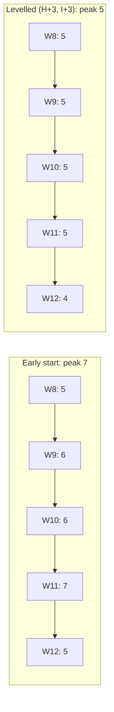

# PM-08 Resource Allocation and Levelling

> [!info] Topic card
> **Unit:** U3 · **Time:** 4 h · **Calculator:** `resource_profile`, `shifts_feasible`, `level_resources` (an exhaustive search within float) and `resource_constrained` (a least-latest-start heuristic) in `code/pm_tools.py`. All profiles below are asserted in `test_resource_profile_and_levelling` and `test_resource_constrained_pm08`.

## 1. Learning objectives
1. **Estimate** resource needs per activity, and **build** a resource histogram (profile) from a schedule.
2. **Distinguish** resource smoothing (within float; the end date is fixed) from resource levelling (the end date may move to respect limits).
3. **Level** a profile by shifting non-critical activities within their float, respecting shared float and dependencies.
4. **Schedule** under a hard resource limit, and **explain** why the critical path can lengthen (the resource-critical path).
5. **Assign** responsibilities with a RACI matrix, and **manage** over-allocation of shared staff.

## 2. Why it matters
CPM assumes unlimited people. In reality, the same two or three developers work on several activities. A schedule that needs 7 developers in week 11, but only 2 in week 6, causes idle time, overtime, burnout, or missed dates. Levelling makes the plan feasible, and shows management the real trade-off between staff and time.

## 3. Prerequisites
[[PM-06 Critical Path Method and Float]] (float, shared float on D-H-I).

## 4. Intuition
Picture the resource histogram as **sand piled on a timeline**. Levelling **moves sand sideways** into hollows, using float, so the peak is lower but the total stays the same. If there isn't enough float to move it, you must **extend the timeline**.

## 5. Rigorous explanation

### 5.1 Resource planning
- Estimate the type and quantity of resources per activity (people with skills, equipment, facilities).
- **Resource calendar:** when each resource is available (part-time staff, holidays, exam weeks for student testers).
- **Profile/histogram:** total demand per period, computed from the start times and the demands.

### 5.2 Smoothing vs levelling
| | Resource smoothing | Resource levelling |
|---|---|---|
| End date | Fixed (uses only float) | May extend |
| Goal | Reduce peaks and variation | Respect hard resource limits |
| When | Peaks are undesirable but not impossible | Limits are real (only 4 developers exist) |

(PMBOK uses these terms as above. Some textbooks call both "levelling".)

### 5.3 Levelling within float
- You may delay an activity by up to its **total float**. But a delay in one activity can consume its successors' float, because float is **shared** along chains (D-H-I in CASE-01).
- Every shift must keep the dependencies valid (`shifts_feasible`).
- Heuristics: move the activities with the most float first; keep critical activities fixed; recompute after each move.
- For small networks, an exhaustive search over the allowed shifts finds the true minimum peak (`level_resources`).

### 5.4 Resource-constrained scheduling
With a hard limit, activities that would together exceed it must run in sequence. That can **extend the project beyond the CPM duration**. The longest chain *after* respecting resources is sometimes called the **resource-critical** path (related to critical chain thinking).

Scheduling heuristics, such as serial scheduling with a priority rule (least latest start first), give good, though not always optimal, schedules.

### 5.5 Responsibility assignment
**RACI:** **R**esponsible (does the work), **A**ccountable (one person who owns the outcome), **C**onsulted, **I**nformed. Exactly one A per deliverable.

## 6. Terminology
| Term | Meaning |
|---|---|
| Resource histogram | A chart of resource demand per period |
| Over-allocation | Demand exceeds availability |
| Smoothing / levelling | Within float, end date fixed / respecting limits, end date may move |
| Resource calendar | When resources are available |
| Resource-critical path | The longest chain once resource limits are respected |
| RACI | Responsible, Accountable, Consulted, Informed |

## 7. Step-by-step: CASE-01 developer histogram
Developers needed per activity:
- A 2, B 2, C 2, D 0 (vendor), E 3, F 2, G 3, H 1, I 2, J 2, K 1.

**At early start** (`resource_profile`), weeks 1–19:
```text
week:  1 2 3 4 5 6 7 8 9 10 11 12 13 14 15 16 17 18 19
devs:  2 2 2 4 4 2 2 5 6  6  7  5  3  3  3  3  2  2  1
```
- **Peak: 7 developers in week 11:** E (3) + F (2) + I (2), with H finished.
- In weeks 9–10: E 3 + F 2 + H 1 = 6.

**Levelling within float** (`level_resources`): the minimum achievable peak is **5**. It's reached by delaying **H by 3 weeks and I by 3 weeks**. The end date stays at 19 weeks:
```text
week:  1 2 3 4 5 6 7 8 9 10 11 12 13 14 15 16 17 18 19
devs:  2 2 2 4 4 2 2 5 5  5  5  4  4  5  5  3  2  2  1
```
Week 8 (E 3 + F 2 = 5) can't be reduced without delaying a critical activity: E is critical, and F's 2 weeks of float would only move its demand elsewhere.

## 8. Diagram: before and after (bar heights = developers)


## 9. Worked examples

### Example 1 (basic): build a mini histogram
Activities: P (weeks 1–2, 2 people), Q (weeks 2–4, 3 people), R (weeks 3–4, 1 person). Week 1: 2. Week 2: 2 + 3 = 5. Week 3: 3 + 1 = 4. Week 4: 3 + 1 = 4. Peak 5, in week 2.

### Example 2 (intermediate): why D can't be moved alone (shared float)
D has TF = 4 but FF = 0. `shifts_feasible(s, REG, {"D": 1})` is **False**: H would then start before D finishes. `{"D": 1, "H": 1}` is also **False**: I would start before H finishes. Only `{"D": 1, "H": 1, "I": 1}` is **True**. Moving D means moving the whole chain, which consumes float that H and I could otherwise have used for levelling.

### Example 3 (challenging): only 4 developers exist (tested)
With a hard limit of 4 developers, E (3) and F (2) can no longer overlap. `resource_constrained(REG, REG_DEV, 4)` schedules:
- E in weeks 8–13 (it starts at 7);
- F in weeks 14–17 (it starts at 13);
- G starts at 17;
- **the project ends at week 23** (4 weeks later than the CPM's 19).

This is in fact optimal for this limit. B finishes at 7, E and F must then run one after the other (6 + 4 = 10 weeks), so G can't start before 17, and G + J + K add 6 more: 17 + 6 = 23. With a limit of 5, the heuristic keeps 19 weeks (peak 5), matching the levelling result. With a limit of 3, it's 27 weeks.

**Management decision:** pay for a fifth developer for weeks 8–15, or accept a 4-week delay. That's a concrete trade-off to put to the sponsor.

## 10. Application: RACI for CASE-01 (extract)
| Deliverable | PM | Business analyst (registry) | Lead dev | Tester | Registrar (sponsor's delegate) |
|---|---|---|---|---|---|
| Requirements spec | A | R | C | C | C |
| System design | A | C | R | I | I |
| Data migration | A | R | R | C | C |
| UAT sign-off | R | C | I | R | **A** |
| Training | A | R | C | I | I |

Each row has exactly one A. UAT is accountable to the business (the registrar), not to the PM. That separation is deliberate.

## 11. Common mistakes
| Mistake | Fix |
|---|---|
| Ignoring part-time availability | Use resource calendars |
| Delaying critical activities to level | Move non-critical ones first; extending the project is a decision, not an accident |
| Moving one activity in a chain alone | Check dependencies; the float is shared |
| Several "A"s, or no "A", in RACI | Exactly one Accountable per deliverable |
| Levelling once and forgetting it | Re-level after schedule changes |
| Calling smoothing "levelling" when the date moves | Be precise: smoothing keeps the end date |

## 12. Comparison: CPM vs resource-constrained schedule (CASE-01)
| | CPM (unlimited) | Smoothed (within float) | Limit 4 developers |
|---|---|---|---|
| Duration | 19 weeks | 19 weeks | 23 weeks |
| Peak developers | 7 | 5 | 4 |
| Changes | — | H and I delayed 3 weeks | E and F sequential |

## 13. Practice
**L1** 1. Define resource levelling and resource smoothing. 2. What does each letter of RACI mean?

**L2** 3. Build the histogram for: X (weeks 1–3, 2 people), Y (weeks 2–5, 2 people), Z (weeks 4–6, 3 people). Find the peak. 4. In CASE-01, why can't the week-8 peak of 5 be reduced?

**L3** 5. Z in question 3 has 2 weeks of float. Level the profile. 6. Write a RACI for CASE-03 (point-of-sale) with 5 deliverables.

**L4** 7. Using `resource_constrained`, find the minimum developer limit that keeps CASE-01 at 19 weeks, and explain it. 8. A key developer is on leave in weeks 9–10. Model it as a reduced limit in those weeks (describe how you'd extend the function), and estimate the impact.

**L5** 9. Build a resource-loaded schedule for your FYP team (or yourself, with your other modules as "resources"), level it, and present the before/after histograms.

## 14. Hints
> [!tip]- Hints
> 3: week 1: 2; week 2: 4; week 3: 4; week 4: 5; week 5: 5; week 6: 3. 5: shift Z by 1 or 2 weeks and recompute. 7: try 6 and 5. 8: a per-week limit array instead of one number.

## 15. Worked solutions
> [!success]- Solutions 1–2
> 1. Levelling adjusts start dates to respect resource limits, and may extend the project. Smoothing redistributes demand within float, without changing the end date. 2. Responsible (does the work), Accountable (owns the outcome; exactly one), Consulted (gives input), Informed (kept updated).

> [!success]- Solution 3
> Week 1: X = 2. Week 2: X + Y = 4. Week 3: X + Y = 4. Week 4: Y + Z = 5. Week 5: Y + Z = 5. Week 6: Z = 3. **Peak 5** (weeks 4–5).

> [!success]- Solution 4
> In week 8, E (3, critical: it can't move) and F (2) both run. F could be delayed (TF = 2), but that only moves its 2 developers into weeks where E is still running (weeks 9–13), so the demand stays at 5 or more somewhere. The exhaustive search (`level_resources`) confirms that 5 is the minimum peak within float.

> [!success]- Solution 5
> Shift Z by 2 weeks (weeks 6–8): week 4: Y = 2; week 5: Y = 2; week 6: Z = 3; weeks 7–8: Z = 3. The profile is 2, 4, 4, 2, 2, 3, 3, 3, and the **peak is 4**, provided the 2 weeks of float are available and nothing depends on Z in between.

> [!success]- Solution 7
> The minimum is **5**. `resource_constrained(REG, REG_DEV, 5)` gives 19 weeks, while 4 gives 23. With 5, E (3) and F (2) can overlap. With 4, they can't, which forces them into sequence. So 5 developers are the minimum for the 19-week plan.

> [!success]- Solution 8
> `resource_constrained` takes an optional `limit_at` dictionary for per-period limits (added for this exercise). With a limit of 5, reduced to 4 in weeks 9–10 (`limit_at={8: 4, 9: 4}`, using 0-based periods), the result is **20 weeks**. F can't run alongside E in weeks 9–10 (3 + 2 > 4), so F starts at period 10 instead of 7. That's 3 weeks of delay against only 2 weeks of float, so G and everything after it slip by **1 week**. Options:
> - split F, so part of it runs in week 8 (if the work allows interruption);
> - bring in a temporary developer for those two weeks;
> - have the developer's leave moved by a week.
>
> The tempting answer "F has float, so there's no impact" is wrong. Always compute it.

## 16. Self-test (pass ≥ 4/5)
1. Does smoothing change the end date? 2. CASE-01's peak at early start? 3. Its minimum peak within float? 4. The duration with 4 developers? 5. How many "A"s per RACI row?
> [!success]- Answers
> 1. No. 2. 7 developers (week 11). 3. 5 (H and I delayed 3 weeks). 4. 23 weeks. 5. Exactly one.

## 17. Flashcards
#flashcards/project-management
Resource smoothing?::Rescheduling within float to reduce peaks; the end date is unchanged.
Resource levelling?::Rescheduling to respect resource limits; the end date may move.
Why can't D be moved alone in CASE-01?::Float is shared along D-H-I; delaying D forces H and I to move.
CASE-01 with 4 developers?::23 weeks: E and F must run in sequence.
RACI?::Responsible, Accountable (exactly one), Consulted, Informed.

## 18. Blank-page recall
Recompute the CASE-01 early-start histogram from the activity table and the developer demands.

## 19. Revision summary
- Build histograms from start times and demands; watch peaks and gaps.
- Smoothing within float keeps the end date (CASE-01 peak 7 → 5). Levelling under hard limits can extend it (4 developers → 23 weeks).
- Float is shared along chains: shift whole chains, and check feasibility.
- RACI assigns exactly one accountable owner per deliverable.

## 20. Links
Prev: [[PM-07 PERT and Schedule Estimation]] · Next: [[PM-09 Cost Estimation and Budgeting]] · Related: [[PM-15 Team Leadership and Conflict Management]], [[PM-A04 Project Schedule]]

## 21. Sources
- PMI, *PMBOK® Guide*, 6th ed., 2017, §6.5.2.3 (resource optimisation: levelling and smoothing) and §9 (Project Resource Management).
- Kolisch, R., "Serial and parallel resource-constrained project scheduling methods revisited", *European Journal of Operational Research*, 90(2), 1996, pp. 320–333.
- *(Not checked online during the build, because there was no network access.)*

## 22. Mastery checklist
- [ ] I can build resource histograms and identify over-allocation
- [ ] I can smooth within float and explain shared float
- [ ] I can schedule under hard limits and explain the extension
- [ ] Reviews scheduled
