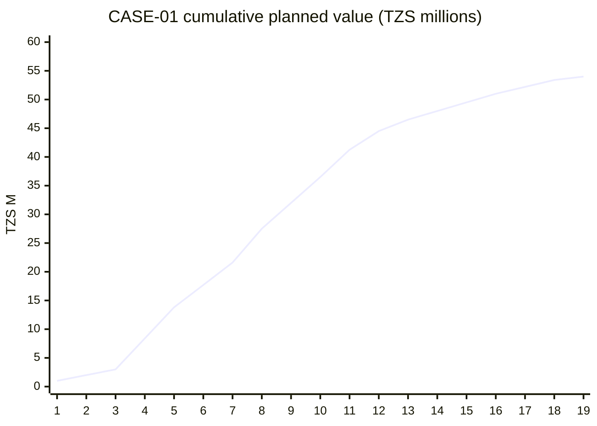

# PM-09 Cost Estimation and Budgeting

> [!info] Topic card
> **Unit:** U3 · **Time:** 4 h · **Calculator:** `cost_baseline` (period cost and cumulative PV) and `npv`/`irr` in `code/pm_tools.py`. The CASE-01 cost table, the S-curve values and the re-appraisal are asserted in `test_cost_baseline_pm09`. Amounts are illustrative (TZS). · **Artefact:** [[PM-A05 Project Budget]]

## 1. Learning objectives
1. **Classify** IS project costs (direct and indirect, fixed and variable, capital and operating, one-off and recurring), and **identify** the ones often missed.
2. **Apply** estimation methods (analogous, parametric, bottom-up, three-point) and state the accuracy ranges (rough order of magnitude vs definitive).
3. **Build** a time-phased cost baseline from the schedule (the S-curve), with contingency and management reserves.
4. **Explain** total cost of ownership (TCO) and life-cycle costing for information systems.
5. **Re-appraise** the business case when estimates change.

## 2. Why it matters
The budget is the yardstick for earned value (PM-10). Underestimate it, and the project "overruns" from day one. Forget recurring costs (licences, support, hosting), and the system becomes unaffordable after go-live. Good estimates come from the WBS, are time-phased by the schedule, and are honest about uncertainty.

## 3. Prerequisites
[[PM-04 Scope Management, Requirements Traceability and WBS]] (work packages) · [[PM-06 Critical Path Method and Float]] (ES dates) · [[PM-03 Project Initiation, Business Case and Charter]] (NPV).

## 4. Intuition
Estimate the **parts** (work packages), add them up, and add a **reserve** for known risks. Then spread the cost over **time** according to the schedule. The resulting cumulative curve looks like an **S**: slow at the start, steep in the middle when most people are working, and flat at the end.

## 5. Rigorous explanation

### 5.1 Cost types for IS projects
| Type | Examples |
|---|---|
| Labour (direct) | Developers, analysts, testers, PM |
| Hardware and infrastructure | Servers, network, cloud hosting |
| Software | Licences, subscriptions, development tools |
| Services | Consultants, vendor implementation, training delivery |
| Indirect / overhead | Office space, management time, utilities |
| Often missed | Data migration and cleansing; user training time; parallel running; security testing; post-go-live support (hypercare); change management; contingencies |
| Recurring (after go-live) | Licences, support contracts, hosting, maintenance staff, upgrades |

**Total cost of ownership (TCO):** the acquisition costs plus all operating costs over the system's useful life. Compare options on TCO, not purchase price.

### 5.2 Estimation methods and accuracy
| Method | Typical stage | Accuracy (commonly quoted ranges) |
|---|---|---|
| Rough order of magnitude (ROM), analogous | Initiation | About −25% to +75% |
| Budget estimate (parametric, top-down) | Early planning | About −10% to +25% |
| Definitive (bottom-up from the WBS) | Detailed planning | About −5% to +10% |

These ranges vary by source and organisation. The point is that **estimates narrow as information improves**. Re-estimate at each stage gate.

**Parametric:** cost = rate × units (e.g. TZS 150,000 per developer-day × 40 days). **Bottom-up:** estimate each work package and roll the estimates up the WBS (cost aggregation).

### 5.3 Reserves and the baseline
- **Contingency reserve:** for identified risks (the "known unknowns", from the risk register: [[PM-11 Risk Management]]). It's **part of the cost baseline**, and the PM manages it.
- **Management reserve:** for unidentified risks. It's **outside the baseline**, controlled by the sponsor, and using it needs a change.
- **Cost baseline** = work package estimates + contingency reserves, time-phased. **Total budget** = cost baseline + management reserve.
- **Funding limit reconciliation:** check that the spending profile fits the cash available per period. If not, shift non-critical work (as in PM-08 levelling).

### 5.4 Time-phasing
Spread each activity's cost over its duration (assume uniform, unless known otherwise), using the schedule's start dates. The cumulative sum is the **planned value (PV) curve**, the S-curve that EVM compares against.

## 6. Terminology
| Term | Meaning |
|---|---|
| Cost baseline | The approved, time-phased budget (excluding management reserve) |
| BAC | Budget at completion: the total cost baseline |
| Contingency / management reserve | For known risks, inside the baseline / for unknowns, outside it |
| Cost aggregation | Rolling work-package costs up the WBS |
| TCO | Total cost of ownership over the system's life |
| S-curve | Cumulative planned cost over time |
| Funding limit | The cash available per period |

## 7. Step-by-step: the CASE-01 bottom-up estimate
| Act | Work package | Basis of estimate | Cost (TZS) |
|---|---|---|---|
| A | Requirements | 2 people × 3 weeks × 5 days × 100,000/day | 3,000,000 |
| B | System design | 2 × 4 weeks × 5 × 150,000 | 6,000,000 |
| C | Database design | 2 × 2 weeks × 5 × 150,000 | 3,000,000 |
| D | Server procurement | Vendor quotation (hardware and licences) | 12,000,000 |
| E | Backend development | 3 × 6 weeks × 5 × 133,333 | 12,000,000 |
| F | Web UI | 2 × 4 weeks × 5 × 150,000 | 6,000,000 |
| G | Integration and test | 3 × 3 weeks × 5 × 100,000 | 4,500,000 |
| H | Server installation | Vendor service + 1 technician | 2,000,000 |
| I | Data migration | 2 × 2 weeks × 5 × 125,000 | 2,500,000 |
| J | UAT and training | 2 × 2 weeks × 5 × 120,000 | 2,400,000 |
| K | Go-live | 1 × 1 week × 5 × 120,000 | 600,000 |
| | **Work packages total** | | **54,000,000** |
| | Contingency reserve (from the risk register, 11%) | | 6,000,000 |
| | **Cost baseline (BAC)** | | **60,000,000** |
| | Management reserve (sponsor-held) | | 4,000,000 |
| | **Total project budget** | | **64,000,000** |

(The day rates are illustrative assumptions, not market data.)

## 8. Diagram: the S-curve (cumulative PV of the work packages, from `cost_baseline`)

*Text version: spending is slow in weeks 1–3 (requirements only), steep in weeks 4–12 (design, procurement and development in parallel), and flattens in weeks 13–19 (testing, UAT, go-live). It ends at 54 M. Contingency is held separately, not spread.*

## 9. Worked examples

### Example 1 (basic): parametric estimate
Twenty screens at 2.5 developer-days each, at TZS 150,000 per day: 20 × 2.5 × 150,000 = **TZS 7,500,000**. State the assumption: the screens are of similar complexity, and the rate is a loaded cost (salary + overhead).

### Example 2 (intermediate): reading the time-phased budget (tested)
- Week 4 costs **TZS 5,400,000**: B (1.5 M/week) + C (1.5 M/week) + D (2.4 M/week) all run in parallel.
- By the end of week 10, the planned cumulative cost is **TZS 36,500,000**, 68% of the work-package total, at 53% of the schedule. That's the steep middle of the S.
- If the university can release only TZS 15 M per month, check the cumulative curve against cumulative funding. Weeks 4–8 spend about 24 M in 5 weeks, so procurement payments (D) may need to be split, or scheduled within D's float.

### Example 3 (challenging): estimates changed, so re-appraise the business case (tested)
The business case (PM-03) assumed a TZS 45 M investment, with benefits of 18 M a year. The bottom-up baseline is **60 M**. At 18 M a year, NPV @12% = **TZS −5,327,712**: no longer viable. PRINCE2's "continued business justification" principle demands a decision:
- **Option 1:** reduce scope (defer the web UI polish or reporting) to bring the cost down.
- **Option 2:** re-examine the benefits. A study of registry staff time, printing and late-registration penalties supports **22 M a year**. At 22 M, NPV = **TZS +6,821,686**, IRR = **17.3%**, payback = **2.73 years**.
- **Option 3:** stop.

The sponsor approved Option 2, with benefits tracking added to the closure report ([[PM-A11 Closure Report]]). The decision is recorded in the decision log, and the business case is updated. That's how a business case should be used: as a living control, not a one-off approval document.

## 10. Application: TCO for the CASE-01 server decision
On-premises servers (D + H = 14 M up front, plus about 2 M a year in support, power and backups) vs cloud hosting (about 0 up front, but about 5 M a year). Over 5 years, undiscounted: on-premises 14 + 10 = 24 M; cloud 25 M. They're roughly equal. The decision then rests on non-cost factors:
- the in-house skills to run servers;
- the reliability of power and the network;
- data-location rules ([[CS-19 Cloud Security and Privacy]]);
- scalability on registration day.

Document it in an ADR-style decision record.

## 11. Common mistakes
| Mistake | Fix |
|---|---|
| Estimating only development effort | Include migration, training, testing, PM, support and change management |
| Ignoring recurring costs | Use TCO over the life of the system |
| Hiding contingency inside every estimate | Explicit, risk-based contingency |
| Putting management reserve into the baseline | Keep it outside; the sponsor controls it |
| Never re-estimating | Narrow the estimates at each stage gate |
| A changed estimate without revisiting the business case | Re-appraise (Example 3) |

## 12. Comparison: estimation methods
| | Analogous | Parametric | Bottom-up |
|---|---|---|---|
| Inputs | A similar past project | Historical rates × quantity | A detailed WBS |
| Effort | Low | Medium | High |
| Accuracy | Low | Medium (if the rates are good) | High |
| When | Initiation | Early planning | Detailed planning |

## 13. Practice
**L1** 1. Contingency vs management reserve? 2. What's BAC?

**L2** 3. Estimate the cost of training 120 staff in groups of 20, at 1 day per group, with a trainer at TZS 300,000/day and a venue at 150,000/day. 4. List 6 commonly forgotten IS project costs.

**L3** 5. Using the cost table, compute the planned cost in week 8 (check with `cost_baseline`). 6. Explain why the S-curve is steep in the middle.

**L4** 7. The funding limit is TZS 10 M per 4-week block. Check the CASE-01 profile against it, and propose shifts within float. 8. Compare the TCO of a licensed off-the-shelf registration package (30 M up front, plus 6 M a year) with custom development (60 M up front, plus 3 M a year) over 5 years, undiscounted and at 12%.

**L5** 9. Produce a complete budget for CASE-03 (point-of-sale): a bottom-up estimate, reserves, a time-phased S-curve, a TCO over 5 years, and a funding check.

## 14. Hints
> [!tip]- Hints
> 3: 6 groups × (300,000 + 150,000). 5: E (2 M/week), F (1.5 M), H (1 M) and D (2.4 M) in week 8? Check which activities are active: D ends at 8, H starts at 8 (0-based), E starts at 7. 8: discount the annual costs with `npv`.

## 15. Worked solutions
> [!success]- Solutions 1–2
> 1. Contingency: for identified risks, inside the cost baseline, managed by the PM. Management reserve: for unidentified risks, outside the baseline, released by the sponsor through change control. 2. Budget at completion: the total approved cost baseline (CASE-01: TZS 60 M including contingency; 54 M of work packages).

> [!success]- Solution 3
> 120 / 20 = 6 sessions × (300,000 + 150,000) = 6 × 450,000 = **TZS 2,700,000** (plus the staff's time away from work, an indirect cost to note).

> [!success]- Solution 5
> Week 8 (period index 7): D runs 3–7 (index 7 is its last week: 2.4 M), E runs 7–12 (2.0 M a week), F runs 7–10 (1.5 M a week). H starts at index 8, so it's not active. Total = 2.4 + 2.0 + 1.5 = **TZS 5.9 M**. `cost_baseline(...)[0][7]` gives 5,900,000.

> [!success]- Solution 6
> In the middle of the project (weeks 4–12), several costly activities run in parallel (design, procurement, backend and UI development), so the spending per week is highest, and the cumulative curve rises steeply. At the start (requirements only) and the end (testing, UAT, go-live, with few people), weekly spending is low.

> [!success]- Solution 8
> **Undiscounted, 5 years:** package 30 + 5 × 6 = **60 M**; custom 60 + 5 × 3 = **75 M**. **At 12%:**
> - package: 30 + 6 × 3.6048 = 30 + 21.63 = **51.63 M**;
> - custom: 60 + 3 × 3.6048 = 60 + 10.81 = **70.81 M**.
>
> (3.6048 is the 5-year annuity factor at 12%, i.e. the sum of 1/1.12^t for t = 1..5.) The package is cheaper on TCO. Check its fit with requirements, customisation limits and vendor lock-in before deciding.

## 16. Self-test (pass ≥ 4/5)
1. What's in the cost baseline? 2. Why is ROM accuracy wide? 3. What does an S-curve show? 4. Give two recurring IS costs. 5. What must happen when the estimate rises above the business case?
> [!success]- Answers
> 1. Time-phased work-package estimates plus contingency reserves (not management reserve). 2. Little information early, so analogous estimates are uncertain. 3. Cumulative planned cost over time. 4. Licences, hosting, support, maintenance staff (any two). 5. Re-appraise the business case and decide: proceed (with justification), descope, or stop.

## 17. Flashcards
#flashcards/project-management
Cost baseline?::Time-phased budget including contingency reserve, excluding management reserve.
Contingency vs management reserve?::Known risks, inside the baseline, PM / unknowns, outside it, sponsor.
TCO?::Acquisition plus operating costs over the system's life.
S-curve?::Cumulative planned cost (PV) over time: slow, steep, flat.
CASE-01 baseline?::54 M of work packages + 6 M contingency = BAC 60 M; plus 4 M management reserve.

## 18. Blank-page recall
Rebuild the CASE-01 cost table and compute PV at week 10 (36.5 M).

## 19. Revision summary
- Cost all IS cost types, including the commonly missed and recurring ones; compare options on TCO.
- Estimates narrow from ROM to definitive; bottom-up from the WBS for the baseline.
- Baseline = estimates + contingency, time-phased into the S-curve; management reserve sits outside.
- Changed estimates mean re-appraising the business case (CASE-01: 60 M needs 22 M a year of benefits to stay positive).

## 20. Links
Prev: [[PM-08 Resource Allocation and Levelling]] · Next: [[PM-10 Earned Value Management]] · Artefact: [[PM-A05 Project Budget]] · Related: [[PM-03 Project Initiation, Business Case and Charter]], [[PM-11 Risk Management]]

## 21. Sources
- PMI, *PMBOK® Guide*, 6th ed., 2017, chapter 7 (Project Cost Management).
- AACE International, Recommended Practice 18R-97, *Cost Estimate Classification System* (accuracy ranges by estimate class).
- Schwalbe, K., *Information Technology Project Management*, 9th ed., Cengage, 2019, chapter 7.
- *(Not checked online during the build, because there was no network access.)*

## 22. Mastery checklist
- [ ] I can build a bottom-up estimate with reserves
- [ ] I can time-phase it into an S-curve and check the funding
- [ ] I can compute TCO and re-appraise a business case
- [ ] Reviews scheduled
