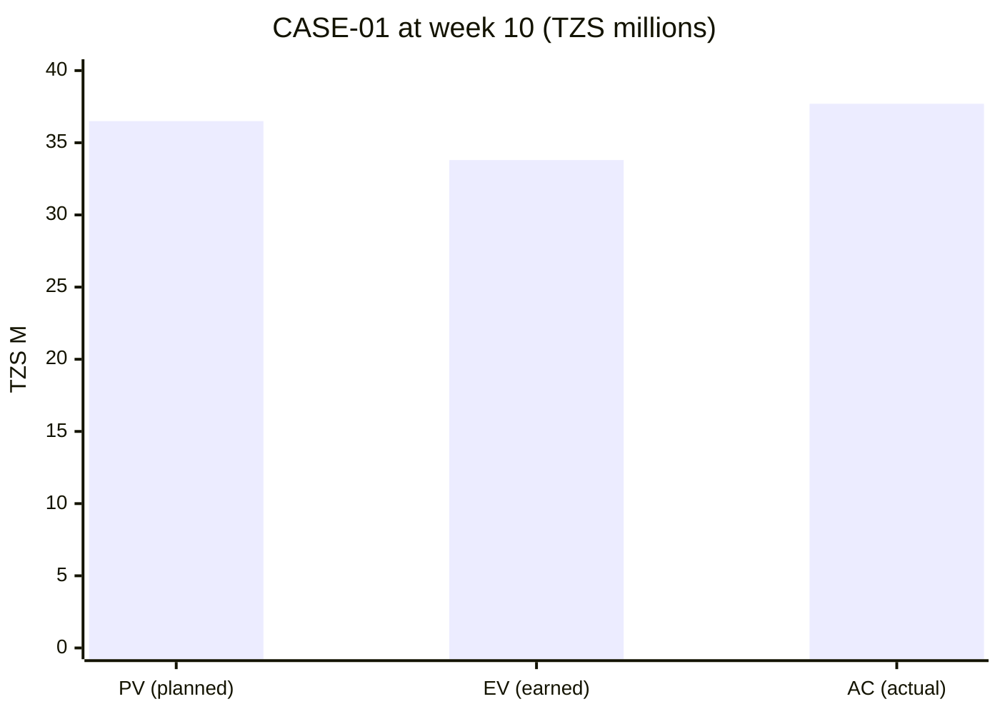

# PM-10 Earned Value Management

> [!info] Topic card
> **Unit:** U4 · **Time:** 5 h · **Calculator:** the `EVM` class and `percent_complete_ev` in `code/pm_tools.py`. Both worked examples are asserted in `test_evm_example` and `test_case01_week10_evm_pm10`. · **Artefact:** [[PM-A09 Status Report]]

## 1. Learning objectives
1. **Define** PV, EV, AC and BAC, and **compute** EV from percentage complete.
2. **Calculate** and **interpret** SV, CV, SPI and CPI.
3. **Forecast** with EAC (three formulas), ETC and VAC, and **choose** the right EAC formula for the situation.
4. **Calculate** TCPI, and **judge** whether a target is realistic.
5. **Explain** the limitations of EVM (SPI converging to 1, the critical path, measuring progress) and **write** a status statement.

## 2. Why it matters
"We've spent half the budget" says nothing about progress. "We've spent 37.7 M, but earned only 33.8 M of value, against 36.5 M planned" says the project is **behind schedule and over budget**, by how much, and roughly where it will finish. EVM integrates scope, schedule and cost into early, objective warnings, and it's a near-certain exam topic.

## 3. Prerequisites
[[PM-09 Cost Estimation and Budgeting]] (the PV S-curve, BAC) · [[PM-06 Critical Path Method and Float]].

## 4. Intuition
Three numbers at a status date:
- **PV:** what we *planned* to have done (in budget money).
- **EV:** what we've *actually done* (in budget money).
- **AC:** what it *actually cost*.

Compare EV with PV for the schedule, and EV with AC for cost. Ratios above 1 are good. Ratios below 1 are bad.

## 5. Rigorous explanation

### 5.1 Base measures
- **BAC:** budget at completion (the total planned value).
- **PV** (planned value, BCWS): the budgeted cost of the work *scheduled* up to the status date.
- **EV** (earned value, BCWP): the budgeted cost of the work *performed* = Σ (budget of each task × % complete).
- **AC** (actual cost, ACWP): the actual cost of the work performed.

**Measuring % complete:**
- 0/100 (credit only when finished);
- 50/50 (half at the start, half at the finish);
- weighted milestones;
- physical % complete (needs objective evidence).

Be consistent, and avoid inflated "90% done" claims.

### 5.2 Variances and indices
| Measure | Formula | Good if |
|---|---|---|
| Schedule variance | SV = EV − PV | > 0 (ahead) |
| Cost variance | CV = EV − AC | > 0 (under budget) |
| Schedule performance index | SPI = EV / PV | > 1 |
| Cost performance index | CPI = EV / AC | > 1 |

### 5.3 Forecasts
| Forecast | Formula | Assumes |
|---|---|---|
| EAC (typical) | BAC / CPI | Current cost efficiency continues (most common) |
| EAC (atypical) | AC + (BAC − EV) | The overrun was a one-off; the remaining work goes to plan |
| EAC (CPI × SPI) | AC + (BAC − EV) / (CPI × SPI) | Schedule pressure also affects cost (e.g. a fixed deadline needs overtime) |
| ETC | EAC − AC | The cost to finish |
| VAC | BAC − EAC | Expected over- or underrun at completion |
| TCPI (to meet BAC) | (BAC − EV) / (BAC − AC) | The efficiency required on the remaining work to finish at BAC |
| TCPI (to meet EAC) | (BAC − EV) / (EAC − AC) | The efficiency required to finish at a new target |

**TCPI rule of thumb:** a TCPI much higher than the current CPI (say, more than 0.1 above it) is rarely achieved. Revise the target instead.

### 5.4 Limitations
- **SPI is in money, not time.** At the end of a late project, EV = PV = BAC, so SPI returns to 1.0 even if the project finished 6 weeks late. Use **earned schedule** methods, or the critical path, for time forecasts.
- **SPI ignores the critical path:** being ahead on non-critical work can hide a delay on critical work.
- EVM is only as good as the % complete measurement and the baseline. Re-baseline only through approved changes.

## 6. Terminology
| Term | Meaning |
|---|---|
| BCWS / BCWP / ACWP | Older names for PV / EV / AC |
| Status (data) date | The cut-off date for the measurement |
| Performance measurement baseline | The time-phased scope, schedule and cost baseline used for EVM |
| Control account | A management control point (WBS × responsible organisation) where EV is measured |
| Earned schedule | A time-based extension of EVM (Lipke, 2003) |

## 7. Step-by-step: CASE-01 at the end of week 10 (tested)
**Planned (PV):** from the S-curve (PM-09), **TZS 36,500,000** (A, B, C, D and H complete; E 3/6 weeks; F 3/4 weeks).

**Actual progress and costs reported:**

| Act | Budget | % complete | EV | AC |
|---|---|---|---|---|
| A | 3.0 M | 100% | 3.0 M | 3.2 M |
| B | 6.0 M | 100% | 6.0 M | 6.5 M |
| C | 3.0 M | 100% | 3.0 M | 2.8 M |
| D | 12.0 M | 100% | 12.0 M | 13.5 M |
| E | 12.0 M | 40% | 4.8 M | 6.0 M |
| F | 6.0 M | 50% | 3.0 M | 3.5 M |
| H | 2.0 M | 100% | 2.0 M | 2.2 M |
| **Total** | | | **33.8 M** | **37.7 M** |

**Calculations** (BAC = 54 M, the work-package baseline; the 6 M contingency is held separately):
- SV = 33.8 − 36.5 = **−2.7 M** (behind schedule). SPI = 33.8/36.5 = **0.926**.
- CV = 33.8 − 37.7 = **−3.9 M** (over budget). CPI = 33.8/37.7 = **0.8966**.
- EAC (typical) = 54/0.8966 = **60,230,769**. VAC = **−6,230,769**.
- EAC (atypical) = 37.7 + (54 − 33.8) = **57,900,000**. EAC (CPI × SPI) = **62,030,564**.
- TCPI (to meet BAC 54 M) = (54 − 33.8)/(54 − 37.7) = 20.2/16.3 = **1.2393**. The current CPI is 0.90, so **not realistic**.
- TCPI (to meet 60 M, i.e. using all the contingency) = 20.2/22.3 = **0.9058**, only slightly above the current CPI. That's achievable with modest improvement.

## 8. Diagram: PV, EV and AC at week 10

*Text version: actual cost (37.7) exceeds earned value (33.8), so the project is over budget. Earned value is below planned value (36.5), so it's behind schedule.*

## 9. Worked examples

### Example 1 (basic): the textbook set (tested)
BAC = 60 M, PV = 30 M, EV = 25 M, AC = 28 M.
- SV = **−5 M**; CV = **−3 M**; SPI = **0.8333**; CPI = **0.8929**.
- EAC (typical) = 60/0.8929 = **67.2 M**; ETC = **39.2 M**; VAC = **−7.2 M**.
- EAC (atypical) = **63.0 M**; EAC (CPI × SPI) = **75.04 M**.
- TCPI (to meet BAC) = 35/32 = **1.0938**.

### Example 2 (intermediate): which EAC?
| Situation | Best EAC |
|---|---|
| The overrun came from a one-time server price increase (D); the remaining work is unaffected | Atypical: AC + (BAC − EV) |
| The developers consistently take 10% longer than estimated | Typical: BAC/CPI |
| Behind schedule and the deadline is fixed, so overtime will be paid | CPI × SPI |

For CASE-01, 1.5 M of the 3.9 M overrun is D's one-off server price rise. The rest (A, B, E, F, H) suggests development effort is systematically underestimated. A **blended** forecast treats D as atypical, and applies the CPI of the other work to what remains:
- CPI excluding D = (33.8 − 12.0)/(37.7 − 13.5) = 21.8/24.2 = **0.9008**;
- ETC = 20.2/0.9008 = **22.42 M**;
- EAC = 37.7 + 22.42 = **60.12 M**.

Report the range: **57.9 M** (if everything left goes to plan) to **60.2 M** (if all of today's inefficiency continues), with **about 60.1 M** as the most defensible single estimate.

### Example 3 (challenging): SPI vs the critical path
SPI = 0.926 suggests about 7% behind. A naive time forecast is 19/0.926 = **20.5 weeks**. But the critical-path view is more precise: E (critical) is 40% done (2.4 weeks' worth of work) when 3 weeks were planned, so it's **0.6 weeks behind**, and the project is forecast at about **19.6 weeks**. F is also behind (50% vs 75%), but it has 2 weeks of float, so it doesn't matter yet. The SPI blends the critical and non-critical activities. Always check the critical path.

## 10. Application: the status statement for the steering committee
> "At week 10, CASE-01 has earned TZS 33.8 M of value against 36.5 M planned (SPI 0.93) and 37.7 M spent (CPI 0.90). The overrun is partly a one-off server price rise (1.5 M) and partly development effort running about 10% above estimate. We forecast a final cost of 57.9–60.2 M against the 54 M work budget, which is within the 60 M baseline including contingency, but would leave little reserve. The critical backend work is 0.6 weeks behind; go-live is forecast for week 19–20. **Actions:** an extra developer review on E for 2 weeks (cost 0.6 M, from contingency), and a scope review of reporting features. **Decision requested:** approve the use of contingency." ([[PM-A09 Status Report]])

## 11. Common mistakes
| Mistake | Fix |
|---|---|
| Comparing AC with PV to judge cost | Cost is CV = EV − AC (PV says nothing about cost efficiency) |
| Using % of budget spent as % complete | Measure physical progress |
| Formulas back-to-front (PV − EV) | Variance = EV minus something; good is positive |
| Using one EAC formula for every situation | Choose by the cause of the variance |
| Trusting SPI for time at the end of a project | SPI tends to 1; use the critical path or earned schedule |
| Hiding variances by re-baselining | Re-baseline only through approved change control |

## 12. Comparison: interpretation grid
| | CPI > 1 (under budget) | CPI < 1 (over budget) |
|---|---|---|
| **SPI > 1 (ahead)** | Excellent; check the quality and the estimates | Ahead but costly (perhaps crashing) |
| **SPI < 1 (behind)** | Behind but cheap (perhaps under-resourced) | **Worst case: CASE-01 at week 10** |

## 13. Practice
**L1** 1. Define PV, EV and AC. 2. Write the CPI and SPI formulas.

**L2** 3. BAC = 100, PV = 40, EV = 35, AC = 45. Compute SV, CV, SPI, CPI and EAC (typical). 4. Interpret CPI = 1.1 and SPI = 0.8.

**L3** 5. Compute EV for: design (budget 8 M) 100%, build (20 M) 50%, test (6 M) 0%. 6. For question 3, compute TCPI to meet BAC, and comment on whether it's realistic.

**L4** 7. In CASE-01, what CPI would be needed on the remaining work to finish at 57 M? 8. Explain with a numeric example why SPI approaches 1 at the end of a late project.

**L5** 9. Create a 3-period EVM table for CASE-02 (inventory system) with plausible data, compute all the measures each period, plot PV/EV/AC, and write a status statement with forecasts and recommendations.

## 14. Hints
> [!tip]- Hints
> 3: SV −5, CV −10, SPI 0.875, CPI 0.778, EAC 128.6. 5: 8 + 10 + 0. 7: TCPI = (BAC − EV)/(target − AC) = 20.2/(57 − 37.7). 8: at completion EV = PV = BAC.

## 15. Worked solutions
> [!success]- Solutions 1–2
> 1. PV: the budgeted cost of the work scheduled to date. EV: the budgeted cost of the work actually performed. AC: the actual cost of the work performed. 2. CPI = EV/AC; SPI = EV/PV.

> [!success]- Solution 3
> SV = 35 − 40 = **−5**; CV = 35 − 45 = **−10**; SPI = 35/40 = **0.875**; CPI = 35/45 = **0.778**; EAC = 100/0.778 = **128.6** (VAC = −28.6). Behind schedule and significantly over budget.

> [!success]- Solution 4
> CPI = 1.1: getting 1.10 of value per 1.00 spent, so under budget. SPI = 0.8: only 80% of the planned work done, so behind schedule. Typical cause: under-resourcing (people weren't available, so less was spent and less was done). Check the critical path, and whether the cheapness is sustainable.

> [!success]- Solution 5
> EV = 8 × 1.0 + 20 × 0.5 + 6 × 0 = **18 M** (asserted in `test_ev_from_percent_complete`).

> [!success]- Solution 6
> TCPI = (100 − 35)/(100 − 45) = 65/55 = **1.18**, against a current CPI of 0.78. That's a jump of 0.40 in efficiency, so it's **unrealistic**. Revise the EAC and seek additional funding or a reduced scope, rather than promising to recover.

> [!success]- Solution 7
> TCPI = (54 − 33.8)/(57 − 37.7) = 20.2/19.3 = **1.047**. The remaining work would need to be done about 5% *under* its budget, while the current CPI is 0.90. That's very unlikely, so 57 M isn't a credible target. 60 M (TCPI 0.906) is.

> [!success]- Solution 8
> Take a 10-week plan with BAC = 100. The project actually finishes in week 14. At week 14, PV = 100 (all the planned work was due by week 10), and EV = 100 (all the work is now done), so SPI = 100/100 = **1.0**, even though the project is 4 weeks late. SPI measures work value, not time, and PV stops growing after the planned finish date. Earned schedule fixes this by measuring when the current EV *should* have been reached (week 10 here), and comparing it with the actual time.

## 16. Self-test (pass ≥ 4/5)
1. CV formula? 2. CPI = 0.9 means? 3. EAC when the overrun was a one-off? 4. What does TCPI tell you? 5. CASE-01 status at week 10?
> [!success]- Answers
> 1. CV = EV − AC. 2. 0.90 of value earned per 1.00 spent: about 11% over budget on the work so far. 3. AC + (BAC − EV). 4. The cost efficiency needed on the remaining work to hit a target. 5. Behind schedule (SPI 0.93) and over budget (CPI 0.90); EAC 57.9–60.2 M.

## 17. Flashcards
#flashcards/project-management
EV?::Budgeted cost of the work performed = Σ budget × % complete.
SV and CV?::SV = EV − PV; CV = EV − AC (negative is bad).
SPI and CPI?::SPI = EV/PV; CPI = EV/AC (below 1 is bad).
EAC typical?::BAC / CPI.
EAC atypical?::AC + (BAC − EV).
TCPI to BAC?::(BAC − EV) / (BAC − AC).
Why can't SPI forecast time late in a project?::It tends to 1 as EV reaches PV = BAC, however late the project is.

## 18. Blank-page recall
Redo the CASE-01 week-10 table and all its measures from the raw percentages and costs.

## 19. Revision summary
- PV (planned), EV (earned), AC (actual). Variances: EV − PV, EV − AC. Indices: EV/PV, EV/AC.
- Forecasts: EAC = BAC/CPI (typical), AC + (BAC − EV) (atypical), with CPI × SPI (schedule pressure); ETC, VAC, TCPI.
- CASE-01, week 10: SPI 0.93, CPI 0.90, EAC 57.9–60.2 M; TCPI to 54 M is 1.24 (unrealistic), to 60 M is 0.91 (credible).
- Use the critical path for time; SPI is money-based and converges to 1.

## 20. Links
Prev: [[PM-09 Cost Estimation and Budgeting]] · Next: [[PM-11 Risk Management]] · Artefact: [[PM-A09 Status Report]] · Related: [[PM-17 Monitoring, Control, Closure and Lessons Learned]], [[PM-CASE-01 University Course Registration System]]

## 21. Sources
- PMI, *Practice Standard for Earned Value Management*, 2nd ed., 2011; PMBOK® Guide, 6th ed., 2017, §7.4 (Control Costs).
- Fleming, Q. W. & Koppelman, J. M., *Earned Value Project Management*, 4th ed., PMI, 2010.
- Lipke, W., "Schedule is different", *The Measurable News*, Summer 2003 (earned schedule).
- *(Not checked online during the build, because there was no network access.)*

## 22. Mastery checklist
- [ ] I can compute EV from % complete, and all the variances and indices
- [ ] I can choose the right EAC and compute TCPI
- [ ] I can explain the limits of SPI, and use the critical path for time
- [ ] Reviews scheduled
