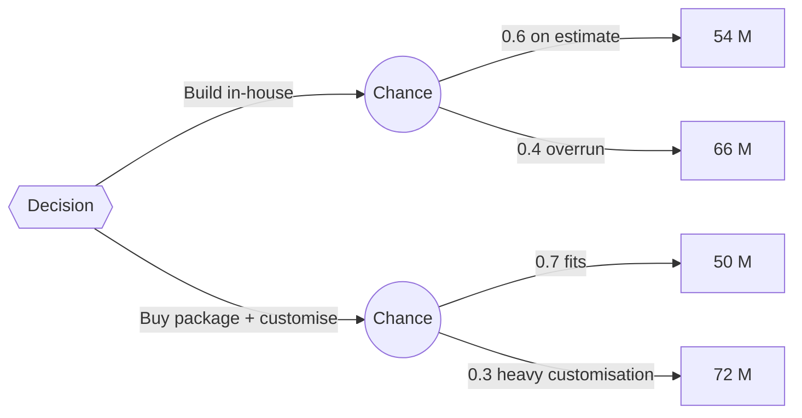

# PM-11 Risk Management

> [!info] Topic card
> **Unit:** U4 · **Time:** 5 h · **Calculator:** `emv` and `decision_value` (a decision tree) in `code/pm_tools.py`. The CASE-01 register and the decision tree are asserted in `test_risk_emv_and_decision_tree_pm11`. · **Artefact:** [[PM-A06 Risk Register]] · Security-specific view: [[CS-16 Risk Analysis, Policy, Governance and Compliance]], [[X-05 Security Risk in Project Management]]

## 1. Learning objectives
1. **Define** risk (threats and opportunities), and **describe** the risk process: plan, identify, analyse (qualitative and quantitative), plan responses, implement, monitor.
2. **Identify** IS project risks using a risk breakdown structure, checklists, assumption analysis and SWOT.
3. **Analyse** risks with a probability–impact matrix, expected monetary value (EMV) and decision trees.
4. **Choose** responses (avoid, transfer, mitigate, accept, escalate; exploit, share, enhance) and **calculate** whether a response is worth its cost.
5. **Maintain** a risk register with owners, triggers and residual risk, and **size** contingency reserves from it.

## 2. Why it matters
Every project plan is a set of assumptions about the future. Risk management makes them explicit, and prepares for the most likely or most damaging surprises before they happen, when responses are cheap. For CASE-01, the contingency reserve in the budget (PM-09) comes directly from this lesson's register.

## 3. Prerequisites
[[PM-03 Project Initiation, Business Case and Charter]] · [[PM-07 PERT and Schedule Estimation]] (uncertainty and reserves) · Expected value from [[DM-18 Introductory Discrete Probability]].

## 4. Intuition
A **risk** is an uncertain event that, *if* it occurs, affects your objectives. An **issue** is a risk that has already happened. Managing risk means **paying a little now** (a mitigation) to avoid **paying a lot later** (the impact), but only where the expected saving exceeds the cost.

## 5. Rigorous explanation

### 5.1 Process (PMBOK 6, chapter 11)
1. **Plan risk management:** methodology, roles, budget, scales, appetite.
2. **Identify:** brainstorming, checklists from past projects, assumption and constraint analysis, SWOT, expert interviews. Write each risk as **cause → event → effect**: "Because the vendor has a 6-week lead time (cause), the servers may arrive late (event), delaying installation and migration (effect)."
3. **Qualitative analysis:** probability and impact scores, a P×I matrix, urgency.
4. **Quantitative analysis:** EMV, decision trees, Monte Carlo simulation (PM-07), sensitivity (tornado diagrams).
5. **Plan responses.**
6. **Implement responses.**
7. **Monitor:** reassess, track triggers, audit, update the register.

### 5.2 Expected monetary value
$EMV = P \times I$ (with impact negative for threats in some conventions; here, threats are positive costs and opportunities negative costs). The sum of the threat EMVs gives a **first estimate of the contingency reserve**. A response is worth it if:
$$\text{EMV}_{\text{before}} > \text{EMV}_{\text{after}} + \text{response cost}$$

### 5.3 Decision trees
- Squares are decisions and circles are chance nodes.
- Evaluate from the right: chance nodes take the probability-weighted average; decision nodes take the best option (the lowest expected cost, or the highest expected value).
- The result is the expected value of each option, under the stated probabilities.

### 5.4 Responses
| Threats | Opportunities | Both |
|---|---|---|
| **Avoid:** change the plan to remove the risk | **Exploit:** make it certain | **Accept:** active (contingency) or passive |
| **Transfer:** insurance, a fixed-price contract, a warranty | **Share:** a partnership | **Escalate:** outside the PM's authority, so pass it to the sponsor or programme |
| **Mitigate:** reduce P or I | **Enhance:** increase P or I | |

Each response needs an **owner**, a **trigger** (an early warning sign), its cost, and the **residual risk** (what remains) and **secondary risks** (new risks it creates).

## 6. Terminology
| Term | Meaning |
|---|---|
| Risk vs issue | An uncertain future event vs a current problem |
| Risk appetite / tolerance / threshold | Willingness to take risk / the acceptable variation / the level that triggers a response |
| Trigger | A sign that a risk is about to occur |
| Residual risk | Risk remaining after the response |
| Secondary risk | A new risk caused by a response |
| Risk breakdown structure (RBS) | A hierarchy of risk categories (technical, external, organisational, PM) |
| Contingency plan / fallback | What to do if the risk occurs / if the contingency plan fails |

## 7. Step-by-step: the CASE-01 quantitative register (tested)
| ID | Risk (cause → event → effect) | P | Impact (TZS) | EMV |
|---|---|---|---|---|
| R1 | Vendor lead time → servers arrive late → install and migration delayed, extra hire costs | 0.30 | 4,000,000 | 1,200,000 |
| R2 | Legacy enrolment data is inconsistent → migration needs extra cleansing | 0.50 | 3,000,000 | 1,500,000 |
| R3 | The single senior backend developer leaves → E is delayed, a contractor is needed | 0.20 | 6,000,000 | 1,200,000 |
| R4 | Registration rules change after design → rework in E and G | 0.40 | 2,500,000 | 1,000,000 |
| R5 | Peak load on registration day → outage, an emergency scale-up | 0.25 | 4,400,000 | 1,100,000 |
| | **Total EMV** | | | **6,000,000** |

The total EMV of **TZS 6.0 M** is exactly the **contingency reserve** in the PM-09 budget. That's no coincidence: the budget was built from this register.

## 8. Diagram: the decision tree for build vs buy (tested)

- Build: 0.6 × 54 + 0.4 × 66 = **58.8 M**.
- Buy: 0.7 × 50 + 0.3 × 72 = **56.6 M**.
- **Choose buy** (the lower expected cost), unless the 30% chance of a 72 M outcome is unacceptable to a risk-averse sponsor. EMV assumes risk neutrality.

## 9. Worked examples

### Example 1 (basic): a qualitative P×I matrix (1–5 scales)
| Risk | P | I | Score | Priority |
|---|---|---|---|---|
| R2 data quality | 4 | 3 | 12 | High |
| R3 key person leaves | 2 | 5 | 10 | High (high impact) |
| R1 server delay | 3 | 3 | 9 | Medium |
| R5 peak-load outage | 2 | 4 | 8 | Medium (but it's registration day, so urgency is high) |
| R4 rule changes | 3 | 2 | 6 | Medium |

Same banding as [[CS-16 Risk Analysis, Policy, Governance and Compliance]]: 1–4 Low, 5–9 Medium, 10–16 High, 20–25 Critical.

### Example 2 (intermediate): is the mitigation worth it?
R3: hire a second backend developer for knowledge sharing (pairing plus documentation) for TZS 0.5 M, which reduces the probability of a damaging departure to 0.05.
- Before: EMV = 0.2 × 6 M = **1.2 M**.
- After: 0.05 × 6 M + 0.5 M = **0.8 M**.

**Saving: 0.4 M**, so do it. It also lowers the **impact** (someone else can continue), and that would make it even better.

### Example 3 (challenging): choosing responses for the whole register
| Risk | Response type | Action | Owner | Trigger |
|---|---|---|---|---|
| R1 | Transfer + mitigate | Order in week 1 with a penalty clause; vendor delivery tracking | Procurement officer | No shipping notice by week 5 |
| R2 | Mitigate | A data-profiling spike in week 2; cleansing scripts | Database developer | More than 2% invalid records in the profile |
| R3 | Mitigate | Pairing, documentation, a second developer (Example 2) | PM | Resignation rumours; heavy overtime |
| R4 | Accept (active) + mitigate | Freeze rules at design approval; change control; contingency | Registrar | A senate meeting on registration rules |
| R5 | Mitigate | Load test at 2× expected peak; scale plan; staggered registration by year group | Lead developer | Load test p95 > 2 s |

**Secondary risk** from R5's staggered registration: students complain about unfair access, so communicate the reasons early (PM-12).

## 10. Application: monitoring
- Review the register at every status meeting. Re-score the risks, retire the closed ones, add new ones.
- Watch the triggers. Record actual occurrences as **issues**, and draw down contingency through the change log.
- Report the top 5 risks on the status report ([[PM-A09 Status Report]]).
- At week 10 (PM-10), D's price rise used 1.5 M. Was it in the register? It's a variant of R1 (cost rather than delay), so draw from contingency and update the register: R1's remaining exposure is now delay only.

## 11. Common mistakes
| Mistake | Fix |
|---|---|
| Writing risks as issues or vague worries ("the project might fail") | Cause → event → effect |
| No owners or triggers | Assign owners; define early warnings |
| Responses that cost more than they save | Compare the EMV before vs after plus the cost |
| Ignoring opportunities | Exploit, share, enhance |
| A register created once and never updated | Review it every status meeting |
| Treating EMV as the outcome | EMV is an average; a single risk either happens or doesn't |

## 12. Comparison: qualitative vs quantitative analysis
| | Qualitative | Quantitative |
|---|---|---|
| Output | A prioritised list (P×I scores) | Money and time effects, distributions |
| Effort | Low | Higher |
| Tools | P×I matrix | EMV, decision trees, Monte Carlo, sensitivity |
| Use | All risks | Top risks; sizing reserves; big decisions |

## 13. Practice
**L1** 1. Risk vs issue? 2. Name the five threat responses.

**L2** 3. Write 3 risks for CASE-02 in cause → event → effect form. 4. Compute the EMV for P = 0.35 and impact TZS 8 M.

**L3** 5. A fixed-price contract transfers R1's cost risk to the vendor for a premium of 0.9 M. Is it worth it? 6. Score your CASE-02 risks on a 5×5 matrix.

**L4** 7. Extend the decision tree: "buy" now costs 2 M for a pilot that reveals the fit before committing (if it fits, P = 0.7; else switch to build). Compute the expected cost. 8. Explain why the sum of EMVs is only a *first* estimate of contingency.

**L5** 9. Build a full risk register (10 risks) for your FYP, with quantification for the top 3, responses with costs, triggers, and a reserve recommendation.

## 14. Hints
> [!tip]- Hints
> 4: 0.35 × 8 = 2.8 M. 5: compare 1.2 M (R1's EMV) with 0.9 M. Note the transfer covers cost, not delay. 7: pilot 2 M + 0.7 × 50 + 0.3 × (the build expectation of 58.8). 8: correlations, the tails of the distribution, and unidentified risks.

## 15. Worked solutions
> [!success]- Solutions 1–2
> 1. A risk is uncertain and in the future (it might happen); an issue has already happened and needs action now. 2. Avoid, transfer, mitigate, accept, escalate.

> [!success]- Solution 4
> EMV = 0.35 × 8,000,000 = **TZS 2,800,000**.

> [!success]- Solution 5
> R1's EMV = 1.2 M, against a 0.9 M premium. Financially, the transfer saves 0.3 M in expectation, **if** it covers the whole impact. But R1's impact includes a schedule delay, which a cost transfer doesn't remove. So combine it with the mitigation (an early order). Worth it, especially if the sponsor is risk-averse.

> [!success]- Solution 7
> Pilot first: 2 M + 0.7 × 50 M + 0.3 × 58.8 M (switch to build) = 2 + 35 + 17.64 = **54.64 M**. That's better than buying without a pilot (56.6 M) or building (58.8 M), because the pilot avoids the 72 M heavy-customisation outcome. The 2 M pays for **information**. Check it with `decision_value(("chance", [(0.7, 52e6), (0.3, 60.8e6)]))`, which folds the 2 M pilot into each branch.

> [!success]- Solution 8
> EMVs assume independent risks and risk-neutral decision-making. In reality:
> - risks can be **correlated** (R3 and R4 both hit E);
> - a single risk's **actual** impact is all or nothing (so EMV-based reserves can be too small if a big one occurs);
> - **unidentified risks** exist (covered by management reserve).
>
> Monte Carlo simulation of the register gives a percentile-based reserve (e.g. P80), which is more robust.

## 16. Self-test (pass ≥ 4/5)
1. EMV formula? 2. Which response type is insurance? 3. What's a trigger? 4. What's residual risk? 5. CASE-01's total EMV?
> [!success]- Answers
> 1. Probability × impact. 2. Transfer. 3. A warning sign that the risk is about to occur. 4. The risk that remains after the response. 5. TZS 6.0 M (= the contingency reserve).

## 17. Flashcards
#flashcards/project-management
Risk statement format?::Cause → event → effect.
Threat responses?::Avoid, transfer, mitigate, accept, escalate.
Opportunity responses?::Exploit, share, enhance, accept, escalate.
Is a response worth it?::If EMV before > EMV after + response cost.
Decision tree evaluation?::Right to left: chance nodes average, decision nodes choose the best.
CASE-01 build vs buy?::Build 58.8 M vs buy 56.6 M; a pilot first, 54.64 M.

## 18. Blank-page recall
Rebuild the CASE-01 register (5 risks, EMV 6 M) and the build/buy tree from memory.

## 19. Revision summary
- Process: plan → identify (cause-event-effect) → qualitative (P×I) → quantitative (EMV, trees, simulation) → respond → implement → monitor.
- EMV = P × I. The sum of the register (CASE-01: 6 M) sizes the contingency. Responses must save more than they cost.
- Responses: threats (avoid, transfer, mitigate, accept, escalate), opportunities (exploit, share, enhance). Assign owners and triggers; record residual and secondary risks.

## 20. Links
Prev: [[PM-10 Earned Value Management]] · Next: [[PM-12 Stakeholder and Communication Management]] · Artefact: [[PM-A06 Risk Register]] · Related: [[CS-16 Risk Analysis, Policy, Governance and Compliance]], [[X-05 Security Risk in Project Management]], [[FYP-T11 Risk Register]], [[DM-18 Introductory Discrete Probability]]

## 21. Sources
- PMI, *PMBOK® Guide*, 6th ed., 2017, chapter 11 (Project Risk Management); PMI, *The Standard for Risk Management in Portfolios, Programs, and Projects*, 2019.
- ISO 31000:2018, *Risk management: Guidelines*.
- Hillson, D., *Effective Opportunity Management for Projects*, CRC Press, 2004.
- *(Not checked online during the build, because there was no network access.)*

## 22. Mastery checklist
- [ ] I can write cause-event-effect risk statements and score them
- [ ] I can compute EMV, evaluate decision trees, and judge whether a response is worth it
- [ ] I can maintain a register with owners, triggers and reserves
- [ ] Reviews scheduled
