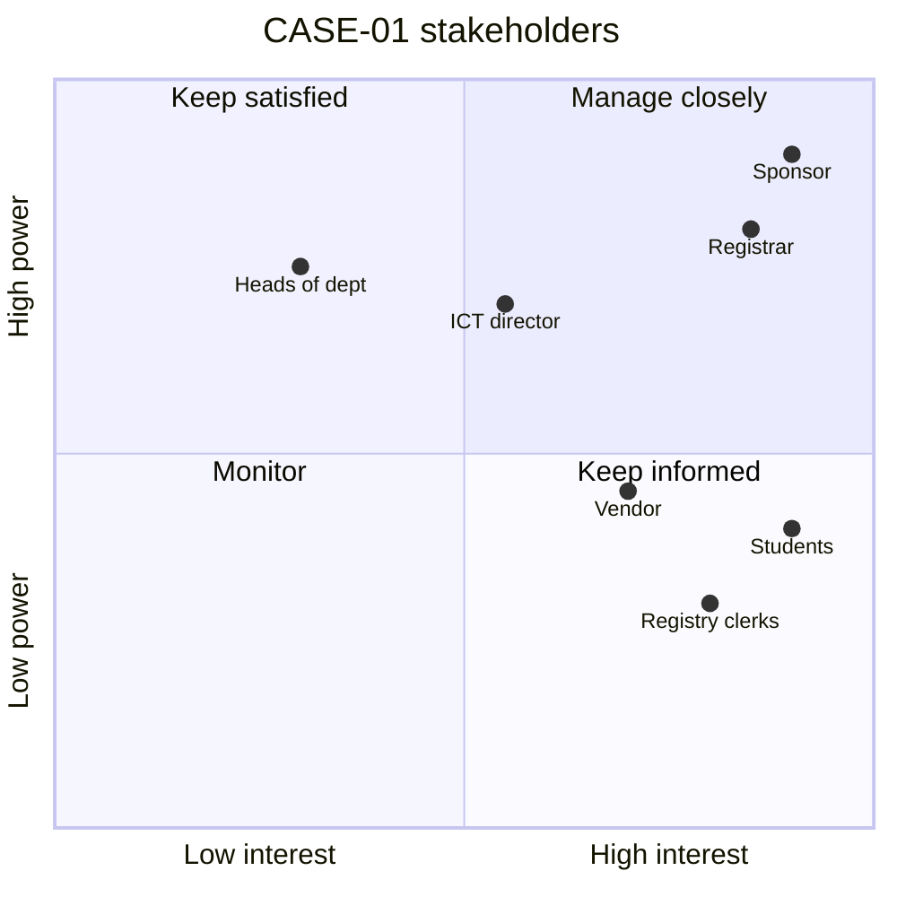

# PM-12 Stakeholder and Communication Management

> [!info] Topic card
> **Unit:** U4 · **Time:** 3 h · **Calculator:** `communication_channels` in `code/pm_tools.py` (tested). · **Artefacts:** [[PM-A07 Stakeholder Register]], [[PM-A08 Communication Plan]]

## 1. Learning objectives
1. **Identify** stakeholders, and **analyse** them with a power/interest grid and an engagement assessment matrix (current vs desired engagement).
2. **Plan** engagement strategies for each stakeholder group.
3. **Calculate** communication channels, and **explain** why communication complexity grows with team size.
4. **Write** a communication plan (who, what, when, how, by whom, feedback).
5. **Choose** communication methods (push, pull, interactive) and handle resistance to change.

## 2. Why it matters
IS projects fail more often from people problems than technical ones: a registrar who wasn't consulted, faculty who refuse the new system, students who learn about a change on registration day. Systematic stakeholder and communication management turns potential opponents into supporters, and makes sure the right people get the right information at the right time.

## 3. Prerequisites
[[PM-03 Project Initiation, Business Case and Charter]] (initial stakeholders in the charter) · [[PM-01 Project Fundamentals and Organizational Context]].

## 4. Intuition
Not everyone needs everything. The vice-chancellor needs a one-page monthly summary. The registry clerks need training and early sight of screens. Students need clear, timely notices. **Match the message, channel and frequency to each group's power and interest.**

## 5. Rigorous explanation

### 5.1 Identification and analysis
- **Stakeholder:** any individual, group or organisation that may affect, be affected by, or perceive itself to be affected by the project.
- **Stakeholder register:** name or role, interest, influence, expectations, current and desired engagement, strategy.
- **Power/interest grid** (Mendelow):

| | Low interest | High interest |
|---|---|---|
| **High power** | **Keep satisfied** | **Manage closely** (key players) |
| **Low power** | **Monitor** (minimum effort) | **Keep informed** |

- **Salience model:** power, legitimacy and urgency.
- **Engagement assessment matrix:** classify each stakeholder's current (C) and desired (D) state: unaware → resistant → neutral → supportive → leading. Plan actions to close the gaps.

### 5.2 Communication complexity
Potential channels among $n$ people: $\dfrac{n(n-1)}{2}$. Values from `communication_channels`:
- 5 people → **10** channels;
- 6 → **15**;
- 10 → **45**;
- 12 → **66**.

Adding one person to a team of 5 adds 5 channels. That's one reason large teams need structured communication, and why adding people late slows projects (Brooks's law, PM-06).

### 5.3 Communication methods
- **Interactive:** meetings, calls, workshops. Best for complex issues and decisions.
- **Push:** emails, memos, reports. Sent, but not necessarily read or understood.
- **Pull:** intranet, a shared dashboard, a wiki. Recipients access them when they need to; good for large audiences.

### 5.4 The communication plan
For each audience:
- what information;
- purpose;
- format and method;
- frequency/timing;
- sender;
- feedback mechanism;
- escalation path.

Include a **glossary**, to avoid jargon, and the **languages** needed (e.g. English and Kiswahili for campus-wide notices).

### 5.5 Resistance and change
Resistance usually comes from loss: of control, of status, of familiar routines, or of jobs. Responses:
- involve people early;
- explain the "why";
- give training and support;
- use champions (respected users);
- listen and adapt;
- celebrate quick wins.

## 6. Terminology
| Term | Meaning |
|---|---|
| Stakeholder register | A list of stakeholders with analysis and strategy |
| Power/interest grid | A 2×2 classification for engagement strategy |
| Engagement levels | Unaware, resistant, neutral, supportive, leading |
| Push / pull / interactive | Send / make available / two-way exchange |
| Communication channel | A potential line of communication between two people |
| Change champion | A respected stakeholder who promotes the change |

## 7. Step-by-step: CASE-01 stakeholder analysis
| Stakeholder | Power | Interest | Quadrant | Current → desired | Strategy |
|---|---|---|---|---|---|
| Deputy VC Academic (sponsor) | High | High | Manage closely | Supportive → Leading | Monthly steering meetings; early warnings |
| Registrar | High | High | Manage closely | Neutral → Supportive | Co-design workshops; owns UAT sign-off |
| Registry clerks | Low | High | Keep informed | Resistant → Supportive | Early demos; training; workload relief message |
| Heads of department | High | Low | Keep satisfied | Unaware → Neutral | A brief at the senate; a one-page summary |
| Students | Low (individually) / High (collectively) | High | Keep informed (and watch: collective power) | Unaware → Supportive | Portal notices, SMS, student union briefing, a FAQ |
| ICT director | High | Medium | Keep satisfied | Supportive → Supportive | Architecture reviews; resource agreement |
| Vendor | Medium | High | Keep informed | Supportive | Weekly technical calls |

## 8. Diagram: the power/interest grid

## 9. Worked examples

### Example 1 (basic): channels
The team grows from 6 to 10 people. Channels go from 15 to **45**: three times as many, for 1.7 times the people. Remedy: sub-teams with leads, plus a single shared status board.

### Example 2 (intermediate): a communication plan extract
| Audience | What | Method | Frequency | Owner | Feedback |
|---|---|---|---|---|---|
| Steering committee | Status, EVM, top risks, decisions needed | Meeting + 2-page report | Monthly | PM | Decisions minuted |
| Registry staff | Progress, demos, training dates | Demo session (interactive) + email | Every sprint review (2 weeks) | Business analyst | Q&A, survey |
| Students | What's changing, when, how to register, help | Portal notice + SMS + student union (push/pull) | 4 and 1 weeks before, then on the day | Registrar's office | Help desk, FAQ |
| Project team | Tasks, blockers | Stand-up (interactive) | Daily, 15 min | Scrum master | Action items |

### Example 3 (challenging): handling resistant registry clerks
Clerks fear the system will eliminate their jobs and expose errors.
- **Diagnose:** interviews show the real concern is workload during the transition, plus the loss of the informal discretion they currently exercise (late registrations).
- **Actions:**
  - involve two senior clerks as **champions** in UAT;
  - commit (with the registrar) that no positions will be cut, and that staff will move to student advising;
  - keep the discretionary late-registration approval in the system as a workflow;
  - training in small groups;
  - a quick-reference card in Kiswahili and English.
- **Measure:** the engagement assessment before and after, and training completion.

## 10. Application: crisis communication on go-live day
If registration slows down (risk R5), the plan says:
- a portal banner within 15 minutes;
- SMS to students with the revised time slots (staggered by year);
- the steering committee informed by phone;
- an update every hour until resolved;
- a post-incident summary within 48 hours.

Pre-write these messages ([[CS-15 Logging, Monitoring, Incident Response and Recovery]]).

## 11. Common mistakes
| Mistake | Fix |
|---|---|
| Only communicating with the sponsor | Analyse all stakeholders, and plan for each group |
| Sending everything to everyone | Tailor it by quadrant and need |
| Push-only communication for complex changes | Interactive sessions for complex issues |
| Treating students as "low power" | Their collective power and visibility are high |
| No feedback channel | Surveys, Q&A, a help desk |
| Communicating only bad news late | Early, honest updates build trust |

## 12. Comparison: communication methods
| | Interactive | Push | Pull |
|---|---|---|---|
| Direction | Two-way | One-way to the recipients | Recipients fetch it |
| Best for | Decisions, conflict, complex topics | Status, notices | Large audiences, reference |
| Risk | Time-consuming | Not read or understood | Not accessed |

## 13. Practice
**L1** 1. Name the four quadrants of the power/interest grid. 2. How many channels are there among 8 people?

**L2** 3. Classify 6 stakeholders of CASE-03 (point-of-sale) on the grid. 4. Explain push vs pull communication with an example of each.

**L3** 5. Write a communication plan (5 audiences) for CASE-02. 6. Build an engagement assessment matrix (current vs desired) for CASE-01.

**L4** 7. A powerful head of department opposes CASE-01, because it removes the department's control of course capacity. Plan an engagement strategy. 8. Explain how Brooks's law relates to communication channels.

**L5** 9. Produce a stakeholder register and communication plan for your FYP (supervisor, users, ethics committee, data owners), and reflect on what could go wrong.

## 14. Hints
> [!tip]- Hints
> 2: 8 × 7 / 2. 7: understand the interest behind the position; involve them; offer configuration (department-controlled capacity settings); escalate to the sponsor only if needed. 8: more people means quadratically more channels.

## 15. Worked solutions
> [!success]- Solutions 1–2
> 1. Manage closely (high power, high interest); keep satisfied (high power, low interest); keep informed (low power, high interest); monitor (low, low). 2. 8 × 7 / 2 = **28**.

> [!success]- Solution 4
> **Push:** the PM emails the monthly status report to the steering committee (sent; you can't be sure it's read). **Pull:** a project wiki page with the schedule, FAQs and training videos that students and staff open when they need it.

> [!success]- Solution 7
> 1. **Understand:** meet them one-to-one. Their interest is protecting their teaching quality and lab capacity, not blocking the project. 2. **Involve:** invite them to the design workshop for course-capacity rules. 3. **Adapt:** make capacity limits configurable by each department, within the system. 4. **Show benefits:** better data on demand per course. 5. **Keep satisfied:** brief them before the senate, and listen to their concerns publicly. 6. **Escalate** to the sponsor only if they still block the project, because escalation can harden opposition.

> [!success]- Solution 8
> Channels grow as $n(n-1)/2$, roughly with the square of team size. Adding people late in a project adds many new communication paths (and the need to train the newcomers), which consumes the existing team's time. Coordination overhead can outweigh the extra capacity, so the project slips further: Brooks's law.

## 16. Self-test (pass ≥ 4/5)
1. The quadrant for high power and low interest? 2. Channels among 12 people? 3. Which method suits a complex decision? 4. What's a change champion? 5. Name two reasons people resist IS change.
> [!success]- Answers
> 1. Keep satisfied. 2. 66. 3. Interactive. 4. A respected stakeholder who promotes and supports the change among peers. 5. Fear of job loss, loss of control or status, a heavier workload, unfamiliarity (any two).

## 17. Flashcards
#flashcards/project-management
Power/interest quadrants?::Manage closely, keep satisfied, keep informed, monitor.
Communication channels formula?::n(n − 1) / 2.
Push vs pull?::Send to recipients vs recipients access it when needed.
Engagement levels?::Unaware, resistant, neutral, supportive, leading.
Communication plan columns?::Audience, information, method, frequency, owner, feedback.

## 18. Blank-page recall
Draw the power/interest grid with CASE-01's stakeholders, and write 3 rows of the communication plan.

## 19. Revision summary
- Identify and analyse stakeholders (power/interest, engagement current → desired), and plan a strategy for each.
- Channels = n(n−1)/2, so communication complexity grows fast with team size.
- Plan: who, what, how, when, by whom, feedback. Mix interactive, push and pull methods.
- Manage resistance through involvement, explanation, champions and support.

## 20. Links
Prev: [[PM-11 Risk Management]] · Next: [[PM-13 Quality Management]] · Artefacts: [[PM-A07 Stakeholder Register]], [[PM-A08 Communication Plan]] · Related: [[PM-15 Team Leadership and Conflict Management]], [[FYP-06 Requirements Gathering, Stakeholder and Feasibility Analysis]]

## 21. Sources
- PMI, *PMBOK® Guide*, 6th ed., 2017, chapters 10 (Communications) and 13 (Stakeholders).
- Mendelow, A., "Stakeholder mapping", *Proceedings of the 2nd International Conference on Information Systems*, Cambridge, MA, 1981.
- Mitchell, R. K., Agle, B. R. & Wood, D. J., "Toward a theory of stakeholder identification and salience", *Academy of Management Review*, 22(4), 1997, pp. 853–886.
- *(Not checked online during the build, because there was no network access.)*

## 22. Mastery checklist
- [ ] I can analyse stakeholders and plan engagement
- [ ] I can compute channels and explain the complexity
- [ ] I can write a communication plan, including for a crisis
- [ ] Reviews scheduled
