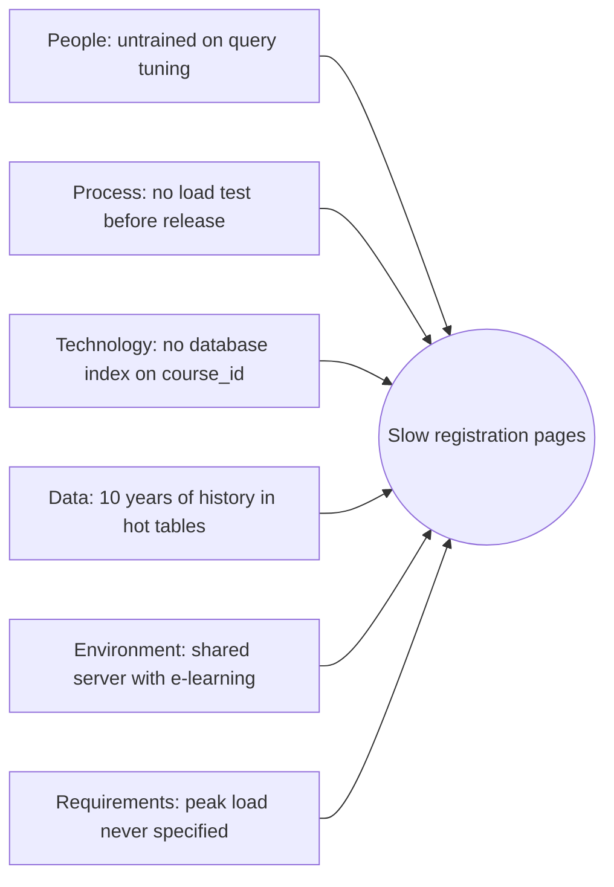

# PM-13 Quality Management

> [!info] Topic card
> **Unit:** U4 · **Time:** 4 h · **Calculator:** `pareto` and `control_limits` in `code/pm_tools.py`. Both examples are asserted in `test_pm12_to_pm16_helpers`. The data are **constructed** for teaching. · Engineering view: [[SD-14 Software Testing, Verification and Validation]]

## 1. Learning objectives
1. **Define** quality ("conformance to requirements" and "fitness for use") and **distinguish** quality from grade.
2. **Describe** the three processes: plan quality management, manage quality (assurance), control quality.
3. **Classify** the costs of quality (prevention, appraisal, internal failure, external failure), and **argue** for prevention.
4. **Use** quality tools: Pareto charts, control charts, cause-and-effect (fishbone) diagrams, checklists, histograms.
5. **Define** quality metrics for IS projects, and **relate** them to standards (ISO 9001, ISO/IEC 25010, CMMI).

## 2. Why it matters
A registration system that's delivered on time but crashes under load, or miscalculates timetable clashes, isn't a success. Quality is cheapest to build in and most expensive to inspect in at the end. For IS projects, the most expensive failures (external failures) happen in front of users, on the busiest day.

## 3. Prerequisites
[[PM-04 Scope Management, Requirements Traceability and WBS]] (acceptance criteria) · [[SD-01 Software Engineering Fundamentals]] (ISO/IEC 25010) · Basic statistics (mean, standard deviation) from [[DM-18 Introductory Discrete Probability]].

## 4. Intuition
Quality is **meeting the promise**: the requirements, plus the user's reasonable expectations. **Grade** is the category of features. A basic but reliable system is low grade and high quality, and that's acceptable. A feature-rich but buggy one is high grade and low quality, and that isn't.

## 5. Rigorous explanation

### 5.1 Processes
1. **Plan quality management:** standards, metrics, acceptance criteria, reviews and tests, roles. Output: the quality management plan and the metrics.
2. **Manage quality (quality assurance):** are we following the right processes? Process audits, reviews, root-cause analysis, process improvement. It's about the **process**.
3. **Control quality:** do the deliverables meet the requirements? Inspection, testing, measurement against the metrics. It's about the **product**. Its outputs are verified deliverables, and they feed scope validation (customer acceptance).

### 5.2 Cost of quality (COQ)
| Category | Examples (IS) |
|---|---|
| **Prevention** (cost of conformance) | Training, coding standards, design reviews, test automation set-up |
| **Appraisal** (cost of conformance) | Testing, code reviews, inspections, audits |
| **Internal failure** (cost of non-conformance) | Rework of defects found before release, re-testing |
| **External failure** (cost of non-conformance) | Defects found by users: outages, emergency fixes, lost trust, manual workarounds |

Investing in prevention and appraisal reduces failure costs, often by much more than it spends. Defects grow more expensive the later they're found (SD-01).

### 5.3 Quality tools
- **Pareto chart:** categories sorted by frequency, with a cumulative %. The "80/20" pattern: a few causes dominate.
- **Control chart:** a process metric over time with a centre line and control limits (often mean ± 3σ). Points outside the limits, or non-random patterns (e.g. 7 in a row on one side, the "rule of seven"), signal **special causes** worth investigating. Variation inside the limits is **common-cause** variation, inherent to the process.
- **Cause-and-effect (Ishikawa/fishbone) diagram:** categories of possible causes (people, process, technology, data, environment, requirements).
- Checklists, check sheets, histograms, scatter diagrams, flowcharts.

### 5.4 Metrics and standards
- **IS metrics:**
  - defect density (defects per KLOC or per function point);
  - defects found in each test phase;
  - mean time to repair;
  - response-time percentiles;
  - availability;
  - user satisfaction;
  - % of requirements passing acceptance.
- **Standards and models:**
  - ISO 9001 (quality management systems);
  - ISO/IEC 25010 (product quality characteristics: SD-01);
  - CMMI (process maturity levels 1–5);
  - ITIL (service quality, after go-live).

## 6. Terminology
| Term | Meaning |
|---|---|
| Quality vs grade | Degree of meeting requirements vs category of features |
| Precision vs accuracy | Consistency of repeated measurements vs closeness to the true value |
| QA vs QC | Process-focused prevention vs product-focused inspection |
| Common vs special cause | Inherent random variation vs an assignable, unusual cause |
| Control limits vs specification limits | Process capability from data vs customer requirements |
| Gold-plating | Exceeding requirements (it adds cost and risk; it isn't "quality") |

## 7. Step-by-step: a quality plan for CASE-01 (extract)
| Deliverable | Standard / metric | Method | Acceptance |
|---|---|---|---|
| Backend code | PEP 8, peer review, unit tests | Code review checklist; CI | 100% of PRs reviewed; all tests green |
| Registration flow | Response time p95 ≤ 2 s at 2,000 concurrent users | Load test | Passes at 2× the expected peak |
| Data migration | Record counts and a 200-record sample | Reconciliation script | 100% of counts match; 0 errors in the sample |
| Timetable clash rule | Zero clashes for registered students | Test cases from the decision table | All cases pass |
| Whole system | UAT by the registry | Scripted UAT with the registrar's sign-off | Every Must requirement passes |

## 8. Diagram: cause and effect for "slow registration pages"

## 9. Worked examples

### Example 1 (basic): Pareto of help-desk tickets in the pilot (tested)
| Category | Count | Cumulative % |
|---|---|---|
| Validation errors | 42 | 46.7 |
| Login problems | 18 | 66.7 |
| Slow pages | 12 | 80.0 |
| Wrong timetable | 9 | 90.0 |
| UI confusion | 6 | 96.7 |
| Other | 3 | 100.0 |

Three categories account for **80%** of the tickets. Fix the validation messages first (clearer rules, inline hints): that's 47% of all tickets.

### Example 2 (intermediate): control chart for page-load time (tested)
Daily average registration-page load times in the pilot (seconds): 1.6, 1.8, 1.7, 1.9, 1.5, 1.8, 1.7, 2.0, 1.6, 1.8, 1.9, 1.7.
- Mean = **1.75 s**.
- With the sample standard deviation, the limits are LCL = **1.316 s** and UCL = **2.184 s**. All the points are within them, so the process is **in statistical control** (only common-cause variation).
- But the **specification** is p95 ≤ 2 s for *individual* requests, and these are *daily averages*. Being in control isn't the same as meeting the specification. Measure the right thing: per-request percentiles.

### Example 3 (challenging): the cost-of-quality argument
Defect data from a comparable past project: 120 defects reached users, at an average external-failure cost of about TZS 150,000 each (support time, emergency fixes, staff overtime), so **18 M**. A proposal for CASE-01:
- test automation and code reviews (prevention + appraisal), about **4 M**;
- expected to catch 75% of those defects before release, where an internal fix costs about TZS 30,000 each.

New expected costs:
- external: 30 × 150,000 = **4.5 M**;
- internal: 90 × 30,000 = **2.7 M**;
- prevention + appraisal: **4 M**.

Total **11.2 M**, against 18 M: a saving of about **6.8 M**. (These figures are illustrative assumptions. The structure of the argument is the lesson.)

## 10. Application: QA vs QC in CASE-01
- **QA:** a fortnightly process audit. Are PRs reviewed? Are the tests written before merging? Is the RTM updated? Corrective action if not.
- **QC:** the sprint reviews verify the increments against the acceptance criteria; the load test; the migration reconciliation; UAT.
- **Scope validation:** the registrar's formal acceptance of the QC-verified deliverables ([[PM-04 Scope Management, Requirements Traceability and WBS]]).

## 11. Common mistakes
| Mistake | Fix |
|---|---|
| Testing only at the end | Plan quality from the start: reviews, CI, early load tests |
| Confusing grade with quality | Low grade can be high quality |
| Treating control limits as specification limits | Specifications come from requirements; control limits come from data |
| Gold-plating as "extra quality" | Meet the requirements; extras need change control |
| Measuring averages when the requirement is about percentiles | Measure what the requirement states |
| QA and QC done by the same person on their own work | Independence: peer review, a separate tester |

## 12. Comparison: QA vs QC
| | Quality assurance | Quality control |
|---|---|---|
| Focus | Process | Product |
| Timing | Throughout (preventive) | On deliverables (detective) |
| Question | Are we doing things right? | Are the results right? |
| Examples | Audits, process reviews, standards | Testing, inspection, measurement |

## 13. Practice
**L1** 1. Quality vs grade? 2. Name the four cost-of-quality categories.

**L2** 3. Classify: (a) a unit-test framework set-up; (b) a bug found in UAT; (c) a production outage on registration day; (d) a code review. 4. What does a point above the UCL mean?

**L3** 5. Draw a fishbone diagram for "migration errors". 6. Build a Pareto chart (with `pareto`) for these defect types: logic 25, UI 40, data 15, performance 10, security 5, other 5.

**L4** 7. Data: 8 consecutive daily load times are all above the mean, but inside the limits. Interpret this. 8. Write 5 quality metrics, with targets, for CASE-02 (inventory).

**L5** 9. Write a quality management plan for your FYP software: standards, metrics, QA activities, QC activities, acceptance criteria.

## 14. Hints
> [!tip]- Hints
> 3: prevention, internal failure, external failure, appraisal. 7: the rule of seven, so look for a special cause (a new release? more users?). 6: UI is first (40%), and UI + logic make 65%.

## 15. Worked solutions
> [!success]- Solutions 1–2
> 1. Quality: the degree to which characteristics meet the requirements. Grade: the category or rank of features (e.g. a basic vs premium edition). 2. Prevention, appraisal, internal failure, external failure.

> [!success]- Solution 3
> (a) Prevention. (b) Internal failure (found before release to users; UAT is still pre-production). (c) External failure. (d) Appraisal.

> [!success]- Solution 4
> The process produced a value unlikely to come from common-cause variation alone (with 3σ limits, roughly 0.3% chance under normality). Investigate for a **special cause** (e.g. a backup job running at the same time, or a new code release).

> [!success]- Solution 6
> `pareto({"logic": 25, "UI": 40, "data": 15, "performance": 10, "security": 5, "other": 5})` gives UI 40 (40%), logic 25 (65%), data 15 (80%), performance 10 (90%), then other 5 (95%) and security 5 (100%) in alphabetical order for the tie. **Note:** Pareto ranks by count, but security defects deserve priority by **severity** despite the low count. Weight by impact where it matters.

> [!success]- Solution 7
> A run of 7 or more consecutive points on one side of the centre line is a non-random pattern (a common "rule of seven" signal). It suggests a **shift** in the process (a special cause), even though no point breaches a limit. For example, a new release on the day the run started, or more users after a faculty joined. Investigate, then either fix it or re-baseline the chart if the shift is intended.

## 16. Self-test (pass ≥ 4/5)
1. Is QA process-focused or product-focused? 2. Which COQ category is the most expensive per defect? 3. What does a Pareto chart reveal? 4. Control vs specification limits? 5. Name two IS quality metrics.
> [!success]- Answers
> 1. Process. 2. External failure. 3. The few categories that account for most of the problems. 4. Control limits describe process behaviour from data; specification limits are the customer's requirements. 5. Defect density, p95 response time, availability, defects per test phase, user satisfaction (any two).

## 17. Flashcards
#flashcards/project-management
Quality vs grade?::Meeting requirements vs category of features.
Cost of quality categories?::Prevention, appraisal (conformance); internal and external failure (non-conformance).
QA vs QC?::Process assurance (prevent) vs product inspection (detect).
Control chart signal?::A point beyond the limits, or a non-random run (e.g. 7 on one side).
Pareto principle?::A few causes account for most of the effects (about 80/20).

## 18. Blank-page recall
Draw the fishbone diagram for slow pages, and the COQ table with IS examples.

## 19. Revision summary
- Quality = conformance and fitness for use (not grade). Plan → manage (QA, process) → control (QC, product) → validate scope.
- The cost of quality favours prevention and appraisal over failure.
- Tools: Pareto (focus), control charts (stability), fishbone (causes), checklists.
- IS metrics: defects, response percentiles, availability, satisfaction. Standards: ISO 9001, ISO/IEC 25010, CMMI.

## 20. Links
Prev: [[PM-12 Stakeholder and Communication Management]] · Next: [[PM-14 Procurement and Change Management]] · Related: [[SD-14 Software Testing, Verification and Validation]], [[X-04 Testing as Software Quality Assurance]], [[SD-15 Refactoring, Technical Debt, Code Review and Quality]]

## 21. Sources
- PMI, *PMBOK® Guide*, 6th ed., 2017, chapter 8 (Project Quality Management).
- Crosby, P. B., *Quality Is Free*, McGraw-Hill, 1979; Juran, J. M., *Juran's Quality Handbook*, 7th ed., McGraw-Hill, 2016.
- Montgomery, D. C., *Introduction to Statistical Quality Control*, 8th ed., Wiley, 2019 (control charts; proper control-limit methods for individuals charts use moving ranges).
- ISO 9001:2015; CMMI Institute, *CMMI* (current version).
- *(Not checked online during the build, because there was no network access.)*

## 22. Mastery checklist
- [ ] I can distinguish quality and grade, and QA and QC
- [ ] I can argue cost of quality with numbers
- [ ] I can build Pareto and control charts and interpret them
- [ ] Reviews scheduled
