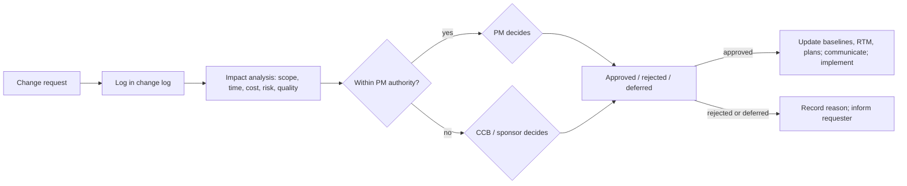

# PM-14 Procurement and Change Management

> [!info] Topic card
> **Unit:** U4 · **Time:** 4 h · **Calculator:** `fpif_pta` and `fpif_final_price` in `code/pm_tools.py`. The incentive-contract example is asserted in `test_pm12_to_pm16_helpers`. · **Artefact:** [[PM-A10 Change Request]]

> [!warning] Public procurement rules
> Public institutions in Tanzania (including public universities) must follow the national public procurement law and the rules of the regulator, the Public Procurement Regulatory Authority (PPRA). Thresholds, methods and approval procedures are set there. Check the **current** Act, Regulations and institutional procurement manual before planning any real purchase. This lesson teaches general principles.

## 1. Learning objectives
1. **Perform** a make-or-buy analysis, including break-even and non-financial factors.
2. **Compare** contract types (fixed-price, cost-reimbursable, time-and-materials) by risk allocation, and **calculate** incentive-fee outcomes and the point of total assumption.
3. **Describe** the procurement process: requirements, solicitation documents (RFI/RFP/RFQ), evaluation criteria, selection, contract administration, closure.
4. **Run** integrated change control: change requests, impact analysis, the change control board, baseline updates, configuration management.
5. **Distinguish** project change control from organisational change management.

## 2. Why it matters
IS projects buy a lot: hardware, licences, cloud services, consultants, entire systems. The contract type decides who carries the risk of overruns. Changes are inevitable. Without disciplined change control, scope creeps, budgets break, and nobody can explain why.

## 3. Prerequisites
[[PM-04 Scope Management, Requirements Traceability and WBS]] (scope baseline) · [[PM-11 Risk Management]] (risk transfer) · [[PM-09 Cost Estimation and Budgeting]] (TCO).

## 4. Intuition
A contract is a **risk-sharing agreement**. With fixed price, the seller carries the cost risk, so they price it in. With cost-plus, the buyer carries it, so the buyer must watch costs. Choose the type according to how well the scope is defined. A change request is a **mini business case** for altering the plan.

## 5. Rigorous explanation

### 5.1 Make or buy
Compare the total costs over the relevant period, then the non-financial factors:
- capability and capacity;
- control of IP, data and security;
- strategic importance;
- vendor lock-in;
- support availability;
- time to market.

Break-even: when does making (a high fixed cost, a lower running cost) become cheaper than buying (a lower fixed cost, a higher running cost)?

### 5.2 Contract types
| Type | Buyer's risk | Seller's risk | Use when |
|---|---|---|---|
| Firm fixed price (FFP) | Low (price fixed) | High | Scope is well defined |
| Fixed price incentive fee (FPIF) | Shared, up to a ceiling | Shared; seller carries all of it above the PTA | Defined scope, but some cost uncertainty |
| Fixed price with economic price adjustment (FP-EPA) | Inflation, exchange-rate risk | Other risks | Long contracts; currency-linked hardware |
| Cost plus fixed fee (CPFF) | High | Low | Uncertain scope (R&D) |
| Cost plus incentive fee (CPIF) | Shared | Shared | Uncertain scope, but cost targets are meaningful |
| Cost plus award fee (CPAF) | High; the award is subjective | Low | Performance is hard to measure objectively |
| Time and materials (T&M) | High (open-ended unless capped) | Low | Staff augmentation; small or undefined work; use a not-to-exceed cap |

**FPIF mechanics.** There's a target cost (TC), a target fee, a target price (TP = TC + fee), a ceiling price (CP), and a share ratio (buyer/seller, e.g. 80/20).
- Fee = target fee + seller share × (TC − actual cost).
- Price = actual cost + fee, capped at CP.
- **Point of total assumption** (PTA) = TC + (CP − TP) / buyer share. Above the PTA, the seller absorbs every extra shilling.

### 5.3 Procurement process
1. **Plan:** a make-or-buy decision; a statement of work (SOW); contract type; evaluation criteria (weighted: technical fit, cost/TCO, vendor experience, support, security); method according to the procurement rules.
2. **Solicit:** RFI (information), RFP (proposals for complex needs), RFQ (quotations for well-defined items). Bidder conferences; answers shared with all bidders equally.
3. **Evaluate and select:** a weighted scoring panel, with documented reasons; due diligence (references, financial stability); negotiation.
4. **Administer:** monitor performance against the SOW and SLAs; inspections; payments by milestone; claims and disputes; contract change control.
5. **Close:** verify the deliverables; final payment; lessons learned on the vendor; archive the records.

### 5.4 Integrated change control
1. **Change request** submitted (by anyone).
2. Logged with an ID.
3. **Impact analysis:** scope, schedule (does it touch the critical path?), cost, quality, risk, resources, contracts.
4. **Decision** by the **change control board (CCB)** or the sponsor, within defined authority levels (e.g. the PM approves changes under 1 week and under 2% of the budget).
5. If approved: update the baselines (scope, schedule, cost), the RTM and the plans; communicate; implement; verify.
6. If rejected or deferred: record the reason, and inform the requester.

**Configuration management:** version control of the deliverables and documents, so everyone works from the approved baseline (Git for code: [[SD-13 Implementation, Code Organization and Version Control]]).

**Organisational change management** (helping people adopt a new system) is a different meaning of "change". See PM-12 §5.5.

## 6. Terminology
| Term | Meaning |
|---|---|
| SOW | Statement of work: what the seller must deliver |
| RFI / RFP / RFQ | Request for information / proposal / quotation |
| Target cost, target fee, ceiling price | FPIF parameters |
| PTA | Point of total assumption: the cost above which the seller bears all overruns |
| CCB | Change control board |
| Change log | A register of all change requests and their status |
| Configuration item | A deliverable under version and change control |

## 7. Step-by-step: make-or-buy for CASE-01 hosting
**Buy** (cloud hosting): TZS 1.2 M a month, no set-up cost. **Make** (on-premises servers): TZS 20 M up front (hardware, licences, installation), plus 0.4 M a month (power, support, backups).
- Break-even month $m$: $20 + 0.4m = 1.2m$, so $0.8m = 20$, so **$m = 25$ months**.
- If the system will run for more than about 2 years, making is cheaper on cost alone.
- **Non-financial factors:**
  - power reliability on campus;
  - in-house skills;
  - data-location requirements ([[CS-19 Cloud Security and Privacy]]);
  - elasticity on registration day (cloud scales; on-premises must be sized for the peak).

**Decision:** on-premises for the core database (data location, long life), plus cloud burst capacity for registration-day web traffic. Record it in a decision log.

## 8. Diagram: integrated change control

## 9. Worked examples

### Example 1 (basic): choose the contract type
| Purchase | Type | Reason |
|---|---|---|
| 20 identical lab PCs, with a specification | FFP | Well defined; competitive quotes |
| Building a novel timetable-optimisation module | CPIF, or T&M with a cap | Uncertain scope; share the risk; incentivise efficiency |
| Two months of a database consultant's time | T&M with a not-to-exceed amount | Staff augmentation |
| Imported servers priced in USD, with delivery in 9 months | FP-EPA | Exchange-rate risk |

### Example 2 (intermediate): FPIF outcomes (tested)
Target cost 40 M; target fee 4 M; target price 44 M; ceiling price 48 M; share 80/20 (buyer/seller).
- **Actual 38 M** (under target): fee = 4 + 0.2 × 2 = 4.4 M, so **price 42.4 M**. Both parties gain.
- **Actual 42 M**: fee = 4 + 0.2 × (−2) = 3.6 M, so **price 45.6 M**.
- **PTA** = 40 + (48 − 44)/0.8 = **45 M**.
- **Actual 46 M** (above the PTA): fee would be 2.8 M, so the price would be 48.8 M, but it's **capped at 48 M**. The seller's real profit is 48 − 46 = 2 M, and each further shilling of cost comes out of the seller's profit.

### Example 3 (challenging): a change request through the process
**Request** (the dean of engineering, week 9): "Add a report of students registered per course with their phone numbers, for SMS reminders."

**Impact analysis:**
- **Scope:** a new report plus SMS integration. SMS was explicitly *excluded* in the scope statement.
- **Schedule:** 1 week of developer time in E (critical!), so +1 week to go-live, unless descoped elsewhere.
- **Cost:** about 0.8 M (development), plus SMS charges (recurring).
- **Risk/quality:** phone numbers are personal data, so check the privacy basis ([[CS-19 Cloud Security and Privacy]]). It adds testing to G.
- **Alternatives:** export the course lists without phone numbers now; SMS in release 2, as planned.

**CCB decision:** **defer** the SMS feature to release 2; **approve** a simple course list report (no personal contact data) for 0.2 M, using F's float (non-critical, so no impact on go-live). The change log, the RTM and the communication to the dean are all updated. (The full form is in [[PM-A10 Change Request]].)

## 10. Application: vendor evaluation for CASE-01 servers
Weighted criteria:
- technical compliance (30%);
- 5-year TCO (30%);
- delivery time (15%);
- local support (15%);
- vendor references (10%).

Score 3 bids, and record the scores and reasons per evaluator. Declare and manage conflicts of interest. Follow the institution's procurement procedures and the approval thresholds under the procurement law.

## 11. Common mistakes
| Mistake | Fix |
|---|---|
| Fixed-price contracts for vague scope | Define the scope first, or use cost-reimbursable/T&M with caps |
| T&M without a cap | A not-to-exceed amount, with regular reviews |
| Choosing on purchase price, not TCO | Evaluate the 5-year TCO, support and risk |
| Informal changes ("just add it") | Change requests, impact analysis, a decision, baseline updates |
| Approving changes without checking the critical path | Schedule impact via the network (PM-06) |
| Unequal information to bidders | Share all answers with all bidders |

## 12. Comparison: fixed price vs cost-reimbursable vs T&M
| | Fixed price | Cost-reimbursable | T&M |
|---|---|---|---|
| Cost risk on | Seller | Buyer | Buyer (unless capped) |
| Scope clarity needed | High | Low | Low |
| Buyer oversight effort | Low–medium | High (audit the costs) | High (monitor the hours) |
| Seller's incentive to control cost | Strong | Weak (unless there's an incentive fee) | Weak |

## 13. Practice
**L1** 1. Which contract type gives the buyer the least cost risk? 2. What does an RFQ request?

**L2** 3. Compute the make-or-buy break-even: buy 2 M/month; make 30 M up front + 0.5 M/month. 4. Name 5 steps in integrated change control.

**L3** 5. FPIF: TC 100, fee 10, CP 120, share 70/30. Compute the PTA, and the price at an actual cost of 110. 6. Write evaluation criteria and weights for selecting a point-of-sale vendor (CASE-03).

**L4** 7. Write the impact analysis for "add a mobile app" in week 12 of CASE-01. 8. Argue for and against T&M for the CASE-01 backend development.

**L5** 9. Draft a statement of work (SOW) for outsourcing CASE-01 data migration: scope, deliverables, acceptance criteria, schedule, payment milestones, and the contract type, with a justification.

## 14. Hints
> [!tip]- Hints
> 3: 30 + 0.5m = 2m, so m = 20. 5: TP = 110; PTA = 100 + (120 − 110)/0.7 = 114.29; fee at 110 = 10 + 0.3 × (−10) = 7, so the price is 117. 7: check the scope exclusions, the critical path, the budget, the reserves and the risks.

## 15. Worked solutions
> [!success]- Solutions 1–2
> 1. Firm fixed price (FFP). 2. Price quotations for clearly specified goods or services.

> [!success]- Solution 3
> 30 + 0.5m = 2m, so 1.5m = 30, so **m = 20 months**. After 20 months, making is cheaper.

> [!success]- Solution 4
> Submit and log the request → impact analysis → decision (PM within authority, or CCB) → update baselines and plans → communicate → implement and verify (the change log is updated throughout).

> [!success]- Solution 5
> TP = 110. **PTA** = 100 + (120 − 110)/0.7 = **114.29**. At an actual cost of 110: fee = 10 + 0.3 × (100 − 110) = 7, so the **price is 117** (below the 120 ceiling). Check: `fpif_pta(100, 10, 120, 0.7)` gives 114.2857…; `fpif_final_price(110, 100, 10, 120, 0.7)` gives 117.0.

> [!success]- Solution 7
> - **Scope:** the mobile app is explicitly excluded (release 2), so this is a major addition: new WBS elements (design, build, test, app-store publication).
> - **Schedule:** at least 6–8 weeks of new work, partly parallel, plus integration on the critical path. Go-live would slip beyond semester start (week 22), which is unacceptable.
> - **Cost:** about 10–15 M, beyond the contingency (most of it already used, PM-10).
> - **Risk:** new technology, store approval delays, security.
>
> **Recommendation:** reject it for release 1; plan it as a separate project or release 2, with its own business case. Offer a mobile-responsive web UI (already within F's scope) as the interim solution.

> [!success]- Solution 8
> **For T&M:** the backend scope (registration rules) may still change, and T&M avoids pricing that uncertainty into a fixed-price premium. Changes are easy. **Against:** the buyer carries all the cost risk, the seller has little incentive to be efficient, and close monitoring of hours is needed. **Compromise:** T&M with a not-to-exceed cap, weekly progress reviews against EV (PM-10), and a switch to fixed price for well-defined later phases. Or CPIF, to share any savings.

## 16. Self-test (pass ≥ 4/5)
1. What's the PTA? 2. When is a cost-plus contract appropriate? 3. Who decides on changes beyond the PM's authority? 4. Why compare on TCO? 5. Project change control vs organisational change management?
> [!success]- Answers
> 1. The cost level above which the seller absorbs all further overruns in an FPIF contract. 2. When the scope is uncertain or exploratory (R&D). 3. The change control board, or the sponsor. 4. Running costs over the life of the system can exceed the purchase price. 5. Controlling changes to the baselines vs helping people adopt a new way of working.

## 17. Flashcards
#flashcards/project-management
FFP risk?::The seller carries the cost risk; it needs well-defined scope.
PTA formula?::Target cost + (ceiling price − target price) / buyer share.
T&M safeguard?::A not-to-exceed cap and regular reviews.
Integrated change control steps?::Request → log → impact analysis → decide → update baselines → communicate → implement.
Make-or-buy break-even?::Fixed_make + run_make × m = fixed_buy + run_buy × m, solved for m.

## 18. Blank-page recall
Draw the change control flow, and redo the FPIF example (38 / 42 / 46 M).

## 19. Revision summary
- Make or buy: TCO, break-even, plus control, skills, data location and lock-in.
- Contract types allocate risk: FFP (seller), cost-plus (buyer), T&M (buyer, so cap it), FPIF (shared up to the PTA).
- Procurement: SOW → RFI/RFP/RFQ → weighted evaluation → contract administration → closure, within public procurement law.
- Integrated change control protects the baselines. Analyse the impact (especially on the critical path) before deciding.

## 20. Links
Prev: [[PM-13 Quality Management]] · Next: [[PM-15 Team Leadership and Conflict Management]] · Artefact: [[PM-A10 Change Request]] · Related: [[PM-04 Scope Management, Requirements Traceability and WBS]], [[SD-13 Implementation, Code Organization and Version Control]], [[PM-CASE-02 Wholesale Inventory Management System]]

## 21. Sources
- PMI, *PMBOK® Guide*, 6th ed., 2017, chapters 4.6 (Perform Integrated Change Control) and 12 (Project Procurement Management).
- Schwalbe, K., *Information Technology Project Management*, 9th ed., Cengage, 2019, chapter 12.
- Public Procurement Regulatory Authority (PPRA), Tanzania: https://www.ppra.go.tz/ (consult the current procurement Act and Regulations).
- *(Not checked online during the build, because there was no network access.)*

## 22. Mastery checklist
- [ ] I can do make-or-buy with a break-even and qualitative factors
- [ ] I can choose contract types and compute FPIF outcomes and the PTA
- [ ] I can run a change request through integrated change control
- [ ] Reviews scheduled
