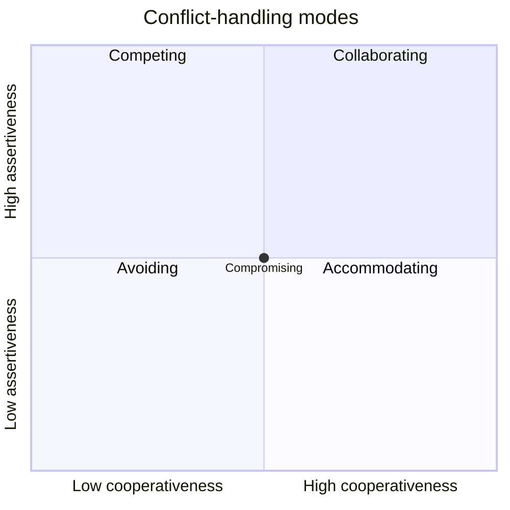

# PM-15 Team Leadership and Conflict Management

> [!info] Topic card
> **Unit:** U5 · **Time:** 3 h · **Related artefact:** the RACI in [[PM-08 Resource Allocation and Levelling]] §10

## 1. Learning objectives
1. **Describe** team development stages (Tuckman), and **choose** leadership behaviours for each.
2. **Apply** motivation theories (Maslow, Herzberg, McClelland, expectancy theory) to IS project teams.
3. **Identify** sources of conflict in projects, and **select** a conflict-handling mode (Thomas–Kilmann) for a situation.
4. **Compare** leadership styles and sources of power, and **use** them appropriately in a matrix organisation.
5. **Lead** virtual and hybrid teams, and give effective feedback.

## 2. Why it matters
Projects are delivered by people. Technical plans fail when teams don't trust each other, when conflicts fester, or when part-time members prioritise their departments. A PM in a weak matrix (PM-01) has little formal authority, so leadership, motivation and conflict skills are often the PM's most important tools.

## 3. Prerequisites
[[PM-12 Stakeholder and Communication Management]] · [[PM-01 Project Fundamentals and Organizational Context]] (organisational structures).

## 4. Intuition
A new team is like a new football squad: talented individuals don't play as a team until they've argued about positions, agreed on tactics and practised together. The PM's role changes from **directing** at the start, to **facilitating** the arguments, to **delegating** once the team performs.

## 5. Rigorous explanation

### 5.1 Team development (Tuckman, 1965; with "adjourning" added in 1977)
| Stage | Behaviour | PM's leadership |
|---|---|---|
| Forming | Polite, uncertain, dependent | Directing: clear goals, roles (RACI), ground rules |
| Storming | Conflict over roles, methods, priorities | Coaching: surface the conflict, facilitate, set the decision process |
| Norming | Agreement on how to work | Supporting: reinforce the norms, involve the team in decisions |
| Performing | Interdependent, self-organising, productive | Delegating: remove obstacles, protect the team |
| Adjourning | Closure, sometimes anxiety about what's next | Recognise contributions, capture lessons, support transitions |

Teams can move backwards (a new member, a new crisis).

### 5.2 Motivation
- **Maslow:** a hierarchy of needs (physiological → safety → belonging → esteem → self-actualisation). A team worried about contract renewal (safety) won't be motivated by "exciting challenges" alone.
- **Herzberg:**
  - **hygiene factors** (pay, conditions, policies) prevent dissatisfaction;
  - **motivators** (achievement, recognition, responsibility, growth) create satisfaction.
- **McClelland:** needs for achievement, affiliation and power, which differ by person.
- **Expectancy theory (Vroom):** motivation = expectancy (effort leads to performance) × instrumentality (performance leads to reward) × valence (the reward is valued). If any factor is zero, motivation is zero.
- **Practical:** recognition in front of their line managers, learning opportunities, autonomy over *how*, and clear goals.

### 5.3 Conflict
**Common sources** (in rough order of frequency in classic studies): schedules, priorities, resources, technical opinions, procedures, cost, personalities. Most conflicts are about the work, not about personality.

**Thomas–Kilmann modes** (assertiveness × cooperativeness):

| Mode | When appropriate |
|---|---|
| **Collaborating** (problem-solving) | Important issues, time available, a win-win needed. Usually the best for long-term relationships |
| **Compromising** | Moderate importance, equal power, a temporary solution needed |
| **Accommodating** (smoothing) | The issue matters more to the other party; to preserve the relationship |
| **Avoiding** (withdrawing) | A trivial issue, or a cooling-off period is needed |
| **Competing** (forcing) | An emergency, safety or legal issues, an unpopular but necessary decision |

### 5.4 Power and leadership styles
- **Sources of power:** legitimate (position), reward, coercive, expert, referent (respect/charisma). In a matrix, the PM relies on **expert** and **referent** power.
- **Styles:**
  - directive, coaching, supportive, delegating (situational leadership);
  - transformational (vision, inspiration);
  - servant leadership (common in agile: remove impediments, serve the team).

### 5.5 Virtual and hybrid teams
- Agreed working hours and response times.
- Video for complex discussions; a shared task board.
- Written decisions.
- Time-zone fairness.
- Deliberate social contact.
- Watch for silent members.

## 6. Terminology
| Term | Meaning |
|---|---|
| Ground rules | Agreed team norms (meetings, communication, decisions) |
| Hygiene factor | Its absence causes dissatisfaction, but its presence doesn't motivate (Herzberg) |
| Expectancy × instrumentality × valence | Vroom's motivation components |
| Collaborating | High assertiveness, high cooperativeness |
| Referent power | Influence from respect or admiration |
| Servant leadership | The leader focuses on enabling the team |

## 7. Step-by-step: resolving a technical conflict
Two developers disagree: one wants a NoSQL database, the other PostgreSQL.
1. **Separate people from the problem:** "Both of you want a reliable, fast system."
2. **Define the criteria:** consistency for registration (no double enrolment), team skills, hosting, reporting needs.
3. **Gather evidence:** a short spike or benchmark, plus the requirements (R-02 clash detection needs joins and transactions).
4. **Decide** using the agreed criteria. Record it in an ADR ([[SD-05 Software Architecture and Architectural Styles]]).
5. **Close:** acknowledge the "losing" option's merits, and commit as a team.

That's **collaborating**, with evidence. If the deadline is tomorrow, the PM or lead may **force** a decision based on the requirements, and explain it.

## 8. Diagram: Thomas–Kilmann modes

## 9. Worked examples

### Example 1 (basic): which mode?
| Situation | Mode |
|---|---|
| A security vulnerability must be fixed before go-live despite a developer's objection | Competing (forcing) |
| Two analysts argue about the colour of a button | Avoiding, or accommodating |
| The registry and ICT disagree about who owns data cleansing, and both are important | Collaborating |
| Two departments each want the same tester for 2 weeks, with equal power | Compromising (split the time) |

### Example 2 (intermediate): diagnosing team stage
Week 3 of CASE-01: frequent arguments in stand-ups about task estimates, and the registry analyst feels the developers ignore the business rules. That's **storming**. **Actions:**
- facilitate an estimation workshop (planning poker);
- clarify roles (the analyst is the voice of the requirements, per the RACI);
- agree a decision rule ("the analyst decides business rules; the developers decide implementation");
- run a retrospective on how the team works.

### Example 3 (challenging): motivation with expectancy theory
A part-time tester from ICT puts in minimal effort. Investigation:
- **expectancy** is low (unclear test procedures, so effort doesn't lead to good results);
- **instrumentality** is low (their line manager evaluates them only on ICT help-desk tickets);
- **valence**: they value professional certification.

**Actions:**
- provide test scripts and training (expectancy);
- agree with the ICT manager that project contributions count in appraisals, and send recognition letters (instrumentality);
- offer to fund an ISTQB Foundation exam on project completion (valence).

## 10. Application: team charter for CASE-01
- **Purpose and goals** (from the project charter).
- **Ground rules:** stand-up at 09:00 (15 min); response within 4 working hours; decisions recorded in the team channel; disagree in the room, commit outside it.
- **Decision rights:** per the RACI.
- **Conflict process:** discuss → facilitate (scrum master or PM) → escalate to the sponsor if still blocked after 2 working days.
- **Recognition:** sprint review shout-outs; a letter to line managers at each milestone.

## 11. Common mistakes
| Mistake | Fix |
|---|---|
| Treating conflict as bad | Productive task conflict improves decisions; manage it |
| Always compromising | Collaborate on important issues; compromise can leave both sides unhappy |
| Using position power in a matrix | Build expert and referent power |
| Assuming money motivates everyone | Find out what each person values |
| Skipping recognition | Recognise people publicly and to their line managers |
| Ignoring silent remote members | Rotate speaking turns; have one-to-ones |

## 12. Comparison: leadership styles
| Style | Focus | Fits |
|---|---|---|
| Directive | Clear instructions | Forming teams, crises |
| Coaching | Develop skills plus direction | Storming, new members |
| Supportive | Involvement, encouragement | Norming |
| Delegating | Autonomy | Performing teams |
| Servant | Remove impediments, enable | Agile teams |
| Transformational | Vision, inspiration | Change-heavy projects |

## 13. Practice
**L1** 1. Name Tuckman's five stages. 2. Name Herzberg's two factor types.

**L2** 3. Choose a conflict mode for 4 situations of your own. 4. List five sources of project conflict.

**L3** 5. Write a team charter for your FYP group. 6. Apply expectancy theory to a disengaged team member in a student project.

**L4** 7. In CASE-01, the registry analyst and the lead developer have a personal conflict that's affecting the team. Plan an intervention. 8. Compare servant and directive leadership for an agile CASE-03 team.

**L5** 9. Reflect on a team you've been in: identify its stages, conflicts, motivation factors and leadership, and what you'd do differently, with theories cited.

## 14. Hints
> [!tip]- Hints
> 2: hygiene, motivators. 7: separate the people from the issues; private conversations first; joint problem-solving on the work issue; ground rules; escalate if behaviour continues. 8: team maturity and self-organisation.

## 15. Worked solutions
> [!success]- Solutions 1–2
> 1. Forming, storming, norming, performing, adjourning. 2. Hygiene factors (e.g. pay, working conditions), which prevent dissatisfaction, and motivators (e.g. achievement, recognition), which create satisfaction.

> [!success]- Solution 4
> Schedules, priorities, resources (staff time), technical opinions, administrative procedures, cost, personalities (any five).

> [!success]- Solution 7
> 1. **Private one-to-ones** with each, to understand their perspective (the analyst feels disrespected; the developer feels micromanaged). 2. Identify the **work issue** underneath: unclear decision rights on business rules. 3. **Joint meeting**, facilitated: agree that the analyst owns the business rules and the developer owns the implementation (update the RACI); agree communication norms. 4. **Monitor**, and recognise improvements. 5. If unprofessional behaviour continues, involve their line managers. The focus throughout is on behaviour and the work, never on personality judgements.

> [!success]- Solution 8
> **Servant leadership** fits a mature, self-organising agile team. The PM or scrum master removes impediments, shields the team from interruptions, and coaches it, while the team decides *how* to work. **Directive leadership** may be needed briefly for a new or struggling team, or in a crisis (a production outage on go-live day). A good leader adapts the style to the team's maturity (situational leadership).

## 16. Self-test (pass ≥ 4/5)
1. The stage with the most conflict? 2. The mode that's best for important issues when there's time? 3. Which power a PM in a weak matrix should rely on? 4. What's valence? 5. Give one ground rule for virtual teams.
> [!success]- Answers
> 1. Storming. 2. Collaborating. 3. Expert and referent power. 4. The value a person places on the reward. 5. Agreed response times, core overlap hours, written decisions (any one).

## 17. Flashcards
#flashcards/project-management
Tuckman stages?::Forming, storming, norming, performing, adjourning.
Thomas–Kilmann modes?::Competing, collaborating, compromising, avoiding, accommodating.
Herzberg?::Hygiene factors prevent dissatisfaction; motivators create satisfaction.
Expectancy theory?::Motivation = expectancy × instrumentality × valence.
Most common source of project conflict (classic studies)?::Schedules (and priorities).

## 18. Blank-page recall
Draw the Tuckman table with leadership styles, and the conflict-modes quadrant.

## 19. Revision summary
- Teams develop through forming, storming, norming, performing and adjourning; adapt your leadership at each stage.
- Motivation: Maslow, Herzberg, McClelland, Vroom. Find out what each person values.
- Conflict is usually about the work: collaborate on important issues; force only when necessary.
- In matrix organisations, lead through expertise, respect, recognition and clear decision rights.

## 20. Links
Prev: [[PM-14 Procurement and Change Management]] · Next: [[PM-16 Agile, Scrum and Hybrid Delivery]] · Related: [[PM-12 Stakeholder and Communication Management]], [[FYP-12 Presentation, Defense and Working with Supervisor Feedback]]

## 21. Sources
- Tuckman, B. W., "Developmental sequence in small groups", *Psychological Bulletin*, 63(6), 1965, pp. 384–399; Tuckman, B. W. & Jensen, M. A. C., "Stages of small-group development revisited", *Group & Organization Studies*, 2(4), 1977, pp. 419–427.
- Herzberg, F., Mausner, B. & Snyderman, B., *The Motivation to Work*, Wiley, 1959; Vroom, V. H., *Work and Motivation*, Wiley, 1964.
- Thomas, K. W. & Kilmann, R. H., *Thomas–Kilmann Conflict Mode Instrument*, 1974.
- Thamhain, H. J. & Wilemon, D. L., "Conflict management in project life cycles", *Sloan Management Review*, 16(3), 1975, pp. 31–50.
- *(Not checked online during the build, because there was no network access.)*

## 22. Mastery checklist
- [ ] I can diagnose team stage and adapt my leadership
- [ ] I can apply motivation theories to real situations
- [ ] I can select and justify conflict modes
- [ ] Reviews scheduled
