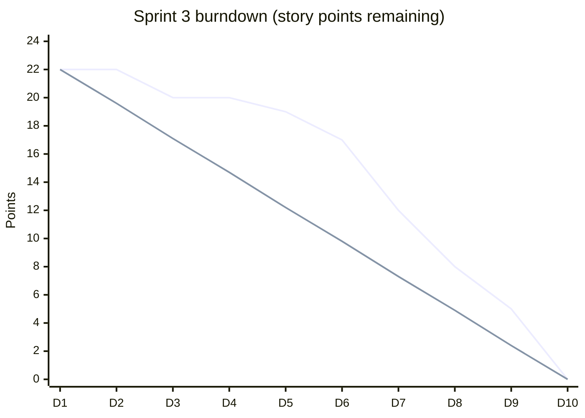

# PM-16 Agile, Scrum and Hybrid Delivery

> [!info] Topic card
> **Unit:** U5 · **Time:** 4 h · **Calculator:** `sprints_needed` in `code/pm_tools.py` (tested). · Engineering view: [[SD-02 Software Process Models]], [[SD-04 Use Cases, User Stories and Traceability]]

## 1. Learning objectives
1. **Explain** the agile values and principles, and when agile suits an IS project.
2. **Describe** Scrum's accountabilities, events and artefacts, and Kanban's practices.
3. **Estimate** with story points, and **forecast** releases from velocity ranges.
4. **Read** burndown and burnup charts, and **detect** problems from them.
5. **Design** a hybrid approach that combines agile delivery with plan-driven governance (budget, contracts, stage gates).

## 2. Why it matters
Many organisations use agile for software work while their finance, procurement and governance stay plan-driven. PMs must translate between the two: sprints and velocity for the team, dates and budgets for the sponsor. Knowing how to forecast honestly from velocity, and how to read a burndown chart, is essential.

## 3. Prerequisites
[[PM-02 Project Lifecycles, Process Groups and Methodologies]] · [[SD-02 Software Process Models]] · [[SD-04 Use Cases, User Stories and Traceability]] (stories and acceptance criteria).

## 4. Intuition
Plan-driven projects fix the **scope** and estimate the time and cost. Agile projects usually fix the **time and cost** (the team and the sprint length), and let the **scope** flex, delivering the most valuable features first. Velocity tells you how much scope fits in the time you have.

## 5. Rigorous explanation

### 5.1 Agile foundations
- The Agile Manifesto's four values (SD-02 §5.3) and 12 principles: early and continuous delivery, welcoming change, frequent delivery, daily collaboration with the business, motivated individuals, face-to-face conversation, working software as the measure of progress, a sustainable pace, technical excellence, simplicity, self-organising teams, regular reflection.
- **Suits:** uncertain requirements, engaged users, a co-located or well-connected team, and work that can be delivered incrementally.
- **Less suited:** fixed regulatory specifications, hardware-heavy work, or customers who can't take part.

### 5.2 Scrum (Scrum Guide, 2020)
- **Accountabilities:**
  - the **product owner** (maximises value; owns and orders the product backlog);
  - the **scrum master** (coaches, removes impediments);
  - the **developers** (create the increment).
- **Events:** the **sprint** (a time-box of up to one month), **sprint planning**, the **daily scrum** (15 min), the **sprint review**, the **sprint retrospective**.
- **Artefacts and their commitments:**
  - the **product backlog** (commitment: the product goal);
  - the **sprint backlog** (commitment: the sprint goal);
  - the **increment** (commitment: the Definition of Done).
- **Kanban:** visualise the workflow, limit WIP, manage flow; measure cycle time and throughput.

### 5.3 Estimation and forecasting
- **Story points:** a relative measure of size, complexity and uncertainty (often Fibonacci-like: 1, 2, 3, 5, 8, 13), estimated by the team (e.g. planning poker).
- **Velocity:** the points completed per sprint. It's a team-specific planning tool, not a productivity metric to compare teams with.
- **Release forecast:** remaining points ÷ velocity, given as a **range**:
  - optimistic: the highest recent velocity;
  - expected: the mean;
  - pessimistic: the lowest.
- **Burndown chart:** remaining work vs time, with an ideal line. **Burnup chart:** completed work and total scope vs time, which shows scope changes explicitly.

### 5.4 Hybrid delivery
- Plan-driven **outer frame:** business case, charter, budget, procurement and contracts, release stage gates, risk register.
- Agile **inner engine:** sprints for software features; the backlog ordered by value; reviews with stakeholders.
- **Bridges:**
  - map epics to WBS deliverables;
  - track scope against the release plan (a burnup);
  - report progress in EV terms if needed (agile EVM: planned value from planned points × cost per point);
  - put change control at the epic or release level, while stories change freely within sprints.

## 6. Terminology
| Term | Meaning |
|---|---|
| Product goal / sprint goal | The long-term objective / the objective of one sprint |
| Definition of Done | The shared quality criteria for the increment |
| Story points | A relative estimate of size |
| Velocity | Points completed per sprint |
| Burndown / burnup | Remaining work / completed work (and scope) over time |
| WIP limit | The maximum number of items in a workflow stage |
| Cycle time | The time from starting an item to finishing it |

## 7. Step-by-step: forecasting the CASE-01 student portal release
- The backlog for the student-facing features (part of F and its follow-ons) is estimated at **120 points**.
- The last four sprints' velocities were **18, 22, 20 and 24** (mean 21).
- `sprints_needed(120, [18, 22, 20, 24])` gives **(5, 6, 7) sprints**: optimistic 120/24 = 5; expected 120/21 = 5.71, so 6; pessimistic 120/18 = 6.67, so 7.
- With 2-week sprints, that's 10–14 weeks. Report it to the sponsor as **"most likely 12 weeks, range 10–14"**, with the lowest-priority features (the "Could" items) as the flex if the date is fixed.

## 8. Diagram: a sprint burndown (constructed example)

*Text version: the first line is the actual remaining work and the second is the ideal straight line. The actual line stays flat for days 1–5, and well above the ideal, then drops steeply on days 7–10. That suggests stories were too large or blocked early, and were finished in a rush at the end. Discuss it in the retrospective (smaller stories, WIP limits, early integration).*

## 9. Worked examples

### Example 1 (basic): who does what in Scrum?
| Task | Accountability |
|---|---|
| Order the backlog by value | Product owner |
| Remove a blocker (no test-server access) | Scrum master (facilitates), with the developers |
| Decide how to implement a story | Developers |
| Accept that a story meets its acceptance criteria | Product owner (against the DoD and the criteria) |

### Example 2 (intermediate): burnup with scope change
Sprint by sprint, completed points went 20, 41, 60, 82 (cumulative), while the total scope grew from 120 to 130 to 140. Remaining: 140 − 82 = 58, at about 20.5 points per sprint, so about **3 more sprints**. A burndown chart showing only the remaining work would hide that scope grew by 20 points. The burnup shows it, so the PM can discuss it with the product owner (is the growth approved? does something else come out?).

### Example 3 (challenging): agile EVM bridge
A release is planned for 6 sprints and 120 points, with a cost of TZS 3 M per sprint (BAC = 18 M; 150,000 per point).
- At the end of sprint 3: planned points 60 (PV = 9 M); completed points 54 (EV = 54 × 150,000 = 8.1 M); actual cost 9.6 M (overtime).
- SPI = 8.1/9 = **0.90**; CPI = 8.1/9.6 = **0.84**.

The steering committee gets familiar EVM figures, and the team keeps working in points. (The calculation follows PM-10. Check it with `EVM(18e6, 9e6, 8.1e6, 9.6e6)`.)

## 10. Application: hybrid plan for CASE-01
- **Predictive:** A (requirements baseline), D and H (servers, under a fixed-price contract), I (migration), J and K (UAT and go-live gate).
- **Agile:** B, E, F and G as 2-week sprints, with the registrar's delegate as product owner.
- **Governance:** monthly steering meetings with EVM; change control for any change to the Must requirements or the release date; stories within the epics flex freely.

## 11. Common mistakes
| Mistake | Fix |
|---|---|
| Velocity as a performance target or a team comparison | A team's own planning aid only |
| A single-number release date from average velocity | Give a range (optimistic, expected, pessimistic) |
| A burndown that hides scope growth | Use a burnup |
| Scrum without a Definition of Done | Agree the DoD; no "almost done" |
| "Agile" with no product owner availability | Secure a committed product owner, or don't claim to be agile |
| Hybrid with no bridge between the two worlds | Map epics to the WBS; report in agreed metrics |

## 12. Comparison: Scrum vs Kanban
| | Scrum | Kanban |
|---|---|---|
| Cadence | Fixed-length sprints | Continuous flow |
| Roles | PO, SM, developers | No prescribed roles |
| Change during an iteration | Avoid changing the sprint goal | Any time, within the WIP limits |
| Metrics | Velocity, burndown | Cycle time, throughput, cumulative flow |
| Best for | Product development | Support, operations, maintenance |

## 13. Practice
**L1** 1. Name the three Scrum accountabilities. 2. What's velocity?

**L2** 3. Forecast the sprints for 90 points with velocities 15, 18 and 21. 4. List the five Scrum events.

**L3** 5. Draw a burnup for: scope 100 → 110 → 110 → 120; completed 25, 48, 70, 92. Forecast the finish. 6. Explain why story points are relative.

**L4** 7. Compute agile EVM for: BAC 24 M over 8 sprints and 160 points; after sprint 4, 70 points done, AC 13 M. 8. Design a hybrid approach for CASE-02.

**L5** 9. Run your FYP's build phase as 2-week sprints: create a backlog with points, track velocity over 3 sprints, forecast completion, and present the burndown and burnup charts to your supervisor.

## 14. Hints
> [!tip]- Hints
> 3: 90/21 = 4.3, so 5; 90/18 = 5; 90/15 = 6. 5: remaining 28, at about 23 a sprint, so about 2 sprints. 7: PV = 12 M (80 points); EV = 70 × 150,000 = 10.5 M.

## 15. Worked solutions
> [!success]- Solutions 1–2
> 1. Product owner, scrum master, developers. 2. The amount of work (in story points) a team completes per sprint, used to forecast future capacity.

> [!success]- Solution 3
> `sprints_needed(90, [15, 18, 21])` gives (5, 5, 6): optimistic 90/21 = 4.29, so 5; expected 90/18 = 5; pessimistic 90/15 = 6. **Five to six sprints.**

> [!success]- Solution 4
> The sprint (the container), sprint planning, the daily scrum, the sprint review, the sprint retrospective.

> [!success]- Solution 5
> The completed line rises 25 → 48 → 70 → 92 (an average of about 23 a sprint). The scope line steps 100 → 110 → 110 → 120. Remaining = 120 − 92 = 28, at about 23 a sprint, so **about 2 more sprints** (1.2 sprints in expectation, rounded up). Scope grew 20% during the release, which should be discussed with the product owner.

> [!success]- Solution 7
> 160 points over 8 sprints means 20 planned per sprint, and the cost per point = 24 M/160 = 150,000. After 4 sprints: PV = 80 points × 150,000 = **12 M**; EV = 70 × 150,000 = **10.5 M**; AC = **13 M**. SPI = 10.5/12 = **0.875**; CPI = 10.5/13 = **0.808**; EAC = 24/0.808 = **29.7 M**. Behind and over budget, so investigate (scope growth? estimation? overtime?).

## 16. Self-test (pass ≥ 4/5)
1. Who orders the product backlog? 2. What does a burnup show that a burndown might hide? 3. Should velocity be compared across teams? 4. What's the maximum sprint length? 5. The commitment for the increment?
> [!success]- Answers
> 1. The product owner. 2. Scope changes (the total scope line). 3. No: points are team-relative. 4. One month. 5. The Definition of Done.

## 17. Flashcards
#flashcards/project-management
Scrum accountabilities?::Product owner, scrum master, developers.
Scrum events?::Sprint, sprint planning, daily scrum, sprint review, retrospective.
Scrum artefacts and commitments?::Product backlog (product goal), sprint backlog (sprint goal), increment (Definition of Done).
Release forecast?::Remaining points ÷ velocity, as a range (max, mean, min of recent velocities).
Burnup advantage?::It shows scope growth separately from progress.
Agile EVM?::PV and EV from planned and completed points × the cost per point.

## 18. Blank-page recall
Draw the Scrum framework (accountabilities, events, artefacts), and redo the 120-point forecast.

## 19. Revision summary
- Agile suits uncertain, incremental work with engaged users. Scrum: PO, SM and developers; 5 events; 3 artefacts with commitments. Kanban: visualise, limit WIP, manage flow.
- Forecast from velocity ranges: 120 points at 18–24 a sprint is 5–7 sprints.
- Burndown for the sprint; burnup for releases (it shows scope change). Agile EVM bridges to governance.
- Hybrid: plan-driven governance outside, agile delivery inside, with explicit bridges.

## 20. Links
Prev: [[PM-15 Team Leadership and Conflict Management]] · Next: [[PM-17 Monitoring, Control, Closure and Lessons Learned]] · Related: [[SD-02 Software Process Models]], [[PM-10 Earned Value Management]], [[PM-CASE-03 Small Business Point-of-Sale Software]]

## 21. Sources
- Schwaber, K. & Sutherland, J., *The Scrum Guide*, November 2020: https://scrumguides.org/
- Beck, K. et al., *Manifesto for Agile Software Development* and its *Principles*, 2001: https://agilemanifesto.org/
- PMI & Agile Alliance, *Agile Practice Guide*, 2017.
- Sulaiman, T., Barton, B. & Blackburn, T., "AgileEVM: earned value management in Scrum projects", *Proceedings of AGILE 2006*, IEEE, pp. 7–16.
- *(Not checked online during the build, because there was no network access.)*

## 22. Mastery checklist
- [ ] I can explain Scrum and Kanban precisely
- [ ] I can forecast from velocity ranges and read burndown and burnup charts
- [ ] I can bridge agile delivery to plan-driven governance (agile EVM, hybrid)
- [ ] Reviews scheduled
