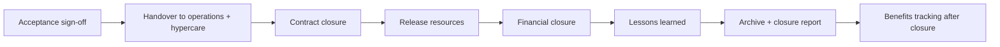

# PM-17 Monitoring, Control, Closure and Lessons Learned

> [!info] Topic card
> **Unit:** U6 · **Time:** 3 h · **Artefacts:** [[PM-A09 Status Report]], [[PM-A11 Closure Report]] · **Case:** [[PM-CASE-01 University Course Registration System]]

## 1. Learning objectives
1. **Describe** the monitoring and controlling cycle: measure, compare with the baselines, forecast, decide, act, report.
2. **Write** status reports with RAG ratings, EVM, risks, issues and decisions requested.
3. **Distinguish** issues, risks, changes and decisions, and **maintain** the logs for each.
4. **Close** a project or phase: acceptance, handover to operations, contract closure, releasing resources, archiving, a closure report.
5. **Run** a lessons-learned review, and **plan** benefits realisation after closure.

## 2. Why it matters
Planning is useless without control: comparing reality with the plan and acting on the difference. Many projects never really close. They drift into "nearly done", with nobody accountable for support, contracts still open, and lessons never captured. Proper closure frees resources, confirms acceptance, and makes the next project better.

## 3. Prerequisites
[[PM-10 Earned Value Management]] (performance measures) · [[PM-14 Procurement and Change Management]] (change control, contract closure) · [[PM-11 Risk Management]].

## 4. Intuition
Control is a **thermostat**: measure the temperature (actual progress), compare it with the setting (the baseline), and switch the heating on or off (corrective action). Closure is **handing over the keys**, with the manual, the warranty and a list of what you'd do differently next time.

## 5. Rigorous explanation

### 5.1 The control cycle
1. **Collect work performance data:** % complete, actual costs, defects, risk triggers.
2. **Compare** with the baselines (scope, schedule, cost, quality), using EVM, the critical path and quality metrics.
3. **Forecast:** EAC, the finish date (critical path, or earned schedule).
4. **Decide:** corrective action (bring performance back in line), preventive action (avoid future deviation), defect repair, or a change request to the baselines.
5. **Act** and **report.**

**Thresholds** (tolerances) decide when the PM acts alone and when to escalate (management by exception, PM-02).

### 5.2 Logs
| Log | Contains | Example |
|---|---|---|
| Risk register | Uncertain future events | R5 peak load |
| Issue log | Current problems needing action | The test server is down |
| Change log | Change requests and decisions | CR-007 course list report |
| Decision log | Key decisions with rationale and decider | Defer SMS to release 2 |
| Lessons-learned register | What worked and what didn't, gathered *during* the project | Early data profiling saved 2 weeks |

### 5.3 Status reporting
A typical status report:
- the period;
- an **overall RAG** (red/amber/green) for schedule, cost, scope, quality and risk, **with defined criteria** (e.g. amber means SPI 0.90–0.95);
- achievements and next steps;
- EVM figures and forecasts;
- the top risks and issues;
- changes;
- **decisions needed**.

Keep it honest: "watermelon reporting" (green outside, red inside) destroys trust.

### 5.4 Closing
1. **Confirm acceptance:** formal sign-off by the customer or sponsor against the acceptance criteria (validate scope).
2. **Handover to operations:** support documentation, runbooks ([[SD-16 Deployment, Maintenance and Documentation]]), training of the support staff, an SLA, a hypercare period.
3. **Close contracts:** verify the deliverables, settle claims, final payments, release retentions after the warranty period.
4. **Release resources:** return the people to their functional managers, with feedback on their performance.
5. **Financial closure:** final costs vs the baseline; close the cost codes.
6. **Lessons learned:** a structured, blameless review.
7. **Archive:** the project records, for audit and future reference.
8. **Closure report** and a celebration.

**Early termination:** projects can also close because the business case no longer holds. Closing them deliberately is a success of governance, not a failure.

### 5.5 Lessons learned and benefits
- **Lessons-learned review:** what went well, what didn't, and why (root causes), plus recommendations with owners. Feed them into the organisation's process assets (templates, checklists, estimating data).
- **Benefits realisation:** many benefits arrive *after* closure (e.g. reduced queue time after two semesters). Assign a **benefits owner** (often the sponsor or the business), set measurement dates, and compare with the business case.

## 6. Terminology
| Term | Meaning |
|---|---|
| Work performance data / information / reports | Raw observations / analysed against the baselines / the communicated form |
| Corrective vs preventive action | Fix a current deviation / avoid a future one |
| RAG status | A red/amber/green rating against defined criteria |
| Hypercare | A period of intensified support right after go-live |
| Administrative closure | Completing the project records, acceptance and archiving |
| Benefits owner | The person accountable for realising the benefits after closure |

## 7. Step-by-step: closing CASE-01
1. Registrar's UAT sign-off (J) and go-live (K) completed in week 19.
2. Two weeks of hypercare: the developers are on call, daily issue reviews, 23 incidents handled.
3. Handover to the ICT operations team: runbook, admin guide, SLA (99.5% availability during registration weeks).
4. Contracts: the server vendor's final payment after the acceptance test; 10% retention held for the 12-month warranty.
5. Final cost: compare the actual cost with the 60 M baseline (EVM at completion).
6. Lessons-learned workshop with the team and the key stakeholders (a 2-hour retrospective format).
7. Benefits plan: measure queue times and clash rates at the end of semesters 1 and 2. Owner: the registrar.
8. Closure report signed by the sponsor ([[PM-A11 Closure Report]]); records archived.

## 8. Diagram: closure checklist flow

## 9. Worked examples

### Example 1 (basic): issue, risk, change or decision?
| Item | Log |
|---|---|
| "The vendor may go bankrupt" | Risk |
| "The test server crashed today" | Issue |
| "Add a course list report" | Change request |
| "We chose PostgreSQL over NoSQL because …" | Decision |

### Example 2 (intermediate): RAG with criteria
Criteria (agreed in the plan):
- Schedule: green if SPI ≥ 0.95 and the critical path is on time; amber if SPI is 0.90–0.95 or the critical path is less than 1 week late; red otherwise.
- Cost: green if CPI ≥ 0.95; amber 0.90–0.95; red below 0.90.

CASE-01 at week 10 (PM-10): SPI 0.926, critical path 0.6 weeks late, so **schedule amber**. CPI 0.8966, so **cost red** (just below 0.90). Overall: **amber/red**, with the decision requested: use contingency. Defined criteria stop optimistic colouring.

### Example 3 (challenging): a blameless lessons-learned entry
| Category | What happened | Root cause | Recommendation | Owner |
|---|---|---|---|---|
| Estimating | Development ran about 10% over (CPI 0.90 at week 10) | No historical data; optimistic estimates under deadline pressure | Record actuals per work package; use three-point estimates and reference data for the next project | PMO |
| Procurement | Server price rose 1.5 M after the quote | The quote's validity expired during approvals | Align quote validity with the approval timeline; use FP-EPA clauses for imported hardware | Procurement officer |
| Data | Data profiling in week 2 found 4% invalid records early | Good practice from risk R2's mitigation | Make data profiling a standard sprint-0 activity | Lead developer |
| Stakeholders | Clerks' resistance fell after champions joined UAT | Early involvement | Use change champions by default | PM |

These are blameless: they focus on causes and processes, not individuals.

## 10. Application: closure report outline
1. Summary.
2. Objectives and success criteria: achieved? (project, product, business).
3. Scope delivered vs planned (including deferrals).
4. Schedule and cost: baseline vs actual, with the variance explained.
5. Quality: defects, the acceptance results.
6. Risks and issues: what occurred and how it was handled.
7. Benefits plan and owner.
8. Lessons learned.
9. Handover and support arrangements.
10. Open items.
11. Approvals.

See [[PM-A11 Closure Report]].

## 11. Common mistakes
| Mistake | Fix |
|---|---|
| Status reports without decisions requested | State the decisions needed explicitly |
| RAG ratings without criteria | Define thresholds in the plan |
| Mixing issues and risks | Separate logs, and convert a risk to an issue when it occurs |
| No formal acceptance | Signed acceptance against the criteria |
| Releasing the team before handover | Hypercare plus a documented handover |
| Lessons learned only at the end, and blaming | Collect them continuously; keep reviews blameless |
| No benefits tracking | A benefits owner, and dates in the closure report |

## 12. Comparison: phase closure vs project closure
| | Phase closure | Project closure |
|---|---|---|
| Purpose | A gate before the next phase | End the whole project |
| Decisions | Continue, change or stop | Accept and hand over |
| Outputs | Phase acceptance, an updated plan | Final acceptance, a closure report, an archive |
| Lessons | For the rest of the project | For future projects |

## 13. Practice
**L1** 1. Corrective vs preventive action? 2. List 6 closure activities.

**L2** 3. Classify 4 items into risk, issue, change and decision logs. 4. Write RAG criteria for quality.

**L3** 5. Write a one-page status report for CASE-01 at week 10 (use PM-10 and PM-11). 6. Write 3 lessons-learned entries for a group project you did.

**L4** 7. Should a project whose business case is no longer viable be closed early? Argue using PRINCE2's continued business justification principle. 8. Design a benefits-realisation plan for CASE-01 (metrics, baselines, targets, dates, owner).

**L5** 9. Write the closure report for your FYP (or simulate it for CASE-02), including acceptance evidence, variance analysis, lessons and benefits.

## 14. Hints
> [!tip]- Hints
> 1: fixing now vs preventing a recurrence. 7: yes, if justification fails, closing is the governed outcome; capture the salvage value and lessons. 8: queue time, clash rate, % online registrations; baselines measured before go-live.

## 15. Worked solutions
> [!success]- Solutions 1–2
> 1. Corrective: realign current performance (e.g. add a reviewer to E, which is behind). Preventive: reduce the likelihood of future deviation (e.g. start the load testing earlier). 2. Acceptance; handover and hypercare; contract closure; releasing resources; financial closure; lessons learned; archiving; the closure report (any six).

> [!success]- Solution 4
> - Green: no open critical defects; all Must requirements pass the tests; defect discovery is falling.
> - Amber: at most 2 open critical defects with fixes scheduled within 1 week, or the test pass rate is 90–95%.
> - Red: more than 2 critical defects, or a pass rate below 90%, or the load test failing.

> [!success]- Solution 7
> Yes. PRINCE2 requires the project to remain desirable, viable and achievable throughout. If, say, a re-appraisal shows a strongly negative NPV with no mandatory or strategic reason (PM-03 Solution 8), continuing wastes resources. A **controlled early closure** does the following:
> - salvages the usable deliverables (e.g. the cleansed data, the designs);
> - closes the contracts on the agreed terms;
> - redeploys the staff;
> - records the lessons.
>
> That's a governance success: the money not spent has value too.

> [!success]- Solution 8
> | Benefit | Metric | Baseline (before) | Target | When | Owner |
> |---|---|---|---|---|---|
> | Shorter registration queues | Average wait at the registry | Measure in the current semester | −80% | End of semester 1 and 2 | Registrar |
> | Fewer clashes | Clash complaints per semester | Count from the current semester | 0 | Semester 1 | Registrar |
> | Online adoption | % of registrations done online | 0% | ≥ 95% | Semester 1 | Registrar |
> | Staff time saved | Registry staff hours on registration | Time study | −60% | Semester 2 | Registrar |
>
> Compare the results with the business case's 22 M a year assumption (PM-09) and report them to the sponsor.

## 16. Self-test (pass ≥ 4/5)
1. What turns a risk into an issue? 2. Why define RAG criteria? 3. Who usually owns benefits after closure? 4. What's hypercare? 5. Is early closure a failure?
> [!success]- Answers
> 1. The risk event occurs. 2. To make the ratings objective and prevent optimistic reporting. 3. The business (the sponsor or a benefits owner). 4. Intensified support just after go-live. 5. Not necessarily: it's correct governance when the justification no longer holds.

## 17. Flashcards
#flashcards/project-management
Control cycle?::Measure, compare with the baselines, forecast, decide, act, report.
Issue vs risk?::Happening now vs might happen.
Closure activities?::Acceptance, handover, contracts, resources, finances, lessons, archive, report.
Watermelon reporting?::Green on the outside, red inside: dishonest status.
Benefits realisation?::Measuring the business-case benefits after delivery, with an owner and dates.

## 18. Blank-page recall
Draw the closure flow, and write the RAG criteria for schedule and cost.

## 19. Revision summary
- Control: compare work performance with the baselines (EVM, critical path, quality) and act within tolerances.
- Keep separate logs for risks, issues, changes, decisions and lessons.
- Status reports: RAG with criteria, figures, risks and issues, and the decisions needed.
- Closure: acceptance → handover/hypercare → contracts → resources → finance → lessons → archive → report. Benefits are tracked afterwards.

## 20. Links
Prev: [[PM-16 Agile, Scrum and Hybrid Delivery]] · Back to: [[PM 00 Dashboard]] · Artefacts: [[PM-A09 Status Report]], [[PM-A11 Closure Report]] · Related: [[SD-16 Deployment, Maintenance and Documentation]], [[FYP-12 Presentation, Defense and Working with Supervisor Feedback]]

## 21. Sources
- PMI, *PMBOK® Guide*, 6th ed., 2017, §4.5–4.7 (Monitor and Control Project Work, Integrated Change Control, Close Project or Phase).
- AXELOS, *Managing Successful Projects with PRINCE2®*, 7th ed., 2023 (Closing a Project; benefits management).
- *(Not checked online during the build, because there was no network access.)*

## 22. Mastery checklist
- [ ] I can run the control cycle and write a status report with RAG criteria
- [ ] I can maintain the logs and run a blameless lessons-learned review
- [ ] I can close a project and plan benefits realisation
- [ ] Reviews scheduled
