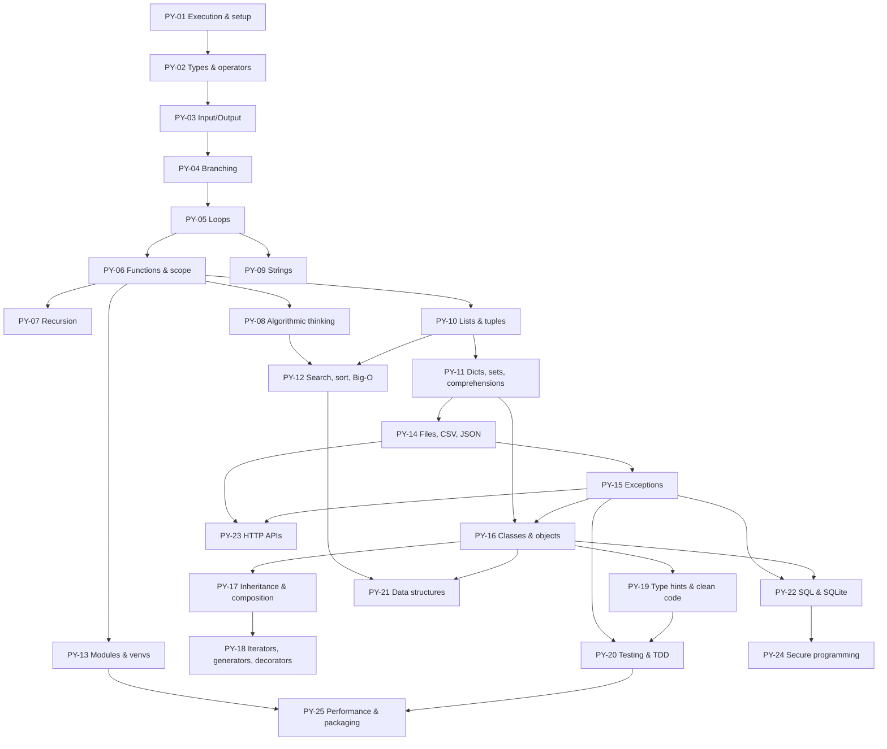

# Python Programming: Curriculum Map and Prerequisites

Back to [[PY 00 Dashboard]] · All modules: [[Master Curriculum Inventory]]

## 1. Hierarchy

| Unit | Topics | Assessment / project |
|---|---|---|
| **U1 Foundations** | PY-01 execution and setup · PY-02 types and operators · PY-03 I/O · PY-04 branching · PY-05 loops | Self-tests; [[PRJ-PY-01 Student Marks and Grading System]] milestone 1 |
| **U2 Functions and Algorithms** | PY-06 functions and scope · PY-07 recursion · PY-08 algorithmic thinking | PRJ-PY-01 complete |
| **U3 Data Collections** | PY-09 strings · PY-10 lists/tuples · PY-11 dicts/sets/comprehensions · PY-12 searching, sorting, Big-O | Mock exam section A |
| **U4 Robust Programs** | PY-13 modules and venvs · PY-14 files/CSV/JSON · PY-15 exceptions | [[PRJ-PY-02 Personal Expense Tracker]] |
| **U5 Object-Oriented Programming** | PY-16 classes · PY-17 inheritance/composition/polymorphism · PY-18 iterators, generators, decorators, context managers | [[PRJ-PY-03 Library Management System]] |
| **U6 Software Engineering in Python** | PY-19 type hints and clean code · PY-20 testing and TDD · PY-21 data structures | Test suites for all projects |
| **U7 Integration** | PY-22 SQL/SQLite · PY-23 HTTP APIs · PY-24 secure programming · PY-25 performance and packaging | [[PRJ-PY-04 Weather API Client]], [[PRJ-PY-05 Hostel Maintenance System]] |

## 2. Prerequisite graph

*Text version: PY-01 → 02 → 03 → 04 → 05 is a strict chain. From loops, two branches open: strings (09), and functions (06). Functions unlock recursion (07), algorithmic thinking (08), lists (10) and modules (13). Lists lead to dicts/sets (11), which lead to files (14), exceptions (15) and classes (16). Searching/sorting (12) needs lists and algorithmic thinking. Classes lead to inheritance (17), generators/decorators (18), clean code (19), data structures (21) and SQL (22). Testing (20) needs exceptions and clean code. Secure programming (24) builds on SQL (22). Packaging (25) needs modules and testing.*

## 3. Cross-module prerequisites and "review this when…" alerts

| When you reach… | Review first | Why |
|---|---|---|
| PY-04 Conditions | [[DM-01 Propositions, Connectives and Truth Tables]], [[DM-02 Logical Equivalence and Laws of Logic]] | `and`/`or`/`not` and De Morgan's laws simplify conditions |
| PY-07 Recursion | [[DM-09 Mathematical Induction]] | Recursive correctness is an induction argument |
| PY-11 Sets | [[DM-06 Sets, Set Operations, Power Sets and Cartesian Products]] | Python `set` operators implement set theory directly |
| PY-12 Complexity | [[DM-08 Sequences and Summations]], [[DM-14 Recurrence Relations]] | Loop costs are sums; divide-and-conquer costs are recurrences |
| PY-16 Classes | [[SD-06 Modular Design, Cohesion and Coupling]] | Classes are a cohesion/encapsulation tool |
| PY-20 Testing | [[SD-14 Software Testing, Verification and Validation]] | Test levels and test design techniques |
| PY-21 Graphs/trees | [[DM-15 Graphs, Representations, Paths and Connectivity]], [[DM-16 Trees and Spanning Trees]] | Data structures implement these mathematical objects |
| PY-24 Security | [[CS-11 Web Application Security]], [[CS-08 Password Storage and Authentication Security]] | Injection and credential handling |

## 4. Topic records

Each lesson's frontmatter holds its topic ID, prerequisites, difficulty and syllabus status. The lesson itself contains objectives, concepts, terminology, examples, misconceptions, exercises with solutions, assessment criteria and a mastery checklist. The table in [[PY 00 Dashboard]] is the canonical order.
