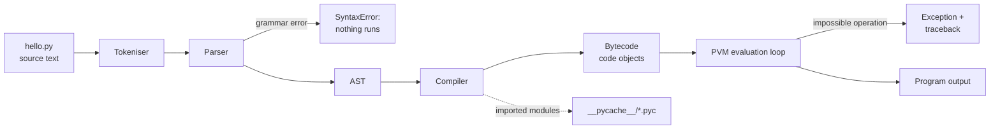

# PY-01 How Python Executes Programs and Environment Setup

> [!info] Topic card
> **Module:** [[PY 00 Dashboard|Python Programming CST06102]] · **Unit:** U1 Foundations · **Status:** provisional-core · **Time:** 2–3 h · **Python:** 3.10+

## 1. Learning objectives
By the end of this lesson you can:
1. **Explain** the path from a `.py` source file to running behaviour: source → tokens → syntax tree → bytecode → Python Virtual Machine.
2. **Distinguish** syntax errors (found *before* any line runs) from runtime errors (found *while* running).
3. **Install** Python, verify the version, and **run** code in the interactive REPL and as a script.
4. **Create and activate** a virtual environment, and **explain** why projects use one.
5. **Predict** the order in which the statements of a script execute.

## 2. Why it matters
Most beginner confusion ("it worked in the shell but not in my file", "why did nothing print?", "pip installed it but Python can't find it") comes from not knowing what actually runs your code. A correct mental model of execution is the foundation for debugging every later topic.

## 3. Prerequisites
None. You need to be able to open a terminal (Command Prompt/PowerShell on Windows, Terminal on macOS/Linux) and navigate folders with `cd`.

## 4. Intuition
Think of Python as a **translator plus a worker**:
- The *translator* (compiler) reads your whole file, checks the grammar, and rewrites it into simple instructions called **bytecode**. If the grammar is wrong anywhere, it refuses to start. That's a **syntax error**.
- The *worker* (the Python Virtual Machine, PVM) then carries out those instructions **one at a time, top to bottom**. If an instruction is impossible (dividing by zero, using a name that doesn't exist), the worker stops right there. That's a **runtime error** (an *exception*).

So Python is often called "interpreted", but more precisely CPython **compiles to bytecode, then interprets the bytecode**.

## 5. Rigorous explanation

### 5.1 The CPython pipeline
**CPython** is the reference implementation of Python, written in C. It is what you download from python.org. Running `python hello.py` performs:

1. **Read** the source file as text (UTF-8 by default).
2. **Tokenise**: split the text into tokens such as names, numbers, operators, `INDENT`/`DEDENT` (indentation is part of the grammar).
3. **Parse** the tokens into an **abstract syntax tree (AST)**, a tree that represents the program's structure. Grammar violations raise `SyntaxError` here, *before any statement executes*.
4. **Compile** the AST into **bytecode**, a compact instruction set for the PVM, stored in *code objects*.
5. **Execute**: the PVM's evaluation loop runs the bytecode instruction by instruction. Errors detected now raise exceptions such as `NameError`, `TypeError` or `ZeroDivisionError`.

For **imported modules**, CPython caches compiled bytecode in `__pycache__/<name>.cpython-3XX.pyc`, so later runs can skip steps 2–4 if the source is unchanged. The main script you run directly is recompiled every time.

### 5.2 Seeing the stages yourself
```python
import ast
import dis

source = "total = 2 + 3 * 4\nprint(total)"
tree = ast.parse(source)           # stage 3: the syntax tree
print(ast.dump(tree.body[0]))      # shows Assign(targets=[Name('total')], value=BinOp(...))
code = compile(source, "<demo>", "exec")   # stage 4: bytecode
dis.dis(code)                      # human-readable bytecode listing
exec(code)                         # stage 5: run it -> prints 14
```
The exact bytecode instruction names **change between Python versions**, so never memorise them. The idea is what matters: your code becomes a list of small stack-machine instructions. Tested on CPython 3.13, `dis` of `def area(w, h): return w * h` shows `LOAD_FAST_LOAD_FAST`, `BINARY_OP 5 (*)`, `RETURN_VALUE`. Older versions show two separate `LOAD_FAST` instructions.

### 5.3 REPL vs script
| | Interactive REPL (`python` with no file) | Script (`python file.py`) |
|---|---|---|
| Input | One statement at a time, prompt `>>>` | Whole file |
| Echo | Automatically prints the value of an expression | Prints **only** what you `print()` |
| Use for | Experiments, checking a function, quick maths | Real programs, anything you want to keep |

The echo difference catches many beginners: `2 + 3` on its own line shows `5` in the REPL but prints **nothing** in a script.

### 5.4 Execution order inside a script
Statements run **top to bottom**. A `def` statement *creates* a function but does not *run* its body. The body runs only when the function is called. A name must be assigned **before** the line that uses it executes.

### 5.5 Installing and verifying Python
- **Windows:** install from https://www.python.org/downloads/ and tick **"Add python.exe to PATH"**. Use `py --version` or `python --version`.
- **macOS:** the python.org installer or Homebrew (`brew install python`). Use `python3 --version`.
- **Linux:** usually preinstalled. Use `python3 --version`. Install the venv module if needed (e.g. `sudo apt install python3-venv` on Debian/Ubuntu).

Throughout this vault, `python` means the command that launches **Python 3.10+** on your system (`python3` or `py` on some platforms).

### 5.6 Virtual environments
A **virtual environment (venv)** is a folder containing its own Python interpreter link and its own `site-packages`. Packages installed into it don't affect other projects. That solves the "project A needs library v1, project B needs v2" problem.

```bash
python -m venv .venv               # create (once per project)
# activate:
source .venv/bin/activate          # macOS/Linux
.venv\Scripts\activate             # Windows (cmd / PowerShell)
python -m pip install pytest       # installs into .venv only
python -m pip freeze > requirements.txt   # record exact versions
deactivate                         # leave the venv
```
Always use `python -m pip` rather than bare `pip`. It guarantees that you install into the interpreter you are actually running.

## 6. Essential terminology
| Term | Meaning |
|---|---|
| Source code | The human-written `.py` text |
| Interpreter | The program (`python`) that runs Python code |
| CPython | The reference implementation of Python, written in C |
| Token | Smallest grammatical unit (name, number, operator, INDENT…) |
| AST | Abstract syntax tree: the parsed structure of the program |
| Bytecode | Low-level instructions for the Python Virtual Machine |
| PVM | Python Virtual Machine: the loop that executes bytecode |
| REPL | Read–Eval–Print Loop: the interactive `>>>` prompt |
| `SyntaxError` | Grammar error, detected before execution starts |
| Exception | A runtime error object raised while code executes |
| Traceback | The report Python prints for an uncaught exception, listing the call chain and the failing line |
| Virtual environment | An isolated per-project Python package directory |
| PATH | OS list of folders searched for commands like `python` |

## 7. Step-by-step reasoning: reading a traceback
```text
Traceback (most recent call last):
  File "/home/amina/marks.py", line 4, in <module>
    average = total / count
              ~~~~~~^~~~~~~
ZeroDivisionError: division by zero
```
1. Read the **last line first**: the exception type (`ZeroDivisionError`) and message.
2. Read the line above it: **file, line number (4), and code** where it happened.
3. "most recent call last" means that, when functions are involved, the **bottom** frame is where the error occurred, and frames above it show who called whom.
4. Ask: *what value made this impossible?* Here `count` must be `0`. Trace back to where `count` was set.

(The `~~~~~~^~~~~~~` markers that point at the failing sub-expression were added in Python 3.11. Older versions show only the line.)

## 8. Diagram

*Text version: source text is tokenised, then parsed. A grammar error stops everything with a SyntaxError. Otherwise the AST is compiled to bytecode, which the PVM executes. A runtime problem raises an exception with a traceback, otherwise the program produces output. For imported modules, bytecode is cached in `__pycache__`.*

## 9. Worked examples

### Example 1 (basic): REPL echo vs script output
**Task:** predict what each produces.
```python
# file: echo_demo.py
2 + 3
print(2 + 3)
"hello"
```
**Reasoning:** in a script, expression statements are evaluated and their results discarded. Only `print` writes to the screen.
**Output when run as a script:**
```text
5
```
In the REPL, typing each line separately shows `5`, then `5`, then `'hello'`. The REPL echoes values using their `repr`, which is why the quotes appear.

### Example 2 (intermediate): syntax error vs runtime error
```python
# syntax-error-demo (this block is intentionally invalid)
print("start")
x = 10
if x > 5
    print("big")
```
**Output:**
```text
  File "demo.py", line 3
    if x > 5
            ^
SyntaxError: expected ':'
```
**Key observation:** `"start"` is **not printed**. The parser rejected the file before execution. Compare:
```python
print("start")
x = 10
print(x / 0)
print("end")
```
**Output:**
```text
start
Traceback (most recent call last):
  File "demo.py", line 3, in <module>
    print(x / 0)
          ~~^~~
ZeroDivisionError: division by zero
```
`"start"` **is** printed, because the error happens during execution at line 3, and line 4 never runs.

### Example 3 (challenging): execution order with a function
```python
print("A")

def greet():
    print("B")
    print(undefined_name)

print("C")
greet()
print("D")
```
**Trace:**
| Step | Line executed | Effect | Output so far |
|---|---|---|---|
| 1 | `print("A")` | prints | A |
| 2 | `def greet():` | creates function object, **body not run** | A |
| 3 | `print("C")` | prints | A C |
| 4 | `greet()` | enters body | |
| 5 | `print("B")` | prints | A C B |
| 6 | `print(undefined_name)` | `NameError` raised | traceback |
| — | `print("D")` | never executed | |

Notice that `undefined_name` did **not** cause an error at definition time. Names are looked up when the line runs, not when the function is defined.

## 10. Application: a reproducible project setup
A team of three students writes the expense tracker ([[PRJ-PY-02 Personal Expense Tracker]]). One installs `pytest` 8, another 9, and tests behave differently. **Fix:** each creates `.venv`, the team commits `requirements.txt` (never the `.venv` folder itself), and everyone runs `python -m pip install -r requirements.txt`. Now "works on my machine" becomes "works on every machine".

## 11. Common mistakes
| Mistake | Why it happens | Fix |
|---|---|---|
| Expecting a bare expression to print in a script | REPL habit | Use `print()` |
| `python` not found / wrong version opens | PATH not set, or several Pythons installed | Re-run the installer with *Add to PATH*, or use `py -3` (Windows) / `python3` |
| `pip install x` then `ModuleNotFoundError` | pip belongs to a different interpreter | Use `python -m pip install x` inside the activated venv |
| Mixing tabs and spaces | Editor settings | Configure the editor to insert 4 spaces |
| Saving the file as `random.py` or `math.py` | Your file shadows the standard library module | Never name scripts after standard modules |
| Committing `.venv` to Git | Not knowing it is machine-specific | Add `.venv/` to `.gitignore` |

## 12. Comparison with related concepts
| Approach | Example languages | When translated | Python's position |
|---|---|---|---|
| Ahead-of-time compiled to machine code | C, Rust | Before running, to a native executable | — |
| Compiled to bytecode + VM | Java (JVM), C# (.NET), **CPython** | At start-up (Python) or build time (Java) | ✔ CPython |
| Just-in-time (JIT) compiled | PyPy, the JVM's hot paths | During execution, for frequently run code | PyPy is an alternative Python implementation. CPython 3.13 also includes an *experimental*, off-by-default JIT. |
| Pure tree-walking interpreter | Many teaching languages | Never; the AST is executed directly | — |

## 13. Practice

**L1 Recall**
1. List the five stages CPython goes through when running a script.
2. What is the difference between the REPL and running a script, with respect to output?

**L2 Routine application**
3. Write a script `about_me.py` that prints your first name, the module code `CST06102`, and the result of `7 * 6`, each on its own line. Run it from the terminal.
4. Create a virtual environment named `.venv`, activate it, and show that `python -c "import sys; print(sys.prefix)"` prints a path inside `.venv`.

**L3 Multi-step**
5. For the program below, state exactly what is printed and where it stops.
```python
print("one")
def f():
    return 10 / 0
print("two")
value = f()
print("three")
```
6. A file contains `print("hi"` (missing `)`) on line 7 and a division by zero on line 2. Which error is reported, and is anything printed? Explain why.

**L4 Transfer**
7. A classmate says, "Python is interpreted, so it can't have compile errors." Evaluate this claim using the pipeline.
8. Your friend's script `json.py` contains `import json` and then `json.dumps({})`. It fails with `AttributeError: module 'json' has no attribute 'dumps'`. Explain the cause and the fix.

**L5 Synthesis**
9. Write a one-page *setup guide* for a new team member joining your Python project. It must guarantee they get the same package versions as you. Include the commands for Windows and Linux, and state which files go into version control.

## 14. Hints
> [!tip]- Hints
> 5: Remember that `def` doesn't run the body.
> 6: Which stage happens first, parsing or execution?
> 8: Where does `import` look first for a module named `json`?
> 9: Think venv + `requirements.txt` + `.gitignore`.

## 15. Worked solutions
> [!success]- Solution 1–2
> 1. Read the source → tokenise → parse to an AST (syntax errors detected here) → compile to bytecode → execute on the PVM.
> 2. The REPL automatically displays the `repr` of each expression statement's value. A script displays only what is explicitly written with `print()` (or other output calls).

> [!success]- Solution 3
> ```python
> print("Amina")
> print("CST06102")
> print(7 * 6)
> ```
> Run with `python about_me.py`. Output:
> ```text
> Amina
> CST06102
> 42
> ```

> [!success]- Solution 4
> ```bash
> python -m venv .venv
> source .venv/bin/activate        # Windows: .venv\Scripts\activate
> python -c "import sys; print(sys.prefix)"
> ```
> The printed path ends with `.venv`, which proves the active interpreter is the venv's. Without activation, `sys.prefix` points to the system installation.

> [!success]- Solution 5
> Output: `one`, then `two`, then a traceback ending in `ZeroDivisionError: division by zero` raised inside `f`. The traceback has two frames: line `value = f()` in `<module>`, then `return 10 / 0` in `f`. `three` is never printed. The function was defined without error because its body only runs at the call.

> [!success]- Solution 6
> A `SyntaxError` for line 7 (Python reports that the `(` was never closed). **Nothing is printed**, and the division by zero on line 2 never runs. Parsing the *whole file* happens before *any* execution, so the grammar error is found first.

> [!success]- Solution 7
> The claim is false. CPython parses and compiles the whole file to bytecode before executing. Grammar violations (`SyntaxError`, `IndentationError`) are therefore detected at compile time, before any statement runs. What Python does *not* do at compile time is type checking or name resolution. Those errors (`TypeError`, `NameError`) appear only at runtime, when the faulty line executes. That is the real difference from statically typed compiled languages such as Java.

> [!success]- Solution 8
> `import json` searches the script's own directory **first** (the first entry of `sys.path`), so the script imports **itself** rather than the standard library module. Your `json.py` has no `dumps`, hence the `AttributeError`. **Fix:** rename the file (e.g. `json_demo.py`) and delete any `__pycache__/json.*.pyc`. Lesson: never name your files after standard-library modules.

> [!success]- Solution 9 (model answer outline)
> 1. Prerequisites: Python 3.10+ (`python --version`).
> 2. Clone the repository.
> 3. `python -m venv .venv`
> 4. Activate it: `source .venv/bin/activate` (Linux/macOS) or `.venv\Scripts\activate` (Windows).
> 5. `python -m pip install -r requirements.txt`
> 6. Verify: `python -m pytest` passes.
> 7. Version control **includes** source code, `requirements.txt` (pinned versions, generated with `pip freeze`), README and tests. It **excludes** `.venv/`, `__pycache__/` and local databases (listed in `.gitignore`).
> Justification: pinning versions makes the environment reproducible, and excluding the venv avoids committing machine-specific binaries.

## 16. Self-test (closed book, 5 min, pass ≥ 4/5)
1. At which stage is `SyntaxError` raised?
2. Why might `pip install requests` succeed yet `import requests` fail?
3. True/false: defining a function with an undefined name inside it raises `NameError` immediately.
4. What directory holds cached bytecode for imported modules?
5. What command creates a virtual environment named `.venv`?

> [!success]- Self-test answers
> 1. Parsing, before execution. 2. pip installed into a different interpreter or environment; use `python -m pip`. 3. False; the name is resolved only when the line runs. 4. `__pycache__`. 5. `python -m venv .venv`.

## 17. Flashcards
#flashcards/python
What does CPython compile source code into?::Bytecode, executed by the Python Virtual Machine (PVM).
When is a SyntaxError detected?::During parsing, before any statement in the file executes.
Why use `python -m pip` instead of `pip`?::It guarantees packages are installed for the interpreter you are actually running.
What is a virtual environment?::An isolated per-project directory with its own interpreter link and installed packages.
Does a script print the value of a bare expression like `2 + 3`?::No. Only the REPL echoes; scripts need print().
In a traceback, where is the line that actually failed?::In the last (bottom) frame, just above the exception line.

## 18. Blank-page recall
Close this note. On paper, draw the pipeline from source to output, mark where each kind of error appears, and write the three commands to create, activate and populate a venv. Then compare with section 8.

## 19. Revision summary
- CPython: **source → tokens → AST → bytecode → PVM**.
- `SyntaxError` = before running (nothing executes). Exceptions = during running (earlier lines already ran).
- The REPL echoes values. Scripts print only via `print()`.
- `def` creates a function. Its body runs only when called.
- One project, one venv: `python -m venv .venv`, `python -m pip install -r requirements.txt`.
- Read tracebacks bottom-up.

## 20. Links
- Next: [[PY-02 Variables, Types, Expressions and Operators]]
- Related: [[SD-13 Implementation, Code Organization and Version Control]] (Git, `.gitignore`), [[PY-13 Modules, Packages, Imports and Virtual Environments]] (deeper import mechanics)
- Practice code: `code/examples/py01_pipeline.py`

## 21. Sources and further reading
- Python Software Foundation, *The Python Tutorial*, §2 "Using the Python Interpreter": https://docs.python.org/3/tutorial/interpreter.html (accessed 2026-10-19)
- Python Software Foundation, *venv: Creation of virtual environments*: https://docs.python.org/3/library/venv.html
- Python Software Foundation, *dis: Disassembler for Python bytecode*: https://docs.python.org/3/library/dis.html (bytecode is version-specific)
- See [[Source Register]] for the full list.

## 22. Mastery checklist
- [ ] I can draw the execution pipeline from memory (level 1)
- [ ] I predicted the outputs in Examples 1–3 before reading them (level 2)
- [ ] I solved practice 1–6 without hints (level 3)
- [ ] I explained practice 7–8 aloud and was correct (level 4)
- [ ] My project uses a venv and `requirements.txt` (level 5)
- [ ] Reviews scheduled in [[Review Schedule]]
