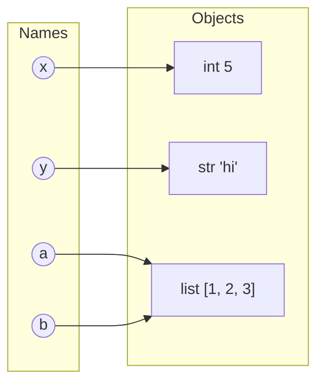

# PY-02 Variables, Types, Expressions and Operators

> [!info] Topic card
> **Unit:** U1 Foundations · **Time:** 3–4 h · **Code:** `code/examples/py02_types.py`, `code/exercises/py02_exercises.py`

## 1. Learning objectives
1. **Explain** that a Python variable is a *name bound to an object*, not a box that holds a value.
2. **Use** the core types `int`, `float`, `bool`, `str` and `NoneType`, and **predict** the type of an expression.
3. **Evaluate** expressions using operator precedence, including `//`, `%` and `**` with negative numbers.
4. **Convert** between types explicitly, and **explain** the floating-point representation error.
5. **Distinguish** `==` (equality) from `is` (identity).
6. **Write** code that follows Python syntax rules: indentation, comments and PEP 8 naming.

## 2. Why it matters
Every program computes with values. Wrong types cause errors (`"5" + 3`), and wrong operator assumptions cause silent wrong answers (`-7 // 2`, `0.1 + 0.2 == 0.3`). The silent wrong answers are the dangerous ones.

## 3. Prerequisites
- [[PY-01 How Python Executes Programs and Environment Setup]]: running scripts and reading tracebacks.

## 4. Intuition
A variable is a **label on a luggage tag**, tied to an object. `x = 5` creates an `int` object 5 and ties the label `x` to it. `x = "hi"` re-ties the *same label* to a *different object*. The label has no type. **Objects** have types. That's what "dynamically typed" means.

## 5. Rigorous explanation

### 5.1 Syntax essentials
- **Statements** end at the end of the line. Long expressions may continue inside `()`, `[]` or `{}`.
- **Indentation** (4 spaces by convention) defines blocks. It is grammar, not decoration.
- **Comments** start with `#` and run to the end of the line. Docstrings (`"""…"""`) document modules and functions (see [[PY-06 Functions, Parameters, Return Values and Scope]]).
- **Names** may contain letters, digits and `_`, must not start with a digit, are case-sensitive, and must not be keywords (`if`, `for`, `class`…). PEP 8 style: `snake_case` for variables and functions, `UPPER_CASE` for constants, `PascalCase` for classes.

### 5.2 Assignment binds names to objects
`name = expression` evaluates the right side **first**, producing an object, then binds the name. Every object has an **identity** (`id(obj)`), a **type** (`type(obj)`) and a **value**.

```python
a = [1, 2]
b = a          # b is bound to the SAME list object
b.append(3)
print(a)       # [1, 2, 3]: one object, two names
```
Immutable objects (`int`, `float`, `str`, `bool`, `tuple`) can never change, so sharing them is never surprising. Mutable objects (`list`, `dict`, `set`) can, and you will meet this again in [[PY-10 Lists and Tuples]].

### 5.3 Core types
| Type | Examples | Notes |
|---|---|---|
| `int` | `0`, `-42`, `10**100`, `1_000_000` | **Arbitrary precision**: no overflow |
| `float` | `3.14`, `1e-3`, `float("inf")` | IEEE 754 double precision (≈15–17 significant decimal digits) |
| `bool` | `True`, `False` | Subclass of `int`: `True + True == 2` |
| `str` | `'hi'`, `"hi"`, `"""multi-line"""` | Immutable Unicode text |
| `NoneType` | `None` | "No value". Functions without `return` give `None` |

### 5.4 Operators and precedence (highest to lowest)
| Level | Operators | Meaning |
|---|---|---|
| 1 | `(...)` | Grouping |
| 2 | `**` | Power (**right-associative**: `2**3**2 == 2**9 == 512`) |
| 3 | `+x`, `-x` | Unary sign (note `-2**2 == -4`, because `**` binds tighter) |
| 4 | `*`, `/`, `//`, `%` | Multiply, true divide, floor divide, modulo (left to right) |
| 5 | `+`, `-` | Add, subtract |
| 6 | `==`, `!=`, `<`, `<=`, `>`, `>=`, `is`, `in` | Comparisons (can be **chained**: `0 <= x < 10`) |
| 7 | `not` | Logical NOT |
| 8 | `and` | Logical AND |
| 9 | `or` | Logical OR |

### 5.5 Division, floor division and modulo
- `/` **always** returns a `float`: `6 / 3 == 2.0`.
- `//` is **floor** division. It rounds *down toward −∞*, not toward zero: `7 // 2 == 3`, `-7 // 2 == -4`.
- `%` satisfies the identity $a = (a // b)\cdot b + (a \bmod b)$, so the result takes the **sign of the divisor**: `-7 % 2 == 1`, `7 % -2 == -1`.
- Typical uses: `n % 2 == 0` tests evenness, and `total_seconds // 60, total_seconds % 60` splits units.

### 5.6 Floating-point representation
Floats are stored in binary. $0.1$ has no finite binary expansion, just as $1/3$ has no finite decimal one, so it is stored as the nearest representable value. Hence:

```python
print(0.1 + 0.2)          # 0.30000000000000004
print(0.1 + 0.2 == 0.3)   # False
import math
print(math.isclose(0.1 + 0.2, 0.3))   # True: compare with a tolerance
```
For money, use integer cents or `decimal.Decimal`, never `float`.

### 5.7 Type conversion
| Call | Result | Note |
|---|---|---|
| `int("42")` | `42` | `int("4.2")` raises `ValueError` |
| `int(3.99)` | `3` | **Truncates** toward zero, does not round |
| `float("2.5")` | `2.5` | |
| `str(10)` | `"10"` | |
| `bool(0)`, `bool("")`, `bool([])` | `False` | Empty/zero values are *falsy*. Everything else is truthy. |
| `round(2.5)`, `round(3.5)` | `2`, `4` | **Round half to even** ("banker's rounding") |

### 5.8 Equality vs identity
`==` asks *"do these have equal values?"*; `is` asks *"are these the very same object?"*. Use `is` only for singletons: `x is None`. `a is b` for small integers or strings may *happen* to be `True` because of caching, but that is an implementation detail you must not depend on.

## 6. Essential terminology
| Term | Meaning |
|---|---|
| Variable / name | Identifier bound to an object |
| Object | Value in memory with identity, type and value |
| Dynamic typing | Types belong to objects. Names can be rebound to any type. |
| Expression | Code that evaluates to a value (`3 * x + 1`) |
| Statement | Code that performs an action (`x = 3`, `if …:`) |
| Operand / operator | The values / the symbol combining them |
| Precedence / associativity | Which operator binds first / the order among equal-precedence operators |
| Mutable / immutable | Can / cannot change in place |
| Truthy / falsy | Treated as True / False in a condition |
| Literal | A value written directly in code (`42`, `"hi"`) |

## 7. Step-by-step: evaluating `10 - 2 ** 3 // 3 % 4 + 1`
1. `**` first: `2 ** 3 = 8` → `10 - 8 // 3 % 4 + 1`
2. `//` and `%`, left to right: `8 // 3 = 2`, then `2 % 4 = 2` → `10 - 2 + 1`
3. `+` and `-`, left to right: `10 - 2 = 8`, then `8 + 1 = 9`.
**Result: `9`.** When in doubt, add parentheses for the reader: `10 - ((2 ** 3) // 3 % 4) + 1`.

## 8. Diagram: names and objects

*Text version: `x` refers to the int 5 and `y` to the str 'hi'. `a` and `b` both refer to the **same** list object, so changing it through `b` is visible through `a`.*

## 9. Worked examples

### Example 1 (basic): temperature conversion. Minimal code, line by line
$F = \frac{9}{5}C + 32$
```python
celsius = 36.6                    # 1: bind name to a float object
fahrenheit = celsius * 9 / 5 + 32 # 2: evaluate left to right: *, /, then +
print(fahrenheit)                 # 3: 97.88000000000001
print(round(fahrenheit, 1))       # 4: 97.9
```
Line 2: `36.6 * 9 = 329.40000000000003` (float error), `/ 5 = 65.88000000000001`, `+ 32 = 97.88000000000001`. Line 4 rounds to one decimal place **for display**.

### Example 2 (intermediate): splitting seconds. Trace table
```python
total = 7384
hours = total // 3600
remaining = total % 3600
minutes = remaining // 60
seconds = remaining % 60
print(hours, minutes, seconds)    # 2 3 4
```
| Line | total | hours | remaining | minutes | seconds |
|---|---|---|---|---|---|
| 1 | 7384 | | | | |
| 2 | 7384 | 2 | | | |
| 3 | 7384 | 2 | 184 | | |
| 4 | 7384 | 2 | 184 | 3 | |
| 5 | 7384 | 2 | 184 | 3 | 4 |

Check: $2 \cdot 3600 + 3 \cdot 60 + 4 = 7384$ ✔. A shorter alternative uses the built-in `divmod`: `hours, remaining = divmod(total, 3600)`.

### Example 3 (challenging): incorrect → bug → corrected
**Task:** read two numbers typed by the user and print their sum.
```python
# INCORRECT
a = input("First: ")     # user types 5
b = input("Second: ")    # user types 3
print(a + b)             # prints 53, not 8
```
**Bug:** `input()` always returns a `str`. `+` on two strings **concatenates** them. No error is raised, which makes this a silent logic bug.
```python
# CORRECTED
a = float(input("First: "))
b = float(input("Second: "))
print(a + b)             # 8.0
```
**Sample I/O:** `5`, `3` → `8.0`; `2.5`, `-1` → `1.5`.
**Edge cases:** input `abc` → `ValueError: could not convert string to float: 'abc'` (handled properly in [[PY-15 Exceptions and Defensive Programming]]). Input `1e3` is valid, giving `1000.0`. Spaces such as `" 7 "` are accepted, because `float` strips surrounding whitespace.

### Example 4 (challenging): negative floor division
```python
print(-7 // 2, -7 % 2)    # -4 1
print(int(-7 / 2))        # -3  (truncation toward zero)
```
Check the identity $a = (a//b)\,b + a \bmod b$: $(-4)(2) + 1 = -7$ ✔. If your algorithm needs "round toward zero" (as in C or Java), use `int(a / b)`, but that goes through a float and loses exactness for very large integers. A safe integer version is `-(-a // b)` for ceiling, or sign handling.

## 10. Application: shopping total in cents
A shop app stores prices in **integer cents** to avoid float error:
```python
price_cents = 1999           # 19.99
quantity = 3
vat_rate_percent = 18
subtotal = price_cents * quantity                       # 5997
vat = (subtotal * vat_rate_percent + 50) // 100         # 1079 (rounds half up)
total = subtotal + vat                                  # 7076
print(f"Total: {total // 100}.{total % 100:02d}")       # Total: 70.76
```
The `+ 50` before `// 100` implements "round half up" in integer arithmetic. `:02d` pads the cents to two digits ([[PY-03 Input, Output and String Formatting]]).

## 11. Common mistakes
| Mistake | Why it happens | Correct thinking |
|---|---|---|
| `"5" + 3` → `TypeError` | Assuming automatic conversion | Python never mixes `str` and `int` silently. Convert explicitly. |
| `input()` used as a number | Forgetting it returns `str` | Wrap it in `int()`/`float()` |
| `0.1 + 0.2 == 0.3` | Expecting exact decimals | Use `math.isclose` or `Decimal` |
| `-7 // 2 == -3` | C/Java truncation habit | Python floors toward −∞ |
| `x is 5` | Confusing identity and equality | Use `==` for values and `is` only for `None` |
| `int(2.9)` expected to be 3 | Assuming rounding | `int` truncates. Use `round()`. |
| `-2 ** 2` expected to be 4 | Precedence of unary minus | `**` binds tighter. Write `(-2) ** 2`. |
| Naming a variable `list` or `str` | Not knowing these are built-ins | You shadow the built-in. Choose `items`, `text`. |

## 12. Comparison
| Concept | Python | C / Java |
|---|---|---|
| Variable | Name → object, untyped name | Typed storage location |
| Integer size | Unlimited | Fixed (32/64-bit), can overflow |
| `7 / 2` | `3.5` | `3` (integer division for ints) |
| `-7 / 2` as an integer | `-7 // 2 == -4` (floor) | `-3` (truncation) |

## 13. Practice

**L1 Recall**
1. What are the types of `7 / 7`, `7 // 7`, `True + 1` and `"7" * 2`? Give their values too.
2. Which of these are invalid names: `total2`, `2total`, `_tmp`, `class`, `my-var`?

**L2 Routine application** *(code bank: `py02_exercises.py`)*
3. `celsius_to_fahrenheit(c)`: return the Fahrenheit value.
4. `split_seconds(total)`: return the tuple `(hours, minutes, seconds)`.
5. `is_even(n)`: return `True` if `n` is even, using `%`.

**L3 Multi-step**
6. Evaluate by hand, showing the steps: `3 + 4 * 2 ** 2 // 5 - 1` and `not 3 > 2 or 1 == 1.0 and "a" < "b"`.
7. `vat_inclusive_cents(price_cents, rate_percent)`: return the price plus VAT in integer cents, rounding half up.

**L4 Transfer**
8. `digit_sum(n)`: return the sum of the decimal digits of a non-negative integer, using only `//` and `%` in a loop (no strings). *(You may preview `while` in [[PY-05 Loops and Iteration]].)*
9. A bank uses `balance = balance + 0.1` ten times starting from `0` and checks `balance == 1.0`. Predict the result, explain it, and propose two fixes.

**L5 Synthesis**
10. Design `format_duration(seconds)` that returns strings like `"2h 03m 04s"`, `"3m 04s"` (no hours part when 0) and `"4s"`. Decide and justify how negative input should be handled.

**Variation (adapt, don't copy):** rewrite `split_seconds` to return `(days, hours, minutes, seconds)`.

## 14. Hints
> [!tip]- Hints
> 6: Precedence order: `**`, then `* // %`, then `+ -`, then comparisons, then `not`, then `and`, then `or`.
> 7: VAT amount = `(price * rate + 50) // 100`.
> 8: `n % 10` gives the last digit, and `n // 10` removes it.
> 10: Build the parts in a list and join them. Raise `ValueError` for negatives.

## 15. Worked solutions
> [!success]- Solution 1–2
> 1. `7 / 7` → `1.0` (float). `7 // 7` → `1` (int). `True + 1` → `2` (int, since bool is a subclass of int). `"7" * 2` → `"77"` (str repetition).
> 2. Invalid: `2total` (starts with a digit), `class` (keyword), `my-var` (`-` is the minus operator). Valid: `total2`, `_tmp`.

> [!success]- Solutions 3–5 (also in `solutions/py02_solutions.py`)
> ```python
> def celsius_to_fahrenheit(c: float) -> float:
>     return c * 9 / 5 + 32
>
> def split_seconds(total: int) -> tuple[int, int, int]:
>     hours, rest = divmod(total, 3600)
>     minutes, seconds = divmod(rest, 60)
>     return hours, minutes, seconds
>
> def is_even(n: int) -> bool:
>     return n % 2 == 0
> ```
> `is_even(-3)` → `-3 % 2 == 1`, so `False`. That's correct for negatives too, because `%` takes the divisor's sign.

> [!success]- Solution 6
> (a) `2 ** 2 = 4` → `4 * 4 = 16` → `16 // 5 = 3` → `3 + 3 - 1 = 5`.
> (b) Comparisons first: `3 > 2` is `True`, `1 == 1.0` is `True`, `"a" < "b"` is `True`. Then `not True` = `False`. Then `and`: `True and True` = `True`. Finally `or`: `False or True` = **`True`**.

> [!success]- Solution 7
> ```python
> def vat_inclusive_cents(price_cents: int, rate_percent: int) -> int:
>     vat = (price_cents * rate_percent + 50) // 100
>     return price_cents + vat
> ```
> `vat_inclusive_cents(1999, 18)`: `1999*18 = 35982`, `+50 = 36032`, `//100 = 360`, total `2359`.

> [!success]- Solution 8
> ```python
> def digit_sum(n: int) -> int:
>     if n < 0:
>         raise ValueError("n must be non-negative")
>     total = 0
>     while n > 0:
>         total += n % 10   # last digit
>         n //= 10          # drop last digit
>     return total
> ```
> Trace for `n = 407`: (total, n) = (0, 407) → (7, 40) → (7, 4) → (11, 0). Returns 11. Complexity: $O(d)$, where $d$ is the number of digits.

> [!success]- Solution 9
> The result is `False`. The sum is `0.9999999999999999`, because each `0.1` is stored inexactly and the errors accumulate. **Fixes:** (1) keep money as integer cents: add `10` ten times and compare with `100`. (2) Use `decimal.Decimal("0.1")`, which is exact in decimal. For scientific values, `math.isclose` is the right tool, but for money it is not.

> [!success]- Solution 10
> ```python
> def format_duration(seconds: int) -> str:
>     if seconds < 0:
>         raise ValueError("duration cannot be negative")
>     h, rest = divmod(seconds, 3600)
>     m, s = divmod(rest, 60)
>     if h:
>         return f"{h}h {m:02d}m {s:02d}s"
>     if m:
>         return f"{m}m {s:02d}s"
>     return f"{s}s"
> ```
> **Design decision:** a negative duration is almost always a caller bug (e.g. end time before start time). Raising `ValueError` makes the bug visible immediately instead of printing a nonsense string. That's *fail fast* ([[PY-15 Exceptions and Defensive Programming]]).

> [!success]- Variation answer
> ```python
> def split_seconds_days(total: int) -> tuple[int, int, int, int]:
>     days, rest = divmod(total, 86_400)
>     hours, rest = divmod(rest, 3600)
>     minutes, seconds = divmod(rest, 60)
>     return days, hours, minutes, seconds
> ```

## 16. Self-test (pass ≥ 5/6)
1. `type(10 / 2)`? 2. `-9 // 4`? 3. `-9 % 4`? 4. `round(0.5)`? 5. When should you use `is`? 6. Value of `2 ** 3 ** 2`?
> [!success]- Answers
> 1. `float`. 2. `-3` (floor of −2.25). 3. `3` (check: −3·4 + 3 = −9). 4. `0` (half to even). 5. To compare with singletons such as `None`. 6. `512` (right-associative).

## 17. Flashcards
#flashcards/python
What does `-7 // 2` evaluate to in Python?::-4. Floor division rounds toward negative infinity.
What sign does `a % b` take in Python?::The sign of the divisor b.
Why is `0.1 + 0.2 != 0.3`?::0.1 and 0.2 have no exact binary representation, so rounding errors accumulate.
What does `int(3.99)` return?::3. int() truncates toward zero.
`==` vs `is`?::== compares values; is compares object identity (use is only with None and other singletons).
What type does `input()` return?::Always str.
Is `**` left- or right-associative?::Right-associative: 2**3**2 = 2**9.

## 18. Blank-page recall
Write the precedence table from memory, three facts about floats, and the conversion rules for `int()`, `float()`, `str()`, `bool()` and `round()`.

## 19. Revision summary
- Names bind to objects. Objects have types, names don't.
- `/` → float. `//` → floor. `%` → divisor's sign. `**` → right-associative and above unary minus.
- Floats are approximate: use `math.isclose`, integer cents or `Decimal`.
- Convert explicitly. `int()` truncates, `round()` is half-to-even.
- `==` for values. `is` only for `None`.

## 20. Links
Prev: [[PY-01 How Python Executes Programs and Environment Setup]] · Next: [[PY-03 Input, Output and String Formatting]] · Related: [[DM-01 Propositions, Connectives and Truth Tables]] (boolean operators), [[DM-17 Boolean Algebra and Logic Circuits]]

## 21. Sources
- Python docs, *Built-in Types* (numeric types, truth value testing): https://docs.python.org/3/library/stdtypes.html
- Python docs, *Expressions §6.17 Operator precedence*: https://docs.python.org/3/reference/expressions.html#operator-precedence
- Python docs, *Floating-Point Arithmetic: Issues and Limitations*: https://docs.python.org/3/tutorial/floatingpoint.html
- PEP 8 *Style Guide for Python Code*: https://peps.python.org/pep-0008/

## 22. Mastery checklist
- [ ] All `py02` exercise tests pass with `PY_TARGET=exercises`
- [ ] Self-test ≥ 5/6
- [ ] I can explain the float error to someone else (L4)
- [ ] Reviews scheduled
