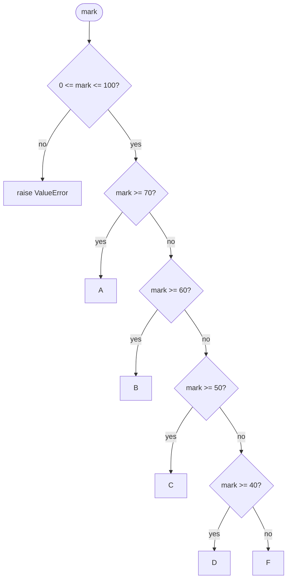

# PY-04 Conditions and Branching

> [!info] Topic card
> **Unit:** U1 · **Time:** 3 h · **Code:** `examples/py04_branching.py`, `exercises/py04_exercises.py`
> **Review first:** [[DM-01 Propositions, Connectives and Truth Tables]] (connectives) and, for §5.4, [[DM-02 Logical Equivalence and Laws of Logic]] (De Morgan).

## 1. Learning objectives
1. **Write** `if` / `elif` / `else` statements whose branches are **mutually exclusive and exhaustive**.
2. **Evaluate** Boolean expressions with `and`, `or`, `not`, comparison chains and truthiness, including **short-circuit** evaluation.
3. **Simplify** conditions using De Morgan's laws, and **restructure** deep nesting into guard clauses.
4. **Test boundary values** systematically (the place where branching bugs live).
5. **Use** conditional expressions and, where appropriate, `match` (Python 3.10+).

## 2. Why it matters
Branching is how programs make decisions: grading, access control, validation, pricing. Most branching bugs sit **on the boundaries** (`>` vs `>=`) or in **branch order**. Both are silent: the program runs and gives the wrong answer.

## 3. Prerequisites
[[PY-02 Variables, Types, Expressions and Operators]] (comparison operators, `bool`) and [[PY-03 Input, Output and String Formatting]].

## 4. Intuition
An `if`/`elif` chain is a **sequence of gates checked top to bottom**. The first gate that opens wins, and **all later gates are skipped**, even if they would also open. Ordering is therefore part of the logic.

## 5. Rigorous explanation

### 5.1 Syntax and semantics
```python
if condition_1:
    block_1
elif condition_2:      # tested only if condition_1 was falsy
    block_2
else:                  # runs if no condition was truthy
    block_3
```
Exactly **one** block of an `if/elif/else` chain executes. Without `else`, **zero or one** executes.

### 5.2 Truthiness
A condition need not be a `bool`. Python calls `bool(value)`. Falsy values are `False`, `None`, `0`, `0.0`, `""`, `[]`, `{}`, `set()` and `range(0)`. Everything else is truthy. `if items:` therefore means "if the list is non-empty".

### 5.3 Boolean operators and short-circuiting
| Expression | Evaluates `b`? | Result |
|---|---|---|
| `a and b` | only if `a` is truthy | `a` if `a` is falsy, else `b` |
| `a or b` | only if `a` is falsy | `a` if `a` is truthy, else `b` |
| `not a` | — | always a `bool` |

`and`/`or` return **one of their operands**, not necessarily `True`/`False`: `"" or "guest"` → `"guest"`. Short-circuiting makes **guards** safe: `if count != 0 and total / count > 50:` never divides by zero.

### 5.4 De Morgan's laws in code
$\lnot(p \land q) \equiv \lnot p \lor \lnot q$ and $\lnot(p \lor q) \equiv \lnot p \land \lnot q$ (proved with truth tables in [[DM-02 Logical Equivalence and Laws of Logic]]).
```python
# "not (valid age and valid email)" is the same as:
if not (age >= 18 and "@" in email): ...
if age < 18 or "@" not in email: ...       # usually clearer
```

### 5.5 Comparison chaining
`0 <= mark <= 100` means `0 <= mark and mark <= 100` (with `mark` evaluated once). Mathematically natural, and safer than writing two comparisons.

### 5.6 Conditional expression
`value_if_true if condition else value_if_false`, e.g. `label = "pass" if mark >= 50 else "fail"`. Use it for *choosing a value*, never for side effects or long chains.

### 5.7 `match` (structural pattern matching, 3.10+)
```python
def http_status_text(code: int) -> str:
    match code:
        case 200:
            return "OK"
        case 301 | 302:
            return "Redirect"
        case 404:
            return "Not Found"
        case _:
            return "Other"
```
`match` shines for **destructuring** shapes (tuples, dicts, objects). For numeric ranges, `if/elif` is clearer.

## 6. Terminology
| Term | Meaning |
|---|---|
| Condition / predicate | Expression evaluated for truthiness |
| Branch | One alternative block |
| Mutually exclusive | At most one branch can apply |
| Exhaustive | Every input is handled by some branch |
| Short-circuit | Stopping evaluation once the result is known |
| Guard clause | Early `return`/`raise` that handles a special case first |
| Boundary value | Input exactly at, just below and just above a threshold |

## 7. Step-by-step: designing a grade classifier
**Illustrative scale** (not your institution's official scale, so replace it with the official one when known): A 70–100, B 60–69, C 50–59, D 40–49, F 0–39. Invalid outside 0–100.
1. **Validate first** (guard): outside $[0, 100]$ → `ValueError`.
2. **Order thresholds from high to low**, so each `elif` implicitly knows the previous conditions were false.
3. **Choose boundary semantics:** 70 is an A, so use `>=`.
4. **List the boundary tests:** −1, 0, 39, 40, 49, 50, 59, 60, 69, 70, 100, 101, plus a fraction such as 69.5.

## 8. Diagram

*Text version: validate the range first, then test thresholds from the highest down. The first true test determines the grade.*

## 9. Worked examples

### Example 1 (basic): minimal code with line-by-line explanation
```python
def grade(mark: float) -> str:
    if not 0 <= mark <= 100:                 # guard: reject invalid input
        raise ValueError(f"mark out of range: {mark}")
    if mark >= 70:                           # highest band first
        return "A"
    elif mark >= 60:                         # here we KNOW mark < 70
        return "B"
    elif mark >= 50:
        return "C"
    elif mark >= 40:
        return "D"
    else:
        return "F"
```
**Trace for `mark = 65`:** guard false → `65 >= 70` false → `65 >= 60` **true** → return `"B"`. The remaining tests are never evaluated.

### Example 2 (intermediate): incorrect → bug → corrected
```python
# INCORRECT
def grade_wrong(mark):
    if mark >= 40:
        return "D"
    elif mark >= 50:
        return "C"
    elif mark >= 60:
        return "B"
    elif mark >= 70:
        return "A"
    return "F"
```
**Bug:** the order is wrong. `grade_wrong(95)` returns `"D"`, because `95 >= 40` opens the first gate. The `elif`s for C, B and A are **unreachable** for any mark ≥ 40. A second bug: there is no validation, so `grade_wrong(150)` returns `"D"`.
**Fix:** Example 1. **General rule:** with `>=` thresholds, test from highest to lowest. With `<` thresholds, test from lowest to highest.

**Boundary tests:**
| Input | Expected | Why test it |
|---|---|---|
| −1 / 101 | ValueError | just outside the range |
| 0 / 100 | F / A | range edges |
| 39 / 40 | F / D | D boundary |
| 69 / 69.5 / 70 | B / B / A | fractional marks just below a boundary |

### Example 3 (challenging): leap years, nesting vs flat logic
Gregorian rule: a year is a leap year if it is divisible by 4, **except** years divisible by 100, **unless** also divisible by 400.
```python
# Nested version (correct but hard to read)
def is_leap_nested(year: int) -> bool:
    if year % 4 == 0:
        if year % 100 == 0:
            if year % 400 == 0:
                return True
            return False
        return True
    return False

# Flat Boolean version
def is_leap(year: int) -> bool:
    return year % 4 == 0 and (year % 100 != 0 or year % 400 == 0)
```
**Verification table:**
| year | %4==0 | %100!=0 | %400==0 | leap? |
|---|---|---|---|---|
| 2023 | F | – | – | **False** (short-circuit at `and`) |
| 2024 | T | T | – | **True** (short-circuit at `or`) |
| 1900 | T | F | F | **False** |
| 2000 | T | F | T | **True** |

The parentheses matter: without them, `and` binds tighter than `or`, giving `(y%4==0 and y%100!=0) or y%400==0`. That happens to be equivalent here, but **write the parentheses anyway** so the reader doesn't have to know.

### Example 4 (transfer): guard clauses replace the "arrow" anti-pattern
```python
# Deeply nested ("arrow code")
def can_borrow(member, book):
    if member is not None:
        if member["active"]:
            if member["loans"] < 3:
                if book["available"]:
                    return True
    return False

# Guard clauses: each special case exits early
def can_borrow_v2(member, book) -> bool:
    if member is None or not member["active"]:
        return False
    if member["loans"] >= 3:
        return False
    return book["available"]
```
Same truth table, but each rule now reads as one line. This function reappears in [[PRJ-PY-03 Library Management System]].

## 10. Application: access-control decision
In [[CS-04 Authorization and Access Control]] you will see role-based checks such as `if user.role == "admin" or (user.role == "lecturer" and course in user.courses):`. The same skills of precedence, short-circuiting and exhaustive branches decide **security** outcomes. A wrong branch order is a privilege-escalation bug.

## 11. Common mistakes
| Mistake | Why | Fix |
|---|---|---|
| `if x == 1 or 2:` | Reads like English | `if x == 1 or x == 2:` or `if x in (1, 2):`. `or 2` is always truthy. |
| `=` instead of `==` in a condition | Habit from maths | `if x = 1:` is a SyntaxError in Python, a useful protection |
| Thresholds out of order | Not realising elif chains stop at the first match | Order from most to least specific |
| `if flag == True:` | Over-explicit | `if flag:` |
| `if items != []:` | Not knowing truthiness | `if items:` |
| Missing `else`, so the function returns `None` | Non-exhaustive branches | Add a final `else` or a `return` |
| Comparing floats with `==` | See [[PY-02 Variables, Types, Expressions and Operators]] | Use `math.isclose` |

## 12. Comparison
| Construct | Best for |
|---|---|
| `if/elif/else` | Ranges, arbitrary conditions |
| Conditional expression | Choosing between two values inline |
| `match` | Matching structure or many literal cases |
| Dictionary lookup `{"A": 4, "B": 3}[g]` | Mapping keys to values without logic ([[PY-11 Dictionaries, Sets and Comprehensions]]) |

## 13. Practice
**L1** 1. What is `"" or 0 or "x"`? What is `5 and 0`? 2. List six falsy values.

**L2** *(code bank `py04_exercises.py`)* 3. `grade(mark)` (Example 1 scale). 4. `is_leap(year)`. 5. `max_of_three(a, b, c)` without using `max()`.

**L3** 6. `classify_triangle(a, b, c)` returns `"invalid"` (non-positive side or triangle inequality violated), `"equilateral"`, `"isosceles"` or `"scalene"`. 7. `ticket_price(age, is_student)`: under 5 free (0); 5–17 → 2000; 18+ → 5000; students aged 18+ get 50% off; age < 0 → `ValueError`.

**L4** 8. Rewrite `not (a > 10 or b <= 5)` without `not`, and prove the equivalence with a truth table (two variables p, q). 9. `quadrant(x, y)` returns 1–4, `"x-axis"`, `"y-axis"` or `"origin"`. Identify every boundary case before coding.

**L5** 10. A shop's discount rules: 10% for orders ≥ 100 000; extra 5% for loyalty members; never more than 12% total; no discount on gift cards. Write `discount_rate(total, is_member, is_gift_card)`, list your test cases, and explain how you ensured the branches are exhaustive.

**Variation:** change `grade` to also return grade points (A=5, B=4, C=3, D=2, F=0) as a tuple `(letter, points)`. Can you avoid duplicating the thresholds?

## 14. Hints
> [!tip]- Hints
> 6: Check validity first. Triangle inequality: each side < the sum of the other two. 8: Apply De Morgan, then negate each comparison. 9: Handle `x == 0` and `y == 0` before the quadrants. 10: Handle the gift card first (guard), then compute and cap: `min(rate, 0.12)`.

## 15. Worked solutions
> [!success]- Solution 1–2
> 1. `"" or 0 or "x"` → `"x"` (the first truthy operand). `5 and 0` → `0` (`5` is truthy, so the result is the second operand). 2. `False`, `None`, `0`, `0.0`, `""`, `[]` (also `{}`, `set()`, `()`, `range(0)`).

> [!success]- Solutions 3–5
> `grade` and `is_leap` are shown in the examples.
> ```python
> def max_of_three(a, b, c):
>     largest = a
>     if b > largest:
>         largest = b
>     if c > largest:
>         largest = c
>     return largest
> ```
> Note the use of **separate** `if`s, not `elif`: each comparison must run.

> [!success]- Solution 6
> ```python
> def classify_triangle(a: float, b: float, c: float) -> str:
>     if a <= 0 or b <= 0 or c <= 0:
>         return "invalid"
>     if a + b <= c or a + c <= b or b + c <= a:
>         return "invalid"
>     if a == b == c:
>         return "equilateral"
>     if a == b or b == c or a == c:
>         return "isosceles"
>     return "scalene"
> ```
> Order matters: equilateral before isosceles, since every equilateral triangle also satisfies the isosceles test. Degenerate triangles (`1, 2, 3`) are invalid because of `<=`.

> [!success]- Solution 7
> ```python
> def ticket_price(age: int, is_student: bool) -> int:
>     if age < 0:
>         raise ValueError("age cannot be negative")
>     if age < 5:
>         return 0
>     if age < 18:
>         return 2000
>     return 2500 if is_student else 5000
> ```
> The tests cover ages −1, 0, 4, 5, 17 and 18, with and without student status.

> [!success]- Solution 8
> $\lnot(p \lor q) \equiv \lnot p \land \lnot q$ with $p$: `a > 10` and $q$: `b <= 5` gives `a <= 10 and b > 5`.
> | p | q | p∨q | ¬(p∨q) | ¬p | ¬q | ¬p∧¬q |
> |---|---|---|---|---|---|---|
> | T | T | T | F | F | F | F |
> | T | F | T | F | F | T | F |
> | F | T | T | F | T | F | F |
> | F | F | F | T | T | T | T |
> The ¬(p∨q) and ¬p∧¬q columns are identical, so the two expressions are equivalent.

> [!success]- Solution 9
> ```python
> def quadrant(x: float, y: float):
>     if x == 0 and y == 0:
>         return "origin"
>     if y == 0:
>         return "x-axis"
>     if x == 0:
>         return "y-axis"
>     if x > 0:
>         return 1 if y > 0 else 4
>     return 2 if y > 0 else 3
> ```
> Boundaries: (0,0), (5,0), (−5,0), (0,5), (0,−5), plus one point per quadrant.

> [!success]- Solution 10
> ```python
> def discount_rate(total: float, is_member: bool, is_gift_card: bool) -> float:
>     if is_gift_card:
>         return 0.0
>     rate = 0.0
>     if total >= 100_000:
>         rate += 0.10
>     if is_member:
>         rate += 0.05
>     return min(rate, 0.12)
> ```
> **Exhaustiveness:** the inputs form $2 \times 2 \times 2 = 8$ classes (gift card or not, total above or below the threshold, member or not). The tests pick one value in each class, plus the boundary `total = 99_999` / `100_000`. Using additive `if`s (not `elif`) is deliberate, because the rules *combine*. Note that a member below the threshold gets 5%: the rules don't say the loyalty bonus needs the threshold. **Ambiguity like this should be clarified with the client** (see [[SD-03 Requirements Engineering]]).

> [!success]- Variation answer
> ```python
> BANDS = [(70, "A", 5), (60, "B", 4), (50, "C", 3), (40, "D", 2), (0, "F", 0)]
> def grade_with_points(mark: float) -> tuple[str, int]:
>     if not 0 <= mark <= 100:
>         raise ValueError(mark)
>     for threshold, letter, points in BANDS:
>         if mark >= threshold:
>             return letter, points
> ```
> Data-driven: the thresholds live in **one** table, so changing the scale means editing data, not logic. This uses a loop ([[PY-05 Loops and Iteration]]).

## 16. Self-test (pass ≥ 4/5)
1. Why does `if x == 1 or 2:` always run? 2. Value of `None or []`? 3. Rewrite `not (x < 0 and y < 0)`. 4. Which branch runs for `mark=70` in Example 2's incorrect code? 5. What do mutually exclusive and exhaustive mean?
> [!success]- Answers
> 1. It parses as `(x == 1) or 2`, and `2` is truthy. 2. `[]`. 3. `x >= 0 or y >= 0`. 4. `"D"`. 5. At most one branch applies, and every input is handled.

## 17. Flashcards
#flashcards/python
What does `a or b` return?::a if a is truthy, otherwise b (one of the operands, not necessarily a bool).
Why order `>=` thresholds from highest to lowest in an elif chain?::The first true condition wins; a low threshold first would capture higher values.
De Morgan for `not (p and q)`?::(not p) or (not q)
What is a guard clause?::An early return/raise that handles a special case first, reducing nesting.
List falsy values::False, None, 0, 0.0, "", [], {}, set(), (), range(0)
What is `0 <= x <= 100` equivalent to?::0 <= x and x <= 100, with x evaluated once.

## 18. Blank-page recall
Write the leap-year rule as a single Boolean expression, and the truth table that verifies it. Write the falsy values. Draw the grading flowchart.

## 19. Revision summary
- An `elif` chain stops at the first truthy condition, so order matters.
- Validate first with guard clauses, then handle the normal cases.
- `and`/`or` short-circuit and return operands. Use them for safe guards.
- De Morgan helps remove `not`. Comparison chains express ranges.
- Test every boundary: just below, at, just above.

## 20. Links
Prev: [[PY-03 Input, Output and String Formatting]] · Next: [[PY-05 Loops and Iteration]] · Logic: [[DM-02 Logical Equivalence and Laws of Logic]] · Integration: [[X-01 Logic and Sets in Python and Requirements]] · Testing boundaries: [[SD-14 Software Testing, Verification and Validation]]

## 21. Sources
- Python docs, *Compound statements: the `if` statement* and *the `match` statement*: https://docs.python.org/3/reference/compound_stmts.html
- Python docs, *Boolean operations*: https://docs.python.org/3/reference/expressions.html#boolean-operations
- PEP 636 *Structural Pattern Matching: Tutorial*: https://peps.python.org/pep-0636/

## 22. Mastery checklist
- [ ] `py04` tests pass with `PY_TARGET=exercises`
- [ ] I can list the boundary tests for any threshold rule
- [ ] Self-test ≥ 4/5 · L4 problem explained · reviews scheduled
