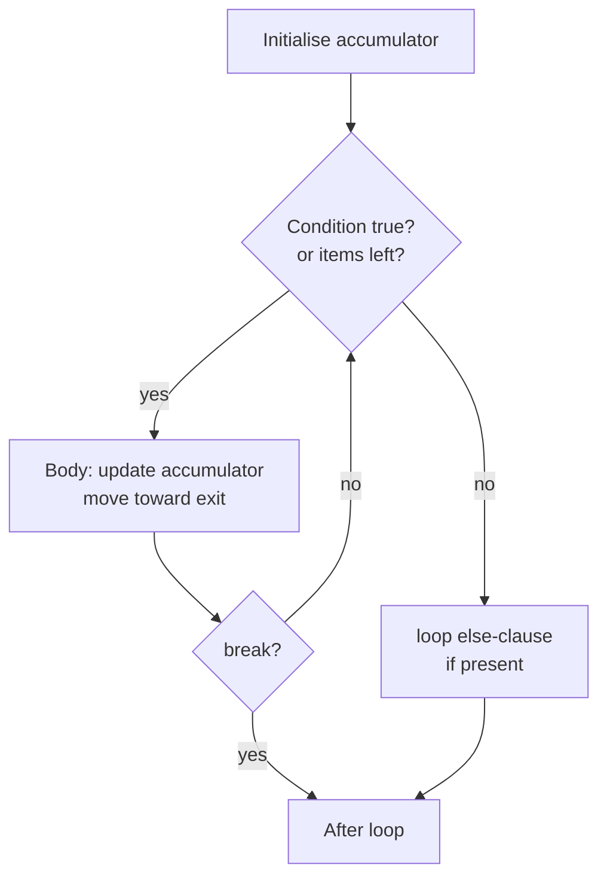

# PY-05 Loops and Iteration

> [!info] Topic card
> **Unit:** U1 · **Time:** 4 h · **Code:** `examples/py05_loops.py`, `exercises/py05_exercises.py`

## 1. Learning objectives
1. **Choose** between `for` (definite iteration over a collection or range) and `while` (iteration until a condition changes).
2. **Apply** the standard loop patterns: accumulator, counter, search with early exit, sentinel/validation loop, and nested loops.
3. **Use** `range`, `break`, `continue`, `enumerate`, `zip` and the loop `else` clause correctly.
4. **Trace** loops with trace tables, and **state a loop invariant** to argue correctness.
5. **Detect and fix** off-by-one errors and infinite loops. **Count** iterations to estimate cost.

## 2. Why it matters
Loops let a fixed amount of code process unbounded data: every mark in a class, every line in a log, every candidate prime. They are also where most runtime cost lives, which is the starting point for complexity in [[PY-12 Searching, Sorting and Complexity]].

## 3. Prerequisites
[[PY-04 Conditions and Branching]]: loop conditions and `if` inside loops.

## 4. Intuition
- `for` says: "**for each** item in this collection, do the block". You know what you're iterating over.
- `while` says: "**as long as** this is true, keep going". You know the stopping condition, not the count.
Every `while` loop needs **something in its body that moves toward making the condition false**. Otherwise it never ends.

## 5. Rigorous explanation

### 5.1 `for` loops and iterables
```python
for item in iterable:
    body
```
`iterable` is anything Python can step through: `range`, `str`, `list`, `tuple`, `dict` (its keys), `set`, files (lines)… On each step, the next element is bound to `item` and the body runs. Mechanically, `for` calls `iter()` once and then `next()` until `StopIteration` ([[PY-18 Iterators, Generators, Decorators and Context Managers]]).

### 5.2 `range(start, stop, step)`
Generates `start, start+step, …` **up to but not including** `stop`. `range(5)` → 0,1,2,3,4. `range(1, 6)` → 1..5. `range(10, 0, -2)` → 10,8,6,4,2. The number of values in `range(a, b)` is `b - a` (for `b ≥ a`). `range` is lazy and uses $O(1)$ memory.

### 5.3 `while` loops
```python
while condition:
    body        # must eventually make condition false (or break)
```
The condition is checked **before** each iteration, so the body may run zero times.

### 5.4 `break`, `continue` and the loop `else`
- `break` exits the innermost loop immediately.
- `continue` skips to the next iteration.
- `else` on a loop runs **only if the loop finished without `break`**. It's ideal for "searched everything, found nothing".
```python
for n in [3, 7, 11]:
    if n % 2 == 0:
        print("found even", n)
        break
else:
    print("no even number")    # runs: no break happened
```

### 5.5 `enumerate` and `zip`
```python
for i, name in enumerate(["Ali", "Bea"], start=1):   # 1 Ali, 2 Bea
    print(i, name)
for name, mark in zip(["Ali", "Bea"], [71, 64]):     # pairs elements
    print(name, mark)
```
Prefer these to `for i in range(len(xs))`. `zip` stops at the **shortest** input. Use `zip(a, b, strict=True)` (3.10+) to get an error when the lengths differ.

### 5.6 Loop invariants
A **loop invariant** is a statement that is true before the loop starts, stays true after every iteration, and, combined with the exit condition, gives the result you want. For the sum $1+\dots+n$:
- Invariant: at the top of each iteration, `total == 1 + 2 + … + (i - 1)`.
- Initially `i = 1`, `total = 0` (the empty sum) ✔. Each iteration adds `i` and increments it ✔. At exit `i = n + 1`, so `total == 1 + … + n` ✔.
This is the same reasoning as **mathematical induction** ([[DM-09 Mathematical Induction]]).

### 5.7 Counting iterations (cost)
A single loop over $n$ items does $n$ iterations, which is $O(n)$. Two **nested** loops over $n$ items do $n \times n = n^2$, which is $O(n^2)$. The triangular nested loop `for i in range(n): for j in range(i):` does $0+1+\dots+(n-1) = \frac{n(n-1)}{2}$ iterations, still $O(n^2)$ ([[DM-08 Sequences and Summations]]).

## 6. Terminology
| Term | Meaning |
|---|---|
| Iteration | One execution of the loop body |
| Iterable | Object that can be looped over |
| Accumulator | Variable that builds up a result (sum, product, list) |
| Sentinel | Special input value that signals the end (e.g. `-1`, `"q"`) |
| Loop invariant | Property true before and after every iteration |
| Off-by-one error | Loop runs one time too many or too few |
| Infinite loop | Loop whose exit condition never becomes true |

## 7. Step-by-step: the input-validation loop pattern
1. Loop forever (`while True:`).
2. Read the input.
3. If valid → `break` (or `return`).
4. Otherwise print a helpful message and loop again.
```python
while True:
    text = input("Mark (0-100): ").strip()
    if text.isdigit() and 0 <= int(text) <= 100:
        mark = int(text)
        break
    print("Please enter a whole number from 0 to 100.")
```

## 8. Diagram

*Text version: initialise, then check the condition. If true, run the body (which can break out directly) and check again. When the condition becomes false, the optional else clause runs, then execution continues after the loop. A `break` skips the else clause.*

## 9. Worked examples

### Example 1 (basic): accumulator. Code, trace and complexity
```python
def sum_to(n: int) -> int:
    total = 0
    for i in range(1, n + 1):   # n + 1 because stop is excluded
        total += i
    return total
```
Trace for `n = 4`:
| iteration | i | total after |
|---|---|---|
| start | – | 0 |
| 1 | 1 | 1 |
| 2 | 2 | 3 |
| 3 | 3 | 6 |
| 4 | 4 | 10 |
Result 10. Check with Gauss's formula $\frac{n(n+1)}{2} = \frac{4 \cdot 5}{2} = 10$ ✔. Time $O(n)$, space $O(1)$. The formula itself is $O(1)$. A good algorithm beats a good loop.

**Incorrect version:**
```python
def sum_to_wrong(n):
    total = 0
    for i in range(n):      # 0..n-1: includes 0, excludes n
        total += i
    return total
```
`sum_to_wrong(4)` gives `6`, an **off-by-one** error. `range(n)` stops *before* `n`. **Fix:** `range(1, n + 1)`.

### Example 2 (intermediate): search with early exit and `while`. Primality
```python
def is_prime(n: int) -> bool:
    if n < 2:
        return False
    d = 2
    while d * d <= n:        # only need divisors up to sqrt(n)
        if n % d == 0:
            return False     # early exit: found a factor
        d += 1
    return True
```
**Why `d * d <= n`?** If $n = a \cdot b$ with $a \le b$, then $a \le \sqrt{n}$. So if there's no divisor up to $\sqrt{n}$, there's none at all. This reduces the cost from $O(n)$ to $O(\sqrt{n})$.
Trace for `n = 91`: d=2 (91%2=1), d=3 (1), d=4 (3), d=5 (1), d=6 (1), d=7 → 91 % 7 == 0 → `False` (91 = 7·13).
**Edge cases:** 0, 1 and negatives → False. 2 → loop doesn't run (4 > 2) → True. 4 → d=2 divides → False.

### Example 3 (challenging): nested loops. Multiplication table as a string
```python
def multiplication_table(n: int) -> str:
    rows = []
    for i in range(1, n + 1):
        cells = []
        for j in range(1, n + 1):
            cells.append(f"{i * j:4d}")
        rows.append("".join(cells))
    return "\n".join(rows)

print(multiplication_table(3))
```
```text
   1   2   3
   2   4   6
   3   6   9
```
The inner loop runs completely for **each** outer iteration: $n^2$ cells. Returning a string makes the function testable ([[PY-03 Input, Output and String Formatting]]).

### Example 4 (challenging): `while` with an unknown count. Collatz steps
Rule: if `n` is even, `n = n // 2`. Otherwise `n = 3n + 1`. Count the steps until `n == 1`.
```python
def collatz_steps(n: int) -> int:
    if n < 1:
        raise ValueError("n must be >= 1")
    steps = 0
    while n != 1:
        n = n // 2 if n % 2 == 0 else 3 * n + 1
        steps += 1
    return steps
```
`collatz_steps(6)`: 6→3→10→5→16→8→4→2→1 = **8 steps**. Nobody has proved this loop terminates for every `n` (the Collatz conjecture is open), but it has been checked for enormous ranges. It is a real example of a loop whose termination is *not obvious*. Without the `n < 1` guard, `n = 0` would loop forever (0 is even, and 0 // 2 = 0).

## 10. Application: a validated menu loop
Every command-line project ([[PRJ-PY-01 Student Marks and Grading System]], [[PRJ-PY-02 Personal Expense Tracker]]) runs a menu like this:
```python
def run_menu():
    while True:
        choice = input("[a]dd  [l]ist  [q]uit > ").strip().lower()
        if choice == "q":
            break
        elif choice == "a":
            print("adding…")
        elif choice == "l":
            print("listing…")
        else:
            print(f"Unknown option {choice!r}")
```

## 11. Common mistakes
| Mistake | Why | Fix |
|---|---|---|
| `range(1, n)` when you need 1..n | `stop` is exclusive | `range(1, n + 1)` |
| Forgetting to update the `while` variable | The condition never changes | Update it in the body. Check every path. |
| Changing a list while iterating over it | Indexes shift, so items get skipped | Iterate over a copy, or build a new list ([[PY-10 Lists and Tuples]]) |
| `for i in range(len(xs)): print(xs[i])` | C habit | `for x in xs:` or `enumerate(xs)` |
| Resetting the accumulator inside the loop | Wrong placement | Initialise it **before** the loop |
| Expecting `else` to mean "if the loop didn't run" | Misleading name | `else` means "loop ended without `break`" |
| Shadowing the loop variable in the inner loop | Both use `i` | Use distinct names (`i`, `j`) |

## 12. Comparison
| Need | Use |
|---|---|
| Each element of a collection | `for x in xs` |
| Element and its index | `for i, x in enumerate(xs)` |
| Two collections in parallel | `for a, b in zip(xs, ys)` |
| Repeat until a condition holds (unknown count) | `while cond:` |
| Retry until valid input | `while True:` + `break` |
| Build a new list from an old one | Comprehension ([[PY-11 Dictionaries, Sets and Comprehensions]]) |

## 13. Practice
**L1** 1. List the values of `range(2, 11, 3)` and `range(5, 0, -1)`. 2. How many times does `for i in range(3): for j in range(4): ...` run its inner body?

**L2** *(code bank)* 3. `sum_to(n)`. 4. `factorial(n)` iteratively (`factorial(0) == 1`; `ValueError` for negatives). 5. `count_multiples(n, k)`: how many of 1..n are divisible by `k`, using a loop.

**L3** 6. `is_prime(n)`. 7. `fizzbuzz(n)` returns a list of strings for 1..n ("Fizz" for multiples of 3, "Buzz" for 5, "FizzBuzz" for both, otherwise the number as a string). 8. `multiplication_table(n)`.

**L4** 9. `collatz_steps(n)`. 10. `right_triangle(h)` returns this pattern for `h = 3` (no trailing spaces):
```text
*
**
***
```
And `pyramid(h)` returns the centred version (`"  *"`, `" ***"`, `"*****"`).

**L5** 11. `primes_up_to(n)` using the **Sieve of Eratosthenes**. Compare its number of operations with calling `is_prime` for each number, and explain which you'd use for $n = 10^6$.

**Variation:** modify `fizzbuzz` to take a list of `(divisor, word)` rules, e.g. `[(3, "Fizz"), (5, "Buzz"), (7, "Bazz")]`.

## 14. Hints
> [!tip]- Hints
> 5: The count is `n // k`, but write the loop anyway and then check it against this formula. 7: Test divisibility by 15 (or both 3 and 5) **first**. 10: The row `i` of the pyramid has `h - i` spaces and `2i - 1` stars. 11: Make a list `is_p = [True] * (n + 1)`. For each `p` from 2 while `p*p <= n`, if `is_p[p]`, mark `p*p, p*p + p, …` as False.

## 15. Worked solutions
> [!success]- Solution 1–2
> 1. `2, 5, 8` (11 is excluded) and `5, 4, 3, 2, 1`. 2. $3 \times 4 = 12$ times.

> [!success]- Solutions 3–5
> ```python
> def factorial(n: int) -> int:
>     if n < 0:
>         raise ValueError("n must be >= 0")
>     result = 1                 # the empty product
>     for k in range(2, n + 1):
>         result *= k
>     return result
>
> def count_multiples(n: int, k: int) -> int:
>     count = 0
>     for i in range(1, n + 1):
>         if i % k == 0:
>             count += 1
>     return count               # equals n // k
> ```
> **Invariant for factorial:** after processing `k`, `result == k!`. Initialising with 1 (not 0) makes `factorial(0) == factorial(1) == 1`.

> [!success]- Solution 7
> ```python
> def fizzbuzz(n: int) -> list[str]:
>     out = []
>     for i in range(1, n + 1):
>         if i % 15 == 0:
>             out.append("FizzBuzz")
>         elif i % 3 == 0:
>             out.append("Fizz")
>         elif i % 5 == 0:
>             out.append("Buzz")
>         else:
>             out.append(str(i))
>     return out
> ```
> A common wrong answer tests `% 3` first, so 15 becomes "Fizz". This is the same ordering bug as in [[PY-04 Conditions and Branching]].

> [!success]- Solution 10
> ```python
> def right_triangle(h: int) -> str:
>     return "\n".join("*" * i for i in range(1, h + 1))
>
> def pyramid(h: int) -> str:
>     rows = []
>     for i in range(1, h + 1):
>         rows.append(" " * (h - i) + "*" * (2 * i - 1))
>     return "\n".join(rows)
> ```
> Derivation: the last row has $2h-1$ stars and 0 spaces. Each row above it has 2 fewer stars and 1 more leading space. So row $i$ has $2i-1$ stars and $h-i$ spaces.

> [!success]- Solution 11
> ```python
> def primes_up_to(n: int) -> list[int]:
>     if n < 2:
>         return []
>     is_p = [True] * (n + 1)
>     is_p[0] = is_p[1] = False
>     p = 2
>     while p * p <= n:
>         if is_p[p]:
>             for multiple in range(p * p, n + 1, p):
>                 is_p[multiple] = False
>         p += 1
>     return [i for i in range(n + 1) if is_p[i]]
> ```
> **Cost comparison:** trial division costs up to $\sqrt{k}$ per number, about $O(n\sqrt{n})$ in total (roughly $\tfrac{2}{3}n^{1.5} \approx 7 \times 10^8$ divisions in the worst case for $n=10^6$; far fewer in practice because most numbers have a small factor). The sieve costs $O(n \log\log n)$, a few million operations for $n=10^6$, but it uses $O(n)$ memory. **For all primes up to $10^6$, use the sieve. To test one large number, use `is_prime`.** Starting at `p*p` is valid because smaller multiples `p·k` with `k < p` were already crossed out by the prime factors of `k`.

> [!success]- Variation answer
> ```python
> def fizzbuzz_rules(n: int, rules: list[tuple[int, str]]) -> list[str]:
>     out = []
>     for i in range(1, n + 1):
>         word = "".join(w for d, w in rules if i % d == 0)
>         out.append(word or str(i))
>     return out
> ```
> Concatenating words removes the need for a special "15" case. The combination rule emerges from the data.

## 16. Self-test (pass ≥ 4/5)
1. When does a loop's `else` run? 2. How many iterations does `for i in range(n): for j in range(i):` make? 3. Why `d * d <= n` in `is_prime`? 4. What's wrong with `while x > 0: print(x)`? 5. Why initialise a product accumulator with 1?
> [!success]- Answers
> 1. When the loop ends without `break`. 2. $n(n-1)/2$. 3. Any factorisation has a factor ≤ √n. 4. `x` never changes, so it's an infinite loop when `x > 0`. 5. 1 is the multiplicative identity, and the empty product is 1.

## 17. Flashcards
#flashcards/python
Is `stop` included in `range(start, stop)`?::No, it is exclusive. range(1, n+1) gives 1..n.
When does the `else` block of a loop run?::Only when the loop finishes without break.
What must every while loop body do?::Make progress toward making the condition false (or break).
Pythonic way to get index and value?::for i, x in enumerate(xs)
Iterations of two nested loops over n items?::n², i.e. O(n²)
What is a loop invariant?::A property true before and after every iteration that, with the exit condition, implies correctness.

## 18. Blank-page recall
Write the five loop patterns (accumulator, counter, early-exit search, validation loop, nested) with a 3-line skeleton for each.

## 19. Revision summary
- `for` → known collection. `while` → unknown count, so guarantee progress.
- `range` excludes `stop`, the classic source of off-by-one errors.
- `break` exits, `continue` skips, and loop `else` means "no break".
- Prefer `enumerate`/`zip` to manual indexing.
- Loop invariants prove correctness. Counting iterations estimates cost.

## 20. Links
Prev: [[PY-04 Conditions and Branching]] · Next: [[PY-06 Functions, Parameters, Return Values and Scope]] · Theory: [[DM-08 Sequences and Summations]], [[DM-09 Mathematical Induction]] · Tracing: [[PY-08 Algorithmic Thinking, Pseudocode, Flowcharts and Tracing]]

## 21. Sources
- Python docs, *More Control Flow Tools* (tutorial §4): https://docs.python.org/3/tutorial/controlflow.html
- Python docs, *Built-in Functions*: `range`, `enumerate`, `zip`: https://docs.python.org/3/library/functions.html
- Cormen, Leiserson, Rivest & Stein, *Introduction to Algorithms*, 4th ed., MIT Press, 2022, §2.1 (loop invariants).

## 22. Mastery checklist
- [ ] `py05` tests pass with `PY_TARGET=exercises`
- [ ] I can state an invariant for a summation or search loop
- [ ] Sieve vs trial division explained (L5) · reviews scheduled
