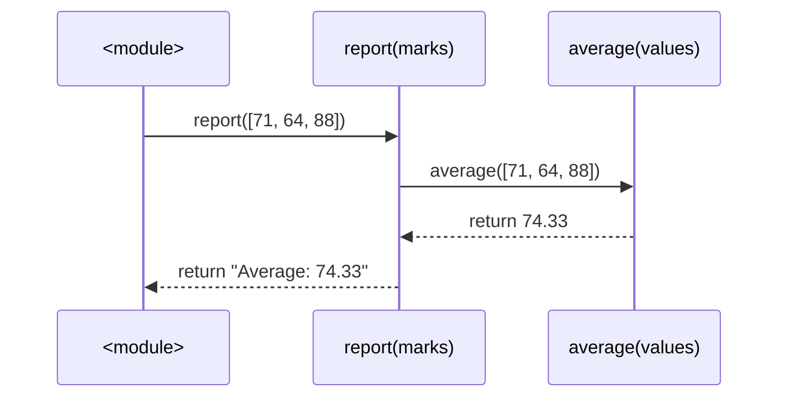
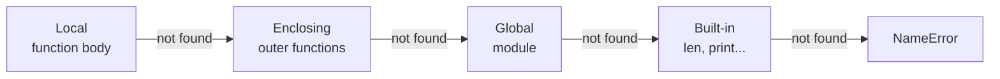
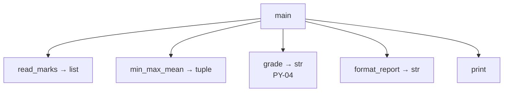

# PY-06 Functions, Parameters, Return Values and Scope

> [!info] Topic card
> **Unit:** U2 · **Time:** 4–5 h · **Code:** `examples/py06_functions.py`, `exercises/py06_exercises.py`

## 1. Learning objectives
1. **Define** and **call** functions, and **distinguish** parameters from arguments and returning from printing.
2. **Use** positional, keyword, default, `*args`, `**kwargs` and keyword-only parameters.
3. **Explain** Python's argument passing ("pass by object reference") and **avoid** the mutable-default trap.
4. **Apply** the LEGB scope rule, and **use** `global`/`nonlocal` only when justified.
5. **Design** small, pure, well-named functions with docstrings, and **decompose** a problem into them.
6. **Treat functions as values**: pass them as arguments, return them, write lambdas and closures.

## 2. Why it matters
Functions are the basic unit of **abstraction**. A name hides details, so you can think at a higher level. They are also the unit of **testing**: every test in this vault calls a function. Poor function design (long, side-effecting, vaguely named) is the most common cause of unmaintainable student code ([[SD-06 Modular Design, Cohesion and Coupling]]).

## 3. Prerequisites
[[PY-05 Loops and Iteration]] (bodies with loops) and [[PY-04 Conditions and Branching]] (guard clauses).

## 4. Intuition
A function is a **named recipe**. Parameters are the **ingredient slots** in the recipe. Arguments are the **actual ingredients** you hand over at each call. `return` hands back the **dish**. Printing is like describing the dish aloud: the caller can't eat a description.

## 5. Rigorous explanation

### 5.1 Definition and call
```python
def area(width: float, height: float) -> float:
    """Return the area of a width x height rectangle."""
    return width * height

result = area(3, 4)       # arguments 3 and 4 bound to parameters width, height
```
- `def` creates a **function object** and binds it to the name `area` ([[PY-01 How Python Executes Programs and Environment Setup]]).
- A call creates a new **frame** (local namespace), binds the parameters, runs the body, and returns the value of the `return` expression. **No `return`** (or bare `return`) returns `None`.
- `return` **ends** the function immediately.
- Type hints (`: float`, `-> float`) are documentation checked by tools such as mypy, **not** by Python at runtime ([[PY-19 Type Hints, Documentation, Clean Code and Refactoring]]).

### 5.2 Kinds of parameters
```python
def make_report(title, *rows, sep="\n", upper=False, **meta):
    ...
make_report("Marks", "Ali 71", "Bea 64", sep="; ", author="Dr K")
```
| Kind | Syntax | Bound from |
|---|---|---|
| Positional-or-keyword | `title` | Position or `title=` |
| Default | `sep="\n"` | Used when the argument is omitted |
| Variadic positional | `*rows` | Extra positional arguments, as a **tuple** |
| Keyword-only | parameters after `*` or `*args` | Must be passed by name |
| Variadic keyword | `**meta` | Extra keyword arguments, as a **dict** |
| Positional-only (3.8+) | parameters before `/` | Position only |

Order in a definition: `def f(pos_only, /, normal, *args, kw_only, **kwargs)`.

### 5.3 Argument passing: "call by object reference"
Python binds each **parameter name to the same object** the caller passed. No copy is made.
- If the function **rebinds** the parameter (`x = x + 1`), the caller is unaffected.
- If the function **mutates** a mutable object (`items.append(...)`), the caller **sees the change**.
```python
def rebind(n):
    n = n + 1          # new int object; caller's variable unchanged

def mutate(items):
    items.append(99)   # same list object; caller sees 99

a, b = 1, [1]
rebind(a); mutate(b)
print(a, b)            # 1 [1, 99]
```

### 5.4 The mutable-default trap
Default values are evaluated **once**, when `def` runs, not on every call.
```python
def add_item_wrong(item, basket=[]):     # ONE list shared by all calls
    basket.append(item)
    return basket

print(add_item_wrong("pen"))     # ['pen']
print(add_item_wrong("book"))    # ['pen', 'book']  surprise!
```
**Correct idiom:** use `None` as a sentinel.
```python
def add_item(item, basket=None):
    if basket is None:
        basket = []                 # fresh list on every call
    basket.append(item)
    return basket
```

### 5.5 Scope: the LEGB rule
To resolve a name, Python searches **L**ocal → **E**nclosing function(s) → **G**lobal (module) → **B**uilt-in.
- Assigning to a name anywhere inside a function makes it **local to that function** for the **whole body**, unless it is declared `global` or `nonlocal`.
```python
count = 0
def increment():
    count += 1        # UnboundLocalError: count is local (assigned here) but read before assignment
```
- `global count` lets the function rebind the module variable. `nonlocal x` rebinds a variable of the enclosing function. **Prefer returning values** over either: global state makes functions hard to test and reason about.

### 5.6 Functions are first-class objects
Functions can be stored in variables, passed as arguments, and returned.
```python
def apply_twice(f, x):
    return f(f(x))
print(apply_twice(lambda v: v * 3, 2))         # 18

names = ["bea", "Ali", "chen"]
print(sorted(names, key=str.lower))             # ['Ali', 'bea', 'chen']
```
A **closure** is a function that remembers variables from the enclosing scope:
```python
def make_multiplier(k):
    def multiply(x):
        return x * k      # k captured from the enclosing scope
    return multiply
triple = make_multiplier(3)
print(triple(10))         # 30
```

### 5.7 Pure functions and side effects
A **pure** function's result depends only on its arguments, and it changes nothing outside itself (no printing, no global writes, no mutation of its inputs). Pure functions are trivially testable and safe to reuse. Programs still need effects (I/O). **Push effects to the edges**: pure core, thin I/O shell ([[PY-03 Input, Output and String Formatting]]).

### 5.8 The call stack
Each call pushes a frame. `return` pops it. Tracebacks print this stack ([[PY-01 How Python Executes Programs and Environment Setup]]). Deep recursion pushes many frames ([[PY-07 Recursion]]).

## 6. Terminology
| Term | Meaning |
|---|---|
| Parameter | Name in the definition |
| Argument | Value supplied in a call |
| Return value | Value sent back to the caller (`None` by default) |
| Frame | A call's local namespace and execution state |
| Scope | Region of code where a name is visible |
| Side effect | Observable change outside the function |
| Pure function | No side effects; output depends only on inputs |
| Closure | Inner function that captures enclosing variables |
| Higher-order function | Function taking or returning functions |
| Docstring | String literal first in a function, describing it |

## 7. Step-by-step: designing a function
1. **Name** it with a verb phrase describing *what*, not *how*: `average_mark`, not `loop_and_divide`.
2. **Decide** the inputs (parameters) and the output (return type). Avoid hidden inputs such as globals.
3. **Write** the docstring and 2–3 example calls *first*. They become tests ([[PY-20 Testing, Debugging and Test-Driven Development]]).
4. **Handle** invalid input with guard clauses.
5. **Implement** the core in ≤ ~20 lines. Longer than that, and it probably does two things, so split it.

## 8. Diagrams

### 8.1 Call stack while `report()` calls `average()`

*Text version: the module calls `report`, which calls `average`. `average` returns 74.33 to `report`, which builds and returns a string to the module. Each call has its own frame, removed when it returns.*

### 8.2 LEGB lookup


## 9. Worked examples

### Example 1 (basic): return vs print
```python
# INCORRECT
def average_wrong(values):
    print(sum(values) / len(values))

result = average_wrong([70, 80])   # prints 75.0
print(result + 5)                  # TypeError: unsupported operand type(s) for +: 'NoneType' and 'int'
```
**Bug:** the function prints but returns `None`.
```python
# CORRECTED
def average(values: list[float]) -> float:
    """Return the arithmetic mean of a non-empty list."""
    if not values:
        raise ValueError("average of empty list")
    return sum(values) / len(values)

print(average([70, 80]) + 5)       # 80.0
```
**Edge cases:** `[]` → `ValueError` (the alternative, `ZeroDivisionError`, would be less clear to the caller). One element → that element. Negative numbers → fine.
**Complexity:** $O(n)$ time, $O(1)$ extra space.

### Example 2 (intermediate): multiple return values and a trace
```python
def min_max_mean(values):
    lo = hi = values[0]
    total = 0
    for v in values:
        if v < lo:
            lo = v
        if v > hi:
            hi = v
        total += v
    return lo, hi, total / len(values)   # a tuple

low, high, mean = min_max_mean([4, 9, 1])
```
| v | lo | hi | total |
|---|---|---|---|
| (start) | 4 | 4 | 0 |
| 4 | 4 | 4 | 4 |
| 9 | 4 | 9 | 13 |
| 1 | 1 | 9 | 14 |
Returns `(1, 9, 4.666…)`. The caller **unpacks** the tuple into three names.

### Example 3 (challenging): scope bug → fix by redesign
```python
# INCORRECT: hidden global state
total_sales = 0
def record_sale(amount):
    total_sales += amount      # UnboundLocalError
```
A "fix" with `global total_sales` works but couples every caller to a module variable: tests interfere with each other, and two shops can't be tracked at once.
**Better design**: pass the state in and return the new state:
```python
def record_sale(total: float, amount: float) -> float:
    if amount <= 0:
        raise ValueError("sale amount must be positive")
    return total + amount

total = 0.0
total = record_sale(total, 1500)
total = record_sale(total, 250)
print(total)   # 1750.0
```
Or encapsulate the state in an object ([[PY-16 Classes and Objects]]). That's the real long-term answer.

### Example 4 (transfer): higher-order function for validation rules
```python
def validate(value, rules):
    """Return the list of error messages for rules that `value` fails."""
    return [message for check, message in rules if not check(value)]

password_rules = [
    (lambda p: len(p) >= 12, "at least 12 characters"),
    (lambda p: any(c.isdigit() for c in p), "a digit"),
    (lambda p: any(c.isupper() for c in p), "an uppercase letter"),
]
print(validate("hello", password_rules))
# ['at least 12 characters', 'a digit', 'an uppercase letter']
```
Adding a rule means adding data, not editing logic (the Open/Closed principle, [[SD-10 SOLID Principles]]). Password policy itself is discussed in [[CS-08 Password Storage and Authentication Security]]: length matters more than composition rules.

## 10. Application: decomposing a marks report
Problem: read marks, compute statistics, assign grades, print a report. Decomposition:

Only `read_marks` and `print` touch I/O. Everything else is pure and unit-tested. This is the architecture of [[PRJ-PY-01 Student Marks and Grading System]].

## 11. Common mistakes
| Mistake | Why | Fix |
|---|---|---|
| Printing instead of returning | Confusing display with value | Return. Let the caller print. |
| Mutable default `def f(x=[])` | Defaults are evaluated once | `x=None`, then create inside |
| `UnboundLocalError` | Assignment makes a name local | Pass and return values |
| Calling before defining at module level | Top-to-bottom execution | Define functions first, or use a `main()` called at the bottom |
| Forgetting `()`: `result = average` | Refers to the function object | `average(values)` |
| Functions that do everything | No decomposition | One function, one job |
| Modifying an argument list unexpectedly | Call by object reference | Document it, or work on a copy |

## 12. Comparison
| Language | Passing semantics |
|---|---|
| Python | Object reference: rebinding is local, mutation is visible |
| C | By value (pointers simulate by-reference) |
| C++ | By value or by reference (`&`) |
| Java | By value of the reference (like Python, for objects) |

## 13. Practice
**L1** 1. What does a function without `return` return? 2. In `def f(a, b=2, *c, d, **e)`, which parameters are keyword-only?

**L2** *(code bank)* 3. `average(values)`. 4. `clamp(x, low, high)` → `x` limited to `[low, high]` (`ValueError` if `low > high`). 5. `add_item(item, basket=None)` (correct idiom).

**L3** 6. `min_max_mean(values)` (`ValueError` on empty). 7. `apply_discount(price, *, percent=0, fixed=0)` applies the percentage first, then subtracts the fixed amount, never below 0. Keyword-only, so callers must name the arguments. 8. Predict the output and explain:
```python
x = 10
def f():
    x = 20
    def g():
        nonlocal x
        x += 1
        return x
    return g() + x
print(f(), x)
```

**L4** 9. `make_counter()` returns a function that returns 1, 2, 3… on successive calls (closure with `nonlocal`). 10. `compose(*funcs)` returns a function that applies the functions right-to-left: `compose(f, g)(x) == f(g(x))`. With no functions, it returns the identity.

**L5** 11. `validate(value, rules)` (Example 4). Then design a rule set for Tanzanian-style mobile numbers in the illustrative format `+255` followed by 9 digits. Justify each rule, and explain why rule-as-data beats a long `if` chain here.

**Variation:** change `make_counter(start=0, step=1)` so that it counts by `step`.

## 14. Hints
> [!tip]- Hints
> 2: Everything after `*c` and before `**e` is keyword-only, so that's `d`. 7: `max(0, price * (1 - percent/100) - fixed)`. 8: `g` modifies `f`'s `x`, not the global. 10: Start with `result = x` and loop over `reversed(funcs)`.

## 15. Worked solutions
> [!success]- Solution 1–2
> 1. `None`. 2. `d` (it comes after `*c`). `e` collects extra keyword arguments.

> [!success]- Solutions 3–7
> ```python
> def clamp(x, low, high):
>     if low > high:
>         raise ValueError("low must be <= high")
>     return max(low, min(x, high))
>
> def min_max_mean(values):
>     if not values:
>         raise ValueError("empty input")
>     return min(values), max(values), sum(values) / len(values)
>
> def apply_discount(price: float, *, percent: float = 0, fixed: float = 0) -> float:
>     return max(0.0, price * (1 - percent / 100) - fixed)
> ```
> `apply_discount(100, 10)` raises `TypeError`, by design. The call `apply_discount(100, percent=10)` is self-documenting.

> [!success]- Solution 8
> `g` declares `nonlocal x`, so it refers to `f`'s local `x` (20) and increments it to 21. It returns 21. Then `g() + x` evaluates as `21 + 21 = 42` (left to right: `g()` runs first, then `x` is read, already 21). The global `x` is untouched. **Output: `42 10`.**

> [!success]- Solutions 9–10
> ```python
> def make_counter(start: int = 0, step: int = 1):
>     count = start
>     def counter():
>         nonlocal count
>         count += step
>         return count
>     return counter
>
> def compose(*funcs):
>     def composed(x):
>         result = x
>         for f in reversed(funcs):
>             result = f(result)
>         return result
>     return composed
> ```
> `c = make_counter(); c(), c(), c()` → 1, 2, 3. Each call to `make_counter` creates an independent `count`. `compose()` with no functions loops zero times, which gives the identity.

> [!success]- Solution 11 (model answer)
> ```python
> phone_rules = [
>     (lambda s: s.startswith("+255"), "must start with +255"),
>     (lambda s: len(s) == 13, "must be +255 followed by 9 digits"),
>     (lambda s: s[1:].isdigit(), "only digits after +"),
> ]
> ```
> **Justification:** each rule maps to exactly one user-facing error, so users get *all* their problems at once rather than one per attempt. Rules can be tested independently and reordered, and new rules (e.g. allowed network prefixes) are added without editing control flow. **Caveat:** the exact national numbering plan is an external requirement and must be checked against the regulator's documentation. The format here is illustrative only.

## 16. Self-test (pass ≥ 4/5)
1. Why is `def f(items=[])` dangerous? 2. What is printed: `def f(n): n += 1` then `a = 5; f(a); print(a)`? 3. LEGB stands for? 4. Can a function return two values? 5. What is a closure?
> [!success]- Answers
> 1. The single default list is shared across calls. 2. `5`: rebinding is local. 3. Local, Enclosing, Global, Built-in. 4. Yes, as a tuple that is unpacked by the caller. 5. An inner function that retains access to variables of its enclosing scope after the outer function returns.

## 17. Flashcards
#flashcards/python
When are default parameter values evaluated?::Once, when the def statement runs, not at each call.
Safe idiom for a mutable default?::def f(x=None): if x is None: x = []
What causes UnboundLocalError?::Assigning to a name inside a function makes it local for the whole body; reading it before assignment fails.
LEGB?::Local, Enclosing, Global, Built-in name lookup order.
Python argument passing?::Call by object reference: mutations are visible to the caller, rebinding is not.
What does `*args` collect?::Extra positional arguments as a tuple.
What does `**kwargs` collect?::Extra keyword arguments as a dict.

## 18. Blank-page recall
From memory, write a function signature with every kind of parameter, the LEGB diagram, and the mutable-default bug with its fix.

## 19. Revision summary
- Functions abstract and enable testing. **Return, don't print.**
- Parameter kinds: positional, default, `*args`, keyword-only, `**kwargs`.
- Objects are passed by reference: mutation is shared, rebinding is local.
- Use `None` defaults for mutable values.
- LEGB. Avoid `global`, and prefer returning values or objects.
- Functions are values: higher-order functions, lambdas, closures.

## 20. Links
Prev: [[PY-05 Loops and Iteration]] · Next: [[PY-07 Recursion]] · Design: [[SD-06 Modular Design, Cohesion and Coupling]] · Testing: [[PY-20 Testing, Debugging and Test-Driven Development]] · Math: [[DM-07 Functions]] (mathematical functions vs Python functions)

## 21. Sources
- Python docs, *Defining Functions* and *More on Defining Functions*: https://docs.python.org/3/tutorial/controlflow.html#defining-functions
- Python docs, *Execution model: naming and binding*: https://docs.python.org/3/reference/executionmodel.html
- Python FAQ, *Why are default values shared between objects?*: https://docs.python.org/3/faq/programming.html#why-are-default-values-shared-between-objects

## 22. Mastery checklist
- [ ] `py06` tests pass with `PY_TARGET=exercises`
- [ ] I can explain call-by-object-reference with a diagram
- [ ] I solved practice 8 without running it · reviews scheduled
