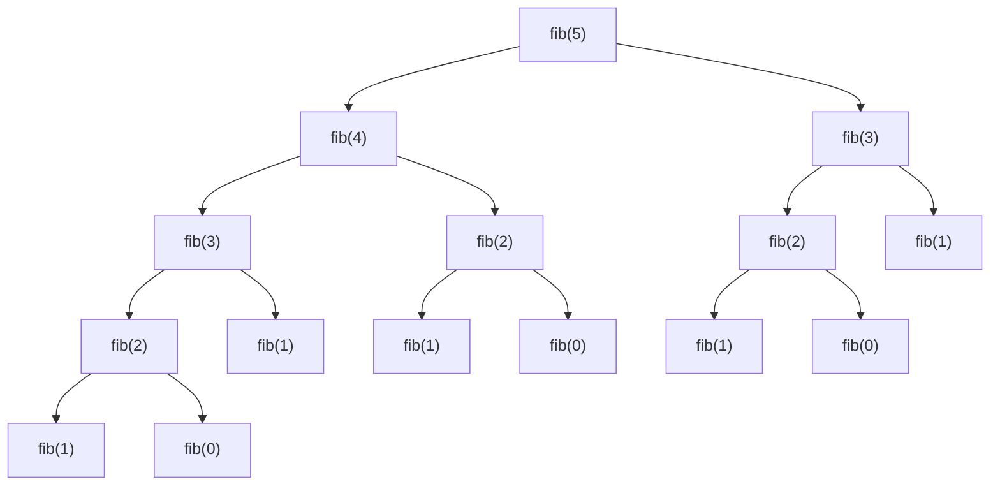

# PY-07 Recursion

> [!info] Topic card
> **Unit:** U2 · **Time:** 4 h · **Code:** `examples/py07_recursion.py`, `exercises/py07_exercises.py`
> **Review when you reach §5.5:** [[DM-09 Mathematical Induction]]. A recursive function is correct for the same reasons an induction proof is valid.

## 1. Learning objectives
1. **Identify** the base case(s) and recursive case(s) of a recursive definition.
2. **Trace** recursive calls using a call tree and the call stack.
3. **Write** recursive functions on numbers, sequences and nested structures.
4. **Prove** a recursive function correct and terminating, using induction and a decreasing measure.
5. **Analyse** costs (e.g. exponential naive Fibonacci versus linear memoised Fibonacci) and **choose** between recursion and iteration.

## 2. Why it matters
Many problems are naturally **self-similar**: a folder contains folders, an expression contains sub-expressions, a sorted list splits into sorted halves. Recursion expresses these directly. It underpins divide-and-conquer algorithms (merge sort, binary search in [[PY-12 Searching, Sorting and Complexity]]), tree processing ([[PY-21 Data Structures and Algorithm Design]]) and recurrence analysis ([[DM-14 Recurrence Relations]]).

## 3. Prerequisites
[[PY-06 Functions, Parameters, Return Values and Scope]] (the call stack, return values).

## 4. Intuition
To solve a big problem, **assume someone can already solve a slightly smaller version of the same problem**, then use their answer. The "someone" is the same function. You must also say how to solve the **smallest** problem directly (the base case). Otherwise the delegation never ends.

*Example:* "How many people are in front of me in a queue?" Ask the person in front, then add 1. The first person in the queue answers 0 (base case).

## 5. Rigorous explanation

### 5.1 Structure
```python
def solve(problem):
    if is_base_case(problem):       # 1. stop condition, answered directly
        return direct_answer(problem)
    smaller = shrink(problem)       # 2. strictly smaller subproblem(s)
    sub = solve(smaller)            # 3. recursive call (trust it)
    return combine(problem, sub)    # 4. build the answer
```

### 5.2 Mathematical definitions translate directly
$$n! = \begin{cases} 1 & n = 0 \\ n \cdot (n-1)! & n \ge 1 \end{cases}$$
```python
def factorial(n: int) -> int:
    if n == 0:
        return 1
    return n * factorial(n - 1)
```

### 5.3 What happens at runtime
Each call gets its own frame with its own `n`. Calls **wind** (push frames) until the base case, then **unwind** (return values multiply back up). CPython limits the depth (`sys.getrecursionlimit()` is **1000** by default). Exceeding it raises `RecursionError`. CPython does **not** perform tail-call optimisation, so deep linear recursion should become a loop.

### 5.4 Termination
Every recursive call must move toward a base case along a **decreasing measure**: a non-negative integer that strictly shrinks with each call (e.g. `n`, `len(list)`, `hi - lo`). Since non-negative integers can't decrease forever, the recursion terminates.

### 5.5 Correctness by induction
Claim: `factorial(n)` returns $n!$ for all $n \ge 0$.
- **Base** $n = 0$: returns 1 = $0!$ ✔
- **Inductive step:** assume `factorial(k)` returns $k!$ for some $k \ge 0$. Then `factorial(k+1)` returns $(k+1)\cdot$`factorial(k)` $= (k+1)\cdot k! = (k+1)!$ ✔
By induction, the claim holds for all $n \ge 0$. This "leap of faith" (trusting the recursive call) is exactly the inductive hypothesis.

### 5.6 Cost: recurrences
Naive Fibonacci, `fib(n) = fib(n-1) + fib(n-2)`, has a call count $C(n) = C(n-1) + C(n-2) + 1$, which grows like $\varphi^n$ ($\varphi \approx 1.618$): **exponential**. The same subproblems are recomputed many times. **Memoisation** (caching results) makes each `fib(k)` computed once, which is $O(n)$.

## 6. Terminology
| Term | Meaning |
|---|---|
| Base case | Input answered without recursion |
| Recursive case | Input answered using calls on smaller inputs |
| Call tree | Tree of all calls made |
| Winding / unwinding | Pushing frames down to the base / returning back up |
| Decreasing measure | Quantity that strictly decreases each call (guarantees termination) |
| Memoisation | Caching results of calls by argument |
| Divide and conquer | Split into parts, solve recursively, combine |
| Tail call | Recursive call that is the last action (not optimised in CPython) |

## 7. Step-by-step: designing `sum_list(xs)`
1. **Smallest input:** the empty list has sum 0 (base case).
2. **Shrink:** `xs[1:]` is one element shorter.
3. **Trust:** `sum_list(xs[1:])` returns the sum of the rest.
4. **Combine:** `xs[0] + sum_list(xs[1:])`.
5. **Measure:** `len(xs)` decreases by 1, so it terminates.
6. **Cost:** slicing copies $O(n)$ elements per call, which is $O(n^2)$ total. Passing an index avoids the copies (see the solution to practice 4).

## 8. Diagram: call tree of naive `fib(5)`

*Text version: fib(5) calls fib(4) and fib(3). fib(3) is computed twice and fib(2) three times. There are 15 calls in total for n = 5. Memoisation collapses the repeats, so each value is computed once.*

## 9. Worked examples

### Example 1 (basic): factorial trace (stack)
`factorial(3)`:
| Stack depth | Call | Waiting to compute | Returns |
|---|---|---|---|
| 1 | factorial(3) | 3 * factorial(2) | 6 |
| 2 | factorial(2) | 2 * factorial(1) | 2 |
| 3 | factorial(1) | 1 * factorial(0) | 1 |
| 4 | factorial(0) | base case | 1 |

Winding goes down the table. Unwinding goes back up: 1 → 1 → 2 → 6.

### Example 2 (intermediate): incorrect → bug → corrected
```python
# INCORRECT
def countdown(n):
    print(n)
    countdown(n - 1)          # no base case
```
**Bug:** there is no base case, so it runs until `RecursionError: maximum recursion depth exceeded`. A subtler bug: `if n == 0: return` with a call such as `countdown(-1)` also never terminates, because the measure doesn't head toward 0.
```python
# CORRECTED: returns the sequence instead of printing, and handles n < 0
def countdown(n: int) -> list[int]:
    if n < 0:
        return []
    return [n] + countdown(n - 1)
```
`countdown(3)` → `[3, 2, 1, 0]`.

### Example 3 (challenging): fast exponentiation (divide and conquer)
$x^n = (x^{n/2})^2$ if $n$ is even, and $x \cdot x^{n-1}$ if $n$ is odd.
```python
def power(x: float, n: int) -> float:
    if n < 0:
        return 1 / power(x, -n)
    if n == 0:
        return 1
    if n % 2 == 0:
        half = power(x, n // 2)   # compute ONCE, then square
        return half * half
    return x * power(x, n - 1)
```
`power(2, 10)`: 10 → 5 → 4 → 2 → 1 → 0, which is 6 calls instead of 10 multiplications. Depth is $O(\log n)$, because $n$ at least halves every two calls.
**Common wrong answer:** `return power(x, n//2) * power(x, n//2)` makes **two** calls per level, which recreates $O(n)$ work.

### Example 4 (challenging): recursion on nested structure
```python
def flatten(nested: list) -> list:
    result = []
    for item in nested:
        if isinstance(item, list):
            result.extend(flatten(item))   # recurse into sub-lists
        else:
            result.append(item)            # base case: a non-list value
    return result

print(flatten([1, [2, [3, 4]], [], 5]))    # [1, 2, 3, 4, 5]
```
The nesting depth is unknown in advance. That's exactly where recursion beats loops.

### Example 5 (classic): Towers of Hanoi
Move $n$ discs from peg A to C using B. Recursive insight: move $n-1$ to B, move the largest to C, move $n-1$ from B to C.
```python
def hanoi(n: int, src="A", aux="B", dst="C") -> list[tuple[str, str]]:
    if n == 0:
        return []
    return hanoi(n - 1, src, dst, aux) + [(src, dst)] + hanoi(n - 1, aux, src, dst)
```
The move count satisfies $M(n) = 2M(n-1) + 1$, $M(0) = 0$, which solves to $M(n) = 2^n - 1$ ([[DM-14 Recurrence Relations]]).

## 10. Application: walking a directory tree
```python
from pathlib import Path

def total_size(path: Path) -> int:
    if path.is_file():
        return path.stat().st_size         # base case
    return sum(total_size(child) for child in path.iterdir())
```
Filesystems are trees, so recursion mirrors the structure. Production code uses `os.walk` / `Path.rglob`, which are iterative internally and immune to the recursion limit. They also need to handle symbolic links, which can create cycles.

## 11. Common mistakes
| Mistake | Why | Fix |
|---|---|---|
| Missing or unreachable base case | Forgot the smallest input, or the measure skips past it | Check that every input eventually reaches a base case |
| Calling with the same-size input | `f(n)` calls `f(n)` | The argument must strictly shrink |
| Forgetting to `return` the recursive result | `f(n-1)` computed and discarded | `return combine(..., f(n-1))` |
| Repeated subproblems | Naive Fibonacci | Memoise (`functools.cache`) or use iteration |
| Deep linear recursion on big inputs | Depth limit 1000 | Convert to a loop |
| Printing instead of returning in recursive code | Same as PY-06 | Return values and compose |

## 12. Comparison: recursion vs iteration
| Aspect | Recursion | Iteration |
|---|---|---|
| Fits | Trees, nested data, divide and conquer | Linear sequences |
| Memory | $O(\text{depth})$ stack frames | Usually $O(1)$ |
| Limits | `RecursionError` beyond ~1000 deep | None |
| Clarity | Mirrors recursive definitions | Mirrors step-by-step processes |
| Correctness argument | Induction | Loop invariant ([[PY-05 Loops and Iteration]]) |
Any recursion can be converted to iteration with an explicit stack ([[PY-21 Data Structures and Algorithm Design]]).

## 13. Practice
**L1** 1. Name the base and recursive cases of $\text{sum}(n) = n + \text{sum}(n-1)$, $\text{sum}(0)=0$. 2. What error does unbounded recursion raise in Python?

**L2** *(code bank)* 3. `factorial(n)` recursively (`ValueError` if `n < 0`). 4. `sum_list(xs)` recursively. 5. `is_palindrome(s)` recursively (compare the ends, recurse on the middle).

**L3** 6. `power(x, n)` (fast, handles negative `n`). 7. `fib_memo(n)` in $O(n)$ using a dictionary cache. 8. `binary_search(xs, target)` recursively on a sorted list, returning an index or −1 (pass `lo, hi` bounds, no slicing).

**L4** 9. `flatten(nested)`. 10. `hanoi(n)` returns the list of moves. Verify `len(hanoi(n)) == 2**n - 1` for n = 0..10. 11. Prove by induction that `sum_list` returns the sum, and state its decreasing measure.

**L5** 12. `permutations(s)` returns all orderings of a string's characters as a sorted list (assume distinct characters). Derive the number of calls and outputs, and explain why the output size makes any algorithm at least $O(n \cdot n!)$.

**Variation:** modify `flatten` to take a `max_depth` parameter (flatten only that many levels).

## 14. Hints
> [!tip]- Hints
> 5: Base case: length ≤ 1 → True. 7: `def fib_memo(n, cache=None)`. Use the `None` idiom from [[PY-06 Functions, Parameters, Return Values and Scope]]. 8: The measure is `hi - lo`. 12: For each character `c`, prepend it to every permutation of the remaining characters.

## 15. Worked solutions
> [!success]- Solutions 1–2
> 1. Base: `sum(0) = 0`. Recursive: `sum(n) = n + sum(n-1)` for n ≥ 1. 2. `RecursionError`.

> [!success]- Solutions 3–5
> ```python
> def factorial(n):
>     if n < 0:
>         raise ValueError("n must be >= 0")
>     return 1 if n == 0 else n * factorial(n - 1)
>
> def sum_list(xs, i=0):
>     if i == len(xs):          # base: no elements left
>         return 0
>     return xs[i] + sum_list(xs, i + 1)   # index avoids O(n) slicing per call
>
> def is_palindrome(s):
>     if len(s) <= 1:
>         return True
>     return s[0] == s[-1] and is_palindrome(s[1:-1])
> ```
> `is_palindrome` short-circuits: once the ends differ, no more calls are made.

> [!success]- Solutions 7–8
> ```python
> def fib_memo(n, cache=None):
>     if cache is None:
>         cache = {0: 0, 1: 1}
>     if n not in cache:
>         cache[n] = fib_memo(n - 1, cache) + fib_memo(n - 2, cache)
>     return cache[n]
>
> def binary_search(xs, target, lo=0, hi=None):
>     if hi is None:
>         hi = len(xs) - 1
>     if lo > hi:
>         return -1                      # empty range: not found
>     mid = (lo + hi) // 2
>     if xs[mid] == target:
>         return mid
>     if xs[mid] < target:
>         return binary_search(xs, target, mid + 1, hi)
>     return binary_search(xs, target, lo, mid - 1)
> ```
> In the standard library, `@functools.cache` gives memoisation with one line. For very large `n`, `fib_memo` still recurses `n` deep, so an iterative loop is better there.

> [!success]- Solution 11
> Claim: for every list `xs` and index $0 \le i \le$ `len(xs)`, `sum_list(xs, i)` returns $\sum_{j=i}^{n-1} x_j$. **Induct on the measure** $m = n - i$.
> *Base* $m = 0$ ($i = n$): returns 0, the empty sum ✔.
> *Step:* assume the claim holds for measure $m$, and take $i$ with $n - i = m + 1$. The call returns $x_i + $ `sum_list(xs, i+1)`. The inner call has measure $m$, so by hypothesis it returns $\sum_{j=i+1}^{n-1} x_j$. The total is $\sum_{j=i}^{n-1} x_j$ ✔.
> With $i = 0$, we get the whole sum. The measure $n - i \ge 0$ decreases by 1 per call, so the recursion terminates.

> [!success]- Solution 12
> ```python
> def permutations(s: str) -> list[str]:
>     if len(s) <= 1:
>         return [s]
>     result = []
>     for i, c in enumerate(s):
>         for rest in permutations(s[:i] + s[i+1:]):
>             result.append(c + rest)
>     return sorted(result)
> ```
> There are $n!$ outputs, each of length $n$, so merely *writing* the output takes $\Omega(n \cdot n!)$. No algorithm can do better than its output size. For $n = 10$ that is already 36 million characters.

> [!success]- Variation answer
> ```python
> def flatten_depth(nested, max_depth):
>     result = []
>     for item in nested:
>         if isinstance(item, list) and max_depth > 0:
>             result.extend(flatten_depth(item, max_depth - 1))
>         else:
>             result.append(item)
>     return result
> ```

## 16. Self-test (pass ≥ 4/5)
1. Two things every recursive function needs? 2. Why is naive `fib` slow? 3. Default recursion limit in CPython? 4. Recurrence for Hanoi moves, and its solution? 5. Why compute `half` once in `power`?
> [!success]- Answers
> 1. A base case and progress toward it (a decreasing measure). 2. Overlapping subproblems are recomputed, so the cost is exponential. 3. 1000. 4. $M(n) = 2M(n-1)+1$, $M(n) = 2^n - 1$. 5. Two calls per level would double the work at each level, giving $O(n)$ instead of $O(\log n)$.

## 17. Flashcards
#flashcards/python
What guarantees a recursive function terminates?::A non-negative measure that strictly decreases on every recursive call and reaches a base case.
Why is recursion correctness like induction?::Base case = induction base; trusting the recursive call = inductive hypothesis.
Does CPython optimise tail recursion?::No. Deep recursion hits RecursionError (limit ~1000).
What is memoisation?::Caching function results by argument so each subproblem is computed once.
Hanoi moves for n discs?::2^n − 1
Complexity of fast exponentiation?::O(log n) multiplications.

## 18. Blank-page recall
Write the four-part recursive template, the factorial induction proof, and the fib call tree for n = 4.

## 19. Revision summary
- Base case + shrinking recursive case + combine.
- Trust the recursive call. Induction justifies it, and a decreasing measure guarantees termination.
- Watch the cost: overlapping subproblems call for memoisation, and halving gives $O(\log n)$.
- Python has a depth limit and no tail-call optimisation, so prefer loops for long linear recursion.

## 20. Links
Prev: [[PY-06 Functions, Parameters, Return Values and Scope]] · Next: [[PY-08 Algorithmic Thinking, Pseudocode, Flowcharts and Tracing]] · Theory: [[DM-09 Mathematical Induction]], [[DM-14 Recurrence Relations]] · Uses: [[PY-12 Searching, Sorting and Complexity]] (merge sort), [[DM-16 Trees and Spanning Trees]]

## 21. Sources
- Python docs, `sys.getrecursionlimit`: https://docs.python.org/3/library/sys.html#sys.getrecursionlimit
- Python docs, `functools.cache`: https://docs.python.org/3/library/functools.html#functools.cache
- Rosen, K. H., *Discrete Mathematics and Its Applications*, 8th ed., McGraw-Hill, 2019, ch. 5 (induction and recursion).

## 22. Mastery checklist
- [ ] `py07` tests pass with `PY_TARGET=exercises`
- [ ] I wrote the induction proof for practice 11 unaided
- [ ] I can explain why the two-call `power` is slow · reviews scheduled
