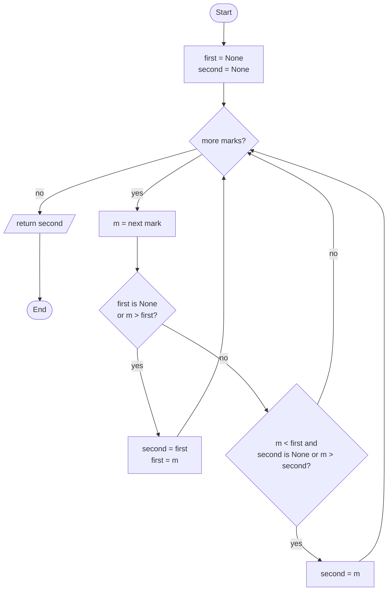

# PY-08 Algorithmic Thinking, Pseudocode, Flowcharts and Tracing

> [!info] Topic card
> **Unit:** U2 · **Time:** 3–4 h · **Code:** `exercises/py08_exercises.py`
> This lesson teaches you to **solve new problems independently**. That's the central skill of the module.

## 1. Learning objectives
1. **Apply** a four-step problem-solving method (understand → plan → implement → review) to an unfamiliar problem.
2. **Decompose** a problem into sub-problems, and **recognise** standard patterns (accumulate, search, filter, map, merge, two pointers, greedy).
3. **Express** algorithms in structured pseudocode and standard flowcharts before coding.
4. **Trace** an algorithm by hand with a trace table, and **find** bugs by desk-checking.
5. **Evaluate** an algorithm for correctness (including counterexamples) and efficiency.

## 2. Why it matters
Syntax is the easy part of programming. Students fail exam questions and projects when they **start typing before they know the algorithm**. Pseudocode and tracing are also what exams test when you can't run code. The [[MOCK-PY-01 Python Programming Mock Examination]] includes trace and pseudocode questions.

## 3. Prerequisites
[[PY-06 Functions, Parameters, Return Values and Scope]] (functions as units of decomposition) and [[PY-05 Loops and Iteration]].

## 4. Intuition
An **algorithm** is a recipe precise enough that someone with no common sense (a computer) gets the right result every time. Algorithmic thinking means **(a)** making the problem precise, **(b)** breaking it into pieces you already know how to do, and **(c)** checking the recipe on examples, *especially awkward ones*, before trusting it.

## 5. Rigorous explanation

### 5.1 What makes an algorithm (Knuth's properties)
1. **Finiteness**: it terminates after a finite number of steps.
2. **Definiteness**: each step is precisely and unambiguously defined.
3. **Input**: zero or more inputs from specified sets.
4. **Output**: one or more outputs related to the inputs.
5. **Effectiveness**: each step is basic enough to be carried out exactly.

### 5.2 The four-step method (adapted from Pólya, *How to Solve It*)
| Step | Questions to ask | Output |
|---|---|---|
| **1. Understand** | What are the inputs, outputs and constraints? What are the edge cases (empty, one item, duplicates, negatives, huge)? Can I do 2–3 examples by hand? | Precise specification + examples table |
| **2. Plan** | Have I seen a similar problem? Which pattern fits? Can I split it into sub-problems? | Pseudocode / flowchart |
| **3. Implement** | Translate the pseudocode one line at a time. Keep functions small. | Code |
| **4. Review** | Trace the examples. Does it handle the edge cases? What does it cost? Can it be simpler? | Tests, complexity, refinements |

### 5.3 Core patterns
| Pattern | Shape | Example |
|---|---|---|
| Accumulate | `acc = init; for x: acc = combine(acc, x)` | Sum, product, max |
| Search | Loop, return on match, "not found" after the loop | Linear search, first duplicate |
| Filter | Keep the items that satisfy a predicate | Passing students |
| Map | Transform each item | Marks → grades |
| Count / group | Dictionary of counters | Word frequency ([[PY-11 Dictionaries, Sets and Comprehensions]]) |
| Two pointers | Two indices moving through sorted data | Merge sorted lists |
| Divide and conquer | Split, recurse, combine | Binary search, merge sort |
| Greedy | Take the locally best choice each step | Coin change (works for *some* coin systems) |

### 5.4 Pseudocode conventions used in this vault
```text
FUNCTION name(param1, param2)
    SET variable TO expression
    IF condition THEN
        ...
    ELSE IF condition THEN
        ...
    ELSE
        ...
    END IF
    FOR EACH item IN collection DO
        ...
    END FOR
    WHILE condition DO
        ...
    END WHILE
    RETURN value
END FUNCTION
```
Rules: one action per line, indentation shows structure, no language-specific syntax, and names are meaningful. If your institution prescribes a different pseudocode style, follow that one in exams.

### 5.5 Flowchart symbols
| Shape | Meaning | Mermaid syntax |
|---|---|---|
| Rounded / stadium | Start / end (terminator) | `A([Start])` |
| Rectangle | Process / assignment | `B[total = 0]` |
| Parallelogram | Input / output | `C[/read n/]` |
| Diamond | Decision | `D{n > 0?}` |
| Arrow | Flow of control | `-->` |

### 5.6 Trace tables
A trace table has **one column per variable** (plus the condition and the output) and **one row per step**, recording values *after* each statement. Tracing finds bugs that tests miss because you see **every intermediate state**. In exams, write the table neatly. Marks are usually given per correct row.

## 6. Terminology
| Term | Meaning |
|---|---|
| Algorithm | Finite, definite, effective procedure from inputs to outputs |
| Specification | Precise statement of inputs, outputs and conditions |
| Decomposition | Splitting a problem into sub-problems |
| Abstraction | Ignoring irrelevant details; naming a process |
| Stepwise refinement | Writing high-level steps, then refining each |
| Desk check / dry run | Executing an algorithm by hand |
| Counterexample | A specific input for which an algorithm fails |
| Edge case | Input at the extremes of the valid range |

## 7. Step-by-step: worked problem-solving session
**Problem:** "Given a list of exam marks, return the **second-highest distinct** mark, or `None` if there isn't one."

**Step 1: understand.** Example table:
| Input | Output | Why |
|---|---|---|
| `[70, 85, 60]` | 70 | Highest 85, next 70 |
| `[85, 85, 70]` | 70 | *Distinct*: the duplicate 85 doesn't count |
| `[50]` | None | Only one value |
| `[]` | None | Empty |
| `[40, 40]` | None | Only one distinct value |

**Step 2: plan.** Option A: sort the distinct values and take the second from the end, $O(n \log n)$. Option B: one pass keeping `first` and `second`, $O(n)$. Choose B.
```text
FUNCTION second_largest(marks)
    SET first TO None
    SET second TO None
    FOR EACH m IN marks DO
        IF first IS None OR m > first THEN
            SET second TO first
            SET first TO m
        ELSE IF m < first AND (second IS None OR m > second) THEN
            SET second TO m
        END IF
    END FOR
    RETURN second
END FUNCTION
```
**Step 3: implement.**
```python
def second_largest(marks: list[float]) -> float | None:
    first = second = None
    for m in marks:
        if first is None or m > first:
            second, first = first, m
        elif m < first and (second is None or m > second):
            second = m
    return second
```
**Step 4: review.** Trace `[85, 85, 70]`:
| m | first | second | branch taken |
|---|---|---|---|
| — | None | None | init |
| 85 | 85 | None | first branch |
| 85 | 85 | None | neither (`m < first` is False) |
| 70 | 85 | 70 | elif |
Returns 70 ✔. `[]` → None ✔. `[40, 40]` → None ✔. The cost is one pass, $O(n)$ time and $O(1)$ space.

## 8. Diagram: flowchart of `second_largest`


## 9. Worked examples

### Example 1 (basic): trace a given algorithm
```text
SET x TO 5
SET y TO 1
WHILE x > 1 DO
    SET y TO y * x
    SET x TO x - 2
END WHILE
OUTPUT y
```
| step | x | y | x > 1? |
|---|---|---|---|
| init | 5 | 1 | T |
| 1 | 3 | 5 | T |
| 2 | 1 | 15 | F |
Output **15** (this computes $5 \cdot 3$, the "double factorial" $5!!$, excluding the final 1).

### Example 2 (intermediate): run-length encoding by decomposition
Problem: `"aaabccdddd"` → `"a3b1c2d4"`.
- Sub-problem 1: walk through the string and **group consecutive equal characters**.
- Sub-problem 2: **emit** `char + count` per group.
```python
def run_length_encode(s: str) -> str:
    if not s:
        return ""
    parts = []
    current, count = s[0], 1
    for ch in s[1:]:
        if ch == current:
            count += 1
        else:
            parts.append(f"{current}{count}")
            current, count = ch, 1
    parts.append(f"{current}{count}")     # flush the LAST group
    return "".join(parts)
```
**Classic bug:** forgetting the final `parts.append` after the loop, which drops the last group. Tracing `"ab"` exposes it immediately: the result would be `"a1"`.

### Example 3 (challenging): greedy algorithm and a counterexample
Make change for amount `a` using the fewest coins. Greedy: repeatedly take the largest coin ≤ the remaining amount.
```python
def greedy_change(amount: int, coins: list[int]) -> list[int]:
    result = []
    for c in sorted(coins, reverse=True):
        while amount >= c:
            amount -= c
            result.append(c)
    if amount != 0:
        raise ValueError("cannot make exact change")
    return result
```
With coins `[1, 5, 10, 25]`, `greedy_change(30)` → `[25, 5]` ✔ (optimal). With coins `[1, 3, 4]` and amount 6, greedy gives `[4, 1, 1]` (3 coins), but `[3, 3]` uses 2. **The counterexample proves the greedy algorithm is not correct in general.** Being correct on some examples proves nothing. One counterexample disproves. (Optimal change for any coin system needs dynamic programming, a challenge in practice 10.)

### Example 4 (transfer): two pointers. Merge two sorted lists
```python
def merge_sorted(a: list, b: list) -> list:
    i = j = 0
    out = []
    while i < len(a) and j < len(b):
        if a[i] <= b[j]:
            out.append(a[i]); i += 1
        else:
            out.append(b[j]); j += 1
    out.extend(a[i:])     # at most one of these two is non-empty
    out.extend(b[j:])
    return out
```
**Invariant:** `out` contains the `i + j` smallest elements of `a + b`, in sorted order. Cost $O(len(a) + len(b))$. This is the "combine" step of merge sort ([[PY-12 Searching, Sorting and Complexity]]).

## 10. Application: from vague request to algorithm
*Request from a hostel warden:* "Tell me which rooms keep reporting problems." First, **make it precise**: "Given a list of (room, date) maintenance reports, return the rooms with ≥ 3 reports in the last 30 days, most reports first." Then decompose: filter by date → count per room → filter count ≥ 3 → sort. Each step is a known pattern. This exact requirement appears in [[X-CAPSTONE Hostel Maintenance System Full Lifecycle]].

## 11. Common mistakes
| Mistake | Why | Fix |
|---|---|---|
| Coding before understanding | Eagerness | Write the examples table first |
| Only testing "typical" input | Edge cases are invisible until you list them | Always check empty, single, duplicates, extremes |
| Pseudocode that is just Python | Misunderstanding its purpose | Use language-neutral structure words |
| Trace table recording values *before* the statement | Inconsistency | Record values *after* each step, consistently |
| "It worked on my example, so it's correct" | Confusing evidence with proof | Seek counterexamples. Argue with invariants. |
| Forgetting to flush the final group/accumulator | Loop exits before the last emit | Trace a 1- and a 2-element input |

## 12. Comparison
| Representation | Strength | Weakness |
|---|---|---|
| Natural language | Easy to write | Ambiguous |
| Pseudocode | Precise, language-neutral, compact | Not executable |
| Flowchart | Visual control flow, good for branching | Unwieldy for big algorithms |
| Code | Executable and testable | Language details distract from the idea |

## 13. Practice
**L1** 1. List Knuth's five properties of an algorithm. 2. Draw the flowchart symbols for decision and input/output.

**L2** *(code bank)* 3. `second_largest(marks)`. 4. `run_length_encode(s)` and `run_length_decode(s)` (assume counts may have several digits, e.g. `"a12b1"`).

**L3** 5. Trace this for `n = 13` and state what it computes:
```text
SET result TO ""
WHILE n > 0 DO
    SET result TO (n MOD 2) + result      // string concatenation
    SET n TO n DIV 2
END WHILE
```
6. `first_duplicate(xs)` returns the first element that appears a second time when scanning left to right, or `None`. Write the pseudocode, then the code.

**L4** 7. `merge_sorted(a, b)`. 8. `greedy_change(amount, coins)`, plus a counterexample for coins `[1, 7, 10]` (find an amount where greedy is not optimal).

**L5** 9. **Design challenge:** a teacher wants to split students into two teams of equal size whose total marks are as close as possible. Specify the problem precisely, propose a simple greedy heuristic, find an input where it is not optimal, and state the cost of the brute-force optimal method.
10. `min_coins(amount, coins)`: the optimal number of coins using dynamic programming (bottom-up table). Compare it with greedy on `[1, 3, 4]`, amount 6.

**Variation:** modify `run_length_encode` to omit a count of 1 (`"aaab"` → `"a3b"`). What ambiguity does this create if the input can contain digits?

## 14. Hints
> [!tip]- Hints
> 4 (decode): accumulate the digit characters until the next letter. 6: Keep a `set` of seen values. 8: Try amounts between 14 and 20. 10: `best[0] = 0`, and `best[a] = 1 + min(best[a - c])` over coins `c ≤ a`.

## 15. Worked solutions
> [!success]- Solutions 1–2
> 1. Finiteness, definiteness, input, output, effectiveness. 2. Decision: a diamond with yes/no exits. I/O: a parallelogram.

> [!success]- Solution 4 (decode)
> ```python
> def run_length_decode(s: str) -> str:
>     out = []
>     char, digits = None, ""
>     for ch in s:
>         if ch.isdigit():
>             digits += ch
>         else:
>             if char is not None:
>                 out.append(char * int(digits))
>             char, digits = ch, ""
>     if char is not None:
>         out.append(char * int(digits))
>     return "".join(out)
> ```
> Round-trip property: `run_length_decode(run_length_encode(s)) == s` for every string `s` without digits. It's a great test ([[PY-20 Testing, Debugging and Test-Driven Development]]).

> [!success]- Solution 5
> | n | n MOD 2 | result | n DIV 2 |
> |---|---|---|---|
> | 13 | 1 | "1" | 6 |
> | 6 | 0 | "01" | 3 |
> | 3 | 1 | "101" | 1 |
> | 1 | 1 | "1101" | 0 |
> Output `"1101"`, the **binary representation** of 13 ($8+4+1$). Note: for $n = 0$ the loop never runs and the result is `""`, an edge case the algorithm handles poorly.

> [!success]- Solution 6
> ```text
> FUNCTION first_duplicate(xs)
>     SET seen TO empty set
>     FOR EACH x IN xs DO
>         IF x IN seen THEN RETURN x END IF
>         ADD x TO seen
>     END FOR
>     RETURN None
> END FUNCTION
> ```
> ```python
> def first_duplicate(xs):
>     seen = set()
>     for x in xs:
>         if x in seen:
>             return x
>         seen.add(x)
>     return None
> ```
> $O(n)$ average time with a set, versus $O(n^2)$ comparing all pairs.

> [!success]- Solution 8
> Coins `[1, 7, 10]`, amount 14: greedy → 10 + 1+1+1+1 = **5 coins**, optimal → 7 + 7 = **2 coins**.

> [!success]- Solution 9 (model answer)
> **Specification:** input is a list of $2k$ marks; output is a partition into two lists of size $k$ that minimises $|\sum A - \sum B|$.
> **Greedy:** sort descending and give each student to the team with the smaller total (if that team isn't full).
> **Counterexample:** marks `[8, 7, 6, 5, 4, 2]` (k = 3). Greedy: 8→A (A=8), 7→B (B=7), 6→B (B=13), 5→A (A=13), 4→A on the tie (A=17, now full), 2→B (B=15). Difference **2**. Optimal: {8, 6, 2} = 16 and {7, 5, 4} = 16, difference **0**.
> **Brute force:** try all $\binom{2k}{k}$ subsets ([[DM-11 Counting Principles, Permutations and Combinations]]). That's exponential, $\approx 1.8 \times 10^5$ subsets already for $2k = 20$. Lesson: heuristics trade guaranteed optimality for speed.

> [!success]- Solution 10
> ```python
> def min_coins(amount: int, coins: list[int]) -> int | None:
>     INF = float("inf")
>     best = [0] + [INF] * amount
>     for a in range(1, amount + 1):
>         for c in coins:
>             if c <= a and best[a - c] + 1 < best[a]:
>                 best[a] = best[a - c] + 1
>     return None if best[amount] == INF else int(best[amount])
> ```
> `min_coins(6, [1, 3, 4])` → 2 (greedy gives 3). Cost $O(\text{amount} \times |\text{coins}|)$. The idea, building optimal answers from optimal sub-answers, is **dynamic programming**.

> [!success]- Variation answer
> ```python
> def rle_compact(s):
>     out, i = [], 0
>     while i < len(s):
>         j = i
>         while j < len(s) and s[j] == s[i]:
>             j += 1
>         out.append(s[i] + (str(j - i) if j - i > 1 else ""))
>         i = j
>     return "".join(out)
> ```
> **Ambiguity:** if the input may contain digits, `"a3"` could mean "aaa" or the two characters "a3". Decoding is no longer unique, so the format needs an escape mechanism. This is a design decision worth raising with stakeholders.

## 16. Self-test (pass ≥ 4/5)
1. What is the purpose of step 1 (understand)? 2. One counterexample is enough to ___ an algorithm. 3. Which flowchart symbol represents a decision? 4. What bug does tracing a 2-element input often reveal in grouping algorithms? 5. Give the time complexity of merging two sorted lists of sizes m and n.
> [!success]- Answers
> 1. A precise specification plus examples and edge cases. 2. Disprove (show it incorrect). 3. A diamond. 4. Failing to flush the last group after the loop. 5. $O(m+n)$.

## 17. Flashcards
#flashcards/python
Pólya's four steps?::Understand, plan, implement (carry out), review (look back).
What is a trace table?::A table with a column per variable and a row per step, recording values after each step.
Does a working example prove an algorithm correct?::No. Examples give evidence; one counterexample disproves.
Is greedy coin change always optimal?::No. E.g. coins {1,3,4}, amount 6: greedy 4+1+1 vs optimal 3+3.
Flowchart I/O symbol?::Parallelogram.

## 18. Blank-page recall
Solve "return the most frequent character in a string" using all four steps on paper: examples table, pseudocode, code, trace.

## 19. Revision summary
- Understand (examples and edge cases) → plan (pattern + pseudocode) → implement → review (trace, test, cost).
- Know the patterns: accumulate, search, filter, map, count, two pointers, divide and conquer, greedy.
- Trace tables record the state after each step.
- Counterexamples disprove. Invariants and induction prove.

## 20. Links
Prev: [[PY-07 Recursion]] · Next: [[PY-09 Strings and String Processing]] · Related: [[PY-12 Searching, Sorting and Complexity]], [[DM-04 Rules of Inference]] (valid reasoning), [[SD-03 Requirements Engineering]] (precise specifications)

## 21. Sources
- Pólya, G., *How to Solve It*, 2nd ed., Princeton University Press, 1957.
- Knuth, D. E., *The Art of Computer Programming, Vol. 1: Fundamental Algorithms*, 3rd ed., Addison-Wesley, 1997, §1.1 (properties of algorithms).
- Cormen et al., *Introduction to Algorithms*, 4th ed., 2022, ch. 15 (greedy) and ch. 14 (dynamic programming).

## 22. Mastery checklist
- [ ] `py08` tests pass with `PY_TARGET=exercises`
- [ ] I solved one unseen problem using all four steps, with a written examples table
- [ ] I found a greedy counterexample on my own · reviews scheduled
