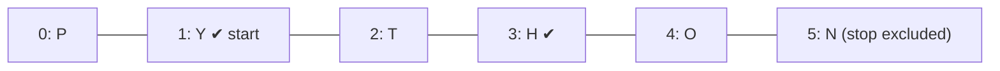

# PY-09 Strings and String Processing

> [!info] Topic card
> **Unit:** U3 · **Time:** 3–4 h · **Code:** `examples/py09_strings.py`, `exercises/py09_exercises.py`

## 1. Learning objectives
1. **Index** and **slice** strings with positive and negative indices and steps.
2. **Explain** string immutability and its consequences (methods return *new* strings).
3. **Use** the core string methods for cleaning, searching, splitting and joining text.
4. **Process** text character by character and word by word with loops and accumulators.
5. **Build** strings efficiently (`"".join`), and **reason** about Unicode code points (`ord`/`chr`).

## 2. Why it matters
Most real input is text: names, commands, CSV lines, log entries, passwords, URLs. Cleaning and validating it correctly is half of defensive programming ([[PY-24 Secure Programming and Input Validation]]) and the core of log analysis ([[LAB-CS-08 Log Analysis and Incident Response]]).

## 3. Prerequisites
[[PY-05 Loops and Iteration]] (iterating), [[PY-03 Input, Output and String Formatting]] (f-strings, escapes).

## 4. Intuition
A string is a **row of numbered character boxes** that is **sealed**: you can read any box or copy any stretch of boxes, but never change a box in place. Every "modification" makes a new row.

## 5. Rigorous explanation

### 5.1 Indexing and slicing
For `s = "PYTHON"`:
| char | P | Y | T | H | O | N |
|---|---|---|---|---|---|---|
| index | 0 | 1 | 2 | 3 | 4 | 5 |
| negative | −6 | −5 | −4 | −3 | −2 | −1 |

- `s[i]` gives one character. An out-of-range index raises `IndexError`.
- `s[start:stop:step]` gives characters from `start` up to **but not including** `stop`. Omitted parts default to the start, the end and 1. **Slices never raise `IndexError`**: `s[2:100]` → `"THON"`.
- `s[::-1]` reverses. `s[::2]` takes every second character → `"PTO"`.
- `len(s)` is the number of characters. Valid indices are `0 … len(s) - 1`.

### 5.2 Immutability
`s[0] = "J"` → `TypeError: 'str' object does not support item assignment`. Methods such as `s.upper()` return **new** strings, so you must use the result: `s = s.upper()`.

### 5.3 Core methods (all return new values)
| Purpose | Methods |
|---|---|
| Case | `lower()`, `upper()`, `title()`, `capitalize()`, `casefold()` (aggressive lowercase for comparisons) |
| Whitespace | `strip()`, `lstrip()`, `rstrip()`, also with chars: `strip(".,")` |
| Search | `find(sub)` (−1 if absent), `index(sub)` (raises `ValueError`), `count(sub)`, `startswith`, `endswith`, `in` |
| Replace | `replace(old, new[, count])` |
| Split / join | `split()` (any whitespace, discards empties), `split(",")` (exact separator, keeps empties), `splitlines()`, `sep.join(iterable_of_str)` |
| Tests | `isdigit()`, `isalpha()`, `isalnum()`, `isspace()`, `isupper()`, `islower()` |
| Pad / align | `zfill(n)`, `center(n)`, `ljust(n)`, `rjust(n)` |
| Prefix/suffix (3.9+) | `removeprefix(p)`, `removesuffix(s)` |

`"a,,b".split(",")` → `['a', '', 'b']`, but `"a  b".split()` → `['a', 'b']`. The difference matters when parsing CSV by hand (don't; use `csv`, see [[PY-14 Files, CSV and JSON]]).

### 5.4 Unicode
Python 3 strings are sequences of **Unicode code points**. `ord("A") == 65`, `chr(97) == "a"`, `ord("é") == 233`. `len("café") == 4`, but its UTF-8 encoding is 5 bytes: `len("café".encode()) == 5`. `str.isdigit()` is true for some non-ASCII digits such as `"²"`, so to validate ASCII digits strictly, use `s.isascii() and s.isdigit()`.

### 5.5 Efficient building
Repeated `s += piece` in a loop may copy the growing string each time, which is $O(n^2)$ in the worst case. (CPython sometimes optimises this, but don't rely on it.) Collect the pieces in a list and call `"".join(pieces)` once, which is $O(n)$.

### 5.6 Comparison
Strings compare **lexicographically by code point**: `"Zebra" < "apple"` is `True`, because `ord("Z") = 90 < 97`. For human-friendly ordering, compare `s.casefold()`.

## 6. Terminology
| Term | Meaning |
|---|---|
| Index | Position of a character (0-based) |
| Slice | Substring defined by start, stop and step |
| Immutable | Cannot be changed after creation |
| Code point | Integer identifying a Unicode character |
| Encoding | Mapping between code points and bytes (UTF-8) |
| Whitespace | Spaces, tabs, newlines |
| Delimiter | Character separating fields (`,`, `;`, `\t`) |
| Normalisation | Converting text to a canonical form (case, spacing) before comparing |

## 7. Step-by-step: normalising user input before comparison
Goal: treat `"  Dar es  Salaam "` and `"dar ES salaam"` as the same city.
1. `strip()` removes the outer spaces.
2. `split()` splits on runs of whitespace, removing the internal duplicates.
3. `" ".join(...)` rejoins with single spaces.
4. `casefold()` gives a case-insensitive form.
```python
def normalise(s: str) -> str:
    return " ".join(s.split()).casefold()
```
(`split()` with no arguments already ignores leading and trailing whitespace, so step 1 is implied.)

## 8. Diagram: slicing `s[1:5:2]`

*Text version: start at index 1 (Y) and take every 2nd character before index 5. That selects indices 1 and 3, giving "YH".*

## 9. Worked examples

### Example 1 (basic): character-counting accumulator
```python
def count_vowels(text: str) -> int:
    count = 0
    for ch in text.lower():
        if ch in "aeiou":
            count += 1
    return count

print(count_vowels("Software Design"))   # 5  (o, a, e, e, i)
```
Trace for `"Hi Ed"`: h(0) i(1) ' '(1) e(2) d(2) → 2. Cost $O(n)$, because `ch in "aeiou"` checks a constant 5 characters.

### Example 2 (intermediate): palindrome sentence. Incorrect → bug → corrected
```python
# INCORRECT
def is_palindrome_sentence(s):
    return s == s[::-1]

print(is_palindrome_sentence("Never odd or even"))   # False, but it should be True
```
**Bug:** case and spaces are compared literally (`"N" != "n"`, and the spaces fall in different positions).
```python
# CORRECTED
def is_palindrome_sentence(s: str) -> bool:
    letters = [ch.casefold() for ch in s if ch.isalnum()]
    return letters == letters[::-1]
```
**I/O:** `"Never odd or even"` → True. `"A man, a plan, a canal: Panama"` → True. `"abc"` → False. `""` → True (vacuously).
**Complexity:** $O(n)$ time and $O(n)$ extra space. A two-pointer version needs $O(1)$ space (practice 8).

### Example 3 (challenging): Caesar cipher with `ord`/`chr`
```python
def caesar_shift(text: str, k: int) -> str:
    out = []
    for ch in text:
        if "a" <= ch <= "z":
            out.append(chr((ord(ch) - ord("a") + k) % 26 + ord("a")))
        elif "A" <= ch <= "Z":
            out.append(chr((ord(ch) - ord("A") + k) % 26 + ord("A")))
        else:
            out.append(ch)          # leave digits, spaces and punctuation unchanged
    return "".join(out)

print(caesar_shift("Attack at Dawn!", 3))   # Dwwdfn dw Gdzq!
print(caesar_shift("Dwwdfn dw Gdzq!", -3))  # Attack at Dawn!
```
- `ord(ch) - ord("a")` maps a..z to 0..25. `% 26` wraps around (and works for negative `k`, because of Python's `%` semantics, see [[PY-02 Variables, Types, Expressions and Operators]]).
- **Security warning:** a Caesar cipher has only 25 keys and is broken instantly by brute force or frequency analysis. It is a teaching toy, **never** real encryption ([[LAB-CS-03 Toy Ciphers and Why They Fail]], [[CS-05 Cryptography Foundations and Symmetric Encryption]]).

### Example 4 (transfer): parsing `key=value` settings
```python
def parse_settings(line: str) -> dict[str, str]:
    """'host=db1; port=5432 ;debug=true' -> {'host': 'db1', 'port': '5432', 'debug': 'true'}"""
    result = {}
    for part in line.split(";"):
        part = part.strip()
        if not part:
            continue                    # tolerate a trailing ';'
        key, sep, value = part.partition("=")
        if not sep:
            raise ValueError(f"missing '=' in {part!r}")
        result[key.strip()] = value.strip()
    return result
```
`str.partition` splits at the **first** `=` only, so values may contain `=` (e.g. `token=a=b`).

## 10. Application: masking sensitive data in logs
Logs must never contain full card numbers or passwords ([[CS-15 Logging, Monitoring, Incident Response and Recovery]]):
```python
def mask(number: str, visible: int = 4) -> str:
    digits = number.replace(" ", "")
    return "*" * (len(digits) - visible) + digits[-visible:]

print(mask("4111 1111 1111 1234"))   # ************1234
```

## 11. Common mistakes
| Mistake | Why | Fix |
|---|---|---|
| `s.upper()` without assigning the result | Expecting in-place change | `s = s.upper()` |
| `s[len(s)]` → IndexError | Last index is `len(s) - 1` | `s[-1]` |
| `"a" "b"` vs `"a" + "b"` confusion | Adjacent literals concatenate at compile time | Be explicit |
| `split(" ")` on messy spacing | Creates empty strings | `split()` |
| Using `index` when absence is normal | `index` raises `ValueError` | `find` (returns −1) or `in` |
| Comparing user text case-sensitively | Users type inconsistently | Normalise with `casefold()` |
| `isdigit()` for "is a valid integer" | Rejects `-5` and accepts `²` | Try `int(s)` and catch `ValueError` |

## 12. Comparison
| Need | Tool |
|---|---|
| Fixed separators | `split`/`partition` |
| Complex patterns (emails, dates in logs) | `re` regular expressions (used in [[LAB-CS-08 Log Analysis and Incident Response]]) |
| Tabular text | `csv` module ([[PY-14 Files, CSV and JSON]]) |
| Structured data | `json` |
| Mutable character buffer | `list` of chars, then `"".join` |

## 13. Practice
**L1** 1. For `s = "DISCRETE"`, give `s[2]`, `s[-2]`, `s[2:5]`, `s[::-2]` and `s[5:2]`. 2. What do `"a,b,,c".split(",")` and `" a b ".split()` return?

**L2** *(code bank)* 3. `count_vowels(text)`. 4. `normalise(s)`. 5. `acronym(phrase)`: `"portable network graphics"` → `"PNG"`.

**L3** 6. `is_palindrome_sentence(s)`. 7. `caesar_shift(text, k)`. 8. `is_palindrome_two_pointer(s)` with $O(1)$ extra space (ignore non-alphanumerics, case-insensitive).

**L4** 9. `are_anagrams(a, b)` (ignore spaces and case). Give two algorithms (sorting vs counting) and their costs. 10. `parse_settings(line)`, including the error case.

**L5** 11. `word_wrap(text, width)` returns lines no longer than `width`, breaking only at spaces (a single word longer than `width` goes on its own line). Specify the edge cases, then implement and test it.

**Variation:** extend `caesar_shift` into a **Vigenère** cipher with key `"KEY"` (each letter of the key gives a shift). Explain why it is still insecure.

## 14. Hints
> [!tip]- Hints
> 1: `s[5:2]` with a positive step is empty. 8: Indices `i = 0`, `j = len(s) - 1`. Skip non-alnum characters on each side, compare, and move inward. 9: `sorted(x) == sorted(y)` costs $O(n \log n)$. Counting with a dict costs $O(n)$. 11: Build the current line word by word, and start a new line when adding `" " + word` would exceed `width`.

## 15. Worked solutions
> [!success]- Solutions 1–2
> 1. Indices: D0 I1 S2 C3 R4 E5 T6 E7. `s[2] = "S"`, `s[-2] = "T"`, `s[2:5] = "SCR"`, `s[::-2] = "EECI"` (indices 7, 5, 3, 1), `s[5:2] = ""` (a positive step can't move from 5 down to 2).
> 2. `['a', 'b', '', 'c']` and `['a', 'b']`.

> [!success]- Solution 5
> ```python
> def acronym(phrase: str) -> str:
>     return "".join(word[0].upper() for word in phrase.split())
> ```

> [!success]- Solution 8
> ```python
> def is_palindrome_two_pointer(s: str) -> bool:
>     i, j = 0, len(s) - 1
>     while i < j:
>         if not s[i].isalnum():
>             i += 1
>         elif not s[j].isalnum():
>             j -= 1
>         elif s[i].casefold() != s[j].casefold():
>             return False
>         else:
>             i += 1
>             j -= 1
>     return True
> ```
> **Invariant:** every character outside `[i, j]` has already been matched with its mirror. Each iteration moves at least one pointer, so the cost is $O(n)$ time and $O(1)$ space.

> [!success]- Solution 9
> ```python
> def are_anagrams(a: str, b: str) -> bool:
>     clean = lambda s: [c for c in s.casefold() if not c.isspace()]
>     ca, cb = clean(a), clean(b)
>     if len(ca) != len(cb):
>         return False
>     counts = {}
>     for c in ca:
>         counts[c] = counts.get(c, 0) + 1
>     for c in cb:
>         if counts.get(c, 0) == 0:
>             return False
>         counts[c] -= 1
>     return True
> ```
> Sorting: $O(n\log n)$ time, simple. Counting: $O(n)$ time and $O(k)$ space for $k$ distinct characters. `collections.Counter(ca) == Counter(cb)` does the same in one line ([[PY-11 Dictionaries, Sets and Comprehensions]]).

> [!success]- Solution 11
> Edge cases: empty text → `[]`. Multiple spaces → collapsed. A word longer than `width` → its own line (not split). `width < 1` → `ValueError`.
> ```python
> def word_wrap(text: str, width: int) -> list[str]:
>     if width < 1:
>         raise ValueError("width must be >= 1")
>     lines, current = [], ""
>     for word in text.split():
>         if not current:
>             current = word
>         elif len(current) + 1 + len(word) <= width:
>             current += " " + word
>         else:
>             lines.append(current)
>             current = word
>     if current:
>         lines.append(current)          # flush (see PY-08)
>     return lines
> ```
> The standard library's `textwrap.wrap` does this professionally.

> [!success]- Variation answer
> ```python
> def vigenere(text: str, key: str, decrypt: bool = False) -> str:
>     out, k = [], 0
>     for ch in text:
>         if ch.isalpha() and ch.isascii():
>             shift = ord(key[k % len(key)].upper()) - ord("A")
>             if decrypt:
>                 shift = -shift
>             base = ord("A") if ch.isupper() else ord("a")
>             out.append(chr((ord(ch) - base + shift) % 26 + base))
>             k += 1
>         else:
>             out.append(ch)
>     return "".join(out)
> ```
> **Still insecure:** the key repeats, so the ciphertext is several interleaved Caesar ciphers. Kasiski examination and frequency analysis recover the key length and then each shift. Modern ciphers (AES) are designed to resist such statistical attacks ([[CS-05 Cryptography Foundations and Symmetric Encryption]]).

## 16. Self-test (pass ≥ 4/5)
1. `"python"[1:4]`? 2. Why does `s.replace("a", "b")` alone not change `s`? 3. `find` vs `index` when not found? 4. Most efficient way to build a long string in a loop? 5. `len("naïve")` and its UTF-8 byte length?
> [!success]- Answers
> 1. `"yth"`. 2. Strings are immutable, and the method returns a new string that must be assigned. 3. `find` returns −1, `index` raises `ValueError`. 4. Append the pieces to a list, then `"".join`. 5. 5 characters and 6 bytes (`ï` takes 2 bytes in UTF-8).

## 17. Flashcards
#flashcards/python
Do slices raise IndexError when out of range?::No, slices are clamped; single-index access does raise.
How to reverse a string?::s[::-1]
`split()` vs `split(" ")`?::split() splits on runs of any whitespace and drops empty strings; split(" ") splits on each single space and keeps empties.
Why use "".join(parts) instead of += in loops?::Join is O(n); repeated += can be O(n²).
What does `str.partition("=")` return?::(before, "=", after) split at the first "=", or (s, "", "") if absent.
casefold vs lower?::casefold is a more aggressive lowercase intended for case-insensitive comparison.

## 18. Blank-page recall
Draw the index/negative-index table for `"STRING"`, and list 12 string methods grouped by purpose.

## 19. Revision summary
- Strings are immutable sequences of code points. Methods return new strings.
- Indexing raises `IndexError`, slicing never does. `[start:stop:step]` excludes `stop`.
- Clean (`strip`, `split`, `casefold`) before comparing. Build with `join`.
- Caesar and Vigenère are toys: they teach character arithmetic, not security.

## 20. Links
Prev: [[PY-08 Algorithmic Thinking, Pseudocode, Flowcharts and Tracing]] · Next: [[PY-10 Lists and Tuples]] · Security: [[PY-24 Secure Programming and Input Validation]], [[LAB-CS-03 Toy Ciphers and Why They Fail]]

## 21. Sources
- Python docs, *Text Sequence Type — str* and *String Methods*: https://docs.python.org/3/library/stdtypes.html#text-sequence-type-str
- Python docs, *Unicode HOWTO*: https://docs.python.org/3/howto/unicode.html
- Python docs, `textwrap`: https://docs.python.org/3/library/textwrap.html

## 22. Mastery checklist
- [ ] `py09` tests pass with `PY_TARGET=exercises`
- [ ] I can slice correctly without running code (practice 1)
- [ ] Two anagram algorithms compared · reviews scheduled
