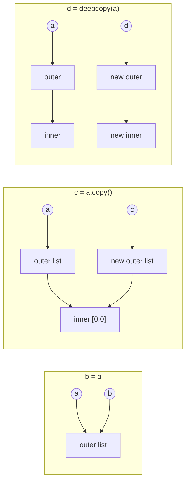

# PY-10 Lists and Tuples

> [!info] Topic card
> **Unit:** U3 · **Time:** 4 h · **Code:** `examples/py10_lists.py`, `exercises/py10_exercises.py`

## 1. Learning objectives
1. **Create**, index, slice and **mutate** lists with their core methods, and **predict** each method's return value.
2. **Explain** aliasing, shallow copies and deep copies, and **avoid** the nested-list multiplication trap.
3. **Use** tuples as immutable records, with packing and unpacking (including `*rest`).
4. **State** the time cost of common list operations, and **choose** operations accordingly.
5. **Process** two-dimensional data (lists of lists), e.g. a marks table.

## 2. Why it matters
Lists are Python's workhorse collection: marks, transactions, lines of a file, search results. Aliasing bugs ("I changed one list and another changed too") are among the most confusing for beginners, and they appear in every project.

## 3. Prerequisites
[[PY-06 Functions, Parameters, Return Values and Scope]] (call by object reference) and [[PY-09 Strings and String Processing]] (indexing and slicing work the same way).

## 4. Intuition
- A **list** is a numbered, resizable shelf of **references to objects**. You can add, remove and replace items.
- A **tuple** is a **sealed** shelf: fixed size, fixed references. It's ideal for a record such as `(name, mark)` or a coordinate `(x, y)`.

## 5. Rigorous explanation

### 5.1 Lists: creation and access
```python
marks = [71, 64, 88]
empty = []
mixed = ["Ali", 71, True]       # allowed, but usually a design smell
from_range = list(range(5))     # [0, 1, 2, 3, 4]
marks[0], marks[-1], marks[1:]  # 71, 88, [64, 88]
```
Slicing creates a **new** list (a shallow copy of that range).

### 5.2 Mutating methods: most return `None`
| Method | Effect | Returns | Cost |
|---|---|---|---|
| `xs.append(x)` | add at the end | `None` | $O(1)$ amortised |
| `xs.extend(iterable)` | add all items | `None` | $O(k)$ |
| `xs.insert(i, x)` | insert before index `i` | `None` | $O(n)$ |
| `xs.pop()` / `xs.pop(i)` | remove and return the last / index `i` | the item | $O(1)$ / $O(n)$ |
| `xs.remove(x)` | remove the **first** occurrence (ValueError if absent) | `None` | $O(n)$ |
| `xs.sort(key=, reverse=)` | sort **in place** (stable) | `None` | $O(n \log n)$ |
| `xs.reverse()` | reverse in place | `None` | $O(n)$ |
| `xs[i] = v` | replace | — | $O(1)$ |
| `del xs[i]` | delete | — | $O(n)$ |

Non-mutating: `len(xs)`, `x in xs` ($O(n)$), `xs.index(x)` ($O(n)$), `xs.count(x)`, `sorted(xs)` (**new** list), `min`, `max`, `sum`, `xs + ys` (new list), `xs * k` (new list).

**Classic bug:** `xs = xs.sort()` sets `xs` to `None`. Use `xs.sort()` or `ys = sorted(xs)`.

### 5.3 Aliasing and copying
```python
a = [1, 2, 3]
b = a            # alias: same object
c = a[:]         # shallow copy: new list, same element references (also list(a), a.copy())
a.append(4)
print(b, c)      # [1, 2, 3, 4] [1, 2, 3]
```
A **shallow** copy copies the outer list only. Nested lists are still shared:
```python
grid = [[0, 0], [0, 0]]
shallow = grid.copy()
shallow[0][0] = 9
print(grid)      # [[9, 0], [0, 0]], because the inner list is shared

import copy
deep = copy.deepcopy(grid)   # recursively copies nested objects
```

### 5.4 The multiplication trap
```python
board = [[0] * 3] * 3        # three references to ONE inner list
board[0][0] = "X"
print(board)                 # [['X', 0, 0], ['X', 0, 0], ['X', 0, 0]]
board = [[0] * 3 for _ in range(3)]   # correct: three distinct inner lists
```
`[0] * 3` is safe, because ints are immutable. Multiplying a list **of lists** copies references, not lists.

### 5.5 Modifying a list while iterating over it
```python
xs = [1, 2, 2, 3]
for x in xs:
    if x == 2:
        xs.remove(x)
print(xs)     # [1, 2, 3]: one 2 survives
```
Removing shifts the later items left, so the loop's internal index skips one. **Fix:** build a new list (`[x for x in xs if x != 2]`) or iterate over a copy (`for x in xs[:]`).

### 5.6 Tuples
```python
point = (3, 4)
single = (5,)            # the comma makes the tuple, not the parentheses
record = "Ali", 71       # packing (parentheses optional)
name, mark = record      # unpacking
first, *rest = [1, 2, 3, 4]   # first=1, rest=[2, 3, 4]
a, b = b, a              # swap via packing/unpacking
```
Tuples are immutable, so they are **hashable** if their elements are. That means they can be dictionary keys and set members ([[PY-11 Dictionaries, Sets and Comprehensions]]). Note that a tuple containing a list can't be changed itself, but the list inside it can.

`collections.namedtuple` and `typing.NamedTuple` give named fields: `Student(name="Ali", mark=71).mark`. Dataclasses ([[PY-16 Classes and Objects]]) are the mutable, more flexible alternative.

### 5.7 Sorting with keys
```python
students = [("Ali", 71), ("Bea", 88), ("Chen", 71)]
by_mark = sorted(students, key=lambda s: s[1], reverse=True)
# [('Bea', 88), ('Ali', 71), ('Chen', 71)]: stable, so Ali stays before Chen
by_mark_then_name = sorted(students, key=lambda s: (-s[1], s[0]))
```
Python's sort is **stable**: equal keys keep their original order. Tuple keys sort lexicographically (first field, then second).

## 6. Terminology
| Term | Meaning |
|---|---|
| Mutable sequence | Ordered collection that can change (list) |
| Alias | Second name for the same object |
| Shallow copy | New outer container, shared inner objects |
| Deep copy | Recursive copy of all nested objects |
| Packing / unpacking | Building / splitting a tuple from or into names |
| Stable sort | Equal elements keep their relative order |
| Amortised $O(1)$ | Average cost per operation over many operations |
| Hashable | Has a fixed hash, so it is usable as a dict key or set member |

## 7. Step-by-step: median of a list
1. **Copy and sort** (don't mutate the caller's list): `s = sorted(values)`.
2. `n = len(s)`. If `n == 0`, raise `ValueError`.
3. If `n` is odd, return `s[n // 2]`.
4. If `n` is even, return `(s[n//2 - 1] + s[n//2]) / 2`.
Check: `[3, 1, 2]` → sorted `[1, 2, 3]`, n = 3, returns `s[1] = 2` ✔. `[4, 1, 3, 2]` → `[1, 2, 3, 4]`, returns `(2 + 3) / 2 = 2.5` ✔.

## 8. Diagram: alias vs shallow copy vs deep copy

*Text version: an alias is two names for one list. A shallow copy has a new outer list but still points to the same inner lists. A deep copy duplicates everything, so nothing is shared.*

## 9. Worked examples

### Example 1 (basic): statistics with a trace
```python
def running_total(values: list[float]) -> list[float]:
    totals = []
    acc = 0
    for v in values:
        acc += v
        totals.append(acc)
    return totals

print(running_total([5, 3, 2]))   # [5, 8, 10]
```
| v | acc | totals |
|---|---|---|
| 5 | 5 | [5] |
| 3 | 8 | [5, 8] |
| 2 | 10 | [5, 8, 10] |

### Example 2 (intermediate): remove duplicates, preserving order. Incorrect → bug → corrected
```python
# INCORRECT 1: list(set(xs)) loses the original order
# INCORRECT 2: mutating while iterating
def dedupe_wrong(xs):
    for x in xs:
        if xs.count(x) > 1:
            xs.remove(x)       # mutates the caller's list AND skips elements
    return xs
```
`dedupe_wrong([1, 2, 1, 2, 1])` returns `[2, 2, 1]`: the duplicates survive, the order is wrong, and the caller's list was destroyed too. (Some inputs, such as `[1, 1, 1, 2]`, happen to come out right. That's why a single passing example proves nothing, see [[PY-08 Algorithmic Thinking, Pseudocode, Flowcharts and Tracing]].)
```python
# CORRECTED: O(n) with a set of seen values, new list returned
def dedupe(xs: list) -> list:
    seen = set()
    out = []
    for x in xs:
        if x not in seen:
            seen.add(x)
            out.append(x)
    return out
```
(`list(dict.fromkeys(xs))` is a one-line equivalent, because dicts preserve insertion order.)
**Edge cases:** empty list → `[]`. Unhashable items (lists) → `TypeError`, since the set needs hashable elements.

### Example 3 (challenging): 2-D marks table. Column averages and transpose
```python
table = [            # rows = students, columns = assessments
    [70, 65, 80],
    [55, 75, 60],
    [90, 85, 95],
]
def column_averages(rows: list[list[float]]) -> list[float]:
    n_cols = len(rows[0])
    return [sum(row[c] for row in rows) / len(rows) for c in range(n_cols)]

def transpose(rows):
    return [list(col) for col in zip(*rows)]

print(column_averages(table))  # [71.666..., 75.0, 78.333...]
print(transpose(table))        # [[70, 55, 90], [65, 75, 85], [80, 60, 95]]
```
`zip(*rows)` unpacks the rows as separate arguments to `zip`, which then pairs up the first elements, the second elements, and so on. That's exactly the columns. **Edge case:** ragged rows (different lengths) are silently truncated by `zip`, so validate the shape first, or use `zip(*rows, strict=True)` (3.10+).

### Example 4 (transfer): rotation with slicing
```python
def rotate(xs: list, k: int) -> list:
    if not xs:
        return []
    k %= len(xs)                    # handles k > len and negative k
    return xs[-k:] + xs[:-k] if k else xs[:]

rotate([1, 2, 3, 4, 5], 2)   # [4, 5, 1, 2, 3]
rotate([1, 2, 3, 4, 5], -1)  # [2, 3, 4, 5, 1]
```
Why the `if k` check? For `k == 0`, `xs[-0:]` is `xs[0:]` (the whole list) and `xs[:-0]` is `xs[:0]` (empty), so the result happens to be correct. The explicit branch just makes the intent clear and returns a copy.

## 10. Application
The expense tracker ([[PRJ-PY-02 Personal Expense Tracker]]) stores expenses as a list of tuples `(date, category, amount_cents)`. Each record is a tuple because an expense, once recorded, shouldn't be edited accidentally in place. Corrections create a new record. Reports use `sorted(..., key=...)` and slicing for "top 5 expenses".

## 11. Common mistakes
| Mistake | Why | Fix |
|---|---|---|
| `xs = xs.sort()` | `sort` returns `None` | `xs.sort()` or `sorted(xs)` |
| `xs.append([4, 5])` when you meant extend | `append` adds one item (here a list) | `xs.extend([4, 5])` |
| `[[0]*n]*m` | Copies references to one inner list | List comprehension |
| `b = a` then mutating `b` | Alias, not copy | `b = a.copy()` or `deepcopy` |
| Removing while iterating | Indices shift | Build a new list |
| `(5)` expected to be a tuple | The comma makes a tuple | `(5,)` |
| `x in big_list` inside a loop | $O(n)$ each time, $O(n^2)$ overall | Use a set ([[PY-11 Dictionaries, Sets and Comprehensions]]) |

## 12. Comparison
| | list | tuple | str |
|---|---|---|---|
| Mutable | ✔ | ✘ | ✘ |
| Hashable | ✘ | ✔ (if its items are) | ✔ |
| Typical use | Homogeneous, growing collection | Fixed record / key | Text |
| Literal | `[1, 2]` | `(1, 2)` | `"12"` |

## 13. Practice
**L1** 1. What do `xs.append(3)`, `xs.pop()` and `sorted(xs)` return? 2. What does `[1, 2] * 2` produce? What about `[[1]] * 2`?

**L2** *(code bank)* 3. `running_total(values)`. 4. `median(values)` (don't mutate the input). 5. `dedupe(xs)`.

**L3** 6. `rotate(xs, k)`. 7. `chunk(xs, size)`: `chunk([1,2,3,4,5], 2)` → `[[1,2],[3,4],[5]]` (`ValueError` if `size < 1`). 8. `column_averages(rows)` and `transpose(rows)`, raising `ValueError` for ragged input.

**L4** 9. `top_n(students, n)`: `students` is a list of `(name, mark)`. Return the `n` best by mark, with ties broken alphabetically by name. 10. Predict the output, then explain it with a diagram:
```python
a = [[1, 2], [3, 4]]
b = a[:]
b[0] = [9, 9]
b[1][0] = 7
print(a, b)
```

**L5** 11. `flatten_matrix` and `reshape(flat, rows, cols)`. State their preconditions, and explain why `reshape` must check `len(flat) == rows * cols`. Then evaluate when a 2-D list is the right design and when a list of tuples or a dictionary keyed by `(row, col)` (a sparse representation) is better.

**Variation:** modify `chunk` to support an overlapping window: `sliding_window([1,2,3,4], 2)` → `[[1,2],[2,3],[3,4]]`.

## 14. Hints
> [!tip]- Hints
> 7: `range(0, len(xs), size)` and slicing. 9: Key `(-mark, name)`. 10: `b[0] = ...` rebinds an element of the *new* outer list, but `b[1]` is still the *shared* inner list. 11: `reshape` uses slices `flat[r*cols:(r+1)*cols]`.

## 15. Worked solutions
> [!success]- Solutions 1–2
> 1. `None`, the removed last element, and a new sorted list. 2. `[1, 2, 1, 2]`. `[[1], [1]]`, where both elements are **the same** inner list.

> [!success]- Solutions 4, 7
> ```python
> def median(values):
>     s = sorted(values)
>     n = len(s)
>     if n == 0:
>         raise ValueError("median of empty list")
>     mid = n // 2
>     return s[mid] if n % 2 else (s[mid - 1] + s[mid]) / 2
>
> def chunk(xs, size):
>     if size < 1:
>         raise ValueError("size must be >= 1")
>     return [xs[i:i + size] for i in range(0, len(xs), size)]
> ```

> [!success]- Solution 9
> ```python
> def top_n(students, n):
>     return sorted(students, key=lambda s: (-s[1], s[0]))[:n]
> ```
> Negating the mark sorts it descending while the name sorts ascending. This works for numbers. For descending strings you'd sort twice (relying on stability), or use `reverse=True` with a suitable key.

> [!success]- Solution 10
> `a = [[1, 2], [3, 4]]`, `b = a[:]`: a new outer list that shares both inner lists.
> `b[0] = [9, 9]` replaces the reference in `b` only. `b[1][0] = 7` mutates the inner list **shared** with `a`.
> Output: `[[1, 2], [7, 4]] [[9, 9], [7, 4]]`.

> [!success]- Solution 11
> ```python
> def flatten_matrix(rows):
>     return [x for row in rows for x in row]
>
> def reshape(flat, rows, cols):
>     if rows < 0 or cols < 0 or len(flat) != rows * cols:
>         raise ValueError("size mismatch")
>     return [flat[r * cols:(r + 1) * cols] for r in range(rows)]
> ```
> **Precondition check:** without it, slicing silently produces short or missing rows (slices never raise). The bug would surface far away from its cause. **Design evaluation:** a dense 2-D list is best for small, mostly full grids (seating plans, marks tables). For large, mostly empty grids (e.g. 10 000 × 10 000 with 50 entries), a dict `{(r, c): value}` uses memory proportional to the entries, not the area. That's a trade-off between memory and the convenience of simple indexing.

> [!success]- Variation answer
> ```python
> def sliding_window(xs, size):
>     if size < 1:
>         raise ValueError("size must be >= 1")
>     return [xs[i:i + size] for i in range(len(xs) - size + 1)]
> ```
> If `size > len(xs)`, `range` is empty, so the result is `[]`.

## 16. Self-test (pass ≥ 4/5)
1. Cost of `xs.insert(0, x)` versus `xs.append(x)`? 2. How do you make a 3 × 3 grid of zeros correctly? 3. Does `sorted` modify its argument? 4. What makes `(5,)` a tuple? 5. What's the difference between a shallow and a deep copy?
> [!success]- Answers
> 1. $O(n)$ vs amortised $O(1)$. 2. `[[0] * 3 for _ in range(3)]`. 3. No, it returns a new list. 4. The comma. 5. A shallow copy duplicates only the outer container. A deep copy recursively duplicates the nested objects too.

## 17. Flashcards
#flashcards/python
What does `list.sort()` return?::None. It sorts in place; use sorted() for a new list.
Why is `[[0]*3]*3` buggy?::It contains three references to the same inner list.
Shallow copy of a list?::a.copy(), list(a), or a[:]: new outer list, shared elements.
Cost of `x in list`?::O(n) linear scan.
Is Python's sort stable?::Yes. Equal keys keep their original relative order.
How to swap two variables?::a, b = b, a (tuple packing/unpacking).
What does `zip(*rows)` do?::Transposes rows into columns (tuples).

## 18. Blank-page recall
Draw the alias / shallow / deep diagram for a nested list, and write the method table (method, effect, return value, cost) from memory.

## 19. Revision summary
- Lists are mutable sequences of references. Tuples are immutable records.
- Most mutating methods return `None`. `sorted` returns a new list.
- Assignment aliases. `copy()` is shallow. `deepcopy` is recursive.
- Never multiply lists of lists, and never remove items while iterating.
- Know the costs: append $O(1)$, insert/remove/`in` $O(n)$, sort $O(n \log n)$.

## 20. Links
Prev: [[PY-09 Strings and String Processing]] · Next: [[PY-11 Dictionaries, Sets and Comprehensions]] · Uses: [[PY-12 Searching, Sorting and Complexity]], [[PRJ-PY-01 Student Marks and Grading System]] · Math: [[DM-06 Sets, Set Operations, Power Sets and Cartesian Products]] (tuples as ordered pairs)

## 21. Sources
- Python docs, *Data Structures* (tutorial §5): https://docs.python.org/3/tutorial/datastructures.html
- Python docs, `copy`: shallow and deep copy operations: https://docs.python.org/3/library/copy.html
- Python Wiki, *TimeComplexity*: https://wiki.python.org/moin/TimeComplexity
- Python docs, *Sorting Techniques*: https://docs.python.org/3/howto/sorting.html

## 22. Mastery checklist
- [ ] `py10` tests pass with `PY_TARGET=exercises`
- [ ] Practice 10 predicted correctly before running
- [ ] I can state the cost of each list method · reviews scheduled
