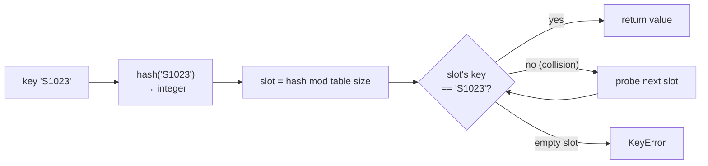

# PY-11 Dictionaries, Sets and Comprehensions

> [!info] Topic card
> **Unit:** U3 · **Time:** 4 h · **Code:** `examples/py11_dicts_sets.py`, `exercises/py11_exercises.py`
> **Review:** [[DM-06 Sets, Set Operations, Power Sets and Cartesian Products]]. Python's `set` operators *are* the mathematical operations.

## 1. Learning objectives
1. **Use** dictionaries for key→value lookup: create, read safely (`get`), update, delete and iterate (`items`).
2. **Apply** the counting and grouping patterns, including `collections.Counter` and `defaultdict`.
3. **Use** sets for membership tests and set algebra (∪, ∩, −, △), and **explain** hashability.
4. **Write** list, dict and set comprehensions, and generator expressions, and **judge** when a loop is clearer.
5. **Explain** why dict and set lookups are $O(1)$ on average while list membership is $O(n)$.

## 2. Why it matters
"Look something up by name or ID" is everywhere: student ID → record, word → count, username → hashed password. Choosing a dict or set instead of a list often turns an $O(n^2)$ program into $O(n)$.

## 3. Prerequisites
[[PY-10 Lists and Tuples]] (tuples as keys, iteration), [[PY-05 Loops and Iteration]].

## 4. Intuition
- A **dict** is a **labelled locker room**: you go straight to locker "S1023" without checking every locker.
- A **set** is a **guest list**: each name appears at most once, and checking whether someone is on the list is instant.
- A **comprehension** is a **one-line recipe**: "the squares of the even numbers in `xs`" → `[x*x for x in xs if x % 2 == 0]`.

## 5. Rigorous explanation

### 5.1 Dictionaries
```python
student = {"id": "S1023", "name": "Amina", "mark": 78}
student["mark"]                 # 78 (KeyError if missing)
student.get("email")            # None, a safe read
student.get("email", "n/a")     # with a default
student["mark"] = 81            # update
student["email"] = "a@x.ac.tz"  # insert
del student["email"]            # delete (KeyError if missing)
student.pop("mark", None)       # remove and return, with a default
"name" in student               # True: membership tests KEYS
for key, value in student.items():
    print(key, value)
```
- Keys must be **hashable** (str, int, tuple of hashables, frozenset). Values can be anything.
- Since Python 3.7, dicts **preserve insertion order** (language guarantee).
- `d.keys()`, `d.values()` and `d.items()` are live **views**.
- Merge: `d1 | d2` (3.9+; right side wins) or `d1.update(d2)`.

### 5.2 How hashing gives $O(1)$
Python computes `hash(key)`, an integer, and uses it to jump to a slot in an internal table. Equal keys must have equal hashes, which is why **mutable** objects such as lists (whose contents, and therefore equality, can change) aren't hashable. Collisions (different keys, same slot) are resolved internally. With a good hash function, lookup, insert and delete are **$O(1)$ on average**. The worst case is $O(n)$, but it's rare in practice.

### 5.3 Counting and grouping patterns
```python
words = "the cat and the hat".split()

counts = {}
for w in words:
    counts[w] = counts.get(w, 0) + 1          # {'the': 2, 'cat': 1, 'and': 1, 'hat': 1}

from collections import Counter, defaultdict
Counter(words).most_common(1)                 # [('the', 2)]

by_length = defaultdict(list)                 # missing keys start as []
for w in words:
    by_length[len(w)].append(w)               # {3: ['the', 'cat', 'and', 'the', 'hat']}
```

### 5.4 Sets
```python
a = {1, 2, 3}
b = {3, 4}
empty = set()          # NOT {}, which is an empty dict
a | b   # union                {1, 2, 3, 4}
a & b   # intersection         {3}
a - b   # difference           {1, 2}
a ^ b   # symmetric difference {1, 2, 4}
a <= {1, 2, 3, 9}      # subset test: True
```
Sets are **unordered** (don't rely on print order) and contain no duplicates. `frozenset` is the immutable, hashable variant. These correspond exactly to $A \cup B$, $A \cap B$, $A \setminus B$, $A \triangle B$ and $A \subseteq B$ in [[DM-06 Sets, Set Operations, Power Sets and Cartesian Products]].

### 5.5 Comprehensions
| Form | Example | Result type |
|---|---|---|
| List | `[x * x for x in range(5) if x % 2 == 0]` | `[0, 4, 16]` |
| Set | `{w.lower() for w in words}` | set |
| Dict | `{name: mark for name, mark in pairs if mark >= 50}` | dict |
| Generator | `sum(x * x for x in range(10**6))` | lazy, $O(1)$ memory |
| Nested | `[(r, c) for r in range(2) for c in range(3)]` | loops read left to right, outer first |

Rule of thumb: if a comprehension needs more than one `for` **and** an `if`, or anything with side effects, write a normal loop.

### 5.6 Inverting a dictionary
```python
grades = {"Ali": "B", "Bea": "A", "Chen": "B"}
by_grade = {}
for name, g in grades.items():
    by_grade.setdefault(g, []).append(name)   # {'B': ['Ali', 'Chen'], 'A': ['Bea']}
```
A naive `{v: k for k, v in grades.items()}` **loses data** when values repeat: `{'B': 'Chen', 'A': 'Bea'}`.

## 6. Terminology
| Term | Meaning |
|---|---|
| Key / value | Lookup label / associated data |
| Hash | Integer derived from an object, used to locate it in a table |
| Hashable | Has a hash that never changes; equal objects have equal hashes |
| Collision | Two keys mapping to the same table slot |
| View | Live window onto a dict's keys/values/items |
| Comprehension | Expression building a collection from an iterable |
| Generator expression | Lazy comprehension producing items on demand |

## 7. Step-by-step: choosing the collection
1. Need **order and duplicates**? → `list`.
2. Need **fast "is x in here?"** with no duplicates? → `set`.
3. Need **lookup by a key**? → `dict`.
4. Need a **fixed record** or a composite key? → `tuple`.
5. Need **counts**? → `Counter`. **Groups**? → `defaultdict(list)`.

## 8. Diagram: dict lookup

*Text version: the key is hashed, the hash picks a slot, and the slot's key is compared. On a collision, Python probes further slots. An empty slot means the key is absent. On average only one or two slots are checked, regardless of the dict's size.*

## 9. Worked examples

### Example 1 (basic): word frequency. Line by line
```python
def word_counts(text: str) -> dict[str, int]:
    counts = {}                                  # 1 empty accumulator
    for word in text.lower().split():            # 2 normalise, then split
        word = word.strip(".,!?;:\"'")           # 3 remove surrounding punctuation
        if word:                                 # 4 skip tokens that were only punctuation
            counts[word] = counts.get(word, 0) + 1   # 5 0 for unseen words
    return counts

word_counts("The cat. The hat!")   # {'the': 2, 'cat': 1, 'hat': 1}
```
| word | counts after |
|---|---|
| the | {'the': 1} |
| cat | {'the': 1, 'cat': 1} |
| the | {'the': 2, 'cat': 1} |
| hat | {'the': 2, 'cat': 1, 'hat': 1} |
Cost: $O(n)$ for $n$ words (each dict operation is $O(1)$ on average).

### Example 2 (intermediate): incorrect → bug → corrected. Common elements
```python
# INCORRECT (slow): O(n·m)
def common_wrong(a: list, b: list) -> list:
    result = []
    for x in a:
        if x in b and x not in result:   # 'in list' is O(len) each time
            result.append(x)
    return result
```
It's correct but quadratic: with 100 000 elements in each list, it does up to $10^{10}$ comparisons.
```python
# CORRECTED: O(n + m)
def common(a: list, b: list) -> list:
    b_set = set(b)
    seen = set()
    out = []
    for x in a:                      # preserves a's order
        if x in b_set and x not in seen:
            seen.add(x)
            out.append(x)
    return out
```
If order doesn't matter: `set(a) & set(b)`.

### Example 3 (challenging): grouping records and reporting
```python
records = [("Ali", "CS", 71), ("Bea", "IT", 88), ("Chen", "CS", 64), ("Dan", "IT", 52)]

def average_by_group(rows):
    totals = {}                 # group -> [sum, count]
    for _, group, mark in rows:
        if group not in totals:
            totals[group] = [0, 0]
        totals[group][0] += mark
        totals[group][1] += 1
    return {g: s / c for g, (s, c) in totals.items()}

print(average_by_group(records))   # {'CS': 67.5, 'IT': 70.0}
```
The dict comprehension **unpacks** `(s, c)` from each value. This is a SQL `GROUP BY` in pure Python ([[PY-22 SQL and Database Integration]]).

### Example 4 (transfer): set algebra for a real question
"Which students registered for Python **and** Discrete Math but **not** Cyber Security?"
```python
python = {"S1", "S2", "S3", "S5"}
dm = {"S2", "S3", "S4"}
cyber = {"S3"}
print((python & dm) - cyber)   # {'S2'}
```
This is $(P \cap D) \setminus C$: an English requirement translated straight into set algebra ([[X-01 Logic and Sets in Python and Requirements]]).

## 10. Application: an index for fast search
The library system ([[PRJ-PY-03 Library Management System]]) keeps `books_by_isbn: dict[str, Book]` for $O(1)$ lookup and `word_index: dict[str, set[str]]`, mapping each title word to the ISBNs containing it. A search for "python programming" is `word_index["python"] & word_index["programming"]`.

## 11. Common mistakes
| Mistake | Why | Fix |
|---|---|---|
| `{}` for an empty set | `{}` is an empty dict | `set()` |
| `d[key]` on a possibly missing key | KeyError | `d.get(key, default)` or check `in` |
| A list as a dict key | Unhashable | Use a tuple |
| Modifying a dict while iterating over it | `RuntimeError: dictionary changed size during iteration` | Iterate over `list(d)`, or build a new dict |
| Relying on set order | Sets are unordered | `sorted(s)` for display |
| Inverting with a comprehension when values repeat | Later keys overwrite earlier ones | Group into lists |
| Over-clever nested comprehensions | Unreadable | Use a loop |

## 12. Comparison
| Operation | list | set | dict |
|---|---|---|---|
| `x in c` | $O(n)$ | $O(1)$ avg | $O(1)$ avg (keys) |
| Add | `append` $O(1)$ | `add` $O(1)$ | `d[k] = v` $O(1)$ |
| Ordered | ✔ | ✘ | insertion order |
| Duplicates | ✔ | ✘ | unique keys |
| Elements must be hashable | ✘ | ✔ | keys ✔ |

## 13. Practice
**L1** 1. What do `{1, 2} | {2, 3}`, `{1, 2} ^ {2, 3}` and `type({})` give? 2. Which of `(1, 2)`, `[1, 2]`, `"ab"` and `{1}` can be dict keys?

**L2** *(code bank)* 3. `word_counts(text)`. 4. `common(a, b)`. 5. `invert(d)`, which groups keys by value into **sorted** lists.

**L3** 6. `average_by_group(rows)`. 7. `squares_of_evens(xs)` and `passing(marks_dict, threshold)` using comprehensions. 8. `most_frequent(xs)` returns the most common item, with ties broken by **first appearance**.

**L4** 9. `two_sum(nums, target)` returns indices `(i, j)` with `i < j` and `nums[i] + nums[j] == target`, or `None`, in $O(n)$. 10. Given the course registrations `{course: set_of_ids}`, write `only_one_course(reg)`, returning the IDs enrolled in exactly one course.

**L5** 11. Design an **inverted index** `build_index(docs: dict[str, str]) -> dict[str, set[str]]` and `search(index, query) -> set[str]` (AND semantics over the query words, case-insensitive, punctuation stripped). Discuss its memory cost, and how you'd add OR / NOT queries.

**Variation:** modify `word_counts` to ignore a set of stop words (`{"the", "and", "a"}`) passed as a parameter.

## 14. Hints
> [!tip]- Hints
> 8: `Counter` keeps first-insertion order for ties, so `max(counts, key=counts.get)` returns the first maximal key. 9: Store `value → index` as you go, and check whether `target - x` has been seen. 10: Count appearances across all the sets, then keep those with count 1. 11: For each word of each doc, `index.setdefault(word, set()).add(doc_id)`. The query intersects the sets.

## 15. Worked solutions
> [!success]- Solutions 1–2
> 1. `{1, 2, 3}`, `{1, 3}`, `<class 'dict'>`. 2. `(1, 2)` and `"ab"` (a `frozenset({1})` would also work, but `{1}` and `[1, 2]` are unhashable).

> [!success]- Solution 5
> ```python
> def invert(d: dict) -> dict:
>     out = {}
>     for k, v in d.items():
>         out.setdefault(v, []).append(k)
>     return {v: sorted(ks) for v, ks in out.items()}
> ```

> [!success]- Solution 7–8
> ```python
> def squares_of_evens(xs):
>     return [x * x for x in xs if x % 2 == 0]
>
> def passing(marks: dict[str, float], threshold: float = 50) -> dict[str, float]:
>     return {name: mk for name, mk in marks.items() if mk >= threshold}
>
> from collections import Counter
> def most_frequent(xs):
>     if not xs:
>         raise ValueError("empty input")
>     counts = Counter(xs)                      # insertion-ordered by first appearance
>     return max(counts, key=counts.get)        # max returns the FIRST maximal element
> ```

> [!success]- Solution 9
> ```python
> def two_sum(nums, target):
>     seen = {}                        # value -> index
>     for j, x in enumerate(nums):
>         i = seen.get(target - x)
>         if i is not None:
>             return (i, j)
>         seen[x] = j
>     return None
> ```
> One pass, $O(n)$ time, $O(n)$ space. The brute-force pair check is $O(n^2)$. Checking *before* inserting ensures `i != j`.

> [!success]- Solution 10
> ```python
> from collections import Counter
> def only_one_course(reg: dict[str, set[str]]) -> set[str]:
>     counts = Counter(sid for ids in reg.values() for sid in ids)
>     return {sid for sid, c in counts.items() if c == 1}
> ```
> For exactly two courses this would be the symmetric difference $A \triangle B$. For many courses, "odd number of courses" is not the same as "exactly one", which is why counting is needed.

> [!success]- Solution 11
> ```python
> import string
> def _words(text):
>     return {w.strip(string.punctuation) for w in text.casefold().split()} - {""}
>
> def build_index(docs):
>     index = {}
>     for doc_id, text in docs.items():
>         for w in _words(text):
>             index.setdefault(w, set()).add(doc_id)
>     return index
>
> def search(index, query):
>     words = _words(query)
>     if not words:
>         return set()
>     sets = [index.get(w, set()) for w in words]
>     return set.intersection(*sets)
> ```
> **Memory:** $O(\text{total distinct (word, doc) pairs})$. **OR** is the union of the sets. **NOT w** is `all_docs - index[w]`. That's exactly the Boolean algebra of sets. Real search engines add ranking (e.g. TF-IDF), which is beyond scope.

> [!success]- Variation answer
> ```python
> def word_counts_filtered(text, stop_words=frozenset()):
>     counts = {}
>     for w in text.lower().split():
>         w = w.strip(".,!?;:\"'")
>         if w and w not in stop_words:
>             counts[w] = counts.get(w, 0) + 1
>     return counts
> ```
> `frozenset()` as the default is safe, because it is immutable (unlike `set()`; see [[PY-06 Functions, Parameters, Return Values and Scope]]).

## 16. Self-test (pass ≥ 4/5)
1. Why can't lists be dict keys? 2. Average cost of `x in some_set`? 3. Write a dict comprehension mapping each name to its length. 4. Which method reads a dict key with a default? 5. What does `a ^ b` compute for sets?
> [!success]- Answers
> 1. They're mutable and therefore unhashable: their equality, and so their hash, could change. 2. $O(1)$. 3. `{n: len(n) for n in names}`. 4. `get`. 5. The symmetric difference: elements in exactly one of the sets.

## 17. Flashcards
#flashcards/python
Empty set literal?::set(). {} is an empty dict.
Safe dict read with default?::d.get(key, default)
Why are dict lookups O(1) on average?::Keys are hashed to table slots, so lookup jumps directly instead of scanning.
Counting idiom?::counts[k] = counts.get(k, 0) + 1, or collections.Counter.
Grouping idiom?::d.setdefault(key, []).append(item) or defaultdict(list).
Do dicts preserve order?::Yes, insertion order (guaranteed since Python 3.7).
Set operators?::| union, & intersection, - difference, ^ symmetric difference, <= subset.

## 18. Blank-page recall
Write the collection-choice decision list (§7) and the complexity comparison table (§12) from memory, and implement word counts three ways (`get`, `Counter`, `defaultdict`).

## 19. Revision summary
- dict = key→value with $O(1)$ average lookup, insertion-ordered, hashable keys.
- set = unique, unordered, $O(1)$ membership, and real set algebra.
- Patterns: count (`get`/`Counter`), group (`setdefault`/`defaultdict`), index.
- Comprehensions for simple transforms and filters, loops for complex logic.
- Replacing list membership with set membership often turns $O(n^2)$ into $O(n)$.

## 20. Links
Prev: [[PY-10 Lists and Tuples]] · Next: [[PY-12 Searching, Sorting and Complexity]] · Math: [[DM-06 Sets, Set Operations, Power Sets and Cartesian Products]], [[DM-10 Relations, Equivalence Relations and Partial Orders]] (grouping = partition into equivalence classes) · Integration: [[X-01 Logic and Sets in Python and Requirements]]

## 21. Sources
- Python docs, *Mapping Types — dict* and *Set Types*: https://docs.python.org/3/library/stdtypes.html#mapping-types-dict
- Python docs, `collections`: https://docs.python.org/3/library/collections.html
- Python Wiki, *TimeComplexity*: https://wiki.python.org/moin/TimeComplexity

## 22. Mastery checklist
- [ ] `py11` tests pass with `PY_TARGET=exercises`
- [ ] I can explain hashing and why lists aren't hashable
- [ ] `two_sum` in $O(n)$ unaided · reviews scheduled
