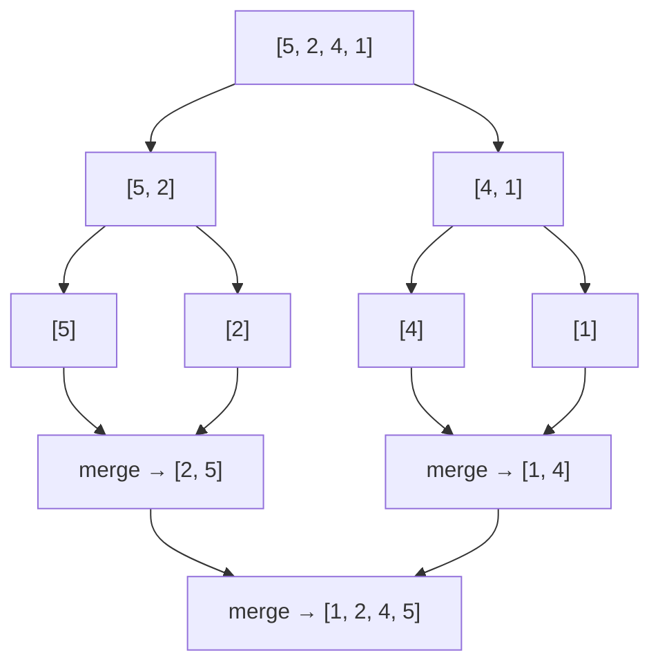

# PY-12 Searching, Sorting and Complexity

> [!info] Topic card
> **Unit:** U3 · **Time:** 5–6 h · **Code:** `examples/py12_timing.py`, `exercises/py12_exercises.py`
> **Review:** [[DM-08 Sequences and Summations]] (for counting loop costs) and [[DM-14 Recurrence Relations]] (for merge sort).

## 1. Learning objectives
1. **Define** Big-O, Big-Ω and Big-Θ, and **classify** code fragments into $O(1)$, $O(\log n)$, $O(n)$, $O(n \log n)$, $O(n^2)$ and $O(2^n)$.
2. **Implement** linear search and iterative binary search, and **justify** binary search with a loop invariant.
3. **Implement and trace** selection, insertion, bubble and merge sort, and **compare** their best, worst and average costs and their stability.
4. **Measure** running time empirically with `timeit`, and **reconcile** the measurements with the theory.
5. **Choose** an appropriate algorithm and data structure for a given problem size.

## 2. Why it matters
An $O(n^2)$ algorithm that takes 1 second for 10 000 records takes about **100 seconds** for 100 000, while an $O(n \log n)$ one takes about 1.2 seconds. Complexity analysis predicts this **before** you ship. It's standard exam material and essential for scalable systems.

## 3. Prerequisites
[[PY-08 Algorithmic Thinking, Pseudocode, Flowcharts and Tracing]] (tracing, invariants), [[PY-10 Lists and Tuples]], [[PY-07 Recursion]] (merge sort).

## 4. Intuition
Complexity asks: **as the input grows, how does the work grow?** Constant factors and machine speed don't matter. The *shape* does. Doubling the input should double $O(n)$ work, quadruple $O(n^2)$ work, and add only **one step** to $O(\log n)$ work.

Binary search is the "guess a number from 1 to 100" game: each guess halves the range, so 7 guesses are enough ($2^7 = 128 \ge 100$).

## 5. Rigorous explanation

### 5.1 Asymptotic notation
Let $f(n)$ be the number of basic steps for input size $n$.
- $f(n) = O(g(n))$ ("at most order $g$") if there exist constants $c > 0$ and $n_0$ such that $0 \le f(n) \le c \cdot g(n)$ for all $n \ge n_0$.
- $f(n) = \Omega(g(n))$ ("at least order $g$") if $f(n) \ge c \cdot g(n)$ for all $n \ge n_0$.
- $f(n) = \Theta(g(n))$ if both hold: a tight bound.

**Example proof:** $f(n) = 3n^2 + 5n + 2 = O(n^2)$. For $n \ge 1$: $5n \le 5n^2$ and $2 \le 2n^2$, so $f(n) \le 3n^2 + 5n^2 + 2n^2 = 10n^2$. Take $c = 10$ and $n_0 = 1$ ∎.

**Simplification rules:** drop constant factors ($5n \to n$). Keep the dominant term ($n^2 + n \to n^2$). Sequential parts **add** ($O(n) + O(n^2) = O(n^2)$). Nested parts **multiply** ($O(n)$ loop × $O(n)$ body $= O(n^2)$).

### 5.2 Growth classes
| Class | Name | Example | n = 10³ | n = 10⁶ |
|---|---|---|---|---|
| $O(1)$ | constant | `d[key]`, `xs[i]` | 1 | 1 |
| $O(\log n)$ | logarithmic | binary search | ~10 | ~20 |
| $O(n)$ | linear | linear search, `sum` | 10³ | 10⁶ |
| $O(n \log n)$ | linearithmic | merge sort, `sorted` | ~10⁴ | ~2×10⁷ |
| $O(n^2)$ | quadratic | selection sort, all pairs | 10⁶ | 10¹² (infeasible) |
| $O(2^n)$ | exponential | all subsets, naive fib | ~10³⁰¹ | — |

### 5.3 Best, worst and average case
For linear search on $n$ items: **best** $O(1)$ (the first item matches), **worst** $O(n)$ (absent, or last), **average** $\approx n/2$ comparisons if the target is present and equally likely anywhere, still $O(n)$. When people say "the complexity", they usually mean the **worst case**.

### 5.4 Space complexity
Extra memory beyond the input: selection sort is $O(1)$ (in place), merge sort is $O(n)$ (temporary lists), and recursive binary search is $O(\log n)$ (stack frames).

### 5.5 Binary search (iterative) and its invariant
Precondition: `xs` is **sorted** in ascending order.
```python
def binary_search(xs: list, target) -> int:
    lo, hi = 0, len(xs) - 1
    while lo <= hi:
        mid = (lo + hi) // 2
        if xs[mid] == target:
            return mid
        if xs[mid] < target:
            lo = mid + 1         # target can only be right of mid
        else:
            hi = mid - 1         # target can only be left of mid
    return -1
```
**Invariant:** if `target` is in `xs`, its index lies in `[lo, hi]`. It holds initially (the whole list). Each branch discards only the half that **can't** contain the target, because the list is sorted. When `lo > hi` the range is empty, so the target is absent.
**Termination:** `hi - lo` strictly decreases each iteration.
**Cost:** the range halves each time, so after $k$ steps it holds about $n / 2^k$ items. It reaches 0 when $k \approx \log_2 n$, giving $O(\log n)$.
(In Python, `(lo + hi) // 2` can't overflow. In C or Java, write `lo + (hi - lo) / 2`.)

The standard library provides `bisect.bisect_left(xs, x)`, which returns the insertion point that keeps `xs` sorted.

### 5.6 Elementary sorts
**Selection sort:** repeatedly select the minimum of the unsorted part and swap it to the front.
```python
def selection_sort(xs: list) -> list:
    a = xs[:]                                    # don't mutate the caller's list
    n = len(a)
    for i in range(n - 1):
        m = i
        for j in range(i + 1, n):
            if a[j] < a[m]:
                m = j
        a[i], a[m] = a[m], a[i]
    return a
```
Comparisons: $(n-1) + (n-2) + \dots + 1 = \frac{n(n-1)}{2} = \Theta(n^2)$ **always**. At most $n-1$ swaps. Not stable.

**Insertion sort:** grow a sorted prefix, inserting each new item into place by shifting larger items right.
```python
def insertion_sort(xs: list) -> list:
    a = xs[:]
    for i in range(1, len(a)):
        key = a[i]
        j = i - 1
        while j >= 0 and a[j] > key:     # strict > keeps it stable
            a[j + 1] = a[j]
            j -= 1
        a[j + 1] = key
    return a
```
Best case (already sorted) $\Theta(n)$. Worst case (reverse sorted) $\Theta(n^2)$. **Stable** and adaptive, which makes it excellent for small or nearly sorted data. Python's built-in Timsort uses insertion sort for small runs.

**Bubble sort:** repeatedly swap adjacent out-of-order pairs. With an early exit when a pass makes no swaps, the best case is $O(n)$. The worst case is $\Theta(n^2)$. It's stable, but in practice slower than insertion sort. Taught for its simplicity.

### 5.7 Merge sort (divide and conquer)
```python
def merge_sort(xs: list) -> list:
    if len(xs) <= 1:
        return xs[:]
    mid = len(xs) // 2
    left = merge_sort(xs[:mid])
    right = merge_sort(xs[mid:])
    return merge(left, right)            # the two-pointer merge from PY-08
```
Recurrence: $T(n) = 2T(n/2) + cn$, $T(1) = c$. **Recursion-tree argument:** level $k$ has $2^k$ subproblems of size $n/2^k$, which costs $cn$ per level. There are $\log_2 n$ levels, so $T(n) = cn\log_2 n + cn = \Theta(n \log n)$ in **every** case. Stable (if the merge takes from the left on ties), with $O(n)$ extra space. A full derivation is in [[DM-14 Recurrence Relations]].

### 5.8 The lower bound for comparison sorting
Any algorithm that sorts only by comparing elements needs $\Omega(n \log n)$ comparisons in the worst case. There are $n!$ possible orderings, each comparison has 2 outcomes, so you need at least $\log_2(n!) = \Theta(n \log n)$ comparisons. Merge sort is therefore **asymptotically optimal**.

## 6. Terminology
| Term | Meaning |
|---|---|
| Asymptotic | Behaviour as $n \to \infty$ |
| Big-O / Ω / Θ | Upper / lower / tight bound up to constants |
| In-place | Uses $O(1)$ extra memory |
| Stable sort | Equal keys keep their relative order |
| Adaptive | Faster on partially sorted input |
| Divide and conquer | Split, solve the parts recursively, combine |
| Precondition | Condition that must hold before calling (e.g. sorted input) |

## 7. Step-by-step: analysing a code fragment
```python
def has_duplicate_pairs(xs):
    for i in range(len(xs)):              # n iterations
        for j in range(i + 1, len(xs)):   # n-1-i iterations
            if xs[i] == xs[j]:            # O(1)
                return True
    return False
```
1. Count the inner-body executions in the worst case (no duplicates): $\sum_{i=0}^{n-1} (n-1-i) = \frac{n(n-1)}{2}$.
2. Each is $O(1)$, so the total is $\Theta(n^2)$.
3. Better: `len(set(xs)) != len(xs)` is $O(n)$ average ([[PY-11 Dictionaries, Sets and Comprehensions]]), or sort and compare neighbours in $O(n \log n)$.

## 8. Diagrams

### 8.1 Merge sort on `[5, 2, 4, 1]`

*Text version: split into halves until single elements remain (depth log₂4 = 2), then merge pairs back up: [5]+[2] → [2,5], [4]+[1] → [1,4], then [2,5]+[1,4] → [1,2,4,5].*

### 8.2 Binary search for 23 in `[2, 5, 8, 12, 16, 23, 38, 56, 72, 91]`
| step | lo | hi | mid | xs[mid] | action |
|---|---|---|---|---|---|
| 1 | 0 | 9 | 4 | 16 | 16 < 23 → lo = 5 |
| 2 | 5 | 9 | 7 | 56 | 56 > 23 → hi = 6 |
| 3 | 5 | 6 | 5 | 23 | found → return 5 |

## 9. Worked examples

### Example 1 (basic): insertion sort trace on `[4, 3, 1, 2]`
| i | key | array after insertion |
|---|---|---|
| — | — | [4, 3, 1, 2] |
| 1 | 3 | [3, 4, 1, 2] |
| 2 | 1 | [1, 3, 4, 2] |
| 3 | 2 | [1, 2, 3, 4] |
Shifts: 1 + 2 + 2 = 5 (the number of **inversions**, i.e. out-of-order pairs, in the input).

### Example 2 (intermediate): binary search. Incorrect → bug → corrected
```python
# INCORRECT
def bsearch_wrong(xs, target):
    lo, hi = 0, len(xs)          # hi is exclusive...
    while lo <= hi:              # ...but the loop treats it as inclusive
        mid = (lo + hi) // 2
        if xs[mid] == target:    # IndexError when mid == len(xs)
            return mid
        elif xs[mid] < target:
            lo = mid
        else:
            hi = mid
    return -1
```
**Bugs (found by running it, see the code bank tests):** (1) mixing an exclusive `hi` with `<=` lets `mid` reach `len(xs)`, so searching an **empty** list raises `IndexError`. (2) `lo = mid` / `hi = mid` don't shrink the range once `hi - lo <= 1`, so searching for 99 in `[1, 3]`, or for 4 in `[1, 3, 5]`, **loops forever**. **Fix:** use the version in §5.5 consistently: inclusive bounds, `<=`, `mid ± 1`. Write the invariant down before coding.

### Example 3 (challenging): first occurrence (lower bound)
With duplicates, `binary_search` returns *some* matching index. To find the **first**:
```python
def lower_bound(xs: list, target) -> int:
    """Smallest i with xs[i] >= target (len(xs) if none). Same as bisect_left."""
    lo, hi = 0, len(xs)          # half-open interval [lo, hi)
    while lo < hi:
        mid = (lo + hi) // 2
        if xs[mid] < target:
            lo = mid + 1
        else:
            hi = mid             # mid might be the answer, so keep it
    return lo
```
**Invariant:** every index `< lo` holds a value `< target`, and every index `≥ hi` holds a value `≥ target`. When `lo == hi`, that index is the boundary. `lower_bound([1, 2, 2, 2, 5], 2)` → 1. To count the occurrences of 2: `lower_bound(xs, 3) - lower_bound(xs, 2)` = 4 − 1 = 3.

### Example 4 (empirical): measuring growth
```python
import random
import timeit

for n in (1000, 2000, 4000):
    data = [random.random() for _ in range(n)]
    t_ins = timeit.timeit(lambda: insertion_sort(data), number=3)
    t_builtin = timeit.timeit(lambda: sorted(data), number=3)
    print(n, round(t_ins, 3), round(t_builtin, 5))
```
Expected pattern (actual times depend on your machine): each doubling of `n` makes insertion sort's time grow about **4×** (quadratic), while `sorted` grows just over **2×** ($n \log n$). The runnable version is in `examples/py12_timing.py`. Run it and record your own numbers. Don't trust anyone else's.

**Actually observed** when this vault was built (CPython 3.13, cloud container, 2026-10-19, 3 repetitions each):
| n | insertion sort (s) | ratio vs previous | `sorted` (s) |
|---|---|---|---|
| 1000 | 0.0648 | — | 0.00042 |
| 2000 | 0.2502 | 3.9× | 0.00062 |
| 4000 | 1.0850 | 4.3× | 0.00147 |

Linear search for the last of 10⁶ items took 0.18 s for 5 runs. Binary search took 0.000033 s, about 5 000× faster.

## 10. Application: choosing for a student records system
- Look up a student by ID 10 000 times a day → **dict** keyed by ID, $O(1)$ each.
- Show the class list sorted by surname once per report → `sorted(..., key=...)`, $O(n \log n)$.
- Find all students with marks in [60, 70) in a list kept sorted by mark → two `bisect` calls, $O(\log n)$ plus the output size.
- Check whether a new ID already exists → set or dict membership, never `in list`.

## 11. Common mistakes
| Mistake | Why | Fix |
|---|---|---|
| Binary search on unsorted data | Precondition ignored | Sort first, or use a set/dict |
| Mixing inclusive and exclusive bounds | Off-by-one, infinite loop | Choose one convention and keep its invariant |
| "$O(2n)$ is worse than $O(n)$" | Misunderstanding constants | They are the same class |
| Treating $O$ as "exact time" | It's an upper bound up to constants | Use Θ for tight claims |
| Calling `sorted()` inside a loop | Hidden $O(n \log n)$ each iteration | Sort once, outside the loop |
| `x in list` in a loop | $O(n^2)$ overall | Build a set first |
| Concluding from one timing run | Noise, caching | Repeat (`timeit`), vary $n$, look at ratios |

## 12. Comparison of sorting algorithms
| Algorithm | Best | Average | Worst | Extra space | Stable | Notes |
|---|---|---|---|---|---|---|
| Selection | $\Theta(n^2)$ | $\Theta(n^2)$ | $\Theta(n^2)$ | $O(1)$ | ✘ | Few swaps |
| Bubble (early exit) | $\Theta(n)$ | $\Theta(n^2)$ | $\Theta(n^2)$ | $O(1)$ | ✔ | Teaching only |
| Insertion | $\Theta(n)$ | $\Theta(n^2)$ | $\Theta(n^2)$ | $O(1)$ | ✔ | Great on small / nearly sorted input |
| Merge | $\Theta(n\log n)$ | $\Theta(n\log n)$ | $\Theta(n\log n)$ | $O(n)$ | ✔ | Predictable |
| Quick (random pivot) | $\Theta(n\log n)$ | $\Theta(n\log n)$ | $\Theta(n^2)$ | $O(\log n)$ | ✘ | Fast in practice |
| Timsort (Python `sorted`) | $\Theta(n)$ | $\Theta(n\log n)$ | $\Theta(n\log n)$ | $O(n)$ | ✔ | Hybrid of merge and insertion |

## 13. Practice
**L1** 1. Order these by growth: $n \log n$, $2^n$, $\log n$, $n^2$, $1$, $n$. 2. What is the precondition of binary search?

**L2** *(code bank)* 3. `linear_search(xs, target)`. 4. `binary_search(xs, target)` (iterative). 5. `selection_sort`, `insertion_sort` and `bubble_sort` (with early exit). All return new lists.

**L3** 6. `merge_sort(xs)`. 7. `lower_bound(xs, target)` and `count_occurrences(sorted_xs, target)` in $O(\log n)$. 8. Give the Θ-complexity of each fragment:
```python
# (a)
i = 1
while i < n:
    i *= 2
# (b)
for i in range(n):
    for j in range(5):
        pass
# (c)
for i in range(n):
    j = n
    while j > 0:
        j //= 2
```

**L4** 9. `count_inversions(xs)` in $O(n \log n)$ by modifying merge sort (an inversion is a pair $i < j$ with $x_i > x_j$). 10. Prove from the definition that $n^2 \ne O(n)$.

**L5** 11. You must report the median of a stream of 10⁶ marks arriving one by one, querying the median after every insertion. Compare (a) sorting after each insertion, (b) maintaining a sorted list with `bisect.insort`, and (c) using two heaps (research `heapq`). Give the complexity of each and recommend one.

**Variation:** modify `insertion_sort` to take a `key` function and sort in descending order while remaining stable.

## 14. Hints
> [!tip]- Hints
> 8: (a) `i` doubles, so count the doublings. (c) multiply the outer `n` by the inner count. 9: When merging, if `right[j] < left[i]`, then `right[j]` forms an inversion with **every** remaining element of `left`. 10: Suppose $n^2 \le cn$ for all $n \ge n_0$, then pick $n > \max(c, n_0)$. 11: `insort` finds the position in $O(\log n)$ but inserts in $O(n)$ (shifting).

## 15. Worked solutions
> [!success]- Solutions 1–2
> 1. $1 < \log n < n < n\log n < n^2 < 2^n$. 2. The list must be sorted (by the same ordering used in the comparisons).

> [!success]- Solution 5 (bubble sort)
> ```python
> def bubble_sort(xs):
>     a = xs[:]
>     n = len(a)
>     for end in range(n - 1, 0, -1):
>         swapped = False
>         for j in range(end):
>             if a[j] > a[j + 1]:
>                 a[j], a[j + 1] = a[j + 1], a[j]
>                 swapped = True
>         if not swapped:          # already sorted: best case O(n)
>             break
>     return a
> ```
> After pass $k$, the $k$ largest elements are in their final positions (invariant), so each pass can stop one position earlier.

> [!success]- Solution 7
> Use `upper_bound` (smallest `i` with `xs[i] > target`, the same as `bisect_right`):
> ```python
> def upper_bound(xs, target):
>     lo, hi = 0, len(xs)
>     while lo < hi:
>         mid = (lo + hi) // 2
>         if xs[mid] <= target:
>             lo = mid + 1
>         else:
>             hi = mid
>     return lo
>
> def count_occurrences(xs, target):
>     return upper_bound(xs, target) - lower_bound(xs, target)
> ```

> [!success]- Solution 8
> (a) `i` takes the values $1, 2, 4, \dots$ until $\ge n$, so there are $\lceil \log_2 n \rceil$ iterations: **Θ(log n)**. (b) $5n$ iterations: **Θ(n)**. (c) The inner loop runs $\lfloor \log_2 n \rfloor + 1$ times for each of $n$ outer iterations: **Θ(n log n)**.

> [!success]- Solution 9
> ```python
> def count_inversions(xs):
>     def sort_count(a):
>         if len(a) <= 1:
>             return a[:], 0
>         mid = len(a) // 2
>         left, inv_l = sort_count(a[:mid])
>         right, inv_r = sort_count(a[mid:])
>         merged, i, j, inv = [], 0, 0, inv_l + inv_r
>         while i < len(left) and j < len(right):
>             if left[i] <= right[j]:
>                 merged.append(left[i]); i += 1
>             else:
>                 merged.append(right[j]); j += 1
>                 inv += len(left) - i      # right[j] < all remaining left items
>         merged += left[i:] + right[j:]
>         return merged, inv
>     return sort_count(xs)[1]
> ```
> `count_inversions([4, 3, 1, 2])` → 5, matching the insertion-sort shift count in Example 1. That's no coincidence: insertion sort performs exactly one shift per inversion.

> [!success]- Solution 10
> Suppose for contradiction that $n^2 = O(n)$, i.e. there are $c > 0$ and $n_0$ with $n^2 \le cn$ for all $n \ge n_0$. Dividing by $n > 0$ gives $n \le c$ for all $n \ge n_0$. Choose $n = \max(n_0, \lceil c \rceil + 1)$. Then $n \ge n_0$ but $n > c$, a contradiction. Therefore $n^2 \ne O(n)$ ∎ (a proof by contradiction, see [[DM-05 Direct Proof, Contrapositive and Contradiction]]).

> [!success]- Solution 11
> (a) Re-sorting after each of $n$ insertions costs $\sum O(k \log k) = O(n^2 \log n)$. Infeasible for $10^6$ marks.
> (b) `insort` costs $O(\log k)$ to find the position plus $O(k)$ to shift, so $O(n^2)$ in total (about $5 \times 10^{11}$ element moves in the worst case, although `memmove` is fast). The median is $O(1)$ by index.
> (c) Two heaps: a max-heap for the lower half and a min-heap for the upper half, rebalanced so their sizes differ by at most 1. Insert costs $O(\log k)$ and the median is $O(1)$, read from the heap tops. Total $O(n \log n)$.
> **Recommendation:** (c). It's the asymptotically best of the three and scales to large streams. (b) is acceptable for small $n$ (a few thousand) because of its simplicity.

> [!success]- Variation answer
> ```python
> def insertion_sort_key_desc(xs, key=lambda x: x):
>     a = xs[:]
>     for i in range(1, len(a)):
>         item = a[i]
>         j = i - 1
>         while j >= 0 and key(a[j]) < key(item):   # strict < keeps equal keys in order
>             a[j + 1] = a[j]
>             j -= 1
>         a[j + 1] = item
>     return a
> ```
> Note: `reversed(insertion_sort(...))` would **not** be stable for equal keys.

## 16. Self-test (pass ≥ 5/6)
1. Worst-case comparisons of binary search on 1 000 000 items (approximately)? 2. Which elementary sort is best on nearly sorted data? 3. Recurrence of merge sort? 4. Is selection sort stable? 5. Lower bound for comparison sorting? 6. Complexity of `for i in range(n): xs.insert(0, i)`?
> [!success]- Answers
> 1. About 20 ($2^{20} \approx 10^6$). 2. Insertion sort. 3. $T(n) = 2T(n/2) + \Theta(n)$. 4. No. 5. $\Omega(n \log n)$. 6. $\Theta(n^2)$, since each insert at the front shifts all existing items.

## 17. Flashcards
#flashcards/python
Definition of f(n) = O(g(n))?::There exist c > 0 and n₀ with f(n) ≤ c·g(n) for all n ≥ n₀.
Binary search invariant?::If the target is present, its index lies within [lo, hi].
Best case of insertion sort?::Θ(n), on already sorted input.
Merge sort time and space?::Θ(n log n) time in all cases, O(n) extra space; stable.
Why can't comparison sorts beat n log n?::They must distinguish n! orderings with binary comparisons: log₂(n!) = Θ(n log n).
Which sorts are stable?::Insertion, bubble, merge, Timsort (not selection, not typical quicksort).

## 18. Blank-page recall
Reproduce the sorting comparison table, the binary-search code with its invariant, and the merge-sort recursion-tree argument from memory.

## 19. Revision summary
- Big-O is an upper bound up to constants. Drop constants and lower-order terms. Nested loops multiply.
- Binary search is $O(\log n)$ but **requires sorted input**. Use consistent bounds and an invariant.
- Elementary sorts are $\Theta(n^2)$ worst case. Insertion sort is adaptive and stable.
- Merge sort is $\Theta(n \log n)$ always, stable, $O(n)$ space, and optimal among comparison sorts.
- Measure with `timeit`, comparing ratios as $n$ doubles.

## 20. Links
Prev: [[PY-11 Dictionaries, Sets and Comprehensions]] · Next: [[PY-13 Modules, Packages, Imports and Virtual Environments]] · Theory: [[DM-08 Sequences and Summations]], [[DM-14 Recurrence Relations]] · Data structures: [[PY-21 Data Structures and Algorithm Design]] · Graph algorithms: [[X-02 Graph Theory in Algorithms, Networks and Scheduling]]

## 21. Sources
- Cormen, Leiserson, Rivest & Stein, *Introduction to Algorithms*, 4th ed., MIT Press, 2022, ch. 2–3 (insertion sort, merge sort, asymptotic notation) and §8.1 (sorting lower bound).
- Python docs, `bisect`: https://docs.python.org/3/library/bisect.html · `timeit`: https://docs.python.org/3/library/timeit.html · `heapq`: https://docs.python.org/3/library/heapq.html
- Python docs, *Sorting Techniques* (stability): https://docs.python.org/3/howto/sorting.html

## 22. Mastery checklist
- [ ] `py12` tests pass with `PY_TARGET=exercises`
- [ ] I proved one Big-O bound from the definition
- [ ] I ran `examples/py12_timing.py` and explained the ratios · reviews scheduled
