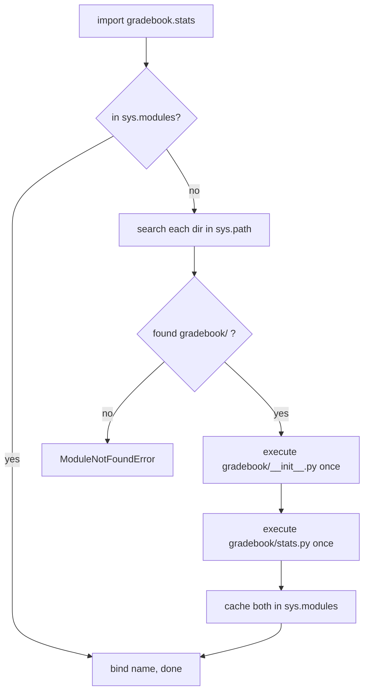

# PY-13 Modules, Packages, Imports and Virtual Environments

> [!info] Topic card
> **Unit:** U4 · **Time:** 3 h · **Code:** `examples/py13_demo_pkg/` (multi-file package), `exercises/py13_exercises.py`

## 1. Learning objectives
1. **Split** a program into modules and packages, and **import** from them with the correct form.
2. **Explain** how Python finds modules (`sys.path`), what happens on first import (the code executes once and is cached in `sys.modules`), and why `if __name__ == "__main__":` exists.
3. **Diagnose** common import errors: shadowing, circular imports, running a package file directly.
4. **Manage** third-party dependencies with `pip`, `requirements.txt` and virtual environments, and **read** version specifiers.
5. **Use** key standard-library modules (`math`, `random`, `datetime`, `pathlib`, `collections`, `statistics`, `json`, `csv`, `logging`).

## 2. Why it matters
Real programs don't fit in one file. Modules give **cohesion** (related code together) and **information hiding** (users import the interface, not the internals), the core ideas of [[SD-06 Modular Design, Cohesion and Coupling]]. Dependency management is what makes a project installable by your supervisor and your examiner.

## 3. Prerequisites
[[PY-06 Functions, Parameters, Return Values and Scope]], [[PY-01 How Python Executes Programs and Environment Setup]] (the venv basics).

## 4. Intuition
A **module** is a toolbox (one `.py` file). A **package** is a cupboard of toolboxes (a folder with `__init__.py`). `import` fetches a toolbox the first time and remembers where it put it, so later imports reuse the same one.

## 5. Rigorous explanation

### 5.1 Import forms
```python
import math                       # use as math.sqrt(2)
import statistics as st           # alias: st.mean(...)
from pathlib import Path          # bring one name in: Path("x")
from collections import Counter, defaultdict
from gradebook.grading import grade    # from a package's module
```
Avoid `from module import *`. It hides where names come from and can silently overwrite your own names.

### 5.2 What `import x` does
1. Check `sys.modules` (the cache). If `x` is already imported, bind the name and stop.
2. Otherwise **search `sys.path`** in order: the directory of the script being run (or the current directory for `-m`/the REPL), then `PYTHONPATH` entries, then the standard library, then `site-packages` (installed third-party packages).
3. **Execute** the module's top-level code **once**, creating a module object, and store it in `sys.modules`.
4. Bind the name `x` in the importing namespace.

So top-level code in a module (prints, connections) runs at import time. Keep module top levels to definitions and constants.

### 5.3 `__name__` and the main guard
Every module has `__name__`. It is `"__main__"` when the file is run directly and the module's name (e.g. `"grading"`) when it is imported.
```python
# grading.py
def grade(mark): ...

def _demo():
    print(grade(65))

if __name__ == "__main__":     # runs only with: python grading.py
    _demo()
```
Without the guard, importing `grading` would run `_demo()`, which would also print during tests.

### 5.4 Packages
```text
py13_demo_pkg/
├── main.py               # entry point: python main.py
└── gradebook/
    ├── __init__.py       # makes 'gradebook' a package; may re-export the public API
    ├── grading.py
    └── stats.py
```
- **Absolute import:** `from gradebook.stats import mean`.
- **Relative import** (only inside a package): `from .stats import mean` (same package), `from ..util import x` (parent).
- Running a package-internal file directly (`python gradebook/grading.py`) breaks relative imports ("attempted relative import with no known parent package"). Run the entry point, or use `python -m gradebook.grading` from the project root.
- A leading underscore (`_helper`) signals "internal, not part of the public interface". It's a convention, not enforcement.

### 5.5 Circular imports
If `a.py` imports `b` and `b.py` imports `a` at the top level, one of them sees a **partially initialised** module, which typically gives `ImportError: cannot import name ... (most likely due to a circular import)`. **Fixes:** move the shared code into a third module (the best fix: it removes the design flaw), import inside the function that needs it, or merge the modules.

### 5.6 Third-party packages and versions
```bash
python -m pip install "requests>=2.31,<3"
python -m pip freeze > requirements.txt     # exact versions: requests==2.32.3
python -m pip install -r requirements.txt
python -m pip list --outdated
```
**Version specifiers** (PEP 440): `==1.2.3` exact, `>=1.2` minimum, `<3` upper bound, `~=1.4.2` "compatible release" (≥1.4.2 and <1.5), `!=1.3.0` exclude. Applications usually **pin** exact versions for reproducibility. Libraries declare **ranges**.

**Supply-chain caution:** only install packages you've verified (check the exact name for typosquats such as `reqeusts`), and prefer well-maintained projects ([[CS-12 Secure Software Development and Database Security]]).

### 5.7 Virtual environments (recap and deeper)
`python -m venv .venv` creates an isolated interpreter context. Inside it, `sys.prefix` differs from `sys.base_prefix`, which is a way to detect a venv in code. Each project gets its own `.venv`, which is **not** committed to Git. Tools such as `pipx`, `uv` and Poetry build on the same ideas ([[PY-25 Performance, Packaging and Project Organization]]).

## 6. Terminology
| Term | Meaning |
|---|---|
| Module | One `.py` file (or extension module) |
| Package | Directory of modules with `__init__.py` |
| `sys.path` | List of directories searched on import |
| `sys.modules` | Cache of imported modules |
| Entry point | Script/module you run to start the program |
| Main guard | `if __name__ == "__main__":` block |
| Dependency | External package your code needs |
| Pinning | Fixing exact dependency versions |
| Shadowing | Your file name hiding a library module |

## 7. Step-by-step: refactoring one file into a package
1. Identify the cohesive groups in `marks.py`: grading rules, statistics, I/O, CLI.
2. Create `gradebook/__init__.py`, `grading.py`, `stats.py` and `io.py`… and **rename `io.py` to `storage.py`**, because a package-relative module is safe but a top-level `io.py` would shadow the standard library `io` module.
3. Move the functions, then fix the imports (`from gradebook.stats import mean`).
4. Keep `main.py` thin: parse the input, call the package, print.
5. Run the tests. They import the package, not the script.

## 8. Diagram: import resolution


## 9. Worked examples

### Example 1 (basic): standard-library toolbox
```python
import math
import random
import statistics
from datetime import date, timedelta

print(math.sqrt(16), math.pi, math.ceil(2.1))   # 4.0 3.141592653589793 3
rng = random.Random(42)                         # seeded, so results are reproducible
print(rng.randint(1, 6))
print(statistics.mean([70, 80, 90]), statistics.median([3, 1, 2]))   # 80 2
print(date(2026, 10, 19) + timedelta(days=14))  # 2026-11-02
```
`random` is **not** suitable for security (tokens, passwords). Use `secrets` ([[PY-24 Secure Programming and Input Validation]]).

### Example 2 (intermediate): the shadowing bug. Incorrect → explanation → fix
A student creates `random.py` with their own experiments, then in `game.py`:
```python
import random
print(random.randint(1, 6))
```
Error: `AttributeError: module 'random' has no attribute 'randint'` (or worse, a partially working program). **Cause:** the script's directory is first on `sys.path`, so `import random` loads the student's `random.py`. **Fix:** rename the file, delete the stale `__pycache__/random.*.pyc`, and check with `print(random.__file__)`.

### Example 3 (challenging): a package with a public API
`examples/py13_demo_pkg/gradebook/__init__.py`:
```python
"""Gradebook package: grading rules and statistics."""
from .grading import grade
from .stats import mean, summary

__all__ = ["grade", "mean", "summary"]
```
Users write `from gradebook import grade, summary` without knowing the internal file layout. That's **information hiding**: you can later split `stats.py` without breaking them. `__all__` documents the public names (and controls `import *`).

### Example 4 (transfer): dynamic import by name
A plugin system loads a function named in a configuration file:
```python
import importlib

def import_by_name(dotted: str):
    """'math.sqrt' -> the sqrt function."""
    module_name, _, attr = dotted.rpartition(".")
    if not module_name:
        raise ValueError("expected 'module.attribute'")
    module = importlib.import_module(module_name)
    return getattr(module, attr)

print(import_by_name("math.sqrt")(25))   # 5.0
```
**Security note:** never import names taken from untrusted input. That amounts to letting an attacker choose which code runs.

## 10. Application
Every project in [[Labs and Projects Index]] uses this layout: a package containing the logic, a thin `main.py`/`cli.py`, `tests/` importing the package, `requirements.txt` and a `.venv`. The capstone [[PRJ-PY-05 Hostel Maintenance System]] takes it furthest, with separate `models`, `repository`, `services` and `cli` modules (a layered architecture, [[SD-05 Software Architecture and Architectural Styles]]).

## 11. Common mistakes
| Mistake | Symptom | Fix |
|---|---|---|
| Naming a file after a library module | `AttributeError` on a "known" function | Rename. Check `module.__file__`. |
| Missing main guard | Code runs during import or tests | `if __name__ == "__main__":` |
| Running a package module directly | "attempted relative import with no known parent package" | `python -m package.module` from the root |
| Circular import | `ImportError … circular import` | Extract the shared module |
| `pip install` outside the venv | Works for you, fails for others | Activate the venv. Use `python -m pip`. |
| No pinned versions | "Worked last month" | `requirements.txt` from `pip freeze` |
| `from x import *` | Mystery names, overwrites | Explicit imports |

## 12. Comparison
| Mechanism | Unit | Purpose |
|---|---|---|
| Function | Block of code | Reuse a computation |
| Class | Data + behaviour | Model an entity ([[PY-16 Classes and Objects]]) |
| Module | File | Group related functions/classes |
| Package | Directory | Group related modules |
| Distribution (wheel) | Installable archive | Share a package via pip ([[PY-25 Performance, Packaging and Project Organization]]) |

## 13. Practice
**L1** 1. What is `__name__` when a file is run directly? When it's imported? 2. Where does Python look first for a module named in `import x`?

**L2** *(code bank)* 3. `parse_requirement(line)` → `(name, specifier)` for lines like `"requests==2.32.3"` or `"pytest >= 8"`, `None` for blank or comment lines. 4. `read_requirements(text)` → dict of name → specifier (lower-cased names). `ValueError` on duplicates.

**L3** 5. `import_by_name(dotted)`. 6. `version_tuple("1.10.2")` → `(1, 10, 2)`, and `satisfies(version, spec)` for the operators `==`, `>=`, `<=`, `>`, `<` and `!=` (one spec, numeric versions only). Explain why comparing version **strings** is wrong.

**L4** 7. Run `examples/py13_demo_pkg/main.py`, then deliberately create a circular import between `grading.py` and `stats.py`. Record the error and fix it by extracting a module. 8. A teammate's code works on their machine but fails on yours with `ModuleNotFoundError: No module named 'tabulate'`. List three possible causes and the command that diagnoses each.

**L5** 9. Design the module structure for [[PRJ-PY-02 Personal Expense Tracker]] (the file tree plus a one-line responsibility for each module), so that the storage format (CSV → JSON → SQLite) can change without touching the reporting code. Justify it in terms of cohesion and coupling.

## 14. Hints
> [!tip]- Hints
> 3: Strip the text, skip it if it's empty or starts with `#`, then find the first operator character (`=<>!~`). 6: `"1.10" < "1.9"` is True as strings, because `"1" < "9"` at the second position. 8: Is the package installed, and in which environment (`python -m pip show tabulate`, `python -c "import sys; print(sys.executable)"`)? 9: Put a `storage` interface between `reports` and the files.

## 15. Worked solutions
> [!success]- Solutions 1–2
> 1. `"__main__"`. The module's name (e.g. `"grading"`). 2. The directory containing the script being run (the first entry of `sys.path`). `sys.modules` is checked before any searching.

> [!success]- Solutions 3–4
> ```python
> def parse_requirement(line: str):
>     line = line.split("#", 1)[0].strip()
>     if not line:
>         return None
>     for i, ch in enumerate(line):
>         if ch in "=<>!~":
>             return line[:i].strip(), line[i:].replace(" ", "")
>     return line, ""                        # no version constraint
>
> def read_requirements(text: str) -> dict[str, str]:
>     result = {}
>     for raw in text.splitlines():
>         parsed = parse_requirement(raw)
>         if parsed is None:
>             continue
>         name, spec = parsed
>         key = name.lower()
>         if key in result:
>             raise ValueError(f"duplicate requirement: {name}")
>         result[key] = spec
>     return result
> ```

> [!success]- Solution 6
> ```python
> import operator
> OPS = {"==": operator.eq, "!=": operator.ne, ">=": operator.ge,
>        "<=": operator.le, ">": operator.gt, "<": operator.lt}
>
> def version_tuple(v: str) -> tuple[int, ...]:
>     return tuple(int(part) for part in v.split("."))
>
> def satisfies(version: str, spec: str) -> bool:
>     for op in ("==", "!=", ">=", "<=", ">", "<"):   # two-char operators first
>         if spec.startswith(op):
>             return OPS[op](version_tuple(version), version_tuple(spec[len(op):]))
>     raise ValueError(f"unsupported spec {spec!r}")
> ```
> String comparison is lexicographic: `"1.10" < "1.9"`. Tuples of ints compare numerically, element by element: `(1, 10) > (1, 9)` ✔. Note that `(1, 0) < (1, 0, 0)` with tuples, whereas PEP 440 treats them as equal. Real tools use `packaging.version`, and this exercise is deliberately simplified. Checking two-character operators first stops `>=` being read as `>` followed by `=1.0`.

> [!success]- Solution 8
> 1. Not installed in that environment → `python -m pip show tabulate`. 2. Installed in a *different* interpreter or venv → `python -c "import sys; print(sys.executable)"` (compare with the teammate's), and check the venv is activated. 3. Never listed in `requirements.txt` → inspect the file, then `python -m pip install -r requirements.txt`. (Also possible: a typo in the import name, or a different package providing the module.)

> [!success]- Solution 9 (model answer)
> ```text
> expense_tracker/
>   models.py      Expense dataclass, Category enum: pure data, no I/O
>   storage.py     ExpenseRepository interface + CsvRepository/JsonRepository/SqliteRepository
>   reports.py     totals_by_category, monthly_summary: depend only on models
>   cli.py         argument parsing / menu: depends on storage + reports
> main.py          builds the repository chosen in config, calls cli.run()
> tests/           one test module per package module
> ```
> **Cohesion:** each module has a single reason to change (the format changes `storage.py`, a new report changes `reports.py`). **Coupling:** `reports.py` receives a `list[Expense]`, never a file path, so swapping CSV for SQLite changes only `storage.py` and one line in `main.py`. This is dependency inversion ([[SD-10 SOLID Principles]]), and the actual project implements it.

## 16. Self-test (pass ≥ 4/5)
1. Why put demo code under the main guard? 2. What does `__init__.py` do? 3. Fix for a circular import? 4. Command to record exact dependency versions? 5. Why is `random` unsuitable for passwords?
> [!success]- Answers
> 1. So it doesn't run when the module is imported (including by tests). 2. It marks the directory as a regular package and runs on first import, and it can re-export the public API. 3. Extract the shared code into a third module, or import locally. 4. `python -m pip freeze > requirements.txt`. 5. Its generator is predictable (not cryptographically secure). Use `secrets`.

## 17. Flashcards
#flashcards/python
Value of `__name__` when a file is run directly?::"__main__"
How often does a module's top-level code run per process?::Once, on first import; later imports use sys.modules.
First place import searches?::sys.modules cache, then the script's directory (first entry of sys.path).
Cause of "attempted relative import with no known parent package"?::Running a package module as a script; use python -m package.module.
What does `~=1.4.2` mean?::Compatible release: >= 1.4.2 and < 1.5.
Why not compare version strings?::Lexicographic order: "1.10" < "1.9".

## 18. Blank-page recall
Draw the import-resolution flowchart and a package tree with an `__init__.py` that re-exports two functions.

## 19. Revision summary
- Module = file, package = folder with `__init__.py`. Import executes once and caches.
- `sys.path` order explains shadowing. Never name files after library modules.
- Main guard for script behaviour. Thin entry points. Underscore for internals.
- Circular imports signal a design flaw: extract the shared module.
- venv + `requirements.txt` (pinned) = reproducible installs. Verify package names.

## 20. Links
Prev: [[PY-12 Searching, Sorting and Complexity]] · Next: [[PY-14 Files, CSV and JSON]] · Design: [[SD-06 Modular Design, Cohesion and Coupling]], [[SD-13 Implementation, Code Organization and Version Control]] · Later: [[PY-25 Performance, Packaging and Project Organization]]

## 21. Sources
- Python docs, *Modules* (tutorial §6): https://docs.python.org/3/tutorial/modules.html
- Python docs, *The import system*: https://docs.python.org/3/reference/import.html
- Python Packaging User Guide, *Installing packages using pip and virtual environments*: https://packaging.python.org/en/latest/guides/installing-using-pip-and-virtual-environments/
- PEP 440 *Version Identification and Dependency Specification*: https://peps.python.org/pep-0440/

## 22. Mastery checklist
- [ ] `py13` tests pass with `PY_TARGET=exercises`
- [ ] I ran the demo package and reproduced and fixed a circular import
- [ ] My project has a venv and a pinned `requirements.txt` · reviews scheduled
