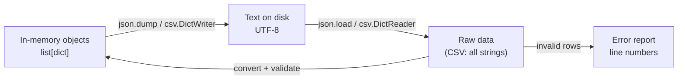

# PY-14 Files, CSV and JSON

> [!info] Topic card
> **Unit:** U4 · **Time:** 4 h · **Code:** `examples/py14_files.py`, `exercises/py14_exercises.py` (tests use temporary folders, so nothing of yours is touched)

## 1. Learning objectives
1. **Open, read and write** text files safely with `with`, explicit `encoding="utf-8"` and the correct mode.
2. **Navigate** paths portably with `pathlib`, and **explain** relative vs absolute paths and the current working directory.
3. **Read and write** CSV with the `csv` module (`DictReader`/`DictWriter`), including validation of bad rows.
4. **Serialise** Python data to JSON and back, and **know** which types map to which.
5. **Write** files atomically, and **explain** why `pickle` must never load untrusted data.

## 2. Why it matters
Without files, every program forgets everything when it exits. Persistence is what makes the expense tracker useful ([[PRJ-PY-02 Personal Expense Tracker]]). File-handling bugs (lost data, corrupted CSV, wrong encodings) are also the most painful for users.

## 3. Prerequisites
[[PY-11 Dictionaries, Sets and Comprehensions]] (records as dicts), [[PY-09 Strings and String Processing]] (`split`, `strip`).

## 4. Intuition
A file is a **long string of bytes on disk**. *Opening* gives you a cursor into it. *Text mode* translates bytes to characters with an encoding. A *format* (CSV, JSON) is an agreed way to turn structured data into text and back. The `with` block is a **library loan**: whatever happens, the book (file) is returned (closed).

## 5. Rigorous explanation

### 5.1 Opening files
```python
with open("notes.txt", "w", encoding="utf-8") as f:
    f.write("first line\n")
    print("second line", file=f)

with open("notes.txt", encoding="utf-8") as f:   # default mode "r"
    for line in f:                               # lazy, one line at a time: O(1) memory
        print(line.rstrip("\n"))
```
| Mode | Meaning | If the file exists | If missing |
|---|---|---|---|
| `"r"` | read text | read from start | `FileNotFoundError` |
| `"w"` | write text | **truncated (erased!)** | created |
| `"a"` | append | write at end | created |
| `"x"` | exclusive create | `FileExistsError` | created |
| `"rb"`/`"wb"` | binary | bytes, not str | |
| `"r+"` | read and write | — | error |

- **Always pass `encoding="utf-8"`** for text. Otherwise the platform default is used (historically e.g. cp1252 on Windows), and files break when moved between machines.
- `with` guarantees `f.close()` even if an exception occurs ([[PY-18 Iterators, Generators, Decorators and Context Managers]]). Unclosed files can lose buffered writes.
- Reading strategies: `f.read()` (the whole file as one string), `f.readlines()` (a list of lines), and iterating `for line in f` (best for large files). Lines keep their `\n`.

### 5.2 Paths with `pathlib`
```python
from pathlib import Path
data_dir = Path("data")
path = data_dir / "marks.csv"          # / joins portably (Windows \, POSIX /)
path.parent.mkdir(parents=True, exist_ok=True)
path.exists(), path.suffix, path.stem, path.name   # (…, '.csv', 'marks', 'marks.csv')
text = path.read_text(encoding="utf-8")            # convenience methods
path.write_text("a,b\n", encoding="utf-8")
for p in data_dir.glob("*.csv"): ...
```
**Relative paths resolve against the current working directory** (where you launched Python), **not** the script's folder. To find files next to your script: `Path(__file__).resolve().parent / "data.csv"`.

### 5.3 CSV
CSV looks simple until a field contains a comma, a quote or a newline: `"Mwanza, Tanzania"`. The `csv` module handles quoting correctly, which a hand-rolled `line.split(",")` does not.
```python
import csv
rows = [{"id": "S1", "name": "Amina", "mark": 78},
        {"id": "S2", "name": "Baraka, J.", "mark": 64}]

with open("marks.csv", "w", newline="", encoding="utf-8") as f:   # newline="" is REQUIRED for csv
    writer = csv.DictWriter(f, fieldnames=["id", "name", "mark"])
    writer.writeheader()
    writer.writerows(rows)

with open("marks.csv", newline="", encoding="utf-8") as f:
    for row in csv.DictReader(f):       # each row is a dict of STRINGS
        print(row["name"], int(row["mark"]))
```
The file contains `S2,"Baraka, J.",64`. The quotes were added automatically. **Every value read back is a `str`**, so convert and validate it.

### 5.4 JSON
JSON (RFC 8259) is a text format for nested data.
| JSON | Python |
|---|---|
| object `{}` | `dict` (keys are **always strings**) |
| array `[]` | `list` (tuples are written as arrays and come back as lists) |
| string | `str` |
| number | `int` / `float` |
| `true`/`false` | `True`/`False` |
| `null` | `None` |
```python
import json
data = {"student": "Amina", "marks": [78, 81], "active": True, "mentor": None}
text = json.dumps(data, indent=2)          # to string
back = json.loads(text)                    # from string
with open("data.json", "w", encoding="utf-8") as f:
    json.dump(data, f, indent=2, ensure_ascii=False)
with open("data.json", encoding="utf-8") as f:
    loaded = json.load(f)
```
`json.dumps({1: "a"})` gives `'{"1": "a"}'`, because integer keys become strings. `datetime`, `set` and custom objects aren't serialisable by default: convert them (e.g. `d.isoformat()`) or pass `default=`.

### 5.5 Serialisation formats compared
| Format | Human-readable | Nested | Types | Safe with untrusted input |
|---|---|---|---|---|
| CSV | ✔ | ✘ (flat tables) | strings only | ✔ (but beware spreadsheet formula injection, see below) |
| JSON | ✔ | ✔ | basic types | ✔ with `json.load` |
| `pickle` | ✘ | ✔ | almost any Python object | **✘ NEVER**: unpickling can execute arbitrary code |
| SQLite | via tools | relational | typed | ✔ with parameterised queries ([[PY-22 SQL and Database Integration]]) |

**CSV/formula injection:** a field such as `=HYPERLINK(...)` may be executed as a formula when a user opens the CSV in a spreadsheet program. When exporting user-supplied text for spreadsheets, prefix cells that start with `=`, `+`, `-` or `@` with `'` ([[CS-11 Web Application Security]]).

### 5.6 Atomic writes
If the program crashes halfway through `open(path, "w")`, the old data is already erased and the new data is incomplete. **Write to a temporary file in the same directory, then `os.replace`** it over the original (atomic on the same filesystem):
```python
import json, os, tempfile
from pathlib import Path

def atomic_write_json(path: Path, data) -> None:
    fd, tmp = tempfile.mkstemp(dir=path.parent, suffix=".tmp")
    try:
        with os.fdopen(fd, "w", encoding="utf-8") as f:
            json.dump(data, f, indent=2)
        os.replace(tmp, path)          # atomic rename
    except BaseException:
        os.unlink(tmp)
        raise
```

## 6. Terminology
| Term | Meaning |
|---|---|
| File handle / object | Python object for reading or writing an open file |
| Encoding | Characters ↔ bytes mapping (UTF-8) |
| Current working directory | Base for relative paths |
| Serialisation | Converting in-memory data to bytes or text |
| Deserialisation | The reverse |
| Delimiter / quoting | Field separator / rules for fields containing it |
| Atomic operation | Happens completely or not at all |
| Persistence | Data surviving program termination |

## 7. Step-by-step: robust CSV import
1. Open with `newline=""` and `encoding="utf-8"`.
2. Use `DictReader`, then check that the header has the required columns.
3. For each row: strip the fields, convert the types, validate the ranges.
4. Collect **valid records** and **error messages (with line numbers)** separately. Don't crash on the first bad row, and don't silently drop it.
5. Report the errors to the user. Save only the valid data.

## 8. Diagram: persistence round trip

*Text version: objects are serialised to UTF-8 text, then read back as raw data (CSV gives only strings). That raw data must be converted and validated before it becomes trusted objects again. Invalid rows go to an error report.*

## 9. Worked examples

### Example 1 (basic): counting lines and words
```python
from pathlib import Path

def file_stats(path: Path) -> tuple[int, int]:
    lines = words = 0
    with path.open(encoding="utf-8") as f:
        for line in f:
            lines += 1
            words += len(line.split())
    return lines, words
```
For a file containing `"a b\n\nc\n"`, this returns `(3, 3)`: three lines (one is empty) and three words. Memory stays $O(1)$ however big the file is, because it iterates line by line.

### Example 2 (intermediate): incorrect → bug → corrected CSV parsing
```python
# INCORRECT
def load_marks_wrong(path):
    marks = {}
    for line in open(path):                 # never closed; platform encoding
        name, mark = line.split(",")        # breaks on "Baraka, J." and on the header
        marks[name] = mark                  # mark is a string like "64\n"
    return marks
```
Bugs: no `with`, no encoding, the header is treated as data, quoted commas split the field, values stay strings with newlines, and there's no validation.
```python
# CORRECTED
import csv

def load_marks(path) -> tuple[dict[str, float], list[str]]:
    marks, errors = {}, []
    with open(path, newline="", encoding="utf-8") as f:
        reader = csv.DictReader(f)
        missing = {"name", "mark"} - set(reader.fieldnames or [])
        if missing:
            raise ValueError(f"missing columns: {sorted(missing)}")
        for line_no, row in enumerate(reader, start=2):   # line 1 is the header
            name = (row["name"] or "").strip()
            try:
                mark = float(row["mark"])
            except (TypeError, ValueError):
                errors.append(f"line {line_no}: invalid mark {row['mark']!r}")
                continue
            if not name:
                errors.append(f"line {line_no}: empty name")
            elif not 0 <= mark <= 100:
                errors.append(f"line {line_no}: mark out of range {mark}")
            else:
                marks[name] = mark
    return marks, errors
```
Sample `marks.csv`:
```text
name,mark
Amina,78
"Baraka, J.",64
Chen,abc
Dan,120
```
Result: `({'Amina': 78.0, 'Baraka, J.': 64.0}, ["line 4: invalid mark 'abc'", 'line 5: mark out of range 120.0'])`.

### Example 3 (challenging): JSON settings with defaults
```python
import json
from pathlib import Path

DEFAULTS = {"currency": "TZS", "decimals": 2, "categories": ["food", "transport"]}

def load_settings(path: Path) -> dict:
    if not path.exists():
        return dict(DEFAULTS)                     # first run: copy of the defaults
    with path.open(encoding="utf-8") as f:
        user = json.load(f)                       # json.JSONDecodeError if corrupt
    if not isinstance(user, dict):
        raise ValueError("settings file must contain a JSON object")
    unknown = set(user) - set(DEFAULTS)
    if unknown:
        raise ValueError(f"unknown settings: {sorted(unknown)}")
    return {**DEFAULTS, **user}                   # user values override the defaults
```
Design points: return a **copy** (so callers can't mutate `DEFAULTS`), reject unknown keys (catches typos such as `"curency"`), and let a corrupt file raise a clear error rather than silently using the defaults.

## 10. Application
[[PRJ-PY-02 Personal Expense Tracker]] stores expenses in JSON with `atomic_write_json`, exports monthly reports to CSV, and imports bank statements from CSV with a per-line error report. These are exactly the three patterns in this lesson.

## 11. Common mistakes
| Mistake | Consequence | Fix |
|---|---|---|
| `open(path, "w")` on the wrong file | Data erased instantly | Double-check the path. Use `"x"` for new files. |
| No `encoding=` | Mojibake (`é`), `UnicodeDecodeError` on other machines | `encoding="utf-8"` |
| Missing `newline=""` with csv | Blank lines between rows on Windows | Always pass it for csv |
| Treating CSV values as numbers | `"64" + 1` → TypeError, `"10" > "9"` is False | Convert explicitly |
| Relative path "file not found" | CWD isn't the script's folder | `Path(__file__).parent / "x"` |
| `pickle.load` on downloaded data | Remote code execution | JSON for interchange. Pickle only for your own trusted files. |
| `json.dump` of a set or datetime | `TypeError: Object of type set is not JSON serializable` | Convert to a list / ISO string |

## 12. Comparison: when to use which
| Situation | Choose |
|---|---|
| Spreadsheet-like table to share with non-programmers | CSV |
| Nested config or API data | JSON |
| Many records, queries, concurrent access | SQLite ([[PY-22 SQL and Database Integration]]) |
| Append-only event log | Text lines / JSON Lines (one JSON object per line) |

## 13. Practice
**L1** 1. What happens with `open("x.txt", "w")` if `x.txt` already contains data? 2. What type is every value from `csv.DictReader`?

**L2** *(code bank; tests use temporary directories)* 3. `write_lines(path, lines)` and `read_lines(path)` (no trailing newlines in the result). 4. `file_stats(path)`.

**L3** 5. `load_marks(path)` exactly as in Example 2. 6. `save_marks(path, marks)` writes a `name,mark` CSV sorted by name, and must round-trip with `load_marks`.

**L4** 7. `load_settings(path)` (Example 3). 8. `append_jsonl(path, record)` and `read_jsonl(path)` for a JSON Lines event log. `read_jsonl` must skip blank lines and report the line numbers of corrupt lines in a `ValueError`.

**L5** 9. `atomic_write_json(path, data)`. Write a test proving that the original file is unchanged if serialisation fails halfway (hint: data containing a `set`). Explain why `tempfile` must create the temporary file in the **same directory**.

**Variation:** modify `save_marks` to protect against CSV formula injection (prefix risky cells with `'`).

## 14. Hints
> [!tip]- Hints
> 3: `"\n".join(lines) + "\n"` when writing; `splitlines()` when reading. 6: `writer.writerow({"name": n, "mark": m})` for `n` in `sorted(marks)`. 8: `json.dumps(record) + "\n"` in mode `"a"`; `enumerate(f, 1)` when reading. 9: `os.replace` is atomic only within one filesystem, and `/tmp` may be on a different one.

## 15. Worked solutions
> [!success]- Solutions 1–2
> 1. The file is **truncated** (emptied) immediately on opening, even before anything is written. 2. `str` (or `None` for missing trailing fields).

> [!success]- Solution 3
> ```python
> def write_lines(path, lines):
>     with open(path, "w", encoding="utf-8") as f:
>         for line in lines:
>             f.write(line + "\n")
>
> def read_lines(path):
>     with open(path, encoding="utf-8") as f:
>         return f.read().splitlines()
> ```

> [!success]- Solution 6
> ```python
> def save_marks(path, marks):
>     with open(path, "w", newline="", encoding="utf-8") as f:
>         writer = csv.DictWriter(f, fieldnames=["name", "mark"])
>         writer.writeheader()
>         for name in sorted(marks):
>             writer.writerow({"name": name, "mark": marks[name]})
> ```
> Round-trip test: `save_marks(p, d)`, then `load_marks(p) == (d_as_floats, [])`.

> [!success]- Solution 8
> ```python
> def append_jsonl(path, record):
>     with open(path, "a", encoding="utf-8") as f:
>         f.write(json.dumps(record, ensure_ascii=False) + "\n")
>
> def read_jsonl(path):
>     records, bad = [], []
>     with open(path, encoding="utf-8") as f:
>         for n, line in enumerate(f, start=1):
>             if not line.strip():
>                 continue
>             try:
>                 records.append(json.loads(line))
>             except json.JSONDecodeError:
>                 bad.append(n)
>     if bad:
>         raise ValueError(f"corrupt lines: {bad}")
>     return records
> ```
> JSON Lines suits logs: appending never needs to rewrite the whole file, and one corrupt line doesn't destroy the rest.

> [!success]- Solution 9
> Implementation in §5.6. Test idea:
> ```python
> def test_atomic_write_preserves_original(tmp_path):
>     p = tmp_path / "data.json"
>     atomic_write_json(p, {"ok": 1})
>     with pytest.raises(TypeError):
>         atomic_write_json(p, {"bad": {1, 2}})      # sets aren't JSON serialisable
>     assert json.loads(p.read_text()) == {"ok": 1}  # original intact
>     assert list(tmp_path.glob("*.tmp")) == []      # temp file cleaned up
> ```
> **Same directory:** `os.replace` is only atomic when the source and destination are on the same filesystem. A temp file in another location might be on a different disk or partition, making the "rename" a non-atomic copy (or an error).

> [!success]- Variation answer
> ```python
> RISKY = ("=", "+", "-", "@")
> def _safe(cell):
>     s = str(cell)
>     return "'" + s if s.startswith(RISKY) else s
> ```
> Apply `_safe` to text fields before `writerow`. Numbers you produce yourself (like a negative mark) need care: prefixing `-5` would turn it into text, so only sanitise user-supplied **text** columns.

## 16. Self-test (pass ≥ 4/5)
1. Why use `with open(...)`? 2. Which argument prevents blank lines in CSV on Windows? 3. What do JSON object keys become in Python? 4. Why is `pickle` dangerous? 5. How do you locate a data file next to your script?
> [!success]- Answers
> 1. It guarantees the file is closed (and buffers flushed) even on exceptions. 2. `newline=""`. 3. Strings, always. 4. Unpickling can execute arbitrary code embedded in the data. 5. `Path(__file__).resolve().parent / "name"`.

## 17. Flashcards
#flashcards/python
What does mode "w" do to an existing file?::Truncates it to empty immediately on open.
Why always pass encoding="utf-8"?::The default encoding is platform-dependent; explicit UTF-8 makes files portable.
What type are CSV values when read?::Strings: convert and validate them.
How to write a file atomically?::Write to a temp file in the same directory, then os.replace() it over the target.
Is pickle safe for untrusted data?::No. Unpickling can execute arbitrary code.
Relative paths are relative to…?::The current working directory, not the script's location.

## 18. Blank-page recall
Write the open-mode table, the JSON↔Python type table, and the five steps of robust CSV import.

## 19. Revision summary
- `with open(path, mode, encoding="utf-8")`. Know that `"w"` truncates.
- `pathlib.Path` for portable paths. Relative paths depend on the CWD.
- CSV: the `csv` module, `newline=""`, values are strings, validate and report errors per line.
- JSON: nested basic types, keys become strings. Never use pickle on untrusted data.
- Atomic writes protect data from crashes.

## 20. Links
Prev: [[PY-13 Modules, Packages, Imports and Virtual Environments]] · Next: [[PY-15 Exceptions and Defensive Programming]] · Projects: [[PRJ-PY-02 Personal Expense Tracker]] · Security: [[CS-12 Secure Software Development and Database Security]]

## 21. Sources
- Python docs, *Reading and Writing Files* (tutorial §7.2): https://docs.python.org/3/tutorial/inputoutput.html#reading-and-writing-files
- Python docs, `csv`: https://docs.python.org/3/library/csv.html · `json`: https://docs.python.org/3/library/json.html · `pathlib`: https://docs.python.org/3/library/pathlib.html
- Python docs, `pickle` (warning box): https://docs.python.org/3/library/pickle.html
- IETF RFC 8259, *The JavaScript Object Notation (JSON) Data Interchange Format*, 2017: https://www.rfc-editor.org/rfc/rfc8259
- OWASP, *CSV Injection*: https://owasp.org/www-community/attacks/CSV_Injection

## 22. Mastery checklist
- [ ] `py14` tests pass with `PY_TARGET=exercises`
- [ ] I wrote the atomic-write failure test myself
- [ ] My project's storage reports bad rows by line number · reviews scheduled
