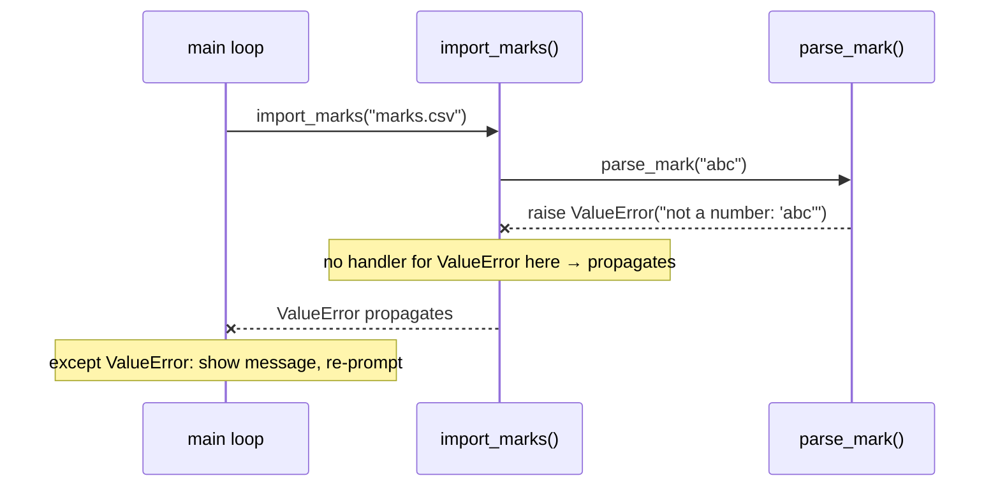

# PY-15 Exceptions and Defensive Programming

> [!info] Topic card
> **Unit:** U4 · **Time:** 4 h · **Code:** `examples/py15_exceptions.py`, `exercises/py15_exercises.py`

## 1. Learning objectives
1. **Explain** how exceptions propagate up the call stack, and **read** the exception hierarchy.
2. **Write** `try`/`except`/`else`/`finally` blocks that catch **specific** exceptions at the right level.
3. **Raise** built-in and **custom** exceptions with informative messages, and **chain** them (`raise … from …`).
4. **Choose** between EAFP and LBYL, and between exceptions and assertions.
5. **Apply** defensive programming: validate at the boundaries, fail fast, never swallow errors silently, clean up resources.

## 2. Why it matters
Users type nonsense, files go missing, networks fail. A robust program **anticipates failure**: it reports what went wrong, protects its data, and keeps running where that's appropriate. Badly handled errors cause crashes, corrupted data and security holes (e.g. error messages leaking internal details, see [[CS-11 Web Application Security]]).

## 3. Prerequisites
[[PY-14 Files, CSV and JSON]] (file errors), [[PY-06 Functions, Parameters, Return Values and Scope]] (the call stack).

## 4. Intuition
An exception is a **fire alarm**. The code that detects the problem raises the alarm (`raise`). It does *not* decide what to do about it. The alarm travels up through the callers until someone who **knows how to respond** handles it (`except`). If nobody does, the program stops and prints the traceback: the record of where the alarm went off.

## 5. Rigorous explanation

### 5.1 Propagation
When an exception is raised, Python abandons the current function and searches the call stack outward for a matching `except`. Each abandoned frame runs its `finally` blocks and `with` exits on the way. If no handler matches, the interpreter prints the traceback and exits with a non-zero status.

### 5.2 Syntax and semantics
```python
try:
    value = int(text)            # code that may fail
except ValueError as exc:        # runs only for ValueError (or subclasses)
    print(f"Not a number: {exc}")
except (TypeError, OverflowError):
    print("Wrong type")
else:
    print("Parsed:", value)      # runs only if NO exception happened in try
finally:
    print("always runs")         # cleanup, even after return or an unhandled error
```
- Handlers are checked **top to bottom**, and the first match wins, so put **specific** exceptions before general ones.
- Keep the `try` block **small**: only the statement that can fail. Put the rest in `else`.

### 5.3 The hierarchy (abridged)
```text
BaseException
 ├── SystemExit, KeyboardInterrupt, GeneratorExit   ← don't catch these by accident
 └── Exception
      ├── ArithmeticError → ZeroDivisionError, OverflowError
      ├── LookupError → IndexError, KeyError
      ├── ValueError → UnicodeError ...
      ├── TypeError, NameError, AttributeError
      ├── OSError → FileNotFoundError, PermissionError, IsADirectoryError, TimeoutError ...
      └── RuntimeError → RecursionError, NotImplementedError
```
A bare `except:` catches **everything**, including Ctrl-C (`KeyboardInterrupt`). `except Exception:` is broader than you usually want. Catch what you can actually handle.

### 5.4 Raising and custom exceptions
```python
class BankError(Exception):
    """Base class for this application's errors."""

class InsufficientFundsError(BankError):
    def __init__(self, balance: int, amount: int):
        super().__init__(f"cannot withdraw {amount}; balance is {balance}")
        self.balance = balance
        self.amount = amount

def withdraw(balance: int, amount: int) -> int:
    if amount <= 0:
        raise ValueError("amount must be positive")
    if amount > balance:
        raise InsufficientFundsError(balance, amount)
    return balance - amount
```
A **custom hierarchy** lets callers catch `BankError` for all domain errors while letting genuine bugs (`TypeError`) surface.

### 5.5 Chaining
```python
try:
    port = int(config["port"])
except (KeyError, ValueError) as exc:
    raise ConfigError("invalid or missing 'port' setting") from exc
```
`from exc` keeps the original cause in the traceback ("The above exception was the direct cause…"). `from None` hides it, which is appropriate when the low-level detail is noise for the user.

### 5.6 EAFP vs LBYL
- **LBYL** ("look before you leap"): `if key in d: value = d[key]`.
- **EAFP** ("easier to ask forgiveness than permission"): `try: value = d[key] except KeyError: ...`.
Python idiom often prefers EAFP, especially where **checking first creates a race**: `if path.exists(): open(path)` can still fail if the file is deleted between the two lines (a TOCTOU, time-of-check-to-time-of-use, problem). Use LBYL when failure is common and the check is cheap and race-free.

### 5.7 Assertions vs exceptions
`assert condition, "message"` documents an **internal invariant** that should be impossible to violate if the code is correct. Assertions are **removed** when Python runs with `-O`, so **never use `assert` to validate user input or enforce security**. Use `raise ValueError(...)` for that.

### 5.8 Defensive programming principles
1. **Validate at trust boundaries** (user input, files, network, other teams' APIs). Inside your own pure core, trust your preconditions ([[PY-24 Secure Programming and Input Validation]]).
2. **Fail fast:** detect bad states early and loudly, close to the cause.
3. **Never swallow errors** (`except: pass`). At minimum, log them.
4. **Handle at the level that can act:** the parsing function raises, and the user-interface loop catches, explains and re-prompts.
5. **Clean up** with `with` / `finally`.
6. **Give useful messages:** what failed, the offending value (`!r`), and what's expected. Don't reveal secrets or stack traces to end users.

## 6. Terminology
| Term | Meaning |
|---|---|
| Exception | Object representing an error condition |
| Raise / throw | Signal an exception |
| Handler | `except` clause that deals with it |
| Propagation | Exception travelling up the call stack |
| Traceback | Report of the call stack at the point of failure |
| EAFP / LBYL | Try-then-handle / check-then-act |
| TOCTOU | Race between checking a condition and using it |
| Fail fast | Detect and report errors as early as possible |
| Exception chaining | Linking a new exception to its cause |

## 7. Step-by-step: deciding where to handle
1. Ask "who can do something useful about this error?"
2. **Low-level function** (e.g. `parse_mark`): can't ask the user again, so it **raises** a clear exception.
3. **Mid-level** (e.g. `import_csv`): may collect per-row errors and continue (see [[PY-14 Files, CSV and JSON]]).
4. **Top level** (CLI loop): **catches** domain errors, shows a friendly message, re-prompts or exits with a status code. It catches unexpected exceptions only to log them, then exits.

## 8. Diagram: propagation through the stack

*Text version: `parse_mark` raises a ValueError. `import_marks` has no handler, so the exception passes up to the main loop, which catches it, shows a friendly message and asks again.*

## 9. Worked examples

### Example 1 (basic): re-prompting input with a retry limit
```python
def read_int(prompt: str, attempts: int = 3, input_fn=input) -> int:
    for remaining in range(attempts, 0, -1):
        text = input_fn(prompt)
        try:
            return int(text)
        except ValueError:
            print(f"{text!r} is not a whole number ({remaining - 1} tries left)")
    raise ValueError("too many invalid attempts")
```
`input_fn` is a **parameter** so tests can pass a fake input function instead of a keyboard. That's dependency injection ([[PY-20 Testing, Debugging and Test-Driven Development]]).
**Trace** with inputs `"x"`, `"7"`: attempt 1 → ValueError → message → attempt 2 → returns 7.

### Example 2 (intermediate): incorrect → bug → corrected (swallowed errors)
```python
# INCORRECT
def load_config(path):
    try:
        with open(path, encoding="utf-8") as f:
            return json.load(f)
    except:                      # catches EVERYTHING, even typos and Ctrl-C
        return {}                # silently pretends there is no config
```
**Bugs:** a missing file, a corrupt JSON file and a `NameError` typo in this function all look identical ("empty config"). The user never learns that their settings are being ignored.
```python
# CORRECTED
def load_config(path: Path) -> dict:
    try:
        with open(path, encoding="utf-8") as f:
            return json.load(f)
    except FileNotFoundError:
        return {}                                   # expected on first run: OK to default
    except json.JSONDecodeError as exc:
        raise ConfigError(f"{path} is not valid JSON (line {exc.lineno})") from exc
```
Only the **expected, harmless** case gets a default. Everything else is reported.

### Example 3 (challenging): `finally` and `else` ordering
```python
def demo(x):
    try:
        print("try")
        result = 10 / x
    except ZeroDivisionError:
        print("except")
        return "error"
    else:
        print("else")
        return result
    finally:
        print("finally")
```
`demo(2)` prints `try, else, finally` and returns `5.0`. `demo(0)` prints `try, except, finally` and returns `"error"`. **`finally` runs even after a `return`** in `except` or `else`, before control actually leaves the function. (A `return` *inside* `finally` would override the others and swallow exceptions, so never do that.)

### Example 4 (transfer): retry with backoff for transient failures
```python
import time

def retry(func, attempts: int = 3, delay: float = 0.5, retry_on=(TimeoutError, ConnectionError),
          sleep=time.sleep):
    for i in range(1, attempts + 1):
        try:
            return func()
        except retry_on:
            if i == attempts:
                raise                     # re-raise the last error unchanged
            sleep(delay * 2 ** (i - 1))   # exponential backoff: 0.5s, 1s, 2s…
```
Retry only **transient** errors (network blips). Retrying a `ValueError` is pointless, because it will fail the same way every time. The bare `raise` re-raises the current exception with its original traceback. This pattern returns in [[PY-23 HTTP APIs and External Services]].

## 10. Application
In [[PRJ-PY-03 Library Management System]], `borrow(member_id, isbn)` raises `MemberNotFound`, `BookUnavailable` or `LoanLimitReached` (all subclasses of `LibraryError`). The CLI catches `LibraryError` and prints its message. A programming bug (e.g. `AttributeError`) is *not* caught, so it shows up during testing rather than being disguised as "book unavailable".

## 11. Common mistakes
| Mistake | Why it's bad | Fix |
|---|---|---|
| Bare `except:` / `except Exception: pass` | Hides bugs, catches Ctrl-C | Catch specific exceptions. Log if you must catch broadly. |
| Huge `try` blocks | You can't tell which line failed | Wrap only the risky statement. Use `else`. |
| General handler before specific | The specific one is unreachable | Order from specific to general |
| `assert` for input validation | Disabled with `-O` | `raise ValueError` |
| Returning `None`/`-1` for errors everywhere | Callers forget to check | Raise exceptions for exceptional cases |
| Messages like "Error!" | Undebuggable | Include what failed and the bad value |
| Showing tracebacks to end users | Leaks internals | Friendly message to the user, details to the log |

## 12. Comparison: error-signalling strategies
| Strategy | Example | Pros | Cons |
|---|---|---|---|
| Exceptions | `raise ValueError` | Can't be ignored silently, carry details | Control flow less visible |
| Sentinel return | `str.find` → −1 | Simple, cheap | Easy to forget to check |
| Optional / None | `dict.get` | Good for "absence is normal" | Ambiguous if None is a valid value |
| Error list | CSV import → `(valid, errors)` | Reports all problems at once | More code |

## 13. Practice
**L1** 1. Which runs when no exception occurs: `except`, `else` or `finally`? 2. Why put `ZeroDivisionError` before `ArithmeticError` in a handler chain?

**L2** *(code bank)* 3. `safe_divide(a, b)` returns `None` when `b == 0`, and lets `TypeError` propagate. 4. `parse_int_or_default(text, default)`. 5. `read_int(prompt, attempts, input_fn)` as in Example 1.

**L3** 6. `withdraw(balance, amount)` with the custom exception hierarchy from §5.4. 7. `load_config(path)` (Example 2) with `ConfigError`.

**L4** 8. `retry(func, attempts, delay, retry_on, sleep)`. Test it with a fake function that fails twice and then succeeds, and a fake `sleep` that records the delays (they should be `[0.5, 1.0]`). 9. Predict the output, then explain:
```python
def f():
    try:
        return "try"
    finally:
        print("cleanup")
print(f())
```

**L5** 10. `process_batch(items, handler)` applies `handler` to each item and returns `(results, failures)`, where `failures` is a list of `(index, exception)`. Discuss when "continue on error" is right (bulk import) and when "stop on first error" is right (bank transfer), with reference to data integrity ([[PY-22 SQL and Database Integration]] transactions).

**Variation:** extend `read_int` with `min_value`/`max_value` limits. Out-of-range input should count as an invalid attempt, with a specific message.

## 14. Hints
> [!tip]- Hints
> 3: `try: return a / b except ZeroDivisionError: return None`. 6: Validate `amount > 0` first. 8: The delays are `delay * 2**(i-1)` for each failed attempt except the last. 9: `finally` runs before the function actually returns.

## 15. Worked solutions
> [!success]- Solutions 1–2
> 1. `else` and `finally`. 2. `ZeroDivisionError` is a subclass of `ArithmeticError`, so with the general handler first, the specific one would never be reached.

> [!success]- Solutions 3–4
> ```python
> def safe_divide(a, b):
>     try:
>         return a / b
>     except ZeroDivisionError:
>         return None
>
> def parse_int_or_default(text, default=0):
>     try:
>         return int(text)
>     except (TypeError, ValueError):
>         return default
> ```
> `safe_divide("1", 2)` still raises `TypeError`. That's a caller bug, which should not be hidden.

> [!success]- Solution 8
> ```python
> def test_retry_succeeds_after_two_failures():
>     calls = {"n": 0}
>     def flaky():
>         calls["n"] += 1
>         if calls["n"] < 3:
>             raise TimeoutError("slow")
>         return "ok"
>     delays = []
>     assert retry(flaky, attempts=3, delay=0.5, sleep=delays.append) == "ok"
>     assert delays == [0.5, 1.0]
> ```
> Injecting `sleep` makes the test instant and deterministic.

> [!success]- Solution 9
> Output: `cleanup`, then `try`. `return "try"` evaluates the return value, then `finally` runs (printing "cleanup"), then the function returns. Finally the caller prints "try".

> [!success]- Solution 10
> ```python
> def process_batch(items, handler):
>     results, failures = [], []
>     for i, item in enumerate(items):
>         try:
>             results.append(handler(item))
>         except Exception as exc:          # broad on purpose: record and continue
>             failures.append((i, exc))
>     return results, failures
> ```
> **Continue on error** suits independent items: importing 10 000 student records shouldn't abort because row 7 is malformed. The user fixes the reported rows. **Stop on first error (and roll back)** suits operations that must be **atomic**. In a transfer, debit and credit must both happen or neither, so a failure halfway must undo the debit. Databases provide this with transactions. The choice is a **requirement**, so ask stakeholders ([[SD-03 Requirements Engineering]]).

> [!success]- Variation answer
> ```python
> def read_int_range(prompt, attempts=3, input_fn=input, min_value=None, max_value=None):
>     for remaining in range(attempts, 0, -1):
>         text = input_fn(prompt)
>         try:
>             value = int(text)
>         except ValueError:
>             print(f"{text!r} is not a whole number")
>             continue
>         if (min_value is not None and value < min_value) or (max_value is not None and value > max_value):
>             print(f"{value} is outside {min_value}..{max_value}")
>             continue
>         return value
>     raise ValueError("too many invalid attempts")
> ```

## 16. Self-test (pass ≥ 4/5)
1. Why avoid a bare `except:`? 2. What does `raise X from e` do? 3. Should you validate a password-length rule with `assert`? 4. EAFP or LBYL for opening a file that might be deleted concurrently? 5. When does `finally` run?
> [!success]- Answers
> 1. It catches everything, including KeyboardInterrupt/SystemExit, and hides bugs. 2. It raises X with `e` recorded as its direct cause (`__cause__`). 3. No. Assertions can be disabled. Raise `ValueError`. 4. EAFP (try to open, handle `FileNotFoundError`), which avoids the TOCTOU race. 5. Always: after `try`/`except`/`else`, even on `return` or an unhandled exception.

## 17. Flashcards
#flashcards/python
When does the else clause of try run?::Only if the try block raised no exception.
When does finally run?::Always, even after return or an unhandled exception.
Why order except clauses specific → general?::The first matching handler wins; a general one first makes later ones unreachable.
Why never validate input with assert?::Assertions are stripped when Python runs with -O.
What is EAFP?::Easier to Ask Forgiveness than Permission: try the operation and handle the exception.
What does a bare `raise` inside except do?::Re-raises the current exception with its original traceback.

## 18. Blank-page recall
Draw the exception hierarchy (the top two levels and six common leaf classes), and write a `try/except/else/finally` skeleton annotated with when each part runs.

## 19. Revision summary
- Exceptions propagate up the stack until a matching handler. `finally` always runs.
- Catch specific exceptions, at the level that can act. Keep `try` blocks small.
- Raise informative (custom) exceptions. Chain them with `from`.
- EAFP avoids races. `assert` is for invariants, never for input validation.
- Validate at boundaries, fail fast, never swallow errors, clean up with `with`.

## 20. Links
Prev: [[PY-14 Files, CSV and JSON]] · Next: [[PY-16 Classes and Objects]] · Related: [[PY-24 Secure Programming and Input Validation]], [[PY-20 Testing, Debugging and Test-Driven Development]] (testing exceptions with `pytest.raises`), [[SD-17 Secure and Reliable Software Design]]

## 21. Sources
- Python docs, *Errors and Exceptions* (tutorial §8): https://docs.python.org/3/tutorial/errors.html
- Python docs, *Built-in Exceptions* (hierarchy): https://docs.python.org/3/library/exceptions.html#exception-hierarchy
- Python docs, *The assert statement*: https://docs.python.org/3/reference/simple_stmts.html#the-assert-statement
- Python Glossary, *EAFP* and *LBYL*: https://docs.python.org/3/glossary.html

## 22. Mastery checklist
- [ ] `py15` tests pass with `PY_TARGET=exercises`
- [ ] I predicted Example 3 and practice 9 correctly
- [ ] My project has a custom exception hierarchy · reviews scheduled
