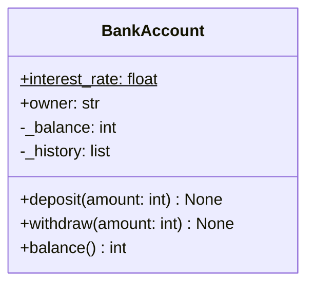

# PY-16 Classes and Objects

> [!info] Topic card
> **Unit:** U5 · **Time:** 5 h · **Code:** `examples/py16_classes.py`, `exercises/py16_exercises.py`
> **Read alongside:** [[SD-07 UML Class Diagrams]]. Every class here can be drawn as a UML class box.

## 1. Learning objectives
1. **Define** classes with `__init__`, instance attributes and methods, and **explain** `self`.
2. **Enforce invariants** in constructors and methods (an object should never be in an invalid state).
3. **Distinguish** instance attributes from class attributes, and instance methods from `@classmethod` and `@staticmethod`.
4. **Implement** the special methods `__repr__`, `__str__`, `__eq__`, `__lt__`, `__add__` and `__hash__`, and **use** `@property` for controlled access.
5. **Use** `@dataclass` for data-centred classes, and **decide** between a dict, a tuple, a dataclass and a full class.

## 2. Why it matters
Until now, data (dicts, lists) and behaviour (functions) were separate, and nothing stopped a caller writing `account["balance"] = -1_000_000`. A class **bundles data with the operations that keep it valid**. That's **encapsulation**, the foundation of object-oriented design ([[SD-06 Modular Design, Cohesion and Coupling]], [[SD-10 SOLID Principles]]).

## 3. Prerequisites
[[PY-11 Dictionaries, Sets and Comprehensions]] (records as dicts), [[PY-15 Exceptions and Defensive Programming]] (raising on invalid states), [[PY-06 Functions, Parameters, Return Values and Scope]].

## 4. Intuition
A **class** is a **blueprint**, like the architectural plan for a house. An **object** (instance) is **a house built from it**: each has its own furniture (attribute values), but all follow the same plan and offer the same operations (methods: "open door", "switch on light"). `self` is "this particular house".

## 5. Rigorous explanation

### 5.1 Defining and using a class
```python
class BankAccount:
    """A bank account whose balance (in cents) can never go negative."""

    interest_rate = 0.02                     # class attribute: shared by all accounts

    def __init__(self, owner: str, balance: int = 0):
        if not owner.strip():
            raise ValueError("owner is required")
        if balance < 0:
            raise ValueError("opening balance cannot be negative")
        self.owner = owner                   # instance attributes: one set per object
        self._balance = balance              # leading underscore: internal, use methods
        self._history: list[tuple[str, int]] = []

    def deposit(self, amount: int) -> None:
        if amount <= 0:
            raise ValueError("deposit must be positive")
        self._balance += amount
        self._history.append(("deposit", amount))

    def withdraw(self, amount: int) -> None:
        if amount <= 0:
            raise ValueError("withdrawal must be positive")
        if amount > self._balance:
            raise ValueError("insufficient funds")
        self._balance -= amount
        self._history.append(("withdraw", amount))

    @property
    def balance(self) -> int:                # read-only attribute-style access
        return self._balance

    def __repr__(self) -> str:
        return f"BankAccount(owner={self.owner!r}, balance={self._balance})"

acct = BankAccount("Amina", 10_000)
acct.deposit(2_500)
print(acct.balance)       # 12500
print(acct)               # BankAccount(owner='Amina', balance=12500)
acct.balance = 0          # AttributeError: property has no setter
```
- `BankAccount("Amina", 10_000)` creates a new object, then calls `__init__(new_object, "Amina", 10_000)`. **`self` is simply the object**, passed automatically as the first argument: `acct.deposit(5)` is equivalent to `BankAccount.deposit(acct, 5)`.
- **Invariant:** `balance >= 0`. Every method that changes state checks it, so no sequence of method calls can break it.
- Python has no `private` keyword. `_name` means "internal by convention". `__name` triggers *name mangling* (`_BankAccount__name`), which prevents accidental clashes in subclasses but is not security.

### 5.2 Class vs instance attributes
Reading `acct.interest_rate` looks on the instance first, then on the class. **Assigning** `acct.interest_rate = 0.05` creates an *instance* attribute that hides the class one, for that object only. A **mutable class attribute** (`history = []` at class level) is shared by all instances, which is the class-level cousin of the mutable-default bug ([[PY-06 Functions, Parameters, Return Values and Scope]]). Create per-object containers in `__init__`.

### 5.3 Kinds of methods
```python
class Temperature:
    def __init__(self, celsius: float):
        self.celsius = celsius

    @classmethod
    def from_fahrenheit(cls, f: float) -> "Temperature":   # alternative constructor
        return cls((f - 32) * 5 / 9)

    @staticmethod
    def is_valid_celsius(c: float) -> bool:                 # utility; needs neither self nor cls
        return c >= -273.15

    @property
    def fahrenheit(self) -> float:                          # computed attribute
        return self.celsius * 9 / 5 + 32
```

### 5.4 Special ("dunder") methods
| Method | Enables | Notes |
|---|---|---|
| `__init__` | construction | Initialise and validate |
| `__repr__` | `repr(obj)`, REPL, debugging | Unambiguous, ideally valid Python |
| `__str__` | `str(obj)`, `print` | Friendly. Falls back to `__repr__` |
| `__eq__` | `==` | Default compares **identity** |
| `__hash__` | dict keys, set members | Equal objects **must** have equal hashes. Defining `__eq__` sets `__hash__` to `None` unless you define it. |
| `__lt__` etc. | `<`, `sorted` | `functools.total_ordering` fills in the rest |
| `__add__` | `+` | Return a **new** object, and `NotImplemented` for unsupported types |
| `__len__`, `__iter__`, `__contains__` | `len`, `for`, `in` | Container behaviour ([[PY-18 Iterators, Generators, Decorators and Context Managers]]) |

### 5.5 Dataclasses
```python
from dataclasses import dataclass, field

@dataclass(frozen=True, order=True)
class Student:
    student_id: str
    name: str
    marks: tuple[float, ...] = field(default_factory=tuple)

    def __post_init__(self):
        if not self.student_id.startswith("S"):
            raise ValueError("student_id must start with 'S'")

    @property
    def average(self) -> float:
        return sum(self.marks) / len(self.marks) if self.marks else 0.0
```
`@dataclass` generates `__init__`, `__repr__` and `__eq__`. With `order=True` you get comparison methods (ordering by fields in declaration order). With `frozen=True` the instances are immutable and hashable. Use `field(default_factory=list)` for mutable defaults (a plain `= []` is rejected with `ValueError`).

## 6. Terminology
| Term | Meaning |
|---|---|
| Class | Blueprint defining attributes and methods |
| Object / instance | A concrete value created from a class |
| Attribute | Data stored on an object or class |
| Method | Function defined in a class, called on instances |
| `self` | The instance a method is called on |
| Constructor | `__init__`, which initialises a new object |
| Encapsulation | Bundling data with methods, and hiding internal representation |
| Invariant | Property that must hold for every valid object |
| Property | Method accessed like an attribute |
| Dunder method | Special `__name__` method hooked into Python syntax |

## 7. Step-by-step: designing a class from a description
*"A Fraction has a numerator and a non-zero denominator. Fractions are stored in lowest terms with a positive denominator. They can be added and compared, and 1/2 equals 2/4."*
1. **Nouns** → attributes: `numerator`, `denominator`.
2. **Rules** → invariants: denominator ≠ 0, lowest terms, denominator > 0. Enforce them in `__init__`.
3. **Verbs** → methods: `__add__`, `__eq__`, `__lt__`, plus `__repr__`.
4. **Equality ⇒ hash:** normalised fields make `__eq__` simple, and `__hash__` uses the same fields.
5. **Immutability?** Yes, so fractions are safe as dict keys: no setters.

## 8. Diagram: UML class box

*Text version: BankAccount has a class attribute interest_rate (underlined/$ = static), the public owner, the private _balance and _history, the methods deposit and withdraw, and a balance property. Its invariant is balance ≥ 0. UML notation is taught in [[SD-07 UML Class Diagrams]].*

## 9. Worked examples

### Example 1 (basic): object state trace
```python
a = BankAccount("Juma", 1000)
b = BankAccount("Neema")
a.deposit(500)
b.deposit(200)
a.withdraw(300)
```
| Step | a._balance | b._balance | a._history |
|---|---|---|---|
| create | 1000 | 0 | [] |
| a.deposit(500) | 1500 | 0 | [("deposit", 500)] |
| b.deposit(200) | 1500 | 200 | (unchanged) |
| a.withdraw(300) | 1200 | 200 | [..., ("withdraw", 300)] |
Each object has **independent** state, while the methods are shared.

### Example 2 (intermediate): incorrect → bug → corrected (shared mutable class attribute)
```python
# INCORRECT
class Course:
    students = []                 # class attribute: ONE list for every course!
    def __init__(self, code):
        self.code = code
    def enrol(self, sid):
        self.students.append(sid)

py, dm = Course("CST06102"), Course("GST06106")
py.enrol("S1")
print(dm.students)                # ['S1']: a DM student who never enrolled
```
**Bug:** `self.students` finds the class attribute (there's no instance attribute), and `append` mutates that single shared list.
```python
# CORRECTED
class Course:
    def __init__(self, code: str):
        self.code = code
        self.students: list[str] = []      # per-instance list
    def enrol(self, sid: str) -> None:
        if sid in self.students:
            raise ValueError(f"{sid} already enrolled in {self.code}")
        self.students.append(sid)
```

### Example 3 (challenging): a value class, `Fraction`
```python
from math import gcd

class Fraction:
    def __init__(self, numerator: int, denominator: int = 1):
        if denominator == 0:
            raise ZeroDivisionError("denominator cannot be zero")
        if denominator < 0:                       # keep the sign in the numerator
            numerator, denominator = -numerator, -denominator
        g = gcd(numerator, denominator)
        self._n = numerator // g
        self._d = denominator // g

    @property
    def numerator(self) -> int:
        return self._n

    @property
    def denominator(self) -> int:
        return self._d

    def __add__(self, other):
        if isinstance(other, int):
            other = Fraction(other)
        if not isinstance(other, Fraction):
            return NotImplemented                 # lets Python try other.__radd__ / raise TypeError
        return Fraction(self._n * other._d + other._n * self._d, self._d * other._d)

    __radd__ = __add__                            # 1 + Fraction(1, 2) works too

    def __eq__(self, other):
        if not isinstance(other, Fraction):
            return NotImplemented
        return (self._n, self._d) == (other._n, other._d)

    def __lt__(self, other):
        return self._n * other._d < other._n * self._d   # both denominators > 0

    def __hash__(self):
        return hash((self._n, self._d))

    def __repr__(self):
        return f"Fraction({self._n}, {self._d})"

print(Fraction(1, 2) + Fraction(1, 3))    # Fraction(5, 6)
print(Fraction(2, 4) == Fraction(1, 2))   # True (normalised)
print(sorted([Fraction(2, 3), Fraction(1, 2)]))   # [Fraction(1, 2), Fraction(2, 3)]
print(len({Fraction(1, 2), Fraction(3, 6)}))      # 1, a consistent hash
```
**Why normalise in `__init__`?** Then equality is plain field comparison, and the hash is consistent with equality. **Why is `__lt__` correct?** For $b, d > 0$: $\frac{a}{b} < \frac{c}{d} \iff ad < cb$ (multiply both sides by $bd > 0$). The gcd and lowest terms connect to number theory in [[DM-05 Direct Proof, Contrapositive and Contradiction]]. The standard library has `fractions.Fraction` for real use.

## 10. Application
[[PRJ-PY-03 Library Management System]] models `Book`, `Member` and `Loan` as classes. A `Member` cannot exceed 3 active loans: that invariant is enforced in `Library.borrow`, the single method allowed to create loans. Without classes, any part of the program could append to a member's loan list and break the rule.

## 11. Common mistakes
| Mistake | Symptom | Fix |
|---|---|---|
| Forgetting `self` in a method definition | `TypeError: takes 0 positional arguments but 1 was given` | `def method(self, ...)` |
| Forgetting `self.` on attributes | Local variable vanishes after `__init__` | `self.name = name` |
| Mutable class attribute | State shared across instances | Initialise in `__init__` |
| `__eq__` without `__hash__` | `TypeError: unhashable type` in sets | Define `__hash__` from the same fields, or use a frozen dataclass |
| Returning `False` instead of `NotImplemented` for foreign types | Breaks reflected operations | `return NotImplemented` |
| Validation only in a setter, not in `__init__` | Invalid objects at birth | Validate in `__init__` too |
| Getter/setter boilerplate for everything | Java habit | Plain attributes. Add `@property` only when needed. |

## 12. Comparison: ways to represent a record
| | dict | namedtuple | dataclass | full class |
|---|---|---|---|---|
| Field names | keys (typo-prone) | ✔ | ✔ | ✔ |
| Immutable option | ✘ | ✔ (always) | `frozen=True` | manual |
| Validation | ✘ | ✘ | `__post_init__` | `__init__` / properties |
| Behaviour (methods) | ✘ | limited | ✔ | ✔ |
| Best for | JSON-like, dynamic data | small fixed records | data-centred models | rich behaviour, invariants |

## 13. Practice
**L1** 1. What is `self`? 2. What's the difference between `__str__` and `__repr__`?

**L2** *(code bank)* 3. `BankAccount` with `deposit`, `withdraw`, `balance` (property), `history()` (returns a **copy**) and `__repr__`. 4. `Rectangle(width, height)` with `area`, `perimeter`, validation (> 0), and `@classmethod square(side)`.

**L3** 5. `Fraction` as in Example 3, plus `__sub__`, `__mul__` and `__str__` (`"5/6"`, or `"3"` when the denominator is 1). 6. A `Student` dataclass (frozen) with `average` and `grade` properties, using the [[PY-04 Conditions and Branching]] scale.

**L4** 7. `Inventory` class: `add(sku, qty)`, `remove(sku, qty)` (error if insufficient), `quantity(sku)`, `low_stock(threshold)` → sorted SKUs, and `__len__` (distinct SKUs). Identify and document its invariants. 8. Explain what goes wrong if `Fraction` were mutable (had a `numerator` setter) and used as a dict key.

**L5** 9. Design a `Money` class (amount in integer minor units + currency code) supporting `+`, `-`, comparison and `allocate(ratios)`, which splits an amount into parts that sum **exactly** to the original (e.g. 100 split 1:1:1 → 34, 33, 33). Justify each design decision: immutability, mixed-currency errors, rounding policy.

**Variation:** add a `transfer_to(other, amount)` method to `BankAccount`. What must happen if the deposit side fails after the withdrawal has succeeded?

## 14. Hints
> [!tip]- Hints
> 3: `history()` returns `list(self._history)`, so callers can't mutate the internal list. 5: $\frac{a}{b}\cdot\frac{c}{d} = \frac{ac}{bd}$, and the constructor normalises. 7: Invariants: every stored quantity > 0 (remove the key when it reaches 0). 8: Hash-table placement uses the hash computed at insertion. 9: Floor-divide each share, then distribute the remainder 1 unit at a time.

## 15. Worked solutions
> [!success]- Solutions 1–2
> 1. The instance the method was called on, passed automatically as the first argument. 2. `__repr__` is the unambiguous developer representation (REPL, debugging, containers). `__str__` is the friendly user-facing text (`print`). `str()` falls back to `__repr__` when `__str__` isn't defined.

> [!success]- Solution 4
> ```python
> class Rectangle:
>     def __init__(self, width: float, height: float):
>         if width <= 0 or height <= 0:
>             raise ValueError("sides must be positive")
>         self.width, self.height = width, height
>
>     @classmethod
>     def square(cls, side: float) -> "Rectangle":
>         return cls(side, side)
>
>     @property
>     def area(self) -> float:
>         return self.width * self.height
>
>     @property
>     def perimeter(self) -> float:
>         return 2 * (self.width + self.height)
> ```
> Note: the width and height are public and could be set to negative values later. If that matters, make them properties with validating setters, or make the class immutable.

> [!success]- Solution 7
> ```python
> class Inventory:
>     """Invariant: every stored quantity is a positive int."""
>     def __init__(self):
>         self._stock: dict[str, int] = {}
>     def add(self, sku: str, qty: int) -> None:
>         if qty <= 0:
>             raise ValueError("qty must be positive")
>         self._stock[sku] = self._stock.get(sku, 0) + qty
>     def remove(self, sku: str, qty: int) -> None:
>         have = self._stock.get(sku, 0)
>         if qty <= 0 or qty > have:
>             raise ValueError(f"cannot remove {qty} of {sku}; have {have}")
>         if qty == have:
>             del self._stock[sku]          # keep the invariant: no zero entries
>         else:
>             self._stock[sku] = have - qty
>     def quantity(self, sku: str) -> int:
>         return self._stock.get(sku, 0)
>     def low_stock(self, threshold: int) -> list[str]:
>         return sorted(s for s, q in self._stock.items() if q < threshold)
>     def __len__(self) -> int:
>         return len(self._stock)
> ```

> [!success]- Solution 8
> A dict stores a key in the slot chosen by its hash **at insertion time**. If the fraction is mutated afterwards (1/2 → 3/4), its hash changes. Lookups for `Fraction(3, 4)` then search a different slot and miss it, while lookups for `Fraction(1, 2)` find the slot but fail the equality check. The entry becomes unreachable, and sets can even end up holding "duplicates". Hence the rule: **only immutable objects should be hashable**.

> [!success]- Solution 9 (model answer, implemented in the code bank)
> ```python
> @dataclass(frozen=True)
> class Money:
>     minor: int          # e.g. cents
>     currency: str
>
>     def _same_currency(self, other: "Money") -> None:
>         if other.currency != self.currency:
>             raise ValueError("currency mismatch")
>
>     def __add__(self, other):
>         if not isinstance(other, Money):
>             return NotImplemented
>         self._same_currency(other)
>         return Money(self.minor + other.minor, self.currency)
>
>     # __sub__ and __lt__ follow the same pattern (see solutions/py16_solutions.py)
>
>     def allocate(self, ratios: list[int]) -> list["Money"]:
>         total = sum(ratios)
>         if not ratios or total <= 0 or any(r < 0 for r in ratios):
>             raise ValueError("ratios must be non-negative with positive sum")
>         shares = [self.minor * r // total for r in ratios]
>         remainder = self.minor - sum(shares)
>         for i in range(remainder):              # hand out leftover units from the first share on
>             shares[i % len(shares)] += 1
>         return [Money(s, self.currency) for s in shares]
> ```
> **Decisions:** *integer minor units* avoid float error ([[PY-02 Variables, Types, Expressions and Operators]]). *Frozen* means amounts can't change behind your back, and the objects are hashable. *A currency mismatch raises* rather than converting silently (conversion needs an exchange rate, which is a separate concern). The *allocation* guarantees that the sum of the parts equals the whole, which is essential for accounting, while naive per-share rounding can create or lose a cent. `Money(100, "TZS").allocate([1, 1, 1])` → 34, 33, 33.

> [!success]- Variation answer
> ```python
> def transfer_to(self, other: "BankAccount", amount: int) -> None:
>     self.withdraw(amount)            # raises before anything changes if invalid
>     try:
>         other.deposit(amount)
>     except Exception:
>         self.deposit(amount)         # compensate: put the money back
>         raise
> ```
> In memory, `deposit` can only fail on invalid input, which `withdraw` already checked. Across a database or network, a failure between the two steps is real, so it needs a **transaction** (atomic commit or rollback). See [[PY-22 SQL and Database Integration]].

## 16. Self-test (pass ≥ 4/5)
1. What does `@property` do? 2. Why define `__hash__` when you define `__eq__`? 3. What does `@dataclass(frozen=True)` give you? 4. Classmethod vs staticmethod? 5. Why do the `Course` instances share students in Example 2?
> [!success]- Answers
> 1. It turns a method into an attribute-style accessor (read-only unless a setter is defined). 2. Defining `__eq__` disables the default hash. To use the objects in sets or dicts, equal objects need equal hashes. 3. Generated `__init__`/`__repr__`/`__eq__`, immutable fields and a `__hash__`. 4. A classmethod receives the class (`cls`), which suits alternative constructors. A staticmethod receives neither the class nor the instance. 5. `students` is a mutable class attribute, so there's one list for all instances.

## 17. Flashcards
#flashcards/python
What is `self`?::The instance on which a method is called, passed automatically as the first parameter.
What is a class invariant?::A condition every valid object must satisfy at all times (e.g. balance ≥ 0), enforced by constructor and methods.
Mutable class attribute danger?::One object shared by all instances, so changes leak between objects.
When must __hash__ be defined?::When objects should be hashable and __eq__ is overridden; equal objects must hash equally.
What should __add__ return for unsupported types?::NotImplemented, so Python can try the reflected method or raise TypeError.
How to give a dataclass a mutable default?::field(default_factory=list)

## 18. Blank-page recall
Write the `BankAccount` class from memory, with its invariant, a property and `__repr__`. Then draw its UML box.

## 19. Revision summary
- Class = blueprint, object = instance, and `self` = the current instance.
- Validate in `__init__` and in every mutator, so invariants always hold.
- Per-object state goes in `__init__`. Don't use mutable class attributes.
- Dunders hook into syntax: `__repr__`, `__eq__` + `__hash__`, `__lt__`, `__add__` (returning `NotImplemented`).
- Dataclasses for data-centred classes. `frozen=True` for value objects.

## 20. Links
Prev: [[PY-15 Exceptions and Defensive Programming]] · Next: [[PY-17 Inheritance, Composition and Polymorphism]] · Design: [[SD-07 UML Class Diagrams]], [[SD-06 Modular Design, Cohesion and Coupling]] · Project: [[PRJ-PY-03 Library Management System]]

## 21. Sources
- Python docs, *Classes* (tutorial §9): https://docs.python.org/3/tutorial/classes.html
- Python docs, *Data model* (special method names): https://docs.python.org/3/reference/datamodel.html
- Python docs, `dataclasses`: https://docs.python.org/3/library/dataclasses.html
- Fowler, M., *Patterns of Enterprise Application Architecture*, Addison-Wesley, 2002, "Money" pattern (allocation).

## 22. Mastery checklist
- [ ] `py16` tests pass with `PY_TARGET=exercises`
- [ ] I can state and enforce the invariants of a class I designed
- [ ] `Money.allocate` sums exactly (property tested) · reviews scheduled
