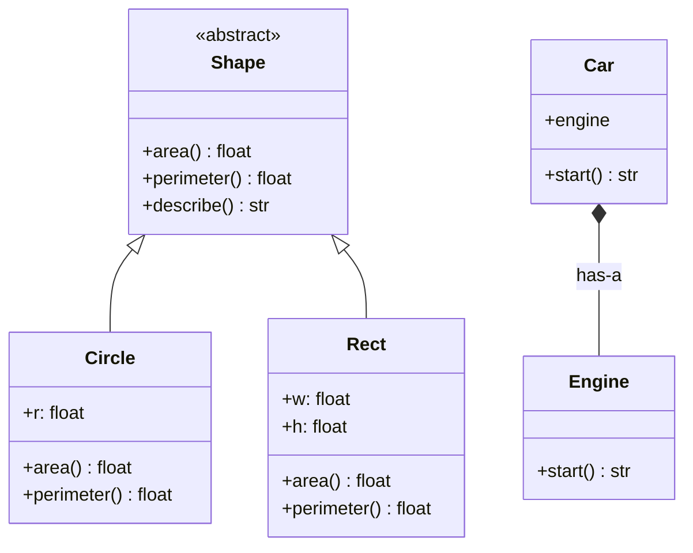

# PY-17 Inheritance, Composition and Polymorphism

> [!info] Topic card
> **Unit:** U5 · **Time:** 5 h · **Code:** `examples/py17_oop.py`, `exercises/py17_exercises.py`
> **Read alongside:** [[SD-10 SOLID Principles]] (Liskov and dependency inversion) and [[SD-07 UML Class Diagrams]] (generalisation vs composition arrows).

## 1. Learning objectives
1. **Create** subclasses that extend or override behaviour, using `super()` correctly.
2. **Distinguish** "is-a" (inheritance) from "has-a" (composition), and **justify** choosing composition in most cases.
3. **Apply** polymorphism: write code that works with any object providing an interface, through inheritance, abstract base classes (`abc`), duck typing or `typing.Protocol`.
4. **Recognise** violations of the Liskov Substitution Principle (e.g. Square-extends-Rectangle) and fix them.
5. **Explain** the method resolution order (MRO) at an introductory level.

## 2. Why it matters
Good hierarchies remove duplication and let new types plug into existing code without editing it ("add a new payment method without touching checkout"). Bad hierarchies are among the most expensive design mistakes: rigid, surprising and hard to change. Exam questions often ask you to **critique** a hierarchy, not just write one.

## 3. Prerequisites
[[PY-16 Classes and Objects]] (classes, `__init__`, invariants, dunders).

## 4. Intuition
- **Inheritance** says "a `SavingsAccount` **is a** `BankAccount`, with extras". It inherits everything and may specialise some of it.
- **Composition** says "a `Car` **has an** `Engine`". The car delegates engine work to the engine object, and you can swap in an electric engine.
- **Polymorphism** ("many forms") says "I don't care what you are, only that you can `area()`". The same call (`shape.area()`) runs different code depending on the object.

## 5. Rigorous explanation

### 5.1 Subclassing and `super()`
```python
class BankAccount:
    def __init__(self, owner: str, balance: int = 0):
        self.owner = owner
        self.balance = balance

    def withdraw(self, amount: int) -> None:
        if amount > self.balance:
            raise ValueError("insufficient funds")
        self.balance -= amount

    def month_end(self) -> None:
        pass                                   # default: nothing

class SavingsAccount(BankAccount):             # SavingsAccount is-a BankAccount
    def __init__(self, owner: str, balance: int = 0, rate: float = 0.01):
        super().__init__(owner, balance)       # let the parent initialise its part
        self.rate = rate

    def month_end(self) -> None:               # override
        self.balance += round(self.balance * self.rate)
```
- Attribute and method lookup goes instance → class → parent classes (following the MRO).
- `super().method(...)` calls the next class in the MRO. Use it rather than hard-coding `BankAccount.__init__(self, ...)`.
- `isinstance(s, BankAccount)` is `True` for a `SavingsAccount`. `issubclass(SavingsAccount, BankAccount)` is `True`.

### 5.2 Abstract base classes
```python
from abc import ABC, abstractmethod
import math

class Shape(ABC):
    @abstractmethod
    def area(self) -> float: ...

    @abstractmethod
    def perimeter(self) -> float: ...

    def describe(self) -> str:                         # concrete method using abstract ones
        return f"{type(self).__name__}: area={self.area():.2f}"

class Circle(Shape):
    def __init__(self, r: float):
        self.r = r
    def area(self) -> float:
        return math.pi * self.r ** 2
    def perimeter(self) -> float:
        return 2 * math.pi * self.r

Shape()        # TypeError: Can't instantiate abstract class Shape ...
```
An ABC defines an **interface contract**. A subclass that forgets a method can't be instantiated, so the error appears early, at construction rather than deep inside some later call.

### 5.3 Polymorphism in practice
```python
def total_area(shapes: list[Shape]) -> float:
    return sum(s.area() for s in shapes)       # works for ANY Shape, including future ones
```
`total_area` never checks types. Adding `Triangle` requires **no change** to `total_area`. That's the **Open/Closed Principle**: open for extension, closed for modification ([[SD-10 SOLID Principles]]).

**Duck typing:** Python doesn't require inheritance at all. Any object with an `area()` method works ("if it walks like a duck…"). `typing.Protocol` documents such an implicit interface for type checkers:
```python
from typing import Protocol
class HasArea(Protocol):
    def area(self) -> float: ...
```

### 5.4 Composition and delegation
```python
class Engine:
    def start(self) -> str:
        return "petrol engine started"

class ElectricMotor:
    def start(self) -> str:
        return "electric motor started"

class Car:
    def __init__(self, engine):                # has-a; injected, so it's swappable
        self.engine = engine
    def start(self) -> str:
        return self.engine.start()             # delegation

Car(ElectricMotor()).start()                   # 'electric motor started'
```
**Why "favour composition over inheritance"** (Gang of Four, 1994):
- Inheritance is a **compile-time, permanent** relationship. Composition can change at runtime.
- Subclasses depend on parent **internals** (the "fragile base class" problem). Composed objects depend only on an **interface**.
- Combining behaviours by inheritance explodes the number of classes (`ElectricConvertibleCar`, `PetrolConvertibleCar`…). Composition combines independent parts.
Use inheritance when there is a genuine, stable **is-a** relationship **and** the subclass honours every promise the parent makes.

### 5.5 The Liskov Substitution Principle (LSP)
*If S is a subtype of T, objects of type T may be replaced with objects of type S without altering the correctness of the program.* (After Liskov & Wing, 1994.)

Classic violation:
```python
class Rectangle:
    def __init__(self, w, h):
        self.w, self.h = w, h
    def set_width(self, w):
        self.w = w
    def area(self):
        return self.w * self.h

class Square(Rectangle):                 # "a square is a rectangle" in geometry...
    def __init__(self, side):
        super().__init__(side, side)
    def set_width(self, w):              # ...but must keep w == h
        self.w = self.h = w

def stretch(r: Rectangle):
    old_h = r.h
    r.set_width(10)
    assert r.area() == 10 * old_h        # Rectangle's promise: changing the width keeps the height
```
`stretch(Rectangle(5, 5))` passes (area 50). `stretch(Square(5))` **fails**: `set_width(10)` also changes the height, so the area is 100 instead of 50. Code written against `Rectangle` breaks when handed a `Square`, which is exactly what LSP forbids. **Fixes:** make shapes immutable (then a square can safely be a rectangle), or don't relate them by inheritance. Both can implement `Shape`.

### 5.6 Multiple inheritance and the MRO (introductory)
Python allows `class C(A, B)`. Lookup follows the **method resolution order**, computed by the C3 linearisation, which you can inspect with `C.__mro__`. In practice, use multiple inheritance only for small **mixins** that add one capability (e.g. `JsonSerializableMixin`), and always call `super()` so the chain works.

## 6. Terminology
| Term | Meaning |
|---|---|
| Base / parent / superclass | Class being inherited from |
| Derived / child / subclass | Class that inherits |
| Override | Subclass redefines an inherited method |
| `super()` | Proxy to call the next class's method in the MRO |
| Abstract class / method | Cannot be instantiated / must be implemented by subclasses |
| Polymorphism | One interface, many implementations |
| Duck typing | Behaviour-based typing ("has the method?") |
| Composition | Object built from other objects (has-a) |
| Delegation | Forwarding a call to a component |
| LSP | Subtypes must be substitutable for their base types |
| MRO | Order in which classes are searched for attributes |

## 7. Step-by-step: deciding inheritance vs composition
1. Can you say "**every** X *is a* Y" without exception, **in terms of behaviour** rather than everyday language? If not, use composition.
2. Will X honour **all** of Y's public promises (preconditions no stronger, postconditions no weaker)? If not, don't inherit (LSP).
3. Do you need to swap or combine behaviours at runtime? Composition.
4. Is the shared part just *code reuse* with no conceptual relationship? Extract a helper or component, not a parent class.

## 8. Diagram

*Text version: Shape is abstract, and Circle and Rect inherit from it (hollow-triangle arrows = generalisation). Car is composed of an Engine (filled-diamond arrow = composition) and delegates `start()` to it.*

## 9. Worked examples

### Example 1 (basic): override with `super()`. Trace
```python
s = SavingsAccount("Amina", 10_000, rate=0.01)
s.withdraw(2_000)      # inherited from BankAccount
s.month_end()          # overridden: adds interest
print(s.balance)       # 8080
```
| Call | Method found in | balance |
|---|---|---|
| `SavingsAccount(...)` | `SavingsAccount.__init__` → `super().__init__` | 10000 |
| `withdraw(2000)` | `BankAccount` (inherited) | 8000 |
| `month_end()` | `SavingsAccount` (override) | 8000 + round(80.0) = 8080 |

### Example 2 (intermediate): incorrect → bug → corrected. Forgetting `super().__init__`
```python
# INCORRECT
class CurrentAccount(BankAccount):
    def __init__(self, owner, balance=0, overdraft=0):
        self.overdraft = overdraft            # parent __init__ never runs

c = CurrentAccount("Juma", 100, overdraft=500)
c.withdraw(50)        # AttributeError: 'CurrentAccount' object has no attribute 'balance'
```
**Fix:** call `super().__init__(owner, balance)` first. Then override `withdraw` to allow `balance - amount >= -overdraft`. Note that this changes the parent's postcondition (a balance that can be negative). Code relying on "balance ≥ 0" would break, so check LSP.

### Example 3 (challenging): polymorphic payroll
```python
from abc import ABC, abstractmethod

class Employee(ABC):
    def __init__(self, name: str):
        self.name = name
    @abstractmethod
    def monthly_pay(self) -> int: ...

class Salaried(Employee):
    def __init__(self, name, annual: int):
        super().__init__(name)
        self.annual = annual
    def monthly_pay(self) -> int:
        return self.annual // 12

class Hourly(Employee):
    def __init__(self, name, rate: int, hours: float):
        super().__init__(name)
        self.rate, self.hours = rate, hours
    def monthly_pay(self) -> int:
        overtime = max(0, self.hours - 160)
        return round(self.rate * (self.hours - overtime) + self.rate * 1.5 * overtime)

def payroll_total(staff: list[Employee]) -> int:
    return sum(e.monthly_pay() for e in staff)

staff = [Salaried("Amina", 12_000_000), Hourly("Juma", 5_000, 170)]
print(payroll_total(staff))   # 1000000 + (5000*160 + 7500*10) = 1000000 + 875000 = 1875000
```
Adding `Commissioned` later touches **no** existing code.

### Example 4 (transfer): refactoring inheritance into composition
```python
# Rigid: every combination needs a subclass
class EmailOrderNotifier: ...
class SmsOrderNotifier: ...
class EmailAndSmsOrderNotifier: ...

# Flexible: OrderService HAS notifiers
class EmailSender:
    def __init__(self):
        self.sent = []
    def send(self, to, msg):
        self.sent.append((to, msg))

class OrderService:
    def __init__(self, notifiers):
        self.notifiers = notifiers
    def place(self, customer, item):
        for n in self.notifiers:
            n.send(customer, f"Order placed: {item}")
```
Tests pass a fake sender that records messages instead of sending real email, the same dependency-injection idea as in [[PY-15 Exceptions and Defensive Programming]]. This is the **Strategy**/**Observer** family of patterns ([[SD-12 Behavioral Design Patterns]]).

## 10. Application
[[PRJ-PY-05 Hostel Maintenance System]] defines a `Repository` interface (an ABC with `add`, `get` and `list`) with `InMemoryRepository` for tests and `SqliteRepository` for production. The services receive a repository through their constructor (composition and dependency inversion), so the whole business layer is tested without a database.

## 11. Common mistakes
| Mistake | Symptom | Fix |
|---|---|---|
| Forgetting `super().__init__` | Missing attributes | Call it first in the subclass `__init__` |
| Inheriting only to reuse code | Odd is-a claims (`Stack(list)` exposes `insert`, `sort`…) | Composition: `Stack` has a list |
| Overriding with an incompatible signature | Callers break | Keep the parameters compatible |
| Strengthening preconditions in a subclass | LSP violation | Subclass must accept everything the parent accepts |
| Deep hierarchies (5+ levels) | Hard to understand | Flatten. Prefer composition. |
| `isinstance` chains instead of polymorphism | `if isinstance(s, Circle) … elif …` | Put the behaviour in the classes |

## 12. Comparison
| Technique | Coupling | Flexibility | Use when |
|---|---|---|---|
| Inheritance | High (to parent internals) | Fixed at definition | True, stable is-a with LSP |
| ABC | Medium | Enforced contract | You want instantiation-time checks |
| Duck typing / Protocol | Low | Very high | Pythonic interfaces, tests with fakes |
| Composition | Low (to an interface) | Swappable at runtime | Default choice for combining behaviour |

## 13. Practice
**L1** 1. What does `super()` do? 2. What happens if you instantiate a class that has an unimplemented abstract method?

**L2** *(code bank)* 3. `Shape` ABC with `Circle`, `Rectangle` and `Triangle` (Heron's formula, validating the triangle inequality). 4. `total_area(shapes)` and `largest(shapes)`.

**L3** 5. The payroll hierarchy with `Salaried`, `Hourly` (overtime above 160 h at 1.5×) and `Commissioned` (base + rate × sales). 6. `Stack` implemented by **composition** over a list: `push`, `pop` (`IndexError` with a clear message on empty), `peek`, `__len__`, `is_empty`. Explain why `class Stack(list)` is a poor design.

**L4** 7. Critique the Square/Rectangle example: write the test that exposes the LSP violation, then redesign with immutable shapes. 8. `OrderService` with injected notifiers, plus a `FakeSender` used in tests.

**L5** 9. A school system has `Person`, `Student`, `Lecturer` and `TeachingAssistant` (a student who also teaches). Propose an inheritance design and a composition/role-based design (`Person` has roles). Compare them on: adding a new role, a person changing roles over time, and avoiding multiple inheritance. Recommend one.

**Variation:** add a `Square` to your `Shape` hierarchy *without* breaking LSP.

## 14. Hints
> [!tip]- Hints
> 3: Heron: $s = (a+b+c)/2$, $A = \sqrt{s(s-a)(s-b)(s-c)}$. 6: A list subclass inherits `insert(0, x)` and `sort()`, which break the stack discipline. 7: The test sets the width and checks that the height is unchanged. 9: Roles as objects: `person.roles = {StudentRole(...), TeachingRole(...)}`.

## 15. Worked solutions
> [!success]- Solutions 1–2
> 1. It returns a proxy that delegates method calls to the next class in the MRO, typically the parent, e.g. to run the parent's `__init__`. 2. `TypeError: Can't instantiate abstract class X without an implementation for abstract method 'm'` (wording varies by version).

> [!success]- Solution 3 (Triangle)
> ```python
> class Triangle(Shape):
>     def __init__(self, a, b, c):
>         if min(a, b, c) <= 0 or a + b <= c or a + c <= b or b + c <= a:
>             raise ValueError("invalid triangle")
>         self.a, self.b, self.c = a, b, c
>     def perimeter(self):
>         return self.a + self.b + self.c
>     def area(self):
>         s = self.perimeter() / 2
>         return math.sqrt(s * (s - self.a) * (s - self.b) * (s - self.c))
> ```
> `Triangle(3, 4, 5).area()` → 6.0.

> [!success]- Solution 6
> ```python
> class Stack:
>     def __init__(self):
>         self._items = []
>     def push(self, x):
>         self._items.append(x)
>     def pop(self):
>         if not self._items:
>             raise IndexError("pop from empty stack")
>         return self._items.pop()
>     def peek(self):
>         if not self._items:
>             raise IndexError("peek at empty stack")
>         return self._items[-1]
>     def is_empty(self):
>         return not self._items
>     def __len__(self):
>         return len(self._items)
> ```
> `class Stack(list)` would inherit about 40 list methods, including `insert`, `remove`, `sort` and indexing, so users could break LIFO order. A stack **is not a** list. It **is implemented with** one. Composition exposes only the stack interface (information hiding).

> [!success]- Solution 7
> ```python
> def test_rectangle_width_independent_of_height():
>     for r in (Rectangle(5, 5), Square(5)):
>         r.set_width(10)
>         assert r.h == 5          # fails for Square: LSP violated
> ```
> **Redesign:** immutable value objects. `Rectangle(w, h).with_width(10)` returns a **new** `Rectangle`. `Square(side)` is a separate `Shape` subclass, or a factory `Rectangle.square(s)` (see [[PY-16 Classes and Objects]]). Without mutation there's no "change one side" promise to break.

> [!success]- Solution 9 (model answer)
> **Inheritance design:** `Person ← Student`, `Person ← Lecturer`, and `TeachingAssistant(Student, Lecturer)` (multiple inheritance, which brings diamond and MRO concerns). Adding a role means a new class, plus combination classes. When a student graduates and becomes a lecturer, the **object's class must change**, which Python can't do cleanly, so you have to create a new object and migrate the references.
> **Role design:** `Person` has a set of `Role` objects (`StudentRole(programme)`, `TeachingRole(courses)`). Adding a role is one new class with no combinations. Changing roles means adding or removing a role object while the identity is preserved. No multiple inheritance.
> **Recommendation:** roles via composition. Roles change over time and combine freely, which is exactly what inheritance models poorly. This is a well-known modelling pattern (the "role object" pattern).

> [!success]- Variation answer
> Make `Square` a sibling, not a child, of `Rectangle`:
> ```python
> class Square(Shape):
>     def __init__(self, side):
>         if side <= 0:
>             raise ValueError("side must be positive")
>         self.side = side
>     def area(self):
>         return self.side ** 2
>     def perimeter(self):
>         return 4 * self.side
> ```
> Both honour the `Shape` contract (`area`, `perimeter`). Neither promises independent sides.

## 16. Self-test (pass ≥ 4/5)
1. "Favour composition over inheritance": give two reasons. 2. State the LSP. 3. Why is `Stack(list)` bad? 4. What does an ABC enforce, and when? 5. Polymorphism means…?
> [!success]- Answers
> 1. Less coupling to parent internals, and behaviour that is swappable and combinable at runtime (it also avoids subclass explosion). 2. Objects of a subtype must be usable wherever the base type is expected without breaking correctness. 3. It exposes list operations that violate stack discipline. 4. That abstract methods are implemented, checked at instantiation. 5. The same interface or call working on objects of different types, each with its own implementation.

## 17. Flashcards
#flashcards/python
Is-a vs has-a?::Is-a → inheritance (subtype); has-a → composition (component object).
Liskov Substitution Principle?::Subtypes must be substitutable for base types without breaking program correctness.
Why does Square extending mutable Rectangle violate LSP?::Square can't keep Rectangle's promise that width changes independently of height.
What does super().__init__(...) do in a subclass?::Runs the parent's initialiser so inherited attributes are set up.
What is duck typing?::Using any object that has the required methods, regardless of its class.
How to see a class's method resolution order?::ClassName.__mro__ (or ClassName.mro()).

## 18. Blank-page recall
Draw the Shape hierarchy and the Car–Engine composition in UML, and write the four-question inheritance-vs-composition checklist.

## 19. Revision summary
- Inheritance = is-a, with `super()` for parent behaviour. Override to specialise.
- ABCs enforce interfaces. Duck typing and Protocols give flexible ones.
- Polymorphism lets code work with future types unchanged (Open/Closed).
- Favour composition. Inherit only for true, LSP-safe is-a relationships.
- Mutable Square/Rectangle is the canonical LSP violation.

## 20. Links
Prev: [[PY-16 Classes and Objects]] · Next: [[PY-18 Iterators, Generators, Decorators and Context Managers]] · Design: [[SD-10 SOLID Principles]], [[SD-11 Creational and Structural Design Patterns]], [[SD-12 Behavioral Design Patterns]], [[SD Flawed Design Clinic]]

## 21. Sources
- Python docs, *Classes: Inheritance* (tutorial §9.5): https://docs.python.org/3/tutorial/classes.html#inheritance
- Python docs, `abc`: https://docs.python.org/3/library/abc.html · `typing.Protocol`: https://docs.python.org/3/library/typing.html#typing.Protocol
- Liskov, B. H. & Wing, J. M., "A behavioral notion of subtyping", *ACM Transactions on Programming Languages and Systems*, 16(6), 1994, pp. 1811–1841.
- Gamma, E., Helm, R., Johnson, R. & Vlissides, J., *Design Patterns: Elements of Reusable Object-Oriented Software*, Addison-Wesley, 1994 ("favor object composition over class inheritance").
- Python docs, *The Python 2.3 Method Resolution Order* (C3): https://docs.python.org/3/howto/mro.html

## 22. Mastery checklist
- [ ] `py17` tests pass with `PY_TARGET=exercises`
- [ ] I can explain the LSP violation with a failing test
- [ ] I refactored one inheritance design into composition · reviews scheduled
