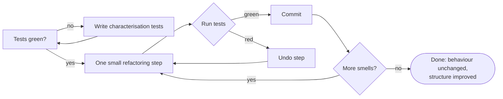

# PY-19 Type Hints, Documentation, Clean Code and Refactoring

> [!info] Topic card
> **Unit:** U6 · **Time:** 4 h · **Code:** `examples/py19_refactor_before.py` → `solutions/py19_solutions.py`, `exercises/py19_exercises.py`
> **Paired with:** [[SD-15 Refactoring, Technical Debt, Code Review and Quality]], which covers the process and team side of the same ideas.

## 1. Learning objectives
1. **Annotate** functions and classes with type hints (`list[int]`, `dict[str, float]`, `X | None`, `Callable`), and **run** `mypy` to find bugs before execution.
2. **Write** docstrings that state purpose, parameters, return values, exceptions and examples.
3. **Identify** common code smells: long function, duplication, magic numbers, deep nesting, flag arguments, poor names, global state.
4. **Refactor** safely in small steps protected by tests: extract function, rename, introduce constant, replace conditional with a table, decompose conditional.
5. **Apply** PEP 8 conventions, and **justify** readability as an engineering requirement.

## 2. Why it matters
Code is read many more times than it is written: by markers, teammates, and you in three months. A "working" program that nobody can safely change is a liability, which is what **technical debt** means. Type hints catch whole classes of bugs before the code even runs, and clean code makes your final-year project defensible in a viva.

## 3. Prerequisites
[[PY-06 Functions, Parameters, Return Values and Scope]], [[PY-16 Classes and Objects]] and, for refactoring safely, a first look at tests in [[PY-20 Testing, Debugging and Test-Driven Development]] (you can study them in parallel).

## 4. Intuition
Clean code is like a well-organised kitchen: everything has one place, labels say what's inside, and a new cook can make dinner without asking you where the salt is. **Refactoring** is tidying the kitchen *without changing the menu*: the output stays identical while the structure improves. Tests are how you prove the menu didn't change.

## 5. Rigorous explanation

### 5.1 Type hints (PEP 484 and later)
```python
from collections.abc import Callable, Iterable

def average(values: list[float]) -> float: ...
def find_student(students: dict[str, str], sid: str) -> str | None: ...
def apply_all(funcs: Iterable[Callable[[int], int]], x: int) -> list[int]: ...

class Course:
    code: str
    capacity: int
    def __init__(self, code: str, capacity: int = 30) -> None: ...
```
- Built-in generics (`list[int]`) work on Python 3.9+, and `X | None` on 3.10+ (`Optional[X]` on older versions).
- **Python does not enforce hints at runtime.** `average(["a"])` still runs (and crashes inside). A **static checker** (mypy, pyright) reads them.
- Real mypy 2.4 output for a small demo file (run when this vault was built):
```text
typed_demo.py:10: error: Item "None" of "str | None" has no attribute "upper"  [union-attr]
typed_demo.py:11: error: List item 0 has incompatible type "str"; expected "float"  [list-item]
```
The first error is a genuine latent bug: `find_student` may return `None`, and the code calls `.upper()` on it without checking. mypy found it **without running the program**.

### 5.2 Docstrings
```python
def weighted_average(marks: list[float], weights: list[float]) -> float:
    """Return the weighted mean of ``marks``.

    Args:
        marks: Assessment marks, each in 0–100.
        weights: Non-negative weights, same length as ``marks``; need not sum to 1.

    Returns:
        The weighted mean, in 0–100.

    Raises:
        ValueError: If the lengths differ, any weight is negative, or all weights are zero.

    Example:
        >>> weighted_average([60, 80], [1, 3])
        75.0
    """
```
Docstrings describe **what and why** (the contract). Comments inside the code explain **why something non-obvious is done**, never *what* the code obviously does (`i += 1  # increment i` is noise). The `>>>` example can be run as a test with `python -m doctest file.py`.

### 5.3 Naming and PEP 8 essentials
| Element | Convention | Good | Bad |
|---|---|---|---|
| Variables, functions | `snake_case`, descriptive | `total_marks`, `is_valid_email()` | `tm`, `x2`, `doStuff()` |
| Constants | `UPPER_SNAKE` | `MAX_LOANS = 3` | `3` scattered in the code |
| Classes | `PascalCase`, nouns | `LoanRecord` | `loan_record_class` |
| Booleans | Predicates | `is_active`, `has_overdue` | `flag`, `status2` |
| Line length | ≤ 79–99 chars (team choice) | | |
| Imports | Standard lib, third-party, local, in groups | | `import *` |

Use a formatter (`black` or `ruff format`) and a linter (`ruff`, `flake8`) so the team stops arguing about style ([[PY-25 Performance, Packaging and Project Organization]]).

### 5.4 Code smells (symptoms that suggest refactoring)
| Smell | Symptom | Typical refactoring |
|---|---|---|
| Long function | > ~25 lines, several comment-separated "sections" | Extract function |
| Duplicated code | The same logic in 2+ places | Extract function / constant |
| Magic numbers | `if mark >= 70` everywhere | Introduce named constant / table |
| Deep nesting | 4+ indentation levels | Guard clauses, extract function |
| Long parameter list | 5+ parameters | Introduce parameter object (dataclass) |
| Flag argument | `report(data, True)` | Split into two functions |
| Primitive obsession | Money as float, dates as strings | Value objects (`Money`, `date`) |
| Global mutable state | Functions read and write module variables | Pass state, or encapsulate it in a class |
| Comments explaining confusing code | `# this checks if the user is allowed…` | Rename / extract so the code explains itself |
| Shotgun surgery | One change requires edits in many files | Move related code together (cohesion) |

### 5.5 Refactoring, safely
**Definition (Fowler):** a change to the internal structure of software that makes it easier to understand and cheaper to modify **without changing its observable behaviour**.
Safe loop:
1. Make sure tests cover the behaviour. If they don't, write **characterisation tests** that record what the code currently does.
2. Make **one small** refactoring step.
3. Run the tests. If green, commit. If red, undo the step.
4. Repeat.
Never mix refactoring with adding features in the same step.

## 6. Terminology
| Term | Meaning |
|---|---|
| Type hint / annotation | Declared expected type, checked statically |
| Static type checker | Tool analysing types without running the code (mypy) |
| Docstring | String literal documenting a module, class or function |
| Code smell | Surface symptom of a deeper design problem |
| Refactoring | Behaviour-preserving restructuring |
| Characterisation test | Test capturing the current behaviour before changing the code |
| Technical debt | Future cost created by expedient design choices |
| Linter / formatter | Tool flagging problems / enforcing layout |

## 7. Step-by-step: refactoring a messy function
Starting point (`examples/py19_refactor_before.py`):
```python
def r(d, f):
    s = 0
    o = ""
    for k in d:
        s = s + d[k]
        if d[k] >= 70:
            g = "A"
        elif d[k] >= 60:
            g = "B"
        elif d[k] >= 50:
            g = "C"
        elif d[k] >= 40:
            g = "D"
        else:
            g = "F"
        if f:
            o = o + k.upper() + ": " + str(d[k]) + " " + g + "\n"
        else:
            o = o + k + ": " + str(d[k]) + " " + g + "\n"
    o = o + "AVG: " + str(round(s / len(d), 1))
    return o
```
**Smells:** cryptic names, magic numbers, a flag argument (`f`), mixed responsibilities (grading + averaging + formatting), string concatenation in a loop, and a crash on empty input.

**Step 0:** characterisation test: `r({"ali": 72, "bea": 55}, False) == "ali: 72 A\nbea: 55 C\nAVG: 63.5"`.
**Step 1 (rename):** `r → grade_report`, `d → marks`, `f → upper_names`, `s → total`, `o → out`, `g → letter`. Run the tests ✔.
**Step 2 (extract function + table):** move the grading into `letter_grade(mark)` driven by a `GRADE_BANDS` constant. Tests ✔.
**Step 3 (separate concerns):** split computing the lines from formatting. Build a list and `"\n".join`. Tests ✔.
**Step 4 (replace the flag):** the caller transforms the names itself, or passes `name_format=str.upper`. Tests ✔.
**Step 5 (decide edge behaviour explicitly):** empty marks → `ValueError("no marks")`. This **changes behaviour** (it used to be `ZeroDivisionError`), so it's a *separate, deliberate* change with its own test, done after the refactoring.

Result:
```python
GRADE_BANDS: list[tuple[float, str]] = [(70, "A"), (60, "B"), (50, "C"), (40, "D"), (0, "F")]

def letter_grade(mark: float) -> str:
    for threshold, letter in GRADE_BANDS:
        if mark >= threshold:
            return letter
    raise ValueError(f"negative mark: {mark}")

def grade_report(marks: dict[str, float],
                 name_format: Callable[[str], str] = lambda s: s) -> str:
    if not marks:
        raise ValueError("no marks")
    lines = [f"{name_format(name)}: {mark} {letter_grade(mark)}" for name, mark in marks.items()]
    average = sum(marks.values()) / len(marks)
    lines.append(f"AVG: {round(average, 1)}")
    return "\n".join(lines)
```

## 8. Diagram: the refactoring loop


## 9. Worked examples

### Example 1 (basic): adding hints exposes a bug
```python
def parse_marks(text: str) -> list[int]:
    return text.split(",")            # mypy: error: Incompatible return value type (got "list[str]", expected "list[int]")  [return-value]
```
The hint states the *intent* (a list of ints), and mypy shows the code doesn't fulfil it. Fix: `return [int(x) for x in text.split(",")]`.

### Example 2 (intermediate): magic numbers → named constants (incorrect → corrected)
```python
# INCORRECT: the loan limit appears in three places; changing policy means hunting them all
if len(member_loans) >= 3: ...
print("You may borrow up to 3 books")
assert loans <= 3
```
```python
# CORRECTED
MAX_LOANS = 3
if len(member_loans) >= MAX_LOANS: ...
print(f"You may borrow up to {MAX_LOANS} books")
```
When the library changes the policy to 5, you edit one line.

### Example 3 (challenging): long parameter list → parameter object
```python
# Before
def create_booking(lab, date, start_hour, end_hour, user_id, purpose, recurring, notify): ...

# After
from dataclasses import dataclass
from datetime import date

@dataclass(frozen=True)
class BookingRequest:
    lab: str
    day: date
    start_hour: int
    end_hour: int
    user_id: str
    purpose: str = ""
    recurring: bool = False

    def __post_init__(self):
        if not 0 <= self.start_hour < self.end_hour <= 24:
            raise ValueError("invalid time range")

def create_booking(request: BookingRequest, notify: bool = True) -> None: ...
```
The validation now lives **with the data** (cohesion), the call sites are readable, and `BookingRequest` can be reused and tested. This appears in the running case study [[SD-CASE LabBook Running Case Study]].

## 10. Application
Before submitting [[PRJ-PY-03 Library Management System]], run `ruff check`, `ruff format` and `mypy` (if installed), and fix every finding. The rubric awards marks for readability and documentation, and a viva examiner will ask "why is this function 80 lines long?"

## 11. Common mistakes
| Mistake | Why it's wrong | Better |
|---|---|---|
| Believing hints are enforced at runtime | They aren't | Run mypy. Validate inputs at boundaries. |
| `Any` everywhere | Disables checking | Precise types, or `object` |
| Comments that repeat the code | Noise that goes stale | Comment *why*. Name things well. |
| "Refactoring" without tests | You can't prove the behaviour is unchanged | Characterisation tests first |
| Big-bang rewrites | High risk, long broken periods | Small, tested, committed steps |
| Abbreviations (`calc_tm_avg`) | Readers have to decode them | `calculate_term_average` |
| Mixing a refactor and a feature in one commit | Can't tell which change broke what | Separate commits |

## 12. Comparison
| Practice | Finds | When |
|---|---|---|
| Type checking (mypy) | Type mismatches, `None` misuse | Before running, in CI |
| Linting (ruff) | Unused variables, style, likely bugs | Every save / commit |
| Unit tests (pytest) | Wrong behaviour | Every change |
| Code review | Design problems, unclear intent | Every merge ([[SD-15 Refactoring, Technical Debt, Code Review and Quality]]) |

## 13. Practice
**L1** 1. Does `def f(x: int)` stop `f("a")` from running? 2. Name five code smells.

**L2** *(code bank)* 3. Add complete type hints and a docstring to `weighted_average(marks, weights)` and implement it (§5.2 contract). 4. Implement `letter_grade(mark)` driven by `GRADE_BANDS`.

**L3** 5. Implement the refactored `grade_report(marks, name_format)`. The code bank's characterisation tests check it against the original messy function. 6. Rewrite this using guard clauses and a named constant:
```python
def can_register(student, course):
    if student is not None:
        if student["fees_paid"]:
            if len(course["enrolled"]) < 40:
                if student["id"] not in course["enrolled"]:
                    return True
    return False
```

**L4** 7. Find and name **six** smells in the following, then refactor it into ≥ 3 functions:
```python
def process(data, mode):
    result = []
    for i in range(len(data)):
        x = data[i]
        if mode == 1:
            if x["amount"] > 0 and x["amount"] < 1000000 and x["currency"] == "TZS":
                result.append(x["amount"] * 1.18)
        elif mode == 2:
            if x["amount"] > 0 and x["amount"] < 1000000 and x["currency"] == "TZS":
                result.append(x["amount"])
    total = 0
    for r in result:
        total = total + r
    print("Total:", total)
    return total
```

**L5** 8. Your team's project has no tests and a 400-line `main.py`. Write a **refactoring plan** (ordered steps, risks, how you'll know each step is safe) to reach a package with models, services and CLI modules. Estimate the effort and justify the order.

**Variation:** extend `grade_report` to accept a custom `bands` table (e.g. a distinction/merit/pass/fail scale) without modifying `letter_grade`'s callers.

## 14. Hints
> [!tip]- Hints
> 6: Each nested `if` becomes `if not …: return False`. 40 → `COURSE_CAPACITY`. 7: Magic numbers (1, 2, 1000000, 1.18), a flag/mode argument, duplicated validation, an index loop, a manual sum, a print side effect, and a cryptic name (`process`, `x`). 8: Characterisation tests at the CLI level first (input → output), then extract the pure functions.

## 15. Worked solutions
> [!success]- Solutions 1–2
> 1. No. Hints aren't enforced at runtime; only static tools report the mismatch. 2. Any five of: long function, duplicated code, magic numbers, deep nesting, long parameter list, flag argument, primitive obsession, global mutable state, explanatory comments on unclear code, shotgun surgery.

> [!success]- Solution 3
> ```python
> def weighted_average(marks: list[float], weights: list[float]) -> float:
>     """(docstring as in §5.2)"""
>     if len(marks) != len(weights):
>         raise ValueError("marks and weights must have the same length")
>     if any(w < 0 for w in weights):
>         raise ValueError("weights must be non-negative")
>     total_weight = sum(weights)
>     if total_weight == 0:
>         raise ValueError("weights must not all be zero")
>     return sum(m * w for m, w in zip(marks, weights)) / total_weight
> ```
> `weighted_average([60, 80], [1, 3])` → $(60 + 240)/4 = 75.0$ ✔.

> [!success]- Solution 6
> ```python
> COURSE_CAPACITY = 40
>
> def can_register(student: dict | None, course: dict) -> bool:
>     if student is None or not student["fees_paid"]:
>         return False
>     if len(course["enrolled"]) >= COURSE_CAPACITY:
>         return False
>     return student["id"] not in course["enrolled"]
> ```

> [!success]- Solution 7
> **Smells:** (1) a cryptic name `process`, (2) a mode flag with magic values 1/2, (3) duplicated validation, (4) magic numbers 1000000 and 1.18 (the VAT rate), (5) `range(len())` indexing, (6) a hand-written sum, (7) a `print` side effect inside the computation, (8) float money.
> ```python
> VAT_RATE = 0.18
> MAX_AMOUNT = 1_000_000
>
> def is_valid_tzs_amount(tx: dict) -> bool:
>     return tx["currency"] == "TZS" and 0 < tx["amount"] < MAX_AMOUNT
>
> def valid_amounts(transactions: list[dict]) -> list[float]:
>     return [tx["amount"] for tx in transactions if is_valid_tzs_amount(tx)]
>
> def total_with_vat(transactions: list[dict]) -> float:
>     return sum(a * (1 + VAT_RATE) for a in valid_amounts(transactions))
>
> def total_without_vat(transactions: list[dict]) -> float:
>     return sum(valid_amounts(transactions))
> ```
> The caller prints. Two clearly named functions replace the mode flag. A further step would use integer cents ([[PY-02 Variables, Types, Expressions and Operators]]).

> [!success]- Solution 8 (model answer)
> 1. **Freeze the behaviour:** write 5–10 end-to-end characterisation tests that run `main.py` with sample inputs and compare the output (≈ 0.5 day). Risk: missing behaviours. Mitigation: use real user scenarios.
> 2. **Extract pure functions** (calculations, validation) into `services.py`, one at a time, running the tests after each (≈ 1 day). Add unit tests for each extracted function.
> 3. **Extract data classes** into `models.py` (replace dicts with dataclasses) (≈ 0.5 day). Type-check with mypy.
> 4. **Isolate I/O** (files, input/print) into `storage.py` and `cli.py` (≈ 1 day).
> 5. **Thin `main.py`:** wiring only (≈ 0.25 day).
> **Order rationale:** tests first, because nothing else is safe without them. Pure logic next (highest value, lowest risk). I/O last (hardest to test). Each step is an independent commit, so the project is never broken for long. That's the safe loop of §5.5 applied at project scale, and it's also something a project manager can schedule ([[PM-04 Scope Management, Requirements Traceability and WBS]]).

## 16. Self-test (pass ≥ 4/5)
1. What makes a change a refactoring? 2. Why write characterisation tests? 3. What smell is `report(data, True)`? 4. Which tool checks type hints? 5. What should a comment explain?
> [!success]- Answers
> 1. The internal structure changes but the observable behaviour doesn't. 2. To capture the current behaviour so you can prove a refactoring preserved it. 3. A flag argument. 4. A static type checker such as mypy or pyright. 5. *Why*: intent, constraints, non-obvious reasons. Not *what* the code literally does.

## 17. Flashcards
#flashcards/python
Are type hints enforced at runtime?::No. Static checkers like mypy check them.
Definition of refactoring?::Changing internal structure without changing observable behaviour.
What is a characterisation test?::A test that records current behaviour before refactoring legacy code.
Fix for magic numbers?::Introduce named constants (or a data table).
Fix for a flag argument?::Split into separate, well-named functions (or pass a strategy).
`X | None` means?::The value may be X or None (Optional[X]); callers must handle None.

## 18. Blank-page recall
List ten code smells with their refactorings, and write the five-step safe refactoring loop.

## 19. Revision summary
- Hints document intent, and mypy checks it statically. `X | None` forces you to handle `None`.
- Docstrings = contract (args, returns, raises, example). Comments = why.
- Smells are symptoms. Refactor in small steps under green tests.
- Names, constants, small functions, guard clauses and parameter objects all serve readability.
- Behaviour changes are separate, deliberate commits.

## 20. Links
Prev: [[PY-18 Iterators, Generators, Decorators and Context Managers]] · Next: [[PY-20 Testing, Debugging and Test-Driven Development]] · SD module: [[SD-15 Refactoring, Technical Debt, Code Review and Quality]], [[SD Flawed Design Clinic]]

## 21. Sources
- Fowler, M., *Refactoring: Improving the Design of Existing Code*, 2nd ed., Addison-Wesley, 2018.
- PEP 8 *Style Guide*: https://peps.python.org/pep-0008/ · PEP 257 *Docstring Conventions*: https://peps.python.org/pep-0257/ · PEP 484 *Type Hints*: https://peps.python.org/pep-0484/
- mypy documentation: https://mypy.readthedocs.io/ (version used here: mypy 2.4.0, run 2026-10-19)
- Martin, R. C., *Clean Code*, Prentice Hall, 2008 (naming, functions, comments).

## 22. Mastery checklist
- [ ] `py19` tests pass with `PY_TARGET=exercises`
- [ ] I ran mypy on one of my projects and fixed the findings
- [ ] I refactored the messy function in five tested steps · reviews scheduled
