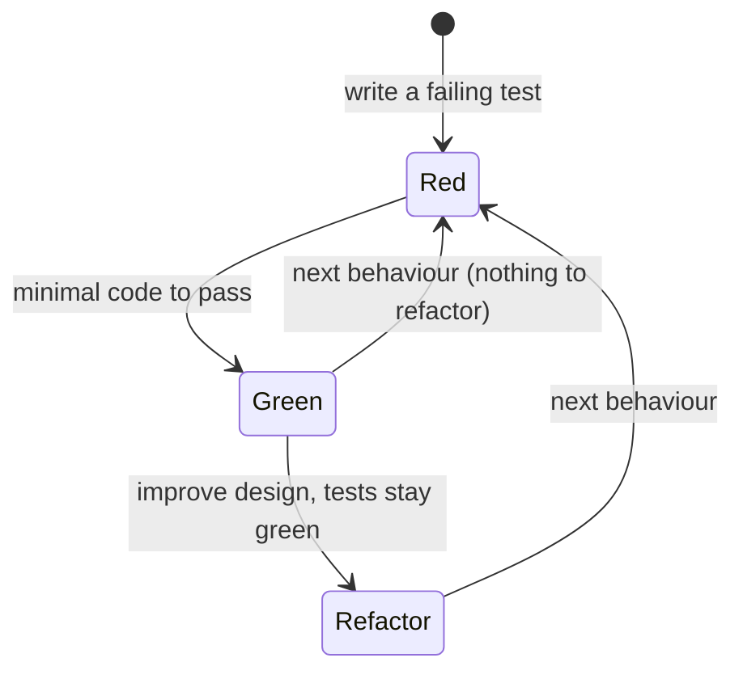

# PY-20 Testing, Debugging and Test-Driven Development

> [!info] Topic card
> **Unit:** U6 · **Time:** 5 h · **Code:** `examples/py20_debug_me.py`, `exercises/py20_exercises.py`, and every `tests/test_pyNN.py` in the code bank (read them: they are worked examples of tests)
> **Paired with:** [[SD-14 Software Testing, Verification and Validation]] (test levels, V&V, test planning) and [[X-04 Testing as Software Quality Assurance]].

## 1. Learning objectives
1. **Write** unit tests with pytest: plain `assert`, `pytest.raises`, `parametrize`, fixtures (`tmp_path`, `capsys`, `monkeypatch`).
2. **Design** test cases systematically with equivalence partitioning, boundary-value analysis and the Arrange–Act–Assert structure.
3. **Use** test doubles (fakes, stubs, mocks) to isolate code from I/O, time and randomness.
4. **Practise** TDD (red → green → refactor) on a small problem, and **explain** its benefits and limits.
5. **Debug** systematically: reproduce, minimise, hypothesise, test the hypothesis (with `breakpoint()`/pdb or logging), fix, and add a regression test.

## 2. Why it matters
"It works on my machine with the input I tried" isn't evidence. Automated tests are **executable evidence** that code meets its specification, and they make refactoring safe ([[PY-19 Type Hints, Documentation, Clean Code and Refactoring]]). Debugging is the skill students spend the most time on and practise the least deliberately.

## 3. Prerequisites
[[PY-15 Exceptions and Defensive Programming]] (testing error paths), [[PY-19 Type Hints, Documentation, Clean Code and Refactoring]], [[PY-13 Modules, Packages, Imports and Virtual Environments]] (tests import your package).

## 4. Intuition
A test is a **small experiment with a predicted outcome**: "if I give `grade` the mark 70, I predict 'A'". Run it automatically every time the code changes, and you get an alarm the moment a prediction fails. TDD flips the order: **write the prediction first**, watch it fail (proving the test can detect absence), then write just enough code to pass.

## 5. Rigorous explanation

### 5.1 pytest essentials
```python
# file: tests/test_grading.py   (pytest discovers test_*.py files and test_* functions)
import pytest
from gradebook.grading import grade

def test_grade_boundary_a():
    assert grade(70) == "A"                     # plain assert; pytest shows both sides on failure

@pytest.mark.parametrize("mark, expected", [(0, "F"), (39, "F"), (40, "D"), (69.5, "B"), (100, "A")])
def test_grade_table(mark, expected):
    assert grade(mark) == expected

def test_grade_rejects_out_of_range():
    with pytest.raises(ValueError, match="out of range"):
        grade(101)
```
Run `python -m pytest` (all tests), `-k boundary` (filter by name), `-x` (stop at the first failure), `-v` (verbose), or `tests/test_grading.py::test_grade_table` (a single test).

**Built-in fixtures** (pytest injects them by parameter name):
| Fixture | Gives you | Typical use |
|---|---|---|
| `tmp_path` | A fresh temporary directory (`pathlib.Path`) | File I/O tests ([[PY-14 Files, CSV and JSON]]) |
| `capsys` | Captured stdout/stderr | Testing printed output |
| `monkeypatch` | Temporarily replace attributes, env vars, `input` | Isolating from the environment |

**Custom fixtures** set up shared objects:
```python
@pytest.fixture
def library():
    lib = Library()
    lib.add_book(Book("BK-0001", "Sample Title"))
    return lib

def test_borrow(library):
    library.borrow("M1", "BK-0001")
    assert not library.is_available("BK-0001")
```

### 5.2 Designing test cases
- **Arrange–Act–Assert (AAA):** set up, perform **one** action, check the outcome. One behaviour per test, named after the behaviour (`test_withdraw_more_than_balance_raises`).
- **Equivalence partitioning:** split the inputs into classes the code should treat the same, and pick one representative from each. For `grade`: invalid low, F, D, C, B, A, invalid high = 7 classes.
- **Boundary-value analysis:** bugs cluster at edges, so test at, just below and just above each boundary (39, 40, 41…), plus the extremes of the domain (0, 100).
- **Error paths:** every `raise` deserves a test.
- **Property-based thinking:** state a law that holds for all inputs (e.g. `decode(encode(s)) == s`, or "a sort's output is ordered and is a permutation of the input"), then test it on many generated inputs. The code bank does this with seeded `random` (`test_py08.py`, `test_py12.py`). The `hypothesis` library automates it.

### 5.3 Test doubles
| Double | What it does | Example |
|---|---|---|
| **Stub** | Returns canned answers | `input_fn=lambda _: "42"` |
| **Fake** | A working lightweight implementation | `InMemoryRepository` instead of SQLite |
| **Mock** | Records calls so you can assert on them | `unittest.mock.Mock()`; `mock.assert_called_once_with(...)` |
| **Spy** | Real behaviour plus recording | A `FakeSender` with a `.sent` list ([[PY-17 Inheritance, Composition and Polymorphism]]) |

**Design for testability:** pass dependencies in (functions, objects, clocks, random generators) instead of creating them inside. That's dependency injection. Code that calls `input()`, `datetime.now()` or `random.random()` directly deep inside the logic is hard to test.

### 5.4 Test-Driven Development
1. **Red:** write a small failing test for the next bit of behaviour, and run it to see it fail (for the *right* reason).
2. **Green:** write the **simplest** code that passes. Hard-coding is allowed temporarily.
3. **Refactor:** clean up the code and the tests while staying green.
4. Repeat with the next test, which forces the generalisation.

**Benefits:** a clear specification of each step, high coverage by construction, design pushed toward small testable units. **Limits:** it doesn't replace thinking about design, it's awkward for exploratory or UI work, and tests are only as good as the cases you imagine.

### 5.5 Coverage
`coverage run -m pytest` and then `coverage report` (the `coverage` package) show which lines ran. **100% line coverage ≠ correct.** It proves every line ran, not that every behaviour was checked. Use it to find untested code, not as a goal in itself.

### 5.6 Systematic debugging
1. **Reproduce** reliably: same input, same failure.
2. **Minimise** the input or the code until the bug is in a small example.
3. **Read** the traceback bottom-up ([[PY-01 How Python Executes Programs and Environment Setup]]).
4. **Hypothesise:** "I think `total` is wrong because…"
5. **Test the hypothesis:** inspect the state with `breakpoint()` (opens pdb: `n` next, `s` step, `p expr` print, `c` continue, `l` list, `q` quit), or targeted logging.
6. **Fix** the root cause, not the symptom.
7. **Add a regression test** that fails without the fix.
Other tactics: rubber-duck explanation, `git bisect` to find the commit that introduced a bug ([[SD-13 Implementation, Code Organization and Version Control]]), and checking your assumptions about the data with `repr()`.

## 6. Terminology
| Term | Meaning |
|---|---|
| Unit test | Tests one function or class in isolation |
| Integration test | Tests components working together |
| Regression test | Ensures a fixed bug stays fixed |
| Fixture | Reusable setup for tests |
| Assertion | Checked expectation |
| Equivalence class | Set of inputs expected to behave the same |
| Boundary value | Input at the edge of an equivalence class |
| Test double | Stand-in for a real dependency |
| Coverage | Proportion of code executed by the tests |
| TDD | Write the failing test first, then code, then refactor |

## 7. Step-by-step TDD session: `int_to_roman`
| Cycle | Test added (red) | Simplest code (green) | Refactor |
|---|---|---|---|
| 1 | `int_to_roman(1) == "I"` | `return "I"` | — |
| 2 | `(3) == "III"` | `return "I" * n` | — |
| 3 | `(5) == "V"`, `(4) == "IV"` | special-case 4 and 5 | Too many ifs, so introduce a table |
| 4 | `(9) == "IX"`, `(14) == "XIV"` | table `[(10,"X"),(9,"IX"),(5,"V"),(4,"IV"),(1,"I")]` with greedy subtraction | Generalise the table up to 1000 |
| 5 | `(1994) == "MCMXCIV"`, `(3999) == "MMMCMXCIX"` | full table | — |
| 6 | `(0)` and `(4000)` raise `ValueError` | guard clause | — |
Final:
```python
ROMAN = [(1000, "M"), (900, "CM"), (500, "D"), (400, "CD"), (100, "C"), (90, "XC"),
         (50, "L"), (40, "XL"), (10, "X"), (9, "IX"), (5, "V"), (4, "IV"), (1, "I")]

def int_to_roman(n: int) -> str:
    if not 1 <= n <= 3999:
        raise ValueError("roman numerals cover 1..3999")
    out = []
    for value, symbol in ROMAN:
        count, n = divmod(n, value)
        out.append(symbol * count)
    return "".join(out)
```
(Greedy works for this table, unlike the coin systems in [[PY-08 Algorithmic Thinking, Pseudocode, Flowcharts and Tracing]], because the subtractive pairs are listed explicitly.)

## 8. Diagram: the TDD cycle


## 9. Worked examples

### Example 1 (basic): testing printed output and input
```python
def greet(input_fn=input) -> None:
    name = input_fn("Name: ").strip()
    print(f"Hello, {name or 'stranger'}!")

def test_greet_blank_name(capsys):
    greet(input_fn=lambda prompt: "   ")
    assert capsys.readouterr().out == "Hello, stranger!\n"
```

### Example 2 (intermediate): a test that finds a bug (incorrect → corrected)
```python
def median(values):          # buggy
    s = sorted(values)
    return s[len(s) // 2]

@pytest.mark.parametrize("values, expected", [([3, 1, 2], 2), ([4, 1, 3, 2], 2.5)])
def test_median(values, expected):
    assert median(values) == expected
```
pytest output (abridged):
```text
FAILED test_median[values1-2.5] - assert 3 == 2.5
```
The even-length partition was never handled. The fix is in [[PY-10 Lists and Tuples]]. **Lesson:** the second equivalence class (even length) exposed the bug. One example per class matters.

### Example 3 (challenging): debugging session with `breakpoint()`
`examples/py20_debug_me.py` contains:
```python
def average_passing(marks, pass_mark=50):
    passing = [m for m in marks if m > pass_mark]
    return sum(passing) / len(passing)

print(average_passing([50, 60, 70]))      # expected 60.0, prints 65.0
```
1. **Reproduce:** `python examples/py20_debug_me.py` → `65.0`.
2. **Hypothesis:** the wrong items are included. Insert `breakpoint()` before `return`.
3. At the `(Pdb)` prompt: `p passing` → `[60, 70]`. The 50 is missing.
4. **Root cause:** `m > pass_mark` should be `m >= pass_mark` (a mark equal to the pass mark passes, by the stated rule).
5. **Fix**, remove the breakpoint, and **add a regression test:** `assert average_passing([50, 60, 70]) == 60.0`.
6. Also notice the second latent bug: `average_passing([10, 20])` divides by zero. Decide the behaviour (raise `ValueError`), and test it.

### Example 4 (transfer): faking time
```python
from datetime import date

def is_overdue(due: date, today: date | None = None) -> bool:
    today = today or date.today()
    return today > due

def test_is_overdue():
    assert is_overdue(date(2026, 10, 1), today=date(2026, 10, 2))
    assert not is_overdue(date(2026, 10, 2), today=date(2026, 10, 2))
```
A test that depends on the real date would pass today and fail next month: a **flaky** test. Inject the clock.

## 10. Application
Every project in this vault ships with tests that demonstrate the techniques: `tmp_path` for storage, fakes for repositories and senders, a fake HTTP transport for [[PRJ-PY-04 Weather API Client]] (no network in tests), and parametrised boundary tables. Your final-year project's evaluation chapter can cite test results as evidence ([[FYP-07 Data Collection Instruments, Sampling and Evaluation Planning]]).

## 11. Common mistakes
| Mistake | Why | Fix |
|---|---|---|
| Tests that never fail | Asserting nothing, or asserting the implementation against itself | Watch each new test fail first (red) |
| Several behaviours per test | Failures are hard to interpret | One behaviour per test, descriptive name |
| Testing only the happy path | Bugs live at boundaries and in errors | Partitions + boundaries + error cases |
| Tests depending on order or shared state | Flaky results | Fresh fixtures per test |
| Using the real network, clock or random | Slow and flaky | Inject doubles / seeds |
| Fixing the symptom (`if result == 65: return 60`) | Doesn't address the cause | Find the root cause. Add a regression test. |
| `print` debugging left in the code | Noise in the output | Remove it, or use logging |

## 12. Comparison
| Approach | Strength | Weakness |
|---|---|---|
| Manual testing | Finds usability issues | Slow, not repeatable |
| Example-based unit tests | Precise, fast | Limited to the cases you imagine |
| Property-based tests | Explore many inputs | Need well-defined properties |
| Static checking (mypy) | Finds type errors without running | Not behaviour |
| Code review | Design and intent | Human, inconsistent |

## 13. Practice
**L1** 1. What do red, green and refactor mean? 2. Name the three built-in fixtures used in this lesson.

**L2** *(code bank)* 3. `int_to_roman(n)` by TDD: follow §7 cycle by cycle. 4. `roman_to_int(s)` (validate with the round trip `int_to_roman(roman_to_int(s)) == s` for canonical input, `ValueError` otherwise).

**L3** 5. List the equivalence classes and boundary values for `ticket_price(age, is_student)` from [[PY-04 Conditions and Branching]], then write a parametrised test table. 6. Fix `average_passing` (Example 3), including the empty case, and write the regression tests.

**L4** 7. `password_issues(pw)` returns a list of problems (shorter than 12 → "too short", no digit, no letter, in a given set of common passwords → "too common"). Write the tests **first** (≥ 8 cases), then the implementation. 8. Write a property-based test for `merge_sort` (output sorted, same multiset of elements as the input) using seeded random lists.

**L5** 9. Write a **test plan** for [[PRJ-PY-02 Personal Expense Tracker]]: the units to test, the doubles needed, the boundary cases for amounts and dates, and what coverage target you'd set and *why*. Then argue whether TDD would have been worth using for that project.

**Variation:** extend `int_to_roman` to support a `lowercase=True` option, test-first.

## 14. Hints
> [!tip]- Hints
> 4: Scan left to right. If a symbol's value is less than the next one's, subtract it, otherwise add it. Then reject non-canonical input such as `"IIII"` by comparing `int_to_roman(result) == s`. 5: Classes: negative, 0–4, 5–17, 18+ non-student, 18+ student. Boundaries: −1, 0, 4, 5, 17, 18. 8: Compare with `sorted(xs)`, or use `collections.Counter` for the multiset.

## 15. Worked solutions
> [!success]- Solutions 1–2
> 1. Red: write a failing test. Green: write the minimal code that passes it. Refactor: improve the design while the tests stay green. 2. `tmp_path`, `capsys`, `monkeypatch`.

> [!success]- Solution 4
> ```python
> VALUES = {"I": 1, "V": 5, "X": 10, "L": 50, "C": 100, "D": 500, "M": 1000}
>
> def roman_to_int(s: str) -> int:
>     if not s or any(ch not in VALUES for ch in s):
>         raise ValueError(f"invalid roman numeral {s!r}")
>     total = 0
>     for i, ch in enumerate(s):
>         v = VALUES[ch]
>         if i + 1 < len(s) and v < VALUES[s[i + 1]]:
>             total -= v
>         else:
>             total += v
>     if not 1 <= total <= 3999 or int_to_roman(total) != s:
>         raise ValueError(f"non-canonical roman numeral {s!r}")
>     return total
> ```
> The canonical check rejects `"IIII"`, `"VX"` and `"IC"`. Reusing `int_to_roman` as an **oracle** is a neat trick, but it means a bug in `int_to_roman` would hide here too, so keep independent tests for both.

> [!success]- Solution 6
> ```python
> def average_passing(marks, pass_mark=50):
>     passing = [m for m in marks if m >= pass_mark]
>     if not passing:
>         raise ValueError("no passing marks")
>     return sum(passing) / len(passing)
>
> def test_pass_mark_inclusive():
>     assert average_passing([50, 60, 70]) == 60.0
>
> def test_no_passing_raises():
>     with pytest.raises(ValueError):
>         average_passing([10, 20])
> ```

> [!success]- Solution 7
> Tests first (abridged):
> ```python
> @pytest.mark.parametrize("pw, issue", [
>     ("short1a", "too short"), ("abcdefghijkl", "no digit"), ("123456789012", "no letter"),
>     ("password1234", "too common")])
> def test_reports_issue(pw, issue):
>     assert issue in password_issues(pw, common={"password1234"})
>
> def test_good_password_has_no_issues():
>     assert password_issues("correct horse 42 battery", common=set()) == []
>
> def test_exactly_12_chars_is_long_enough():
>     assert "too short" not in password_issues("abcdefghij12", common=set())
> ```
> Implementation:
> ```python
> def password_issues(pw: str, common: set[str]) -> list[str]:
>     issues = []
>     if len(pw) < 12:
>         issues.append("too short")
>     if not any(c.isdigit() for c in pw):
>         issues.append("no digit")
>     if not any(c.isalpha() for c in pw):
>         issues.append("no letter")
>     if pw.lower() in common:
>         issues.append("too common")
>     return issues
> ```
> Current guidance (NIST SP 800-63B) stresses **length** and **blocklists of common or breached passwords** over complex composition rules. See [[CS-08 Password Storage and Authentication Security]] for the reasoning.

> [!success]- Solution 8
> ```python
> import random
> from collections import Counter
> def test_merge_sort_properties():
>     rng = random.Random(2026)
>     for _ in range(500):
>         xs = [rng.randint(-100, 100) for _ in range(rng.randint(0, 50))]
>         out = merge_sort(xs)
>         assert all(a <= b for a, b in zip(out, out[1:]))   # ordered
>         assert Counter(out) == Counter(xs)                 # permutation of the input
> ```
> The seed makes any failure reproducible.

> [!success]- Solution 9 (model answer outline)
> **Units:** the `Expense` model (validation), the storage (JSON/CSV round trips with `tmp_path`, a corrupt file, atomic write), the reports (totals by category/month), and CLI parsing. **Doubles:** a fake repository for the report tests, an injected `today` for the month boundaries, and `capsys`/an injected `input_fn` for the CLI. **Boundaries:** amount 0 (reject), 1 (accept), maximum, negative; dates at month ends, 29 February (leap/non-leap), and the last day of December. **Coverage target:** about 90% of the model/service/storage lines, while the CLI is checked with a few end-to-end tests. The aim is to find untested logic, not to hit a number. **TDD?** Yes for the models and reports: the rules are crisp and the regressions costly (money). Less so for the interactive menu, which is better covered by a handful of scripted end-to-end tests.

## 16. Self-test (pass ≥ 4/5)
1. What is a regression test? 2. Why see a new test fail first? 3. What does 100% coverage guarantee? 4. How do you test code that calls `date.today()`? 5. What are the steps of systematic debugging?
> [!success]- Answers
> 1. A test that checks a previously fixed bug doesn't reappear. 2. It proves the test can detect the missing behaviour (it isn't vacuous). 3. Only that every line ran during the tests, not that the behaviour is correct. 4. Inject the date (a parameter or a clock object), or monkeypatch it. 5. Reproduce → minimise → read the traceback → hypothesise → test the hypothesis (debugger/logging) → fix the root cause → add a regression test.

## 17. Flashcards
#flashcards/python
TDD cycle?::Red (failing test) → Green (minimal code) → Refactor (clean while green).
How to assert an exception in pytest?::with pytest.raises(ValueError, match="text"): ...
Equivalence partitioning?::Divide inputs into classes treated the same way and test one representative of each.
Boundary-value analysis?::Test at, just below and just above each boundary of each class.
Stub vs mock?::A stub returns canned values; a mock records interactions so you can assert on them.
Start the debugger at a line?::Insert breakpoint() (pdb commands: n, s, p expr, c, l, q).

## 18. Blank-page recall
Write a parametrised pytest test, a fixture, and a `pytest.raises` test from memory, then list the seven debugging steps.

## 19. Revision summary
- Tests are executable evidence. pytest: `assert`, `raises`, `parametrize`, fixtures.
- Design cases with partitions, boundaries and error paths. Use AAA, one behaviour per test.
- Inject dependencies so doubles can replace I/O, time and randomness.
- TDD: red → green → refactor. Coverage finds gaps but doesn't prove correctness.
- Debug scientifically and always finish with a regression test.

## 20. Links
Prev: [[PY-19 Type Hints, Documentation, Clean Code and Refactoring]] · Next: [[PY-21 Data Structures and Algorithm Design]] · SD: [[SD-14 Software Testing, Verification and Validation]] · Integration: [[X-04 Testing as Software Quality Assurance]] · Code bank: [[Python Code Bank]]

## 21. Sources
- pytest documentation: https://docs.pytest.org/ (pytest 9.1 used to run this vault's tests, 2026-10-19)
- Python docs, `unittest.mock`: https://docs.python.org/3/library/unittest.mock.html · `pdb`: https://docs.python.org/3/library/pdb.html
- Beck, K., *Test-Driven Development: By Example*, Addison-Wesley, 2002.
- Myers, G. J., Sandler, C. & Badgett, T., *The Art of Software Testing*, 3rd ed., Wiley, 2011 (equivalence partitioning, boundary-value analysis).
- NIST SP 800-63B, *Digital Identity Guidelines: Authentication and Lifecycle Management*: https://pages.nist.gov/800-63-3/sp800-63b.html (check the current revision)

## 22. Mastery checklist
- [ ] `py20` tests pass with `PY_TARGET=exercises`
- [ ] I completed one TDD kata cycle by cycle, committing at each green
- [ ] I fixed the planted bug with pdb and added a regression test · reviews scheduled
