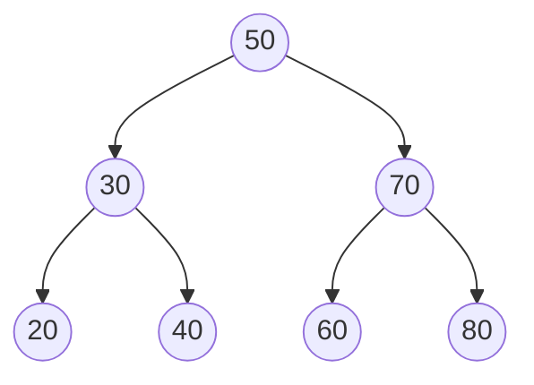
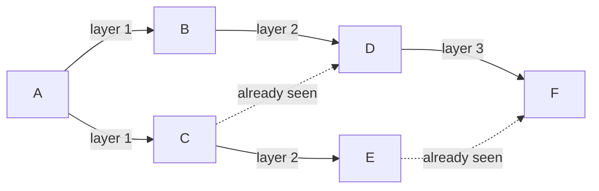

# PY-21 Data Structures and Algorithm Design

> [!info] Topic card
> **Unit:** U6 · **Time:** 6–8 h (do it in two sittings) · **Code:** `examples/py21_structures.py`, `exercises/py21_exercises.py`
> **Review:** [[DM-15 Graphs, Representations, Paths and Connectivity]] and [[DM-16 Trees and Spanning Trees]]. This lesson implements those mathematical objects.

## 1. Learning objectives
1. **Distinguish** an abstract data type (ADT: *what* operations) from a data structure (*how* they're implemented).
2. **Implement and analyse** a stack, a queue (with `collections.deque`), a singly linked list, a hash map with chaining, a binary search tree, and a priority queue (`heapq`).
3. **Represent** graphs as adjacency lists, and **implement** BFS (shortest paths in unweighted graphs) and DFS.
4. **Select** a structure for a problem by comparing operation costs.
5. **Recognise** the algorithm-design paradigms (brute force, greedy, divide and conquer, dynamic programming, graph search), and **apply** the right one.

## 2. Why it matters
Choosing the right structure is often the whole solution. Bracket checking is trivial with a stack. "Shortest number of hops" is trivial with BFS and a queue. "Top 10 of a million" is trivial with a heap. These are standard exam topics and the vocabulary of every technical interview and design discussion.

## 3. Prerequisites
[[PY-12 Searching, Sorting and Complexity]] (Big-O), [[PY-16 Classes and Objects]] (implementing classes with invariants), [[PY-07 Recursion]] (tree algorithms), [[PY-11 Dictionaries, Sets and Comprehensions]] (hashing).

## 4. Intuition
| Structure | Everyday analogy |
|---|---|
| Stack (LIFO) | A pile of plates: take from the top |
| Queue (FIFO) | A bank queue: first come, first served |
| Linked list | A treasure hunt: each clue points to the next |
| Hash map | Lockers numbered by a formula on your name |
| BST | A phone book where each page tells you "go left for earlier names, right for later" |
| Heap | A tournament bracket: the winner (min or max) is always at the top |
| Graph | A road map: places and roads |

## 5. Rigorous explanation

### 5.1 ADT vs data structure
An **ADT** specifies operations and their behaviour: *Stack: push(x), pop() → last pushed, peek(), is_empty()*. A **data structure** is a concrete representation: a Python list (dynamic array) or a linked list. The same ADT can have several implementations with different costs.

### 5.2 Stack
Python list: `append` and `pop()` at the end, both $O(1)$ amortised (the composed `Stack` class is in [[PY-17 Inheritance, Composition and Polymorphism]]).
**Uses:** undo, function calls (the call stack), bracket matching, expression evaluation, DFS.

### 5.3 Queue
`list.pop(0)` is $O(n)$, because every remaining element shifts. Use `collections.deque`: `append` and `popleft` are $O(1)$.
```python
from collections import deque
q = deque()
q.append("A"); q.append("B")
q.popleft()      # 'A'
```
**Uses:** BFS, scheduling, buffering.

### 5.4 Singly linked list
```python
class Node:
    def __init__(self, value, next=None):
        self.value = value
        self.next = next

class LinkedList:
    def __init__(self):
        self.head = None
        self._size = 0

    def prepend(self, value):                 # O(1)
        self.head = Node(value, self.head)
        self._size += 1

    def find(self, value) -> bool:            # O(n)
        node = self.head
        while node:
            if node.value == value:
                return True
            node = node.next
        return False

    def reverse(self):                        # O(n) time, O(1) extra space
        prev, node = None, self.head
        while node:
            node.next, prev, node = prev, node, node.next
        self.head = prev
```
| Operation | Dynamic array (list) | Singly linked list |
|---|---|---|
| Index `i` | $O(1)$ | $O(n)$ |
| Insert/delete at the front | $O(n)$ | $O(1)$ |
| Append at the end | $O(1)$ amortised | $O(n)$, or $O(1)$ with a tail pointer |
| Search | $O(n)$ | $O(n)$ |
In Python, lists usually win on cache locality and constant factors. Linked lists matter for understanding pointers, and for structures built on them (queues, adjacency lists, LRU caches).

### 5.5 Hash map with separate chaining
An array of $m$ **buckets**. A key goes into bucket `hash(key) % m`, and each bucket is a list of `(key, value)` pairs. The **load factor** is $\alpha = n/m$. When it exceeds a threshold (e.g. 0.75), **resize** to roughly $2m$ and rehash everything. Average operation cost is $O(1 + \alpha)$, which stays $O(1)$ when resizing keeps $\alpha$ bounded. The worst case (all keys in one bucket) is $O(n)$. Python's `dict` uses open addressing rather than chaining, but the cost analysis is analogous.

### 5.6 Binary search tree (BST)
**Invariant:** for every node, all keys in its left subtree are smaller and all keys in its right subtree are larger.
```python
class BSTNode:
    def __init__(self, key):
        self.key, self.left, self.right = key, None, None

def insert(root, key):
    if root is None:
        return BSTNode(key)
    if key < root.key:
        root.left = insert(root.left, key)
    elif key > root.key:
        root.right = insert(root.right, key)
    return root                    # duplicates ignored

def inorder(root):                 # left, node, right → sorted order
    if root:
        yield from inorder(root.left)
        yield root.key
        yield from inorder(root.right)
```
Search, insert and delete cost $O(h)$, where $h$ is the height: $O(\log n)$ for a balanced tree, but $O(n)$ for a **degenerate** tree (inserting sorted data creates a "linked list"). Self-balancing trees (AVL, red-black) guarantee $O(\log n)$, and are beyond this module.

### 5.7 Priority queue: binary heap (`heapq`)
`heapq` keeps a list in **min-heap** order: `heap[0]` is the smallest. `heappush` and `heappop` cost $O(\log n)$, and `heapify` is $O(n)$. For a max-heap, push negated keys. `heapq.nlargest(k, xs)` finds the top $k$ in $O(n \log k)$.

### 5.8 Graphs: adjacency lists, BFS, DFS
```python
graph = {"A": ["B", "C"], "B": ["D"], "C": ["D", "E"], "D": ["F"], "E": ["F"], "F": []}

def bfs_shortest_path(graph, start, goal):
    """Fewest-edges path from start to goal, or None. O(V + E)."""
    parents = {start: None}
    queue = deque([start])
    while queue:
        node = queue.popleft()
        if node == goal:
            path = []
            while node is not None:            # walk back through the parents
                path.append(node)
                node = parents[node]
            return path[::-1]
        for nb in graph.get(node, []):
            if nb not in parents:               # visited check, essential for cycles
                parents[nb] = node
                queue.append(nb)
    return None

bfs_shortest_path(graph, "A", "F")   # ['A', 'B', 'D', 'F']
```
**Why BFS finds the shortest path:** it explores in layers. Every node at distance $k$ is dequeued before any at distance $k+1$, so the first time the goal is reached, it's by a fewest-edges path. **DFS** (a stack or recursion) explores deep first. It's used for reachability, cycle detection and topological sort (ordering tasks by dependencies, the same idea as CPM in [[PM-06 Critical Path Method and Float]] and [[X-02 Graph Theory in Algorithms, Networks and Scheduling]]). For **weighted** shortest paths, use Dijkstra's algorithm (a heap-based extension of BFS, given as practice 10).

### 5.9 Algorithm-design paradigms
| Paradigm | Idea | Example in this vault |
|---|---|---|
| Brute force | Try everything | All pairs, all subsets |
| Greedy | Best local choice | Coin change (sometimes), Kruskal/Prim ([[DM-16 Trees and Spanning Trees]]) |
| Divide and conquer | Split, recurse, combine | Merge sort, binary search |
| Dynamic programming | Reuse optimal sub-answers | `min_coins`, memoised Fibonacci |
| Graph search | BFS/DFS over states | Shortest hops, reachability |

## 6. Terminology
| Term | Meaning |
|---|---|
| ADT | Abstract data type: operations and behaviour |
| LIFO / FIFO | Last-in-first-out / first-in-first-out |
| Node / pointer (reference) | Element / link to another node |
| Load factor | Entries ÷ buckets in a hash table |
| Height (of a tree) | Edges on the longest root-to-leaf path |
| In-order traversal | Left subtree, node, right subtree |
| Heap property | Each parent ≤ its children (min-heap) |
| Adjacency list | Map from each vertex to its neighbours |
| BFS / DFS | Breadth-first / depth-first search |

## 7. Step-by-step: choosing a structure
1. List the **operations** the problem needs and how often each runs.
2. Look up the cost of each operation for each candidate (§12).
3. Pick the structure that minimises the cost of the **frequent** operations.
4. Prefer the standard library (`list`, `dict`, `set`, `deque`, `heapq`) over hand-written code in production. Hand-write them to *learn*.

## 8. Diagrams

### 8.1 BST after inserting 50, 30, 70, 20, 40, 60, 80

*In-order traversal gives 20, 30, 40, 50, 60, 70, 80 (sorted). Height 2. Inserting 10, 20, 30… in sorted order would instead create a chain of height n − 1.*

### 8.2 BFS layers from A


## 9. Worked examples

### Example 1 (basic): balanced brackets with a stack
```python
def balanced(text: str) -> bool:
    pairs = {")": "(", "]": "[", "}": "{"}
    stack = []
    for ch in text:
        if ch in "([{":
            stack.append(ch)
        elif ch in pairs:
            if not stack or stack.pop() != pairs[ch]:
                return False
    return not stack        # leftover openers mean unbalanced
```
| ch | stack |
|---|---|
| `(` | [`(`] |
| `[` | [`(`, `[`] |
| `]` | [`(`] (matched) |
| `)` | [] (matched) |
`balanced("([])")` → True. `balanced("(]")` → False. `balanced("((")` → False (the stack isn't empty at the end). $O(n)$ time.

### Example 2 (intermediate): incorrect → bug → corrected linked-list reverse
```python
# INCORRECT
def reverse_wrong(head):
    prev = None
    node = head
    while node:
        node.next = prev        # link reversed, but the rest of the list is now LOST
        prev = node
        node = node.next        # node.next is prev, so the loop moves backwards
    return prev
```
For `1 → 2 → 3`: after the first iteration `1.next = None`, then `node = 1.next = None`, and the loop ends. It returns just `[1]`, so 2 and 3 are lost. **Fix:** save `next` *before* overwriting it:
```python
def reverse(head):
    prev, node = None, head
    while node:
        nxt = node.next         # 1. remember the rest
        node.next = prev        # 2. reverse the link
        prev, node = node, nxt  # 3. advance
    return prev
```
**Invariant:** `prev` is the reversed list of the nodes processed so far, and `node` heads the unprocessed remainder.

### Example 3 (challenging): postfix evaluation (stack) and why compilers use it
Postfix `3 4 + 2 *` means $(3 + 4) \times 2$.
```python
def eval_postfix(tokens: list[str]) -> float:
    stack = []
    ops = {"+": lambda a, b: a + b, "-": lambda a, b: a - b,
           "*": lambda a, b: a * b, "/": lambda a, b: a / b}
    for t in tokens:
        if t in ops:
            if len(stack) < 2:
                raise ValueError("not enough operands")
            b, a = stack.pop(), stack.pop()      # order matters for - and /
            stack.append(ops[t](a, b))
        else:
            stack.append(float(t))
    if len(stack) != 1:
        raise ValueError("malformed expression")
    return stack[0]
```
`eval_postfix("3 4 + 2 *".split())` → 14.0. No parentheses or precedence rules are needed, which is why the Python virtual machine is a stack machine ([[PY-01 How Python Executes Programs and Environment Setup]]: `BINARY_OP` pops two operands and pushes the result).

### Example 4 (transfer): top-k with a heap
"Show the 3 students with the highest marks out of 100 000."
```python
import heapq
top3 = heapq.nlargest(3, students, key=lambda s: s.mark)   # O(n log 3) ≈ O(n)
```
Sorting all the students costs $O(n \log n)$. The heap keeps only the 3 best so far.

## 10. Application
The hostel maintenance capstone ([[X-CAPSTONE Hostel Maintenance System Full Lifecycle]]) uses a **priority queue** of open requests ordered by `(urgency, created_at)`. Technicians always take the most urgent, oldest job. Escalation policies are a dictionary of rules, and duplicate-report detection uses a set of `(room, category)` keys.

## 11. Common mistakes
| Mistake | Fix |
|---|---|
| `list.pop(0)` as a queue | `deque.popleft()` |
| BFS/DFS without a visited set | Infinite loops on cycles, so track visited (or parents) |
| BST with sorted input, expecting $O(\log n)$ | Shuffle, or use a balanced tree / `bisect` on a sorted list |
| Losing nodes when relinking | Save `next` before overwriting |
| Popping operands in the wrong order (`a - b`) | The second pop is the left operand |
| `heapq` used as a max-heap directly | Push `-key` (or use `nlargest`) |
| Mutable keys in a hash map | Keys must be immutable (hash stability) |

## 12. Comparison: operation costs (average case)
| Structure | Access by index | Search | Insert | Delete | Notes |
|---|---|---|---|---|---|
| list (dynamic array) | $O(1)$ | $O(n)$ | end $O(1)$*, front $O(n)$ | $O(n)$ | *amortised |
| deque | ends $O(1)$, middle $O(n)$ | $O(n)$ | ends $O(1)$ | ends $O(1)$ | queue |
| linked list | $O(n)$ | $O(n)$ | front $O(1)$ | front $O(1)$ | given a node, insert after it is $O(1)$ |
| dict / set | — | $O(1)$ | $O(1)$ | $O(1)$ | worst $O(n)$ |
| BST (balanced) | — | $O(\log n)$ | $O(\log n)$ | $O(\log n)$ | ordered traversal |
| binary heap | min $O(1)$ | $O(n)$ | $O(\log n)$ | pop-min $O(\log n)$ | priority queue |
| sorted list + bisect | $O(1)$ | $O(\log n)$ | $O(n)$ | $O(n)$ | good when reads ≫ writes |

## 13. Practice
**L1** 1. Stack or queue for: undo, a print spooler, DFS, BFS? 2. What is the height of a BST built by inserting 1, 2, 3, 4, 5 in that order?

**L2** *(code bank)* 3. `balanced(text)`. 4. `eval_postfix(tokens)`. 5. `Queue` implemented with **two stacks** (amortised $O(1)$ enqueue/dequeue).

**L3** 6. `LinkedList` with `append`, `prepend`, `find`, `remove(value)` (`ValueError` if absent), `reverse`, `__iter__` and `__len__`. 7. `BST` class with `insert`, `__contains__`, `inorder()`, `height()` and `min()`.

**L4** 8. `HashMap` with chaining: `put`, `get` (`KeyError` if missing), `delete`, `__len__`, and automatic resize at load factor > 0.75. 9. `bfs_shortest_path(graph, start, goal)` and `has_cycle(graph)` (directed, using DFS with three colours: unvisited, in progress, done).

**L5** 10. `dijkstra(graph, source)` for non-negative weighted graphs `{u: [(v, w), …]}` using `heapq`, returning the distances. Explain why it fails with negative edge weights, and give its complexity.

**Variation:** extend `bfs_shortest_path` to return **all** shortest paths' length-by-node (a distance map), and use it to find every node exactly 2 hops away.

## 14. Hints
> [!tip]- Hints
> 5: Push onto `inbox`. To dequeue, if `outbox` is empty, move everything from `inbox` to `outbox` (this reverses the order), then pop from `outbox`. 8: `self._buckets = [[] for _ in range(m)]`. When resizing, re-insert every pair into the new buckets. 9 (cycle): a back edge to an "in progress" node means a cycle. 10: Push `(dist, node)`, and skip popped entries that are stale (`d > dist[node]`).

## 15. Worked solutions
> [!success]- Solutions 1–2
> 1. Undo → stack. Print spooler → queue. DFS → stack. BFS → queue. 2. 4 (a chain of 5 nodes has 4 edges).

> [!success]- Solution 5
> ```python
> class Queue:
>     def __init__(self):
>         self._inbox, self._outbox = [], []
>     def enqueue(self, x):
>         self._inbox.append(x)
>     def dequeue(self):
>         if not self._outbox:
>             while self._inbox:
>                 self._outbox.append(self._inbox.pop())
>         if not self._outbox:
>             raise IndexError("dequeue from empty queue")
>         return self._outbox.pop()
>     def __len__(self):
>         return len(self._inbox) + len(self._outbox)
> ```
> **Amortised analysis:** each element is moved from inbox to outbox at most once, so $n$ operations cost $O(n)$ in total, which is $O(1)$ amortised per operation, even though a single dequeue can cost $O(n)$.

> [!success]- Solution 7 (core)
> ```python
> class BST:
>     def __init__(self):
>         self.root = None
>         self._size = 0
>     def insert(self, key):
>         def _ins(node):
>             if node is None:
>                 self._size += 1
>                 return BSTNode(key)
>             if key < node.key:
>                 node.left = _ins(node.left)
>             elif key > node.key:
>                 node.right = _ins(node.right)
>             return node
>         self.root = _ins(self.root)
>     def __contains__(self, key):
>         node = self.root
>         while node:
>             if key == node.key:
>                 return True
>             node = node.left if key < node.key else node.right
>         return False
>     def height(self):
>         def _h(node):
>             return -1 if node is None else 1 + max(_h(node.left), _h(node.right))
>         return _h(self.root)
> ```
> By convention, the height of an empty tree is −1 and of a single node is 0. The full class with `inorder` and `min` is in the code bank.

> [!success]- Solution 9 (cycle detection)
> ```python
> def has_cycle(graph):
>     WHITE, GREY, BLACK = 0, 1, 2
>     colour = {u: WHITE for u in graph}
>     def visit(u):
>         colour[u] = GREY
>         for v in graph.get(u, []):
>             if colour.get(v, WHITE) == GREY:
>                 return True                 # back edge → cycle
>             if colour.get(v, WHITE) == WHITE and visit(v):
>                 return True
>         colour[u] = BLACK
>         return False
>     return any(colour[u] == WHITE and visit(u) for u in list(graph))
> ```
> In a project schedule, a cycle in the precedence graph means an impossible plan (A waits for B, which waits for A). CPM requires an acyclic network ([[PM-05 Activity Sequencing, Network Diagrams and Gantt Charts]]).

> [!success]- Solution 10
> ```python
> import heapq
> def dijkstra(graph, source):
>     dist = {source: 0}
>     heap = [(0, source)]
>     while heap:
>         d, u = heapq.heappop(heap)
>         if d > dist.get(u, float("inf")):
>             continue                         # stale entry
>         for v, w in graph.get(u, []):
>             nd = d + w
>             if nd < dist.get(v, float("inf")):
>                 dist[v] = nd
>                 heapq.heappush(heap, (nd, v))
>     return dist
> ```
> **Why non-negative weights are needed:** when `u` is popped with the smallest tentative distance, Dijkstra assumes no later path can be shorter. A negative edge discovered later could reduce it, which breaks that "settled" assumption (use Bellman–Ford instead). **Complexity:** $O((V + E)\log V)$ with a binary heap.

## 16. Self-test (pass ≥ 4/5)
1. Why does BFS give shortest paths in unweighted graphs? 2. Worst-case BST search, and when does it happen? 3. Why use a deque for queues? 4. What is the load factor, and why resize? 5. Cost of `heapq.nlargest(k, xs)`?
> [!success]- Answers
> 1. It visits nodes in non-decreasing distance order (layer by layer), so the first visit is via a fewest-edges path. 2. $O(n)$, in a degenerate tree, e.g. after inserting sorted keys. 3. `popleft` is $O(1)$, while `list.pop(0)` is $O(n)$. 4. Entries per bucket. Resizing keeps the chains short, so operations stay $O(1)$ on average. 5. $O(n \log k)$.

## 17. Flashcards
#flashcards/python
ADT vs data structure?::ADT = operations/behaviour (what); data structure = concrete representation (how).
Efficient Python queue?::collections.deque with append/popleft (both O(1)).
BST invariant?::Left subtree keys < node key < right subtree keys, for every node.
In-order traversal of a BST yields?::Keys in sorted order.
BFS vs DFS data structure?::BFS uses a queue; DFS uses a stack (or recursion).
heapq is a min-heap or max-heap?::Min-heap: heap[0] is the smallest; negate keys for max behaviour.
Why reverse a linked list by saving next first?::Overwriting node.next first loses the rest of the list.

## 18. Blank-page recall
Draw the operation-cost table (§12) and implement `balanced`, `reverse` and `bfs_shortest_path` from memory.

## 19. Revision summary
- An ADT is the contract and a structure the implementation. Costs depend on the implementation.
- Stack for LIFO (brackets, undo, DFS). Deque for queues (BFS).
- Linked lists: $O(1)$ front operations, $O(n)$ access. Save `next` before relinking.
- Hash map: $O(1)$ average via hashing and resizing. BST: $O(h)$, so balance matters.
- Heaps for priorities and top-k. BFS for unweighted shortest paths, Dijkstra for non-negative weights.

## 20. Links
Prev: [[PY-20 Testing, Debugging and Test-Driven Development]] · Next: [[PY-22 SQL and Database Integration]] · Math: [[DM-15 Graphs, Representations, Paths and Connectivity]], [[DM-16 Trees and Spanning Trees]] · Integration: [[X-02 Graph Theory in Algorithms, Networks and Scheduling]]

## 21. Sources
- Cormen, Leiserson, Rivest & Stein, *Introduction to Algorithms*, 4th ed., MIT Press, 2022: ch. 10 (stacks, queues, lists), 11 (hash tables), 12 (BSTs), 6 (heaps), 20 (BFS/DFS), 22 (Dijkstra).
- Python docs, `collections.deque`: https://docs.python.org/3/library/collections.html#collections.deque · `heapq`: https://docs.python.org/3/library/heapq.html
- Miller, B. & Ranum, D., *Problem Solving with Algorithms and Data Structures using Python* (free online edition): https://runestone.academy/ns/books/published/pythonds/index.html

## 22. Mastery checklist
- [ ] `py21` tests pass with `PY_TARGET=exercises`
- [ ] I can justify a structure choice from the cost table
- [ ] I implemented BFS and cycle detection unaided · reviews scheduled
