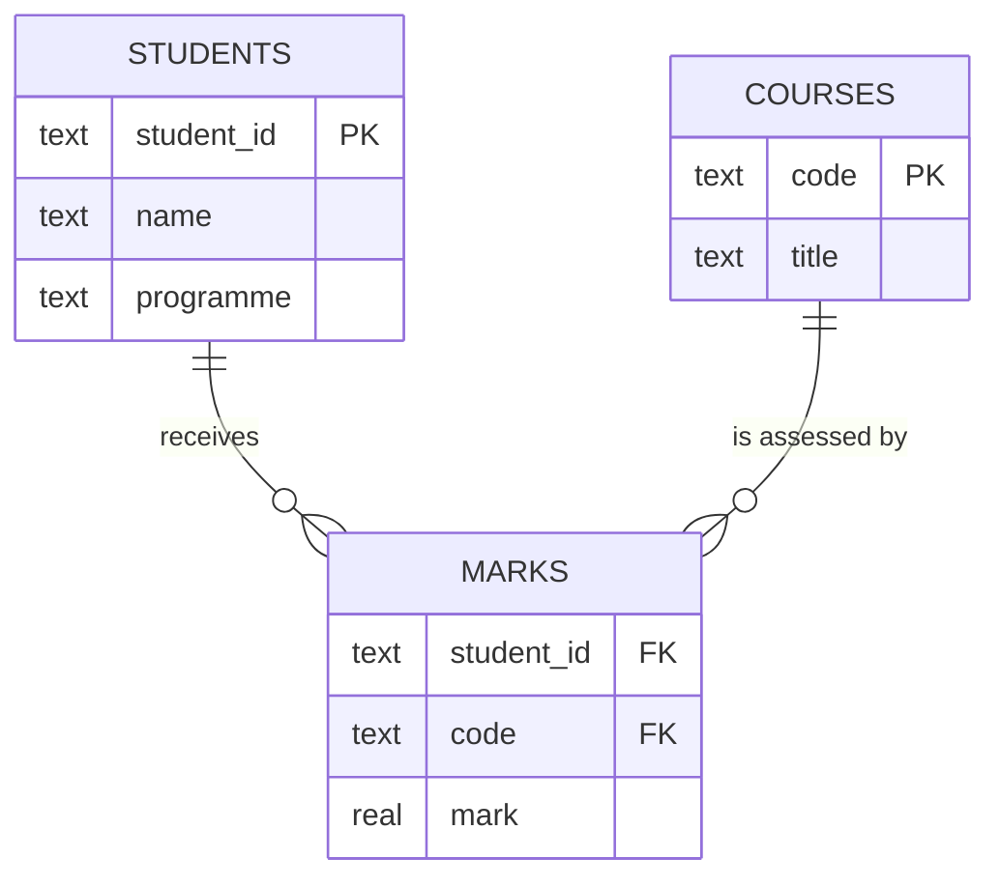

# PY-22 SQL and Database Integration

> [!info] Topic card
> **Unit:** U7 · **Time:** 5 h · **Code:** `examples/py22_sqlite.py`, `exercises/py22_exercises.py` (all tests use in-memory databases) · SQLite library version in the build environment: 3.45.1
> **Read alongside:** [[SD-09 Data Modeling and Interface Design]] (ER modelling) and [[CS-12 Secure Software Development and Database Security]] (injection, least privilege).

## 1. Learning objectives
1. **Explain** the relational model: tables, rows, columns, primary keys, foreign keys and constraints.
2. **Write** SQL for DDL (`CREATE TABLE`) and DML (`INSERT`, `SELECT … WHERE … ORDER BY`, `UPDATE`, `DELETE`), aggregates (`GROUP BY`, `HAVING`) and joins (`INNER`, `LEFT`).
3. **Use** Python's `sqlite3`: connections, **parameterised queries**, `row_factory`, and transactions (`with conn:` commit/rollback).
4. **Demonstrate** why string-built SQL enables **SQL injection**, and **prevent** it.
5. **Structure** database code with a repository class that separates SQL from business logic.

## 2. Why it matters
Files ([[PY-14 Files, CSV and JSON]]) don't handle concurrent users, complex queries or guaranteed consistency. Databases do. SQL is among the most widely used languages in industry, and injection remains a top web-security risk ([[CS-11 Web Application Security]]).

## 3. Prerequisites
[[PY-15 Exceptions and Defensive Programming]] (transactions roll back on exceptions), [[PY-16 Classes and Objects]] (repository classes). The mathematical basis, relations as sets of tuples, is in [[DM-10 Relations, Equivalence Relations and Partial Orders]].

## 4. Intuition
A database is a set of **strictly shaped spreadsheets** (tables) that can point at each other (foreign keys). It enforces rules (no duplicate ID, no mark for a non-existent student) and answers questions you write in SQL ("average mark per course, highest first"). The database works out *how* to answer. You only say *what* you want (SQL is **declarative**).

## 5. Rigorous explanation

### 5.1 Schema (DDL) for a small student-records database
```sql
CREATE TABLE students (
    student_id  TEXT PRIMARY KEY,                 -- unique identifier
    name        TEXT NOT NULL,
    programme   TEXT NOT NULL DEFAULT 'CS'
);
CREATE TABLE courses (
    code        TEXT PRIMARY KEY,                 -- e.g. CST06102
    title       TEXT NOT NULL UNIQUE
);
CREATE TABLE marks (
    student_id  TEXT NOT NULL REFERENCES students(student_id),
    code        TEXT NOT NULL REFERENCES courses(code),
    mark        REAL NOT NULL CHECK (mark BETWEEN 0 AND 100),
    PRIMARY KEY (student_id, code)                -- one mark per student per course
);
```
- **Primary key:** uniquely identifies a row. **Foreign key:** must match a primary key in another table (**referential integrity**). **CHECK / NOT NULL / UNIQUE** enforce business rules *in the data layer*, so even a buggy program can't violate them.
- In SQLite, **foreign keys are enforced only after `PRAGMA foreign_keys = ON`** on each connection.
- SQLite uses flexible typing: declared column types are "affinities", and `STRICT` tables (3.37+) enforce types.

### 5.2 Queries (DML)
```sql
INSERT INTO students (student_id, name) VALUES ('S1', 'Amina');
SELECT name FROM students WHERE programme = 'CS' ORDER BY name;
UPDATE marks SET mark = 72 WHERE student_id = 'S1' AND code = 'CST06102';
DELETE FROM marks WHERE mark IS NULL;            -- NULL needs IS / IS NOT, never "= NULL"

-- aggregate per group, filter groups with HAVING
SELECT code, COUNT(*) AS n, ROUND(AVG(mark), 1) AS avg_mark
FROM marks GROUP BY code HAVING COUNT(*) >= 2 ORDER BY avg_mark DESC;

-- INNER JOIN: only matching rows
SELECT s.name, m.code, m.mark
FROM students s JOIN marks m ON m.student_id = s.student_id;

-- LEFT JOIN: all students, with NULLs where there are no marks
SELECT s.name FROM students s
LEFT JOIN marks m ON m.student_id = s.student_id
WHERE m.student_id IS NULL;                      -- students with NO marks
```
**Logical evaluation order:** `FROM/JOIN → WHERE → GROUP BY → HAVING → SELECT → ORDER BY`. That's why `WHERE` can't use aggregates (use `HAVING`).

### 5.3 `sqlite3` in Python
```python
import sqlite3

conn = sqlite3.connect("school.db")          # or ":memory:" for tests
conn.execute("PRAGMA foreign_keys = ON")
conn.row_factory = sqlite3.Row               # rows behave like dicts: row["name"]

with conn:                                   # transaction: commit on success, rollback on exception
    conn.execute("INSERT INTO students (student_id, name) VALUES (?, ?)", ("S2", "Baraka"))

rows = conn.execute("SELECT * FROM students WHERE name LIKE ?", ("%ara%",)).fetchall()
conn.close()
```
- **Placeholders** `?` (or named `:name`) pass the values separately from the SQL text. The driver never interprets them as SQL.
- `with conn:` **does not close** the connection. It manages a transaction. Close it explicitly, or wrap it with `contextlib.closing`.
- Errors: `sqlite3.IntegrityError` (constraint violation), `sqlite3.OperationalError` (bad SQL, locked database).

### 5.4 SQL injection
```python
# DANGEROUS: never do this
name = input("Search name: ")                  # attacker types:  x' OR '1'='1
sql = f"SELECT * FROM students WHERE name = '{name}'"
# becomes: SELECT * FROM students WHERE name = 'x' OR '1'='1'   → returns EVERY row
```
The attacker's text **changed the structure of the query**. With a parameterised query, `x' OR '1'='1` is just an (unusual) name to search for, and it matches nothing. This is demonstrated safely, on a throwaway in-memory database, in [[LAB-CS-06 Input Validation and SQL Injection Prevention]].
**Rules:** always use placeholders for **values**. Identifiers (table and column names) can't be parameterised, so validate them against an **allowlist** if they come from users (e.g. a sort column).

### 5.5 Transactions and ACID
A **transaction** groups statements so that they all succeed or none do. **ACID**: Atomicity (all or nothing), Consistency (constraints hold), Isolation (concurrent transactions don't see each other's partial work), Durability (committed data survives crashes). A fees payment that debits one table and credits another **must** be one transaction.

### 5.6 Repository pattern
```python
class StudentRepository:
    def __init__(self, conn: sqlite3.Connection):
        self.conn = conn
    def add(self, student_id: str, name: str) -> None:
        with self.conn:
            self.conn.execute("INSERT INTO students (student_id, name) VALUES (?, ?)", (student_id, name))
    def get(self, student_id: str) -> dict | None:
        row = self.conn.execute("SELECT * FROM students WHERE student_id = ?", (student_id,)).fetchone()
        return dict(row) if row else None
```
The rest of the program calls `repo.add(...)` and never sees SQL. You can swap in an in-memory fake for tests ([[PY-17 Inheritance, Composition and Polymorphism]]). This is the data-access layer of a layered architecture ([[SD-05 Software Architecture and Architectural Styles]]).

## 6. Terminology
| Term | Meaning |
|---|---|
| Relation / table | Set of rows with the same columns |
| Tuple / row, attribute / column | One record / one field |
| Primary key | Column(s) uniquely identifying a row |
| Foreign key | Column referencing a primary key elsewhere |
| Referential integrity | Every foreign key value exists in the referenced table |
| DDL / DML | Data definition (schema) / manipulation (data) language |
| Join | Combining rows from tables on a condition |
| Aggregate | Function over many rows: COUNT, SUM, AVG, MIN, MAX |
| Transaction | Unit of work that commits or rolls back as a whole |
| Parameterised query | SQL with placeholders, with values bound separately |
| Index | Data structure (usually a B-tree) speeding up lookups on columns |

## 7. Step-by-step: writing a query from a question
Question: *"For each course, the number of students who passed (≥ 50) and their average, only courses with at least 2 passes, best average first."*
1. **FROM** which table? `marks` (plus `courses` for the titles).
2. **WHERE** filters individual rows: `mark >= 50`.
3. **GROUP BY** the unit of the answer: `code`.
4. **HAVING** filters groups: `COUNT(*) >= 2`.
5. **SELECT** the output columns: `code, COUNT(*), AVG(mark)`.
6. **ORDER BY** `AVG(mark) DESC`.
```sql
SELECT m.code, c.title, COUNT(*) AS passes, ROUND(AVG(m.mark), 1) AS avg_pass
FROM marks m JOIN courses c ON c.code = m.code
WHERE m.mark >= 50
GROUP BY m.code, c.title
HAVING COUNT(*) >= 2
ORDER BY avg_pass DESC;
```

## 8. Diagram: entity–relationship model

*Text version: a student receives zero or more marks, and a course is assessed by zero or more marks. Each mark belongs to exactly one student and one course. MARKS is the associative table that resolves the many-to-many relationship between STUDENTS and COURSES. Its primary key is (student_id, code).*

## 9. Worked examples

### Example 1 (basic): create, insert, query in memory
```python
import sqlite3
conn = sqlite3.connect(":memory:")
conn.executescript("""
CREATE TABLE students (student_id TEXT PRIMARY KEY, name TEXT NOT NULL);
INSERT INTO students VALUES ('S1', 'Amina'), ('S2', 'Baraka');
""")
print(conn.execute("SELECT name FROM students ORDER BY name DESC").fetchall())
# [('Baraka',), ('Amina',)]
```
Each row comes back as a **tuple** (unless `row_factory` is set). `fetchall()` returns a list, `fetchone()` returns one row or `None`.

### Example 2 (intermediate): injection. Incorrect → demonstration → corrected
```python
def find_unsafe(conn, name):                       # INCORRECT
    return conn.execute(f"SELECT student_id FROM students WHERE name = '{name}'").fetchall()

def find_safe(conn, name):                         # CORRECTED
    return conn.execute("SELECT student_id FROM students WHERE name = ?", (name,)).fetchall()

payload = "x' OR '1'='1"
find_unsafe(conn, payload)    # [('S1',), ('S2',)]: every student leaked
find_safe(conn, payload)      # []: treated as a literal name
find_unsafe(conn, "O'Brien")  # sqlite3.OperationalError: a legitimate name breaks the query too
```
The `O'Brien` case shows that string building is **also a correctness bug**, not only a security one.

### Example 3 (challenging): a transaction that must be atomic
```python
def transfer_marks(conn, from_code, to_code):
    """Move all marks from one course code to another (e.g. after a code change)."""
    with conn:                                       # one transaction
        conn.execute("INSERT INTO courses (code, title) SELECT ?, title || ' (new)' FROM courses WHERE code = ?",
                     (to_code, from_code))
        conn.execute("UPDATE marks SET code = ? WHERE code = ?", (to_code, from_code))
        conn.execute("DELETE FROM courses WHERE code = ?", (from_code,))
```
If any statement fails (e.g. `to_code` already exists, so the INSERT violates the primary key), the `with conn:` block **rolls back** everything, and the database is never left with marks pointing at a deleted course. Test it by forcing a failure and checking that the state is unchanged (practice 8).

## 10. Application
[[PRJ-PY-05 Hostel Maintenance System]] stores rooms, students, maintenance requests and status history in SQLite through repository classes. Status changes are recorded in a history table **in the same transaction** as the update, giving an audit trail ([[CS-15 Logging, Monitoring, Incident Response and Recovery]]).

## 11. Common mistakes
| Mistake | Consequence | Fix |
|---|---|---|
| f-strings or `+` to build SQL with values | Injection, broken quotes | `?` placeholders |
| `("S1")` as the parameter tuple | Treated as a string of 2 characters → "Incorrect number of bindings" | `("S1",)`: note the comma |
| Forgetting `commit` / `with conn:` | Changes vanish when the connection closes | Use `with conn:` |
| Assuming FK enforcement in SQLite | Orphan rows | `PRAGMA foreign_keys = ON` per connection |
| `WHERE col = NULL` | Never true | `IS NULL` |
| `WHERE` with an aggregate | Error | `HAVING` |
| `SELECT *` in application code | Breaks when the columns change, and over-fetches | Name the columns |
| One connection shared across threads | Errors or corruption | One connection per thread, or a proper pool |

## 12. Comparison
| Storage | Queries | Concurrency | Integrity rules | Typical scale |
|---|---|---|---|---|
| CSV/JSON files | Code you write | Poor | In your code only | Small, single user |
| SQLite (embedded, file) | SQL | Many readers, one writer at a time | Constraints, transactions | Apps, prototypes, small sites |
| PostgreSQL / MySQL (server) | SQL | High | Full, plus users and roles | Multi-user systems |
| NoSQL document stores | API / query language | High | Schema-flexible | Varied, very large data |

## 13. Practice
**L1** 1. Primary key vs foreign key? 2. Why use `HAVING` rather than `WHERE` for `COUNT(*) >= 2`?

**L2** *(code bank; in-memory DB)* 3. `create_schema(conn)` (the three tables of §5.1, with FKs on). 4. `add_student`, `add_course` and `record_mark` (using `INSERT OR REPLACE` / upsert semantics for marks).

**L3** 5. `course_averages(conn)` → a list of `(code, avg)` rounded to 1 decimal place, best first. 6. `students_without_marks(conn)` → sorted names (LEFT JOIN). 7. `search_students(conn, fragment)`, a case-insensitive `LIKE` search using parameters. The input `%` must be treated literally (escape it).

**L4** 8. `transfer_marks(conn, from_code, to_code)` with a test proving the rollback leaves the DB unchanged when `to_code` already exists. 9. `top_students(conn, code, n)` with ties broken by name, and `sort_students(conn, column)` that accepts only `"name"` or `"student_id"` (allowlist), raising `ValueError` otherwise.

**L5** 10. Design the schema for [[PRJ-PY-02 Personal Expense Tracker]] with categories, expenses and monthly budgets. Include the constraints that enforce: positive amounts, valid dates, one budget per category per month, and no expense referring to a deleted category. Write the query "categories over budget this month", and justify each constraint.

**Variation:** add a `STRICT` table version of `marks` and show which bad insert it rejects that the non-strict table accepts.

## 14. Hints
> [!tip]- Hints
> 4: `INSERT INTO marks VALUES (?, ?, ?) ON CONFLICT(student_id, code) DO UPDATE SET mark = excluded.mark` (upsert, SQLite 3.24+). 7: Escape `\`, `%` and `_` in the fragment, then `LIKE ? ESCAPE '\'` with `f"%{escaped}%"`. 9: Map the user's choice to a fixed SQL fragment, and never insert raw text. 10: `CHECK (amount_cents > 0)`, `UNIQUE (category_id, month)`, FKs with `ON DELETE RESTRICT`.

## 15. Worked solutions
> [!success]- Solutions 1–2
> 1. A primary key uniquely identifies the rows of its own table. A foreign key references a primary key in another (or the same) table, enforcing referential integrity. 2. `WHERE` filters rows *before* grouping, so aggregates don't exist yet. `HAVING` filters groups *after* aggregation.

> [!success]- Solutions 5–7
> ```python
> def course_averages(conn):
>     return conn.execute(
>         "SELECT code, ROUND(AVG(mark), 1) AS a FROM marks GROUP BY code ORDER BY a DESC, code"
>     ).fetchall()
>
> def students_without_marks(conn):
>     rows = conn.execute("""
>         SELECT s.name FROM students s
>         LEFT JOIN marks m ON m.student_id = s.student_id
>         WHERE m.student_id IS NULL ORDER BY s.name""").fetchall()
>     return [r[0] for r in rows]
>
> def search_students(conn, fragment):
>     escaped = fragment.replace("\\", "\\\\").replace("%", "\\%").replace("_", "\\_")
>     rows = conn.execute("SELECT name FROM students WHERE name LIKE ? ESCAPE '\\' ORDER BY name",
>                         (f"%{escaped}%",)).fetchall()
>     return [r[0] for r in rows]
> ```
> SQLite's `LIKE` is case-insensitive for ASCII letters by default. Without the escaping, searching for `%` would match *every* name. That isn't injection (the value is still a parameter), but it is a logic bug.

> [!success]- Solution 8 (rollback test)
> ```python
> def test_transfer_rolls_back(conn):
>     add_course(conn, "OLD", "Old"); add_course(conn, "NEW", "New")
>     add_student(conn, "S1", "Amina"); record_mark(conn, "S1", "OLD", 70)
>     with pytest.raises(sqlite3.IntegrityError):
>         transfer_marks(conn, "OLD", "NEW")          # NEW exists → INSERT fails
>     assert conn.execute("SELECT code FROM marks").fetchall() == [("OLD",)]
>     assert {r[0] for r in conn.execute("SELECT code FROM courses")} == {"OLD", "NEW"}
> ```

> [!success]- Solution 9
> ```python
> SORTABLE = {"name": "name", "student_id": "student_id"}
> def sort_students(conn, column):
>     if column not in SORTABLE:
>         raise ValueError(f"cannot sort by {column!r}")
>     return [r[0] for r in conn.execute(f"SELECT name FROM students ORDER BY {SORTABLE[column]}")]
> ```
> The f-string is safe **only** because the interpolated text comes from our own fixed mapping, never directly from the user.

> [!success]- Solution 10 (model answer)
> ```sql
> CREATE TABLE categories (id INTEGER PRIMARY KEY, name TEXT NOT NULL UNIQUE);
> CREATE TABLE expenses (
>     id INTEGER PRIMARY KEY,
>     spent_on TEXT NOT NULL CHECK (date(spent_on) IS NOT NULL AND date(spent_on) = spent_on),
>     category_id INTEGER NOT NULL REFERENCES categories(id) ON DELETE RESTRICT,
>     amount_cents INTEGER NOT NULL CHECK (amount_cents > 0),
>     note TEXT NOT NULL DEFAULT ''
> );
> CREATE TABLE budgets (
>     category_id INTEGER NOT NULL REFERENCES categories(id) ON DELETE CASCADE,
>     month TEXT NOT NULL CHECK (month GLOB '[0-9][0-9][0-9][0-9]-[0-1][0-9]'),
>     limit_cents INTEGER NOT NULL CHECK (limit_cents >= 0),
>     PRIMARY KEY (category_id, month)
> );
> -- over budget this month
> SELECT c.name, SUM(e.amount_cents) AS spent, b.limit_cents
> FROM budgets b JOIN categories c ON c.id = b.category_id
> JOIN expenses e ON e.category_id = b.category_id AND substr(e.spent_on, 1, 7) = b.month
> WHERE b.month = strftime('%Y-%m', 'now')
> GROUP BY c.id HAVING spent > b.limit_cents;
> ```
> **Justification:** integer cents avoid float error. The date `CHECK` rejects strings like `2026-13-45` (SQLite's `date()` returns NULL for invalid input, and the equality rejects non-canonical forms). `RESTRICT` stops deleting a category that still has expenses (no orphan expenses), while budgets `CASCADE` because a budget means nothing without its category. The composite primary key enforces one budget per category per month. Enforcing these in the schema protects the data even from future buggy code.

> [!success]- Variation answer
> ```sql
> CREATE TABLE marks_strict (student_id TEXT NOT NULL, code TEXT NOT NULL, mark REAL NOT NULL) STRICT;
> INSERT INTO marks_strict VALUES ('S1', 'X', 'seventy');   -- Error: cannot store TEXT value in REAL column marks_strict.mark
> ```
> The non-strict table would silently store the text `'seventy'` in the `REAL` column (type affinity).

## 16. Self-test (pass ≥ 4/5)
1. How does a parameterised query prevent injection? 2. What does `with conn:` do in `sqlite3`? 3. INNER vs LEFT JOIN? 4. Which SQLite setting enables foreign-key enforcement? 5. ACID stands for?
> [!success]- Answers
> 1. Values are sent separately from the SQL text, so they're never parsed as SQL. 2. It commits the transaction on success or rolls it back on an exception (it does **not** close the connection). 3. INNER returns only matching rows. LEFT returns all rows of the left table, with NULLs where there's no match. 4. `PRAGMA foreign_keys = ON` (per connection). 5. Atomicity, Consistency, Isolation, Durability.

## 17. Flashcards
#flashcards/python
Safe way to pass values into SQL with sqlite3?::Placeholders: conn.execute("... WHERE id = ?", (value,))
Single-value parameter tuple syntax?::(value,): the trailing comma is required.
WHERE vs HAVING?::WHERE filters rows before grouping; HAVING filters groups after aggregation.
Find rows in A with no match in B?::LEFT JOIN B ... WHERE B.key IS NULL
Does `with conn:` close a sqlite3 connection?::No. It commits/rolls back a transaction; call close() separately.
Can table/column names be parameterised?::No. Validate them against an allowlist.

## 18. Blank-page recall
Write the three-table schema with all its constraints, a GROUP BY/HAVING query, a LEFT JOIN query, and the Python code for a safe parameterised insert inside a transaction.

## 19. Revision summary
- Tables + keys + constraints = integrity enforced by the database.
- SQL is declarative: `FROM → WHERE → GROUP BY → HAVING → SELECT → ORDER BY`.
- **Always** use placeholders for values. Allowlist identifiers.
- `with conn:` = a transaction (atomic). Turn foreign keys on in SQLite.
- Repository classes keep SQL out of the business logic.

## 20. Links
Prev: [[PY-21 Data Structures and Algorithm Design]] · Next: [[PY-23 HTTP APIs and External Services]] · Security: [[LAB-CS-06 Input Validation and SQL Injection Prevention]], [[PY-24 Secure Programming and Input Validation]] · Design: [[SD-09 Data Modeling and Interface Design]]

## 21. Sources
- Python docs, `sqlite3`: https://docs.python.org/3/library/sqlite3.html (including "How to use placeholders to bind values in SQL queries")
- SQLite documentation: *Foreign Key Support* https://www.sqlite.org/foreignkeys.html · *STRICT Tables* https://www.sqlite.org/stricttables.html · *UPSERT* https://www.sqlite.org/lang_upsert.html
- OWASP, *SQL Injection Prevention Cheat Sheet*: https://cheatsheetseries.owasp.org/cheatsheets/SQL_Injection_Prevention_Cheat_Sheet.html
- Elmasri, R. & Navathe, S. B., *Fundamentals of Database Systems*, 7th ed., Pearson, 2016.

## 22. Mastery checklist
- [ ] `py22` tests pass with `PY_TARGET=exercises`
- [ ] I demonstrated injection and its fix on an in-memory DB
- [ ] My rollback test passes · reviews scheduled
