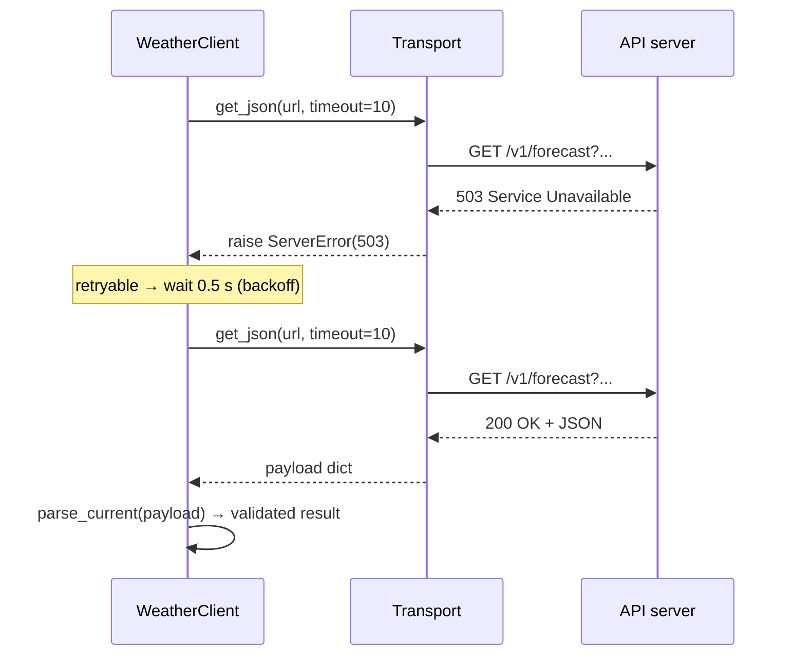

# PY-23 HTTP APIs and External Services

> [!info] Topic card
> **Unit:** U7 · **Status:** *supplementary* · **Time:** 4 h · **Code:** `examples/py23_http.py`, `exercises/py23_exercises.py`, and the full project [[PRJ-PY-04 Weather API Client]]
> **Verification note:** the network policy of the environment where this vault was built **blocked outbound calls** to the example weather API. All code was therefore tested against a **fake transport** that returns documented-format responses. The endpoint and parameter names come from Open-Meteo's published usage, as seen in third-party documentation via search on 2026-10-19 ([[Source Register]]). Run the live example yourself, and if the response layout differs, adjust the parser. The validation will tell you exactly which field is missing.

## 1. Learning objectives
1. **Explain** the HTTP request/response cycle: method, URL, query string, headers, status code, body.
2. **Call** a JSON API from Python with `urllib.request` (standard library), and **recognise** the equivalent `requests` code.
3. **Handle** failures robustly: timeouts, connection errors, 4xx vs 5xx status codes, malformed JSON, missing fields. Retry only what is retryable.
4. **Keep secrets out of code** (API keys from environment variables), and **respect** rate limits and terms of use.
5. **Design** API clients for testability with an injectable transport, and **test** them without the network.

## 2. Why it matters
Modern applications integrate payment gateways, SMS providers, maps, weather, identity providers and AI services. Integration code fails in ways local code doesn't (slow networks, outages, changed formats), so it needs disciplined error handling and tests that don't depend on the internet.

## 3. Prerequisites
[[PY-14 Files, CSV and JSON]] (JSON parsing), [[PY-15 Exceptions and Defensive Programming]] (retry, exception chaining), [[PY-17 Inheritance, Composition and Polymorphism]] (injected collaborators).

## 4. Intuition
An HTTP API is a **counter at a government office**. You hand over a form (the request: what you want, plus your details), wait, and receive a stamped reply (the response: a status like "approved" or "rejected" plus documents). Sometimes the office is closed (connection error), slow (timeout) or busy ("come back later": 429/503). A good client knows which problems are worth queueing again for.

## 5. Rigorous explanation

### 5.1 HTTP essentials
```text
GET /v1/forecast?latitude=-6.82&longitude=39.28&current=temperature_2m HTTP/1.1
Host: api.open-meteo.com
Accept: application/json
User-Agent: semester6-weather-client/1.0
```
| Part | Meaning |
|---|---|
| Method | `GET` read, `POST` create, `PUT`/`PATCH` update, `DELETE` remove |
| URL + query string | Resource plus parameters (`?key=value&...`, URL-encoded) |
| Headers | Metadata: `Accept`, `Content-Type`, `Authorization`, `User-Agent` |
| Body | Request data (JSON for POST/PUT), or response data |
| Status code | `2xx` success, `3xx` redirect, `4xx` **client** error (your request is wrong), `5xx` **server** error |

Key status codes: 200 OK, 201 Created, 204 No Content, 400 Bad Request, 401 Unauthorized (not authenticated), 403 Forbidden (authenticated but not allowed), 404 Not Found, 429 Too Many Requests (rate limited), 500 Internal Server Error, 502/503/504 gateway or unavailable.

**REST** conventions: resources as nouns in URLs (`/students/S1`), methods as verbs, JSON representations, and statelessness (each request carries everything needed).

### 5.2 Calling an API with the standard library
```python
import json
import urllib.parse
import urllib.request

BASE = "https://api.open-meteo.com/v1/forecast"

def build_url(base: str, params: dict) -> str:
    return f"{base}?{urllib.parse.urlencode(params)}"

url = build_url(BASE, {"latitude": -6.82, "longitude": 39.28, "current": "temperature_2m,wind_speed_10m"})
req = urllib.request.Request(url, headers={"Accept": "application/json",
                                           "User-Agent": "semester6-weather-client/1.0"})
with urllib.request.urlopen(req, timeout=10) as resp:      # ALWAYS set a timeout
    payload = json.load(resp)
print(payload["current"]["temperature_2m"], payload["current_units"]["temperature_2m"])
```
`urlencode` escapes special characters (spaces, `&`, non-ASCII) correctly, which hand-built query strings get wrong. `urlopen` raises `urllib.error.HTTPError` for 4xx/5xx (it has `.code`), and `urllib.error.URLError` for network failures. A timeout raises `TimeoutError` (or a `URLError` wrapping it).
With the third-party **requests** library the same call is `requests.get(BASE, params=..., timeout=10)`, then `r.raise_for_status()` and `r.json()`.

### 5.3 What to retry
| Failure | Retry? | Why |
|---|---|---|
| Timeout, connection reset | Yes, with backoff | Probably transient |
| 500, 502, 503, 504 | Yes, with backoff (a few times) | Server-side, often transient |
| 429 Too Many Requests | Yes, **after** waiting (honour `Retry-After` if present) | You are over the limit |
| 400, 401, 403, 404, 422 | **No** | Your request is wrong. Repeating it won't help. |
| Malformed JSON or missing fields | No | Contract violation. Report it clearly. |

### 5.4 Validate responses
Treat API responses as **untrusted input** ([[PY-24 Secure Programming and Input Validation]]). Check the types and ranges you rely on, and fail with a message naming the missing or invalid field:
```python
def parse_current(payload: dict) -> dict:
    try:
        current = payload["current"]
        units = payload.get("current_units", {})
        temp = float(current["temperature_2m"])
    except (KeyError, TypeError, ValueError) as exc:
        raise ValueError(f"unexpected API response shape: {exc!r}") from exc
    if not -90 <= temp <= 60:
        raise ValueError(f"implausible temperature {temp}")
    return {"time": current.get("time"), "temperature": temp,
            "unit": units.get("temperature_2m", "°C")}
```

### 5.5 Secrets and etiquette
- Many APIs require a key. **Never hard-code it** or commit it. Read it from the environment: `key = os.environ["SMS_API_KEY"]` (a `KeyError` gives a clear message: the key isn't configured). Keep a `.env.example` with **placeholder** names only ([[CS-12 Secure Software Development and Database Security]]).
- Send keys in headers (e.g. `Authorization: Bearer …`) rather than URLs where the API allows, because URLs end up in logs.
- Respect the provider's **terms of use and rate limits**, identify your client with a `User-Agent`, and **cache** responses that don't change often.

### 5.6 Testable design: inject the transport
```python
from typing import Protocol

class Transport(Protocol):
    def get_json(self, url: str, timeout: float) -> dict: ...

class WeatherClient:
    def __init__(self, transport: Transport, base: str = BASE):
        self.transport, self.base = transport, base
    def current(self, lat: float, lon: float) -> dict:
        url = build_url(self.base, {"latitude": lat, "longitude": lon, "current": "temperature_2m"})
        return parse_current(self.transport.get_json(url, timeout=10))
```
Production code passes a `UrllibTransport`. Tests pass a `FakeTransport` that returns canned dictionaries or raises chosen errors. The tests are fast, deterministic and offline.

## 6. Terminology
| Term | Meaning |
|---|---|
| Endpoint | URL of an API operation |
| Query parameter | `key=value` pair after `?` |
| Header | Request/response metadata line |
| Status code | Three-digit result code |
| REST | Architectural style: resources, standard methods, statelessness |
| Idempotent | Repeating it has the same effect (GET, PUT, DELETE: yes; POST: generally no) |
| Rate limit | Maximum number of requests allowed per time window |
| Backoff | Increasing the delay between retries |
| Transport | Component that actually performs network I/O |

## 7. Step-by-step: integrating any new API
1. Read the official documentation: endpoint, parameters, authentication, limits, terms.
2. Make one manual call (browser, or `curl`) and save a **sample response** as a test fixture.
3. Write `build_url`/`parse_*` as pure functions, and test them against the sample.
4. Add a transport with a timeout, then error mapping and retries for the retryable cases.
5. Add caching if the data changes slowly.
6. Write the tests with a fake transport: success, 404, 503-then-success, timeout, malformed response.

## 8. Diagram: request lifecycle with retries


## 9. Worked examples

### Example 1 (basic): URL building. Incorrect → corrected
```python
city = "Dar es Salaam"
url_wrong = "https://geocoding.example/search?name=" + city + "&count=1"   # space breaks the URL
url_right = build_url("https://geocoding.example/search", {"name": city, "count": 1})
# https://geocoding.example/search?name=Dar+es+Salaam&count=1
```
(`geocoding.example` is a reserved example domain; see RFC 2606.)

### Example 2 (intermediate): mapping errors in the transport
```python
import urllib.error

class ClientError(Exception): ...        # 4xx: don't retry
class ServerError(Exception): ...        # 5xx / 429: retryable

class UrllibTransport:
    def get_json(self, url: str, timeout: float) -> dict:
        req = urllib.request.Request(url, headers={"Accept": "application/json",
                                                   "User-Agent": "semester6-weather-client/1.0"})
        try:
            with urllib.request.urlopen(req, timeout=timeout) as resp:
                return json.load(resp)
        except urllib.error.HTTPError as exc:
            if exc.code == 429 or exc.code >= 500:
                raise ServerError(f"HTTP {exc.code}") from exc
            raise ClientError(f"HTTP {exc.code}") from exc
        except (urllib.error.URLError, TimeoutError) as exc:
            raise ServerError(f"network problem: {exc}") from exc
```
Callers now deal with two meaningful categories instead of half a dozen library-specific exceptions (an **adapter**, [[SD-11 Creational and Structural Design Patterns]]).

### Example 3 (challenging): retry + cache, tested offline
```python
import time

class CachedWeatherClient(WeatherClient):
    def __init__(self, transport, ttl: float = 600, clock=time.monotonic, sleep=time.sleep, attempts=3):
        super().__init__(transport)
        self.ttl, self.clock, self.sleep, self.attempts = ttl, clock, sleep, attempts
        self._cache: dict[tuple[float, float], tuple[float, dict]] = {}

    def current(self, lat, lon):
        key = (round(lat, 2), round(lon, 2))
        hit = self._cache.get(key)
        if hit and self.clock() - hit[0] < self.ttl:
            return hit[1]                                  # fresh cache hit: no network call
        for attempt in range(1, self.attempts + 1):
            try:
                result = super().current(lat, lon)
                self._cache[key] = (self.clock(), result)
                return result
            except ServerError:
                if attempt == self.attempts:
                    raise
                self.sleep(0.5 * 2 ** (attempt - 1))
```
A test with a fake clock checks that a second call within 600 s makes **zero** transport calls, and a call after 601 s makes one. A fake transport that raises `ServerError` once checks the retry. Both run in milliseconds without a network.

## 10. Application
[[PRJ-PY-04 Weather API Client]] turns this lesson into a full command-line application: city geocoding, current weather, input validation, retries, caching, an injectable transport, and a test suite that never touches the network.

## 11. Common mistakes
| Mistake | Consequence | Fix |
|---|---|---|
| No timeout | The program hangs forever on a dead server | `timeout=` on every call |
| Retrying 4xx errors | Wasted calls, possible account lockout | Retry only 5xx/429/network errors |
| Hard-coded API keys | Leaked in Git history | Environment variables, `.gitignore` the `.env` file |
| Trusting the response shape | `KeyError` deep in unrelated code | Validate at the boundary with clear messages |
| Tests that hit the real API | Slow, flaky, rate-limited, fail offline | Fake transport + saved sample responses |
| Building query strings by hand | Broken encoding, injection into URLs | `urllib.parse.urlencode` |
| Ignoring terms and rate limits | Blocked access, legal issues | Read the docs, cache, identify the client |

## 12. Comparison
| Tool | Pros | Cons |
|---|---|---|
| `urllib.request` | Standard library, no install | Verbose |
| `requests` | Friendly API, widely used | Third-party dependency |
| `httpx` | Sync and async, HTTP/2 | Third-party |
| Official SDK from the provider | Handles auth/retries | Another dependency, may lag the API |

## 13. Practice
**L1** 1. What's the difference between 401 and 403? 2. Which status codes should a client retry?

**L2** *(code bank)* 3. `build_url(base, params)`. 4. `parse_current(payload)` with validation (§5.4).

**L3** 5. `classify_status(code)` → `"success"`, `"client_error"`, `"retryable"` or `"other"`. 6. `WeatherClient.current(lat, lon)` using an injected transport. Validate the latitude (−90..90) and longitude (−180..180) **before** any network call.

**L4** 7. `CachedWeatherClient` with a TTL cache and retries, tested with a fake clock and a fake sleep. 8. `get_api_key(env, name)` reads from a mapping (inject `os.environ`), raises a clear `RuntimeError` if it's missing, and never includes the key's value in any message.

**L5** 9. Write an **integration design note** (½ page) for adding an SMS notification provider to the hostel system: which data leaves your system (privacy), failure handling (what if SMS fails? queue and retry?), idempotency (avoid sending the same SMS twice on retry), secrets, testing approach and monitoring. Link it to the risk register in [[PM-11 Risk Management]].

## 14. Hints
> [!tip]- Hints
> 5: `200 <= code < 300` → success; 429 or ≥ 500 → retryable; 400–499 → client error. 7: Inject `clock=lambda: t[0]`, where `t` is a one-element list you mutate in the test. 8: The error message should name the variable, not its value. 9: Idempotency key: send a unique message ID, so the provider (or your own outbox table) ignores duplicates.

## 15. Worked solutions
> [!success]- Solutions 1–2
> 1. 401: not authenticated (missing or invalid credentials). 403: authenticated but not permitted. 2. 429 (after waiting), 500, 502, 503, 504, plus network timeouts and connection errors.

> [!success]- Solutions 5–6
> ```python
> def classify_status(code: int) -> str:
>     if 200 <= code < 300:
>         return "success"
>     if code == 429 or 500 <= code < 600:
>         return "retryable"
>     if 400 <= code < 500:
>         return "client_error"
>     return "other"
>
> class WeatherClient:
>     def __init__(self, transport, base=BASE):
>         self.transport, self.base = transport, base
>     def current(self, lat, lon):
>         if not (-90 <= lat <= 90 and -180 <= lon <= 180):
>             raise ValueError("coordinates out of range")
>         url = build_url(self.base, {"latitude": lat, "longitude": lon, "current": "temperature_2m"})
>         return parse_current(self.transport.get_json(url, timeout=10))
> ```

> [!success]- Solution 8
> ```python
> def get_api_key(env, name: str) -> str:
>     value = env.get(name, "").strip()
>     if not value:
>         raise RuntimeError(f"environment variable {name} is not set; see .env.example")
>     return value
> ```
> Called as `get_api_key(os.environ, "SMS_API_KEY")`. The test passes a dict, and the real environment is never touched.

> [!success]- Solution 9 (model answer outline)
> **Data leaving the system:** the phone number and a minimal message ("Request #123 for room B12 is now IN PROGRESS"). No names or health details. That's data minimisation ([[CS-19 Cloud Security and Privacy]]). **Failure handling:** an *outbox* table. The service writes `(message_id, phone, text, status='pending')` in the same transaction as the status change, and a sender job delivers pending messages with backoff and marks them sent, failed or abandoned after N attempts. **Idempotency:** a unique `message_id` per notification. Never send twice for the same ID, even after a crash. **Secrets:** the API key comes from the environment, with least-privilege credentials. **Testing:** a fake SMS transport, plus tests for crash-between-write-and-send and duplicate prevention. **Monitoring:** count and alert on failed sends. **Risks for the register:** provider outage (medium likelihood, medium impact, mitigated by queue and retry), cost overrun from loops (low likelihood, high impact, mitigated by rate caps), and privacy breach (low likelihood, high impact, mitigated by minimisation and a provider contract).

## 16. Self-test (pass ≥ 4/5)
1. Why must every network call have a timeout? 2. Why validate API responses? 3. Where should API keys live? 4. How do you test an API client without the internet? 5. Is POST idempotent?
> [!success]- Answers
> 1. Without one, a stalled server can hang the program indefinitely. 2. They're external, untrusted input whose format can change or break. 3. In environment variables or a secrets manager, never in the code or Git. 4. Inject a fake transport that returns saved sample responses or raises chosen errors. 5. Not in general: repeating it may create duplicates. Use idempotency keys.

## 17. Flashcards
#flashcards/python
4xx vs 5xx?::4xx = client error (fix the request, don't retry); 5xx = server error (often transient, retry with backoff).
What does 429 mean?::Too Many Requests: rate limited; wait (honour Retry-After) then retry.
Safely build a query string?::urllib.parse.urlencode(params)
How to make API clients testable?::Inject the transport (dependency injection) and use a fake in tests.
Where do API keys go?::Environment variables / secrets manager, never source code.

## 18. Blank-page recall
Draw the retry sequence diagram, and write the status-code retry table from memory.

## 19. Revision summary
- HTTP: method + URL + headers + body → status + headers + body. Know 2xx/4xx/5xx and 429.
- Always set timeouts. Retry only transient failures, with backoff.
- Validate responses like any untrusted input. Fail clearly.
- Secrets in the environment. Respect rate limits and terms. Cache.
- Inject the transport, so tests run offline.

## 20. Links
Prev: [[PY-22 SQL and Database Integration]] · Next: [[PY-24 Secure Programming and Input Validation]] · Project: [[PRJ-PY-04 Weather API Client]] · Security: [[CS-09 Network Security and Secure Communication]] (TLS), [[CS-11 Web Application Security]]

## 21. Sources
- Python docs, `urllib.request`: https://docs.python.org/3/library/urllib.request.html · `urllib.parse.urlencode`: https://docs.python.org/3/library/urllib.parse.html
- IETF RFC 9110, *HTTP Semantics*, 2022 (methods, status codes, idempotency): https://www.rfc-editor.org/rfc/rfc9110
- IETF RFC 6585 (429 Too Many Requests): https://www.rfc-editor.org/rfc/rfc6585 · RFC 2606 (reserved example domains): https://www.rfc-editor.org/rfc/rfc2606
- Open-Meteo forecast API (endpoint `https://api.open-meteo.com/v1/forecast`, parameters `latitude`, `longitude`, `current`): official docs at https://open-meteo.com/en/docs. *Not reachable from the build environment. The parameters were confirmed only via third-party documentation in search results, so verify them before relying on them.*
- `requests` documentation: https://requests.readthedocs.io/

## 22. Mastery checklist
- [ ] `py23` tests pass with `PY_TARGET=exercises`
- [ ] I ran the live example on my own machine and compared its response with the parser
- [ ] My client has timeouts, a retry policy and offline tests · reviews scheduled
