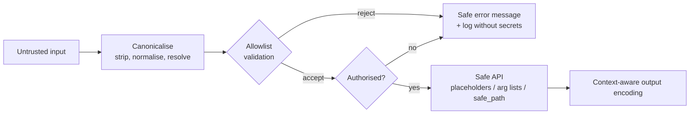

# PY-24 Secure Programming and Input Validation

> [!info] Topic card
> **Unit:** U7 · **Time:** 4–5 h · **Code:** `examples/py24_secure.py`, `exercises/py24_exercises.py`
> **Cyber Security links:** [[CS-11 Web Application Security]], [[CS-12 Secure Software Development and Database Security]], [[CS-08 Password Storage and Authentication Security]], [[LAB-CS-06 Input Validation and SQL Injection Prevention]].
> **Ethics:** every attack string in this lesson is run only against your own code on your own machine, to understand defences. See the ethics notice in [[README]].

## 1. Learning objectives
1. **Identify** trust boundaries, and **validate** all input crossing them using allowlists (type, length, range, format), with canonicalisation first.
2. **Prevent** injection: SQL (placeholders), OS command (no shell, argument lists), path traversal (resolve + containment check), and code (no `eval`/`pickle` on untrusted data).
3. **Use** the `secrets` module for tokens, `hashlib.pbkdf2_hmac`/`scrypt` with salts for password storage, and `hmac.compare_digest` for constant-time comparison.
4. **Handle** errors and logs without leaking secrets or internals.
5. **Apply** secure defaults and least privilege to Python programs and their dependencies.

## 2. Why it matters
Most real-world breaches exploit ordinary programming mistakes: unvalidated input, string-built queries, stored plaintext passwords, secrets in source code. Secure coding is **part of correctness**: a program that does what an attacker asks has a bug.

## 3. Prerequisites
[[PY-22 SQL and Database Integration]] (injection basics), [[PY-15 Exceptions and Defensive Programming]] (fail fast, error messages), [[PY-09 Strings and String Processing]] (string handling).

## 4. Intuition
Treat every piece of external data like **a parcel from a stranger**: check the label (type), size and contents **before** bringing it into the house, and never let it give orders. Injection happens when data is mistaken for **instructions**. The cure is to keep data and instructions in **separate channels**: placeholders, argument lists, safe parsers.

## 5. Rigorous explanation

### 5.1 Trust boundaries and validation strategy
A **trust boundary** is where data enters from a less trusted source: user input, files, network, environment, other services, even your own database if others write to it.
1. **Canonicalise:** decode and normalise first (strip whitespace, Unicode-normalise, `Path.resolve()`). Attackers hide payloads in alternative encodings.
2. **Validate with an allowlist:** define what *is* allowed (type, length, character set, range, format) and reject everything else. Blocklists ("reject `<script>`") always miss variants.
3. **Fail closed:** on doubt, reject, with a clear and safe message.
4. **Encode or escape on output** for the destination context (HTML escaping for web pages, CSV formula escaping, see [[PY-14 Files, CSV and JSON]]).
Validation is defence in depth. It **doesn't replace** placeholders or safe APIs.

```python
import re
USERNAME_RE = re.compile(r"[a-z][a-z0-9_]{2,19}")

def validate_username(raw: str) -> str:
    name = raw.strip().lower()
    if not USERNAME_RE.fullmatch(name):          # fullmatch: the WHOLE string must match
        raise ValueError("username: 3–20 chars, letters/digits/_ , starting with a letter")
    return name
```
`re.match` only anchors at the start (`"bob; rm -rf"` would pass a `match` against `[a-z]+`). **Use `fullmatch`.**

### 5.2 Injection families and defences
| Family | Dangerous pattern | Defence |
|---|---|---|
| SQL | `f"... WHERE name = '{x}'"` | Placeholders `?` ([[PY-22 SQL and Database Integration]]) |
| OS command | `os.system(f"ping {host}")`, `subprocess.run(cmd, shell=True)` | `subprocess.run(["ping", "-c", "1", host])` with `shell=False` (the default) **and** validation of `host` |
| Path traversal | `open(BASE / user_filename)` with `../../etc/passwd` | `resolve()` then check `is_relative_to(BASE)` |
| Code injection | `eval(user_text)`, `exec`, `pickle.loads(untrusted)` | `ast.literal_eval` for literals, JSON for data, never pickle untrusted data |
| Log injection | Writing raw user text containing `\n` into logs | Escape or strip control characters, or use structured logging |

**Why the argument list stops command injection:** with `shell=False`, there's no shell to interpret `;`, `&&` or `$(...)`. The string `"8.8.8.8; rm -rf ~"` becomes a single (invalid) hostname argument. It still needs validation so that weird input isn't passed to tools at all.

### 5.3 Path traversal defence
```python
from pathlib import Path

UPLOADS = Path("uploads").resolve()

def safe_path(user_name: str) -> Path:
    candidate = (UPLOADS / user_name).resolve()          # collapses .. and follows symlinks
    if not candidate.is_relative_to(UPLOADS):            # Python 3.9+
        raise ValueError("path escapes the uploads folder")
    return candidate
```
`safe_path("report.pdf")` → OK. `safe_path("../secrets.txt")` → `ValueError`. Absolute paths (`"/etc/passwd"`) are also caught, because `UPLOADS / "/etc/passwd"` becomes `/etc/passwd`.

### 5.4 Secrets and randomness
- `random` is **predictable** (a Mersenne Twister). Never use it for tokens, passwords or session IDs.
- `secrets.token_urlsafe(32)` gives a URL-safe random token with 32 bytes of entropy. `secrets.choice` gives random choices for passwords.
- Store configuration secrets in the environment or a secrets manager, never in code (see [[PY-23 HTTP APIs and External Services]]).

### 5.5 Password storage (overview; full theory in CS-08)
**Never** store plaintext or a fast hash (`sha256(password)`). Use a **slow, salted** key-derivation function:
```python
import hashlib, hmac, secrets

ITERATIONS = 600_000            # OWASP's 2023 guidance for PBKDF2-HMAC-SHA256; review periodically

def hash_password(password: str) -> str:
    salt = secrets.token_bytes(16)
    dk = hashlib.pbkdf2_hmac("sha256", password.encode(), salt, ITERATIONS)
    return f"pbkdf2_sha256${ITERATIONS}${salt.hex()}${dk.hex()}"

def verify_password(password: str, stored: str) -> bool:
    algo, iters, salt_hex, dk_hex = stored.split("$")
    if algo != "pbkdf2_sha256":
        raise ValueError("unknown algorithm")
    dk = hashlib.pbkdf2_hmac("sha256", password.encode(), bytes.fromhex(salt_hex), int(iters))
    return hmac.compare_digest(dk.hex(), dk_hex)     # constant-time comparison
```
- **Salt** (random per user): identical passwords get different hashes, which defeats precomputed rainbow tables.
- **Work factor** (iterations): makes each guess slow for an attacker who steals the database.
- **Storing the algorithm and parameters** with the hash lets you upgrade later.
- `compare_digest` avoids timing differences that could leak how many characters matched.
In production, prefer a maintained library (`argon2-cffi`, `bcrypt`) or your framework's built-in hasher. The rationale is in [[CS-08 Password Storage and Authentication Security]], with hands-on work in [[LAB-CS-01 Password Strength and Secure Password Storage]].

### 5.6 Errors and logging
- To users: generic messages ("Invalid username or password"). Don't reveal *which* part was wrong, because that enables account enumeration.
- To logs: enough detail to investigate (who, what, when, from where), **but no passwords, tokens, full card numbers or personal data beyond what's necessary**. Redact them.
- Never show stack traces to end users in production.

### 5.7 Secure defaults and least privilege
Run with the minimum permissions needed. Create files with restrictive permissions when they hold secrets (`os.open(path, os.O_WRONLY | os.O_CREAT, 0o600)` on POSIX). Pin and audit your dependencies (`pip-audit`). Keep Python updated. Disable debug modes in production.

## 6. Terminology
| Term | Meaning |
|---|---|
| Trust boundary | Point where data enters from a less trusted source |
| Allowlist / blocklist | Accept only known-good / reject known-bad |
| Canonicalisation | Converting input to a standard form before validating |
| Injection | Untrusted data interpreted as code or commands |
| Path traversal | Using `..` or absolute paths to escape a directory |
| Salt | Random per-password value stored with the hash |
| KDF / work factor | Slow key-derivation function / its cost parameter |
| Constant-time comparison | Comparison whose duration doesn't depend on where the inputs differ |
| Least privilege | Grant only the permissions required |

## 7. Step-by-step: securing a "download my report" feature
1. **Input:** a `filename` from the user. Canonicalise: `strip()`, reject empty input.
2. **Allowlist the format:** `[A-Za-z0-9_-]{1,50}\.pdf`, using `fullmatch`.
3. **Containment:** `safe_path(filename)` inside `reports/`.
4. **Authorisation:** does this user own the report? (Validation ≠ authorisation, see [[CS-04 Authorization and Access Control]].)
5. **Open read-only**, stream it, and log `user, filename, result`, with no file contents in the log.
6. **Errors:** "Report not found" for both "doesn't exist" and "not yours". Don't reveal which.

## 8. Diagram: defence in depth for one input

*Text version: canonicalise the input, validate it against an allowlist, check authorisation, use only safe APIs (placeholders, argument lists, contained paths), and encode the output for its destination. A rejection produces a safe message and a log entry without secrets.*

## 9. Worked examples

### Example 1 (basic): `match` vs `fullmatch`. Incorrect → corrected
```python
import re
CODE_RE = re.compile(r"[A-Z]{3}\d{5}")          # module codes like CST06102
CODE_RE.match("CST06102; DROP TABLE marks")     # <re.Match ...> : INCORRECT acceptance
CODE_RE.fullmatch("CST06102; DROP TABLE marks") # None : correctly rejected
CODE_RE.fullmatch("CST06102")                   # <re.Match ...>
```

### Example 2 (intermediate): command injection
```python
import subprocess

def ping_unsafe(host):                                       # INCORRECT
    return subprocess.run(f"ping -c 1 {host}", shell=True)   # host = "8.8.8.8; cat ~/.ssh/id_rsa"

HOST_RE = re.compile(r"[A-Za-z0-9.-]{1,253}")
def ping_command(host: str) -> list[str]:                    # CORRECTED: build, validate, no shell
    if not HOST_RE.fullmatch(host):
        raise ValueError("invalid hostname")
    return ["ping", "-c", "1", host]                         # pass to subprocess.run(cmd, timeout=5)
```
With `shell=True`, the semicolon ends the ping command and starts a second one chosen by the attacker. The corrected version never involves a shell, and it validates the input. Returning the argument list (rather than executing it) also makes the function unit-testable without running `ping`.

### Example 3 (challenging): redacting secrets in log lines
```python
SECRET_KEYS = re.compile(r"(?i)\b(password|passwd|token|api_key|secret)=([^\s&]+)")
CARD = re.compile(r"\b(?:\d[ -]?){12,15}(\d{4})\b")

def redact(line: str) -> str:
    line = SECRET_KEYS.sub(lambda m: f"{m.group(1)}=[REDACTED]", line)
    line = CARD.sub(lambda m: "**** **** **** " + m.group(1), line)
    return line.replace("\n", "\\n").replace("\r", "\\r")    # prevent log forging

redact("login user=amina password=Hunter2! token=abc123&x=1")
# 'login user=amina password=[REDACTED] token=[REDACTED]&x=1'
```
The `\n` escaping stops an attacker injecting a fake extra log line ("log forging"). Regex-based redaction is a *safety net*. The primary control is **never logging secrets in the first place**.

## 10. Application
The capstone [[X-CAPSTONE Hostel Maintenance System Full Lifecycle]] threat-models its prototype ([[LAB-CS-07 Threat Modeling a Sample Web Application]]), then applies this lesson: validated room codes and categories (allowlists), parameterised SQL in every repository, PBKDF2 password hashes for staff accounts, `secrets` tokens for password-reset links, and redacted audit logs.

## 11. Common mistakes
| Mistake | Fix |
|---|---|
| Validating with `re.match` / `search` | `fullmatch` |
| Blocklisting "bad characters" | Allowlist the good ones |
| Validating, then using a *different* (unnormalised) value | Validate and use the same canonical value |
| `shell=True` with any external data | Argument lists, `shell=False` |
| `random` for tokens | `secrets` |
| `sha256(password)` | A salted slow KDF (PBKDF2 / scrypt / bcrypt / Argon2) |
| `==` on secrets or MACs | `hmac.compare_digest` |
| `eval(input())` "for a calculator" | `ast.literal_eval`, or a proper parser |
| Detailed errors to users | Generic messages to users, detail (without secrets) to logs |

## 12. Comparison: validation vs sanitisation vs encoding
| Technique | What it does | Example | Use when |
|---|---|---|---|
| Validation | Accept or reject | `fullmatch` username | At input boundaries (always) |
| Sanitisation | Modify input to make it safe | Strip control characters | Only when rejecting isn't acceptable |
| Output encoding | Escape for the destination context | `html.escape`, CSV `'` prefix | At output time (always, for the context) |
| Parameterisation | Separate data from code | SQL `?`, argv lists | Whenever an interpreter is involved |

## 13. Practice
**L1** 1. Why is an allowlist better than a blocklist? 2. Which module generates secure tokens?

**L2** *(code bank)* 3. `validate_username(raw)`. 4. `validate_module_code(raw)` for codes like `CST06102` (3 uppercase letters + 5 digits, after strip/upper).

**L3** 5. `safe_path(base, user_name)` (§5.3, with `base` as a parameter). 6. `hash_password(password, iterations)` and `verify_password(password, stored)`. Tests use a low iteration count for speed. Explain why production must not.

**L4** 7. `ping_command(host)` (Example 2). 8. `redact(line)` (Example 3), plus three test cases of your own, including log forging.

**L5** 9. **Security review:** list every vulnerability in this snippet and rewrite it securely:
```python
import os, pickle, random
def login(username, password, db):
    row = db.execute(f"SELECT pw FROM users WHERE u='{username}'").fetchone()
    if row and row[0] == password:
        token = str(random.random())
        open(f"sessions/{username}", "wb").write(pickle.dumps({"token": token}))
        return token
    print(f"login failed for {username} with password {password}")
```

**Variation:** extend `validate_username` to reject a configurable set of reserved names (`admin`, `root`, `system`), case-insensitively.

## 14. Hints
> [!tip]- Hints
> 5: `(base.resolve() / user_name).resolve()` and then `is_relative_to(base.resolve())`. 6: Store `algo$iters$salt$hash`, and `split("$")` to verify. 9: Look for injection, plaintext passwords, insecure randomness, path traversal, pickle, an unclosed file, logging of the password, and account enumeration.

## 15. Worked solutions
> [!success]- Solutions 1–2
> 1. You can define the small set of valid inputs precisely, while the set of malicious inputs is unbounded and constantly evolving, so blocklists inevitably miss variants. 2. `secrets`.

> [!success]- Solution 4
> ```python
> MODULE_RE = re.compile(r"[A-Z]{3}\d{5}")
> def validate_module_code(raw: str) -> str:
>     code = raw.strip().upper()
>     if not MODULE_RE.fullmatch(code):
>         raise ValueError("module code must be 3 letters followed by 5 digits, e.g. CST06102")
>     return code
> ```
> Note that `\d` matches Unicode digits too. For strict ASCII, use `[0-9]{5}`, or add `code.isascii()`.

> [!success]- Solution 6 (test-speed note)
> The functions are as in §5.5, with an `iterations` parameter. Tests use e.g. 1 000 iterations so that hundreds of tests run quickly. **Production must not**, because the iteration count is the attacker's cost per guess. Dropping it by a factor of 600 makes offline cracking 600× faster. Store the count in the hash string so verification uses the right one, and rehash on login when you increase it.

> [!success]- Solution 9
> **Vulnerabilities:** (1) SQL injection via an f-string. (2) Passwords stored and compared in **plaintext**. (3) `==` comparison (not constant-time, minor here but bad practice). (4) A `random.random()` token, which is predictable. (5) **Path traversal** via `sessions/{username}` (`username = "../../app/config"`). (6) **pickle** for session data: if an attacker can write or replace that file, loading it later executes code. (7) The file handle is never closed (no `with`). (8) It **logs the password**. (9) The failure message reveals usernames (enumeration) and is printed instead of logged. (10) There's no rate limiting (out of scope here, but note it).
> ```python
> import hashlib, json, logging, secrets
> log = logging.getLogger("auth")
>
> def login(username: str, password: str, db, sessions_dir: Path) -> str | None:
>     username = validate_username(username)                       # allowlist
>     row = db.execute("SELECT pw_hash FROM users WHERE u = ?", (username,)).fetchone()
>     if row is None or not verify_password(password, row[0]):     # salted KDF + compare_digest
>         log.info("login failed user=%s", username)               # no password in the logs
>         return None                                              # generic failure to the caller
>     token = secrets.token_urlsafe(32)
>     path = safe_path(sessions_dir, f"{username}.json")
>     with open(path, "w", encoding="utf-8") as f:
>         json.dump({"token_sha256": hashlib.sha256(token.encode()).hexdigest()}, f)
>     return token
> ```
> Storing only a **hash of the session token** means a leaked sessions folder doesn't hand out live sessions. To avoid a timing side channel for unknown users, real systems also run a dummy hash when the user doesn't exist.

> [!success]- Variation answer
> ```python
> def validate_username_reserved(raw: str, reserved=frozenset({"admin", "root", "system"})) -> str:
>     name = validate_username(raw)
>     if name in {r.lower() for r in reserved}:
>         raise ValueError("this username is reserved")
>     return name
> ```

## 16. Self-test (pass ≥ 4/5)
1. `re.match` vs `re.fullmatch` for validation? 2. Why does an argument list prevent command injection? 3. Two purposes of a salt? 4. Why `hmac.compare_digest`? 5. What's wrong with `pickle.loads` on downloaded data?
> [!success]- Answers
> 1. `match` only anchors at the start, so trailing garbage passes. `fullmatch` requires the whole string to match. 2. No shell parses the string, so metacharacters are just characters in one argument. 3. Identical passwords get different hashes, and precomputed (rainbow) tables become useless. 4. Its timing doesn't reveal how much of the value matched. 5. Unpickling can execute arbitrary code embedded by the attacker.

## 17. Flashcards
#flashcards/python
Validation strategy at trust boundaries?::Canonicalise, then allowlist (type, length, format, range), fail closed.
Which regex method for validation?::re.fullmatch (whole string must match).
Prevent OS command injection?::subprocess.run([...args...]) without shell=True, plus input validation.
Prevent path traversal?::resolve() the joined path and check is_relative_to(base).
Secure token generation?::secrets.token_urlsafe(32)
Store passwords how?::Salted, slow KDF (PBKDF2/scrypt/bcrypt/Argon2) with stored parameters; verify with compare_digest.

## 18. Blank-page recall
Write the injection table (family, dangerous pattern, defence) and `hash_password`/`verify_password` from memory.

## 19. Revision summary
- Find the trust boundaries. Canonicalise, then allowlist-validate with `fullmatch`.
- Keep data out of instruction channels: SQL placeholders, argv lists, contained paths, no `eval`/pickle.
- `secrets` for tokens. A salted slow KDF plus `compare_digest` for passwords.
- Generic messages for users, redacted logs, least privilege, audited dependencies.

## 20. Links
Prev: [[PY-23 HTTP APIs and External Services]] · Next: [[PY-25 Performance, Packaging and Project Organization]] · CS: [[CS-11 Web Application Security]], [[CS-12 Secure Software Development and Database Security]], [[CS-08 Password Storage and Authentication Security]] · Integration: [[X-03 Security Requirements in Software Architecture]]

## 21. Sources
- OWASP Cheat Sheet Series: *Input Validation*, *OS Command Injection Defense*, *Password Storage* (PBKDF2-HMAC-SHA256 600 000 iterations recommendation, as published 2023, so check for updates), *Logging*: https://cheatsheetseries.owasp.org/
- Python docs: `secrets` https://docs.python.org/3/library/secrets.html · `hashlib.pbkdf2_hmac` https://docs.python.org/3/library/hashlib.html · `hmac.compare_digest` https://docs.python.org/3/library/hmac.html · `subprocess` security considerations https://docs.python.org/3/library/subprocess.html#security-considerations · `pathlib.PurePath.is_relative_to`
- MITRE CWE: CWE-78 (OS command injection), CWE-89 (SQL injection), CWE-22 (path traversal), CWE-502 (deserialisation of untrusted data), CWE-916 (password hash with insufficient computational effort): https://cwe.mitre.org/

## 22. Mastery checklist
- [ ] `py24` tests pass with `PY_TARGET=exercises`
- [ ] I found ≥ 8 issues in practice 9 without hints
- [ ] My project's inputs are validated with `fullmatch` allowlists · reviews scheduled
