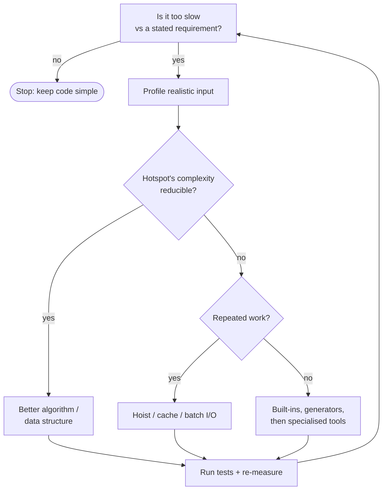

# PY-25 Performance, Packaging and Project Organization

> [!info] Topic card
> **Unit:** U7 · **Status:** *supplementary* · **Time:** 4 h · **Code:** `examples/py25_profile.py`, `exercises/py25_exercises.py`
> This lesson turns a working program into a **professional project**: measured, logged, packaged and organised. It's the last lesson before the advanced project [[PRJ-PY-05 Hostel Maintenance System]].

## 1. Learning objectives
1. **Measure before optimising:** use `timeit` for micro-benchmarks and `cProfile`/`pstats` to find hotspots, and **interpret** the profiler output.
2. **Apply** optimisations in order of impact: algorithm and data structure, then avoiding repeated work and caching, then built-ins, then micro-tweaks.
3. **Use** the `logging` module correctly (levels, loggers per module, configuration at the entry point, no secrets in logs).
4. **Organise** a project (src layout, tests, docs, config) and **describe** it with `pyproject.toml`, including a console-script entry point.
5. **Apply** semantic versioning, a changelog, and automated quality gates (linters, formatters, tests in CI).

## 2. Why it matters
"Make it work, make it right, make it fast", in that order. Premature optimisation wastes effort and obscures code, while unmeasured guesses are usually wrong about *where* the time goes. Logging and packaging are what separate a student script from something an organisation can deploy, support and audit ([[SD-16 Deployment, Maintenance and Documentation]]).

## 3. Prerequisites
[[PY-12 Searching, Sorting and Complexity]] (Big-O), [[PY-13 Modules, Packages, Imports and Virtual Environments]] (packages, pip), [[PY-20 Testing, Debugging and Test-Driven Development]] (tests protect optimisations).

## 4. Intuition
Optimising without a profiler is like a mechanic replacing parts at random. A profiler is the diagnostic computer: it tells you that 90% of the time is spent in one place. Fix **that** place, ideally by doing less work rather than doing the same work faster.

## 5. Rigorous explanation

### 5.1 Measuring
- **`timeit`** repeats a small snippet many times and reports the total. Use it to compare alternatives (`python -m timeit -s "xs = list(range(1000))" "sum(xs)"`).
- **`cProfile`** records every function call: the number of calls, `tottime` (time inside the function itself) and `cumtime` (including the functions it calls).
```bash
python -m cProfile -s cumtime examples/py25_profile.py | head -20
```
```python
import cProfile, pstats
cProfile.run("main()", "prof.out")
pstats.Stats("prof.out").sort_stats("cumtime").print_stats(10)
```
- **Memory:** `tracemalloc` (snapshots of allocations), and `sys.getsizeof(obj)` (shallow size of one object).
- **Amdahl's law:** if a part takes a fraction $p$ of the run time and you speed it up by a factor $s$, the overall speed-up is $\frac{1}{(1-p) + p/s}$. Making a 10% part infinitely fast saves at most about 10%. **Optimise the biggest fraction.**

### 5.2 Optimisation ladder (highest impact first)
1. **Better algorithm / data structure:** $O(n^2) \to O(n \log n)$ or $O(n)$. E.g. `x in list` inside a loop → a set ([[PY-11 Dictionaries, Sets and Comprehensions]]).
2. **Avoid repeated work:** move invariant computations out of loops, and **cache** pure results (`functools.cache`/`lru_cache`, [[PY-07 Recursion]]).
3. **Use built-ins and the standard library:** `sum`, `sorted`, `"".join`, `collections.Counter`, `heapq`. They're implemented in C.
4. **Lazy evaluation:** generators avoid building huge intermediate lists ([[PY-18 Iterators, Generators, Decorators and Context Managers]]).
5. **I/O batching:** fewer, larger reads and writes. One SQL transaction for many inserts (`executemany`).
6. **Micro-optimisations** (local-variable lookups and so on): rarely worth the readability cost.
7. **Beyond Python:** NumPy vectorisation, PyPy, C extensions, multiprocessing, when profiling proves you need them.
After every change: **run the tests** (correctness) and **re-measure** (it really got faster).

### 5.3 Logging
```python
import logging

log = logging.getLogger(__name__)          # one logger per module, named after it

def assign_request(request_id: int, technician: str) -> None:
    log.info("assigning request %s to %s", request_id, technician)   # lazy %-formatting
    ...
    log.debug("assignment details: %r", {"id": request_id})

# Configure ONCE, at the entry point (main), never in library modules:
if __name__ == "__main__":
    logging.basicConfig(level=logging.INFO,
                        format="%(asctime)s %(levelname)s %(name)s: %(message)s")
```
| Level | Use for |
|---|---|
| DEBUG | Detailed diagnostics during development |
| INFO | Normal significant events (user logged in, request created) |
| WARNING | Unexpected but handled (retrying, deprecated input) |
| ERROR | An operation failed |
| CRITICAL | The system can't continue |
`log.exception("…")` inside an `except` block logs the traceback at ERROR level. **Never log secrets** ([[PY-24 Secure Programming and Input Validation]]). Logs are also security evidence ([[CS-15 Logging, Monitoring, Incident Response and Recovery]]).

### 5.4 Project layout (src layout)
```text
hostel-maintenance/
├── pyproject.toml          # metadata, dependencies, tool config, entry points
├── README.md               # what, install, usage, development
├── CHANGELOG.md            # notable changes per version
├── LICENSE
├── .gitignore              # .venv/, __pycache__/, *.db, .env
├── src/
│   └── hostel/
│       ├── __init__.py     # __version__ = "1.2.0"
│       ├── models.py
│       ├── repository.py
│       ├── services.py
│       └── cli.py          # def main(): ...
├── tests/
│   ├── test_models.py
│   └── test_services.py
└── docs/
    └── architecture.md
```
**Why `src/`?** Tests then run against the *installed* package (`pip install -e .`), not accidentally against the files in the current directory, which catches packaging mistakes early.

### 5.5 `pyproject.toml` (PEP 621 metadata)
```toml
[build-system]
requires = ["setuptools>=68", "wheel"]
build-backend = "setuptools.build_meta"

[project]
name = "hostel-maintenance"
version = "1.2.0"
description = "Maintenance request tracking for student hostels"
readme = "README.md"
requires-python = ">=3.10"
dependencies = []                       # stdlib-only core

[project.optional-dependencies]
dev = ["pytest>=8", "ruff", "mypy"]

[project.scripts]
hostel = "hostel.cli:main"              # installs a 'hostel' command

[tool.pytest.ini_options]
testpaths = ["tests"]
```
`python -m pip install -e ".[dev]"` gives an editable install with the dev tools. `python -m build` (the `build` package) produces a wheel (`.whl`) and an sdist in `dist/`.

### 5.6 Versioning and changelog
**Semantic Versioning** `MAJOR.MINOR.PATCH`: increment **MAJOR** for incompatible API changes, **MINOR** for backwards-compatible features, **PATCH** for backwards-compatible bug fixes. Pre-1.0 (`0.y.z`) means "anything may change". Keep a `CHANGELOG.md` with sections per version (Added / Changed / Fixed / Removed). This vault itself keeps one ([[CHANGELOG]]).

### 5.7 Quality gates
Formatter (`ruff format`/`black`), linter (`ruff check`), type checker (`mypy`), tests (`pytest`) and dependency audit (`pip-audit`), run locally and in **continuous integration** (e.g. GitHub Actions) on every push. Merge only when all are green ([[SD-13 Implementation, Code Organization and Version Control]], [[SD-16 Deployment, Maintenance and Documentation]]).

## 6. Terminology
| Term | Meaning |
|---|---|
| Profiler | Tool measuring where time (or memory) is spent |
| Hotspot | Code consuming a large share of the run time |
| `tottime` / `cumtime` | Time inside the function only / including its callees |
| Amdahl's law | Overall speed-up limit given the fraction optimised |
| Premature optimisation | Optimising before measuring or needing to |
| Logger / handler / formatter | Named log source / output destination / message layout |
| Wheel | Built distribution format (`.whl`) |
| Entry point | Function exposed as a command-line program |
| SemVer | MAJOR.MINOR.PATCH versioning rules |
| CI | Continuous integration: automated checks on every change |

## 7. Step-by-step: an optimisation session
1. Write or confirm the **tests** (behaviour lock).
2. Create a **realistic benchmark input** (e.g. 50 000 records).
3. **Profile** and find the top `cumtime` functions you own.
4. **Hypothesise** why each is slow. Look at the complexity first.
5. Apply **one** change from the top of the ladder.
6. **Test**, then **re-profile**. Record the before/after numbers in the commit message.
7. Stop when it's fast enough for the requirement (define "fast enough" first: an NFR, [[SD-03 Requirements Engineering]]).

## 8. Diagram: optimisation decision flow


## 9. Worked examples

### Example 1 (basic): `timeit` comparison
```python
import timeit
setup = "data = list(range(10_000)); targets = list(range(0, 20_000, 7))"
t_list = timeit.timeit("[t in data for t in targets]", setup=setup, number=10)
t_set = timeit.timeit("s = set(data); [t in s for t in targets]", setup=setup, number=10)
```
List membership is $O(n)$ per lookup, versus $O(1)$ average for a set (building the set costs $O(n)$ once). The runnable script prints the measured ratio on your machine.

### Example 2 (intermediate): profile → hotspot → fix (incorrect → corrected)
```python
# SLOW: O(n·m) because 'w in stop_words' scans a LIST, and the lowercase work is repeated
def keyword_counts_slow(docs: list[str], stop_words: list[str]) -> dict[str, int]:
    counts = {}
    for doc in docs:
        for w in doc.split():
            if w.lower() not in [s.lower() for s in stop_words]:     # rebuilds a list EVERY word
                counts[w.lower()] = counts.get(w.lower(), 0) + 1
    return counts
```
Real `cProfile` output from the build environment (CPython 3.13, `python -m cProfile -s tottime examples/py25_profile.py`, abridged):
```text
   ncalls  tottime  percall  cumtime  percall filename:lineno(function)
        1    0.379    0.379    0.654    0.654 py25_solutions.py:19(keyword_counts_slow)
  2072138    0.274    0.000    0.274    0.000 {method 'lower' of 'str' objects}
```
**Reading it:** the slow function's *own* time (`tottime` 0.379 s) plus **2 million** calls to `str.lower` account for almost all of the run. The call count is the clue: the 100 stop words are lower-cased again for **every one** of the 20 000 words. (On Python 3.12+ comprehensions are inlined (PEP 709), so no separate `<listcomp>` row appears. Older versions show one.)
```python
# FAST: build the stop set once; lowercase each word once; Counter in C
from collections import Counter
def keyword_counts_fast(docs: list[str], stop_words: list[str]) -> dict[str, int]:
    stop = {s.lower() for s in stop_words}
    return dict(Counter(w for doc in docs for w in (x.lower() for x in doc.split()) if w not in stop))
```
Both return the same dictionary (the code bank test checks equivalence on random input). Only the fast one scales.

### Example 3 (challenging): logging configuration for a CLI
```python
import logging
import sys

def configure_logging(verbose: bool = False, logfile: str | None = None) -> None:
    handlers: list[logging.Handler] = [logging.StreamHandler(sys.stderr)]
    if logfile:
        handlers.append(logging.FileHandler(logfile, encoding="utf-8"))
    logging.basicConfig(level=logging.DEBUG if verbose else logging.INFO,
                        format="%(asctime)s %(levelname)-8s %(name)s: %(message)s",
                        handlers=handlers, force=True)
```
Logs go to **stderr**, so stdout stays clean for program output (it can be piped). `force=True` (3.8+) replaces any earlier configuration, which is useful in tests. Library modules only call `logging.getLogger(__name__)`. They never call `basicConfig`.

## 10. Application
[[PRJ-PY-05 Hostel Maintenance System]] follows the src layout with a `pyproject.toml` entry point `hostel = "hostel.cli:main"`, module-level loggers, an audit log of status changes (the `status_history` table), and a changelog (`CHANGES.txt`; plain-text names keep them from clashing with this vault's own README and CHANGELOG notes). Its `README.txt` documents installation, usage, architecture and the testing commands. Those are deliverables your final-year project will also need ([[FYP-08 Technical Architecture and Design Planning]]).

## 11. Common mistakes
| Mistake | Fix |
|---|---|
| Optimising without measuring | Profile first |
| Micro-optimising an $O(n^2)$ algorithm | Change the algorithm |
| Benchmarking tiny inputs | Use realistic sizes and repeat runs |
| `print` for diagnostics in production code | `logging` with levels |
| `logging.basicConfig` inside library modules | Configure only in the entry point |
| f-strings in log calls with expensive arguments | `log.debug("x=%s", x)` (formatted only if emitted) |
| Committing `dist/`, `.venv/`, `*.egg-info` | `.gitignore` |
| Bumping MAJOR for a bug fix (or PATCH for a breaking change) | Follow SemVer |

## 12. Comparison
| Tool | Measures | Granularity |
|---|---|---|
| `timeit` | Wall time of a snippet, repeated | Statement |
| `cProfile` | Calls and time per function | Function |
| `tracemalloc` | Allocations | Line / traceback |
| Line profilers (third-party) | Time per line | Line |

## 13. Practice
**L1** 1. What does Amdahl's law say about optimising a part that takes 5% of the run time? 2. Name the five logging levels in order.

**L2** *(code bank)* 3. `has_duplicates_fast(xs)` in $O(n)$. 4. `keyword_counts_fast(docs, stop_words)` (must equal the slow version).

**L3** 5. `parse_semver("1.4.2")` → `(1, 4, 2)` (`ValueError` on malformed input), and `bump(version, part)` with `part` ∈ {"major", "minor", "patch"} (lower parts reset to 0). 6. `make_logger(name, stream, level)` returns a logger writing `LEVEL name: message` lines to the given stream (for tests: an `io.StringIO`), without adding duplicate handlers when called twice.

**L4** 7. Run `python -m cProfile -s cumtime examples/py25_profile.py`, identify the top hotspot you own, and explain the `tottime` vs `cumtime` columns for it. 8. Using Amdahl's law: a report takes 20 s, of which 15 s is a database query and 5 s is formatting. You can make the query 10× faster *or* the formatting 100× faster. Which gives the bigger overall speed-up? Show the calculation.

**L5** 9. Write the `pyproject.toml`, the directory tree and a 10-line README outline for your [[PRJ-PY-02 Personal Expense Tracker]], including a console entry point, dev extras and pytest configuration. Then propose the CI checks for it, and justify why each one earns its run time.

## 14. Hints
> [!tip]- Hints
> 1: The maximum speed-up is $1/(1-0.05) \approx 1.053$, about 5%. 5: `re.fullmatch(r"(\d+)\.(\d+)\.(\d+)", v)`. 6: Check `logger.handlers` before adding, and set `logger.propagate = False` so the root logger doesn't print duplicates. 8: Compute $T_{new}$ for each option.

## 15. Worked solutions
> [!success]- Solutions 1–2
> 1. Even an infinite speed-up of that part gives at most $1/0.95 \approx 1.05\times$ overall, so it's rarely worth it. 2. DEBUG < INFO < WARNING < ERROR < CRITICAL.

> [!success]- Solution 5
> ```python
> import re
> SEMVER = re.compile(r"(0|[1-9]\d*)\.(0|[1-9]\d*)\.(0|[1-9]\d*)")
> def parse_semver(v: str) -> tuple[int, int, int]:
>     m = SEMVER.fullmatch(v.strip())
>     if not m:
>         raise ValueError(f"not a semantic version: {v!r}")
>     return tuple(int(g) for g in m.groups())
>
> def bump(version: str, part: str) -> str:
>     major, minor, patch = parse_semver(version)
>     if part == "major":
>         return f"{major + 1}.0.0"
>     if part == "minor":
>         return f"{major}.{minor + 1}.0"
>     if part == "patch":
>         return f"{major}.{minor}.{patch + 1}"
>     raise ValueError("part must be major, minor or patch")
> ```
> SemVer forbids leading zeros in numeric identifiers (`01.2.3`), and the regex enforces this.

> [!success]- Solution 6
> ```python
> import logging
> def make_logger(name, stream, level=logging.INFO):
>     logger = logging.getLogger(name)
>     logger.setLevel(level)
>     logger.propagate = False
>     if not any(getattr(h, "_semester6", False) for h in logger.handlers):
>         handler = logging.StreamHandler(stream)
>         handler.setFormatter(logging.Formatter("%(levelname)s %(name)s: %(message)s"))
>         handler._semester6 = True
>         logger.addHandler(handler)
>     return logger
> ```
> Loggers are global singletons per name, so adding a handler on every call would print each message several times. That's a classic bug.

> [!success]- Solution 8
> Option A (query 10× faster): $T = 15/10 + 5 = 6.5$ s, a speed-up of $20/6.5 \approx 3.08\times$. Option B (formatting 100× faster): $T = 15 + 5/100 = 15.05$ s, a speed-up of $\approx 1.33\times$. **Option A wins**, despite its smaller factor, because it targets the larger fraction (75%). That's Amdahl's law in practice.

> [!success]- Solution 9 (model answer, abridged)
> ```toml
> [project]
> name = "expense-tracker"
> version = "0.3.0"
> requires-python = ">=3.10"
> dependencies = []
> [project.optional-dependencies]
> dev = ["pytest>=8", "ruff", "mypy"]
> [project.scripts]
> expenses = "expense_tracker.cli:main"
> [tool.pytest.ini_options]
> testpaths = ["tests"]
> ```
> README outline: purpose, features, install (`pip install -e .[dev]`), usage examples (`expenses add 12000 food "lunch"`), data location and backup, running the tests, architecture summary (link), version and changelog, licence, contact.
> **CI checks:** `ruff check` (seconds; catches real bugs such as unused variables and shadowing), `ruff format --check` (seconds; no style debates in review), `mypy` (seconds; catches `None` misuse), `pytest` (the core evidence of correctness), `pip-audit` (supply-chain risk, cheap). Each costs seconds and prevents defects that would cost hours later. That's the quality-cost argument in [[PM-13 Quality Management]].

## 16. Self-test (pass ≥ 4/5)
1. Why profile before optimising? 2. Highest-impact optimisation category? 3. Where should `basicConfig` be called? 4. What does a MINOR version bump signal? 5. Why use the src layout?
> [!success]- Answers
> 1. Intuition about hotspots is unreliable, and measuring finds where the time actually goes. 2. A better algorithm or data structure (a complexity reduction). 3. Once, in the application's entry point. 4. A backwards-compatible new feature. 5. Tests run against the installed package, which catches packaging and import errors.

## 17. Flashcards
#flashcards/python
Amdahl's law?::Overall speedup = 1 / ((1 − p) + p/s) for fraction p sped up by factor s.
tottime vs cumtime in cProfile?::tottime excludes time in called functions; cumtime includes it.
Correct per-module logger?::log = logging.getLogger(__name__)
SemVer parts?::MAJOR (breaking), MINOR (compatible feature), PATCH (compatible fix).
What does [project.scripts] in pyproject.toml do?::Defines console commands mapped to functions (entry points).
First rung of the optimisation ladder?::Improve the algorithm/data structure (complexity).

## 18. Blank-page recall
Draw the optimisation ladder, the src-layout tree and a minimal `pyproject.toml` from memory.

## 19. Revision summary
- Make it work → right → fast. Measure first (`timeit`, `cProfile`) and apply Amdahl's law.
- Optimise the algorithm first, then repeated work and caching, then built-ins, then micro-tweaks. Re-test and re-measure.
- Logging: a logger per module, configured at the entry point, sensible levels, no secrets.
- src layout + `pyproject.toml` + an entry point + SemVer + a changelog + CI quality gates.

## 20. Links
Prev: [[PY-24 Secure Programming and Input Validation]] · Next: [[PRJ-PY-05 Hostel Maintenance System]] · SD: [[SD-16 Deployment, Maintenance and Documentation]], [[SD-13 Implementation, Code Organization and Version Control]] · PM: [[PM-13 Quality Management]]

## 21. Sources
- Python docs, *The Python Profilers* (`cProfile`, `pstats`): https://docs.python.org/3/library/profile.html · `timeit` · `tracemalloc`
- Python docs, *Logging HOWTO*: https://docs.python.org/3/howto/logging.html
- Python Packaging User Guide, *Writing your pyproject.toml* and *Packaging Python Projects*: https://packaging.python.org/en/latest/guides/writing-pyproject-toml/
- PEP 621 *Storing project metadata in pyproject.toml*: https://peps.python.org/pep-0621/
- Semantic Versioning 2.0.0: https://semver.org/
- Amdahl, G. M., "Validity of the single processor approach to achieving large scale computing capabilities", *AFIPS Conference Proceedings*, vol. 30, 1967, pp. 483–485.

## 22. Mastery checklist
- [ ] `py25` tests pass with `PY_TARGET=exercises`
- [ ] I profiled a program, fixed its hotspot, and recorded the before/after times
- [ ] One of my projects has `pyproject.toml`, logging and a changelog · reviews scheduled
