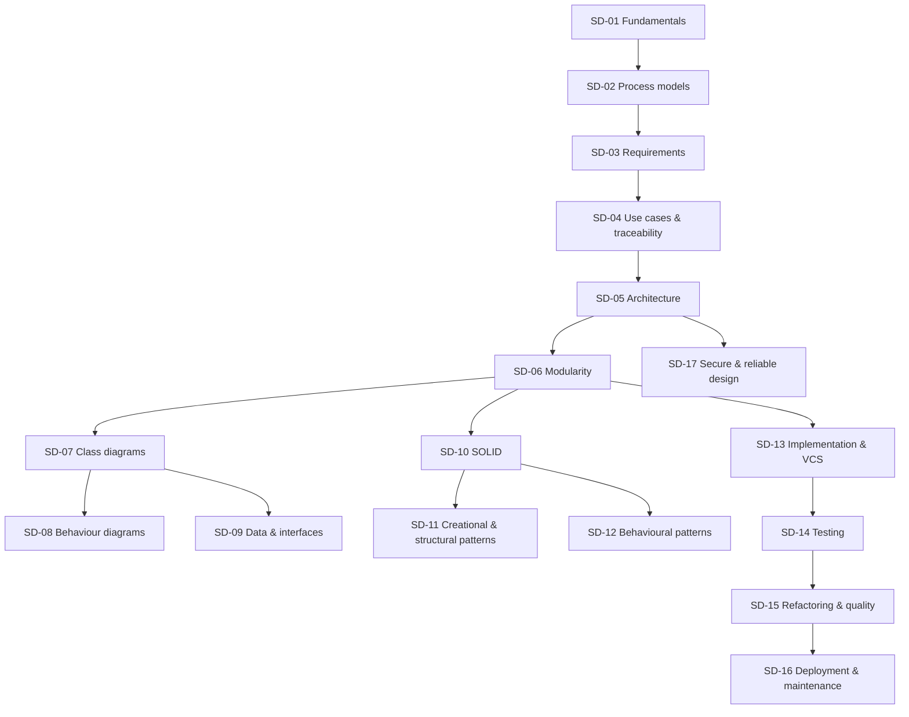

# Software Design and Development: Curriculum Map

Back to [[SD 00 Dashboard]]

## 1. Units
| Unit | Topics | LabBook artefact |
|---|---|---|
| U1 Process | SD-01 fundamentals · SD-02 process models | Quality-attribute list; process decision |
| U2 Requirements | SD-03 requirements engineering · SD-04 use cases, stories, traceability | SRS extract; use cases UC-01 to UC-03; traceability matrix |
| U3 Design | SD-05 architecture · SD-06 modularity | Layered architecture; ADR-001; module map |
| U4 Modelling | SD-07 class diagrams · SD-08 behaviour diagrams · SD-09 data and interfaces | Class, sequence and state diagrams; ERD; API contract |
| U5 Principles and patterns | SD-10 SOLID · SD-11 creational/structural · SD-12 behavioural | `rules.py` (Strategy, Composite), `events.py` (Observer), `app.py` (Factory) |
| U6 Construction | SD-13 implementation and VCS · SD-14 testing · SD-15 refactoring and quality | Package layout; contract tests; clinic refactorings |
| U7 Operation | SD-16 deployment and maintenance · SD-17 secure and reliable design | Release plan; security review |

## 2. Prerequisite graph

*Text version: process (01–02) leads to requirements (03–04), then architecture (05) and modular design (06). Modularity feeds modelling (07–09), principles and patterns (10–12) and construction (13–15), which ends in deployment (16). Secure design (17) builds on architecture.*

## 3. Review alerts
| Before… | Review | Why |
|---|---|---|
| SD-07 | [[PY-16 Classes and Objects]], [[PY-17 Inheritance, Composition and Polymorphism]] | Classes, composition, inheritance |
| SD-08 | [[DM-10 Relations, Equivalence Relations and Partial Orders]] | State transitions as a relation |
| SD-09 | [[PY-22 SQL and Database Integration]] | Schemas, keys, constraints |
| SD-10/11/12 | [[PY-19 Type Hints, Documentation, Clean Code and Refactoring]] | Protocols, interfaces in Python |
| SD-14 | [[PY-20 Testing, Debugging and Test-Driven Development]] | pytest, fixtures, TDD |
| SD-17 | [[CS-02 Threat Modeling and Security Requirements]] | STRIDE and security requirements |

## 4. Cross-module links
[[X-01 Logic and Sets in Python and Requirements]] · [[X-03 Security Requirements in Software Architecture]] · [[X-04 Testing as Software Quality Assurance]] · [[PM-04 Scope Management, Requirements Traceability and WBS]] · [[FYP-08 Technical Architecture and Design Planning]] · [[X-CAPSTONE Hostel Maintenance System Full Lifecycle]]
