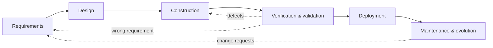

# SD-01 Software Engineering Fundamentals

> [!info] Topic card
> **Unit:** U1 · **Time:** 3 h · **Case:** [[SD-CASE LabBook Running Case Study]]

## 1. Learning objectives
1. **Define** software engineering, and **distinguish** it from programming.
2. **Explain** why software projects fail and what engineering discipline adds (process, requirements, design, verification, maintenance).
3. **Name and apply** the product quality characteristics of ISO/IEC 25010 to a real system.
4. **Describe** the software lifecycle activities and the roles involved.
5. **Explain** essential vs accidental complexity, and the cost of change over time.

## 2. Why it matters
A program that one person writes for one afternoon only needs to work today. Software that a team builds for an institution must work for years, for many users, while requirements, staff and technology change. Software engineering is the set of practices that makes that possible at a predictable cost. Most of your working life as a developer will be spent changing existing systems, so "easy to change" is as important as "works".

## 3. Prerequisites
Basic programming ([[PY-06 Functions, Parameters, Return Values and Scope]] level). No prior design knowledge is assumed.

## 4. Intuition
Programming is **building a shed**: you can design it in your head and fix mistakes as you go. Software engineering is **building a hospital**: many people, regulations, a budget, users who can't wait, and a building that will be modified for decades. You need drawings (designs), agreed specifications (requirements), inspections (testing and reviews) and maintenance plans. The skills of the bricklayer (programming) remain essential, but they're no longer enough.

## 5. Rigorous explanation

### 5.1 Definitions
- **Software engineering** (IEEE): the application of a systematic, disciplined, quantifiable approach to the development, operation and maintenance of software.
- **Software** includes code, but also its documentation, configuration, data, tests and build scripts.
- **Programming** is one activity inside software engineering, alongside requirements, design, verification, deployment, maintenance and project management.

### 5.2 Lifecycle activities
1. **Requirements:** what the system must do (functional) and how well (non-functional).
2. **Design:** architecture (major parts and how they interact) and detailed design (modules, classes, interfaces).
3. **Construction:** coding, code review, version control.
4. **Verification and validation:** testing, inspection. *Verification:* are we building the product right? *Validation:* are we building the right product?
5. **Deployment:** release, installation, configuration.
6. **Maintenance and evolution:**
   - corrective: fix defects;
   - adaptive: respond to environment changes;
   - perfective: improve or add features;
   - preventive: refactor, reduce debt.

How these activities are ordered and repeated is the **process model** ([[SD-02 Software Process Models]]).

### 5.3 Product quality (ISO/IEC 25010:2023)
ISO/IEC 25010 defines product quality characteristics. The 2023 revision lists nine:
- functional suitability;
- performance efficiency;
- compatibility;
- interaction capability (formerly usability);
- reliability;
- security;
- maintainability;
- flexibility (formerly portability);
- safety.

Each has sub-characteristics; for example, maintainability includes modularity, reusability, analysability, modifiability and testability. If your course uses the 2011 edition (eight characteristics, with "usability" and "portability"), learn its names, but the ideas are the same.

**Quality attributes conflict.** Encryption costs performance, flexibility can cost simplicity, and high availability costs money. Design means making these trade-offs explicitly.

### 5.4 Why projects fail and what helps
Common causes:
- unclear or changing requirements;
- unrealistic schedules;
- poor communication with users;
- weak testing;
- accumulating technical debt;
- lack of risk management;
- "big bang" integration late in the project.

Engineering responses:
- validated requirements ([[SD-03 Requirements Engineering]]);
- iterative delivery ([[SD-02 Software Process Models]]);
- modular design ([[SD-06 Modular Design, Cohesion and Coupling]]);
- automated testing ([[SD-14 Software Testing, Verification and Validation]]);
- continuous integration;
- risk and project management ([[PM-11 Risk Management]]).

### 5.5 Complexity and the cost of change
- **Essential complexity** belongs to the problem itself, e.g. LabBook's weekly quota, overlap and opening-hour rules. **Accidental complexity** is what we add through poor tools or design, e.g. the string-compared times in the flawed god class ([[SD Flawed Design Clinic]]). Good design minimises the accidental kind.
- **The cost of a defect grows** the later it's found. A requirement error found in a review costs a conversation; the same error found after deployment costs redesign, data fixes and user trust. The exact multipliers in old studies are debated, but the direction is well established.
- **Lehman's laws** of software evolution observe that a system used in the real world must keep changing or become less useful, and that its complexity grows unless work is done to reduce it.

### 5.6 Professional responsibility
Software affects people's grades, money, health and safety. Engineers have duties of competence, honesty about limitations, privacy and security. Professional codes such as the ACM/IEEE-CS Software Engineering Code of Ethics express these.

## 6. Terminology
| Term | Meaning |
|---|---|
| Functional requirement | What the system does (e.g. "book a workstation") |
| Non-functional requirement / quality attribute | How well it does it (performance, security, usability…) |
| Verification / validation | Built right? / right thing built? |
| Technical debt | The future cost of shortcuts taken now |
| Stakeholder | Anyone affected by, or able to affect, the system |
| Maintainability | The ease of analysing, modifying and testing the software |
| Essential / accidental complexity | Complexity inherent in the problem / introduced by the solution |

## 7. Step-by-step: turning a request into quality goals
A head of department says: "We need a system so students stop fighting over lab computers." Then:
1. **Identify the stakeholders:** students, lecturers, technicians, the department head, ICT.
2. **Restate the goal:** fair, conflict-free booking of lab workstations.
3. **Pick the 4–5 most important quality characteristics** and make each measurable:
   - *Reliability:* no double bookings, ever.
   - *Interaction capability:* booking in under 1 minute on a phone.
   - *Security:* only university users; bookers' identities are trustworthy.
   - *Maintainability:* new booking rules can be added in under a day.
   - *Performance:* the availability view loads in under 2 s at peak time (300 concurrent users).
4. **Record the trade-offs:** e.g. "single sign-on integration takes time; phase 1 uses university accounts via the existing identity provider."

## 8. Diagram: lifecycle activities and feedback

## 9. Worked examples

### Example 1 (basic): functional or non-functional?
| Statement | Type |
|---|---|
| "A technician can mark a workstation out of service." | Functional |
| "Availability pages load within 2 s for 95% of requests at 300 concurrent users." | Non-functional (performance) |
| "All booking changes are logged with the user and the time." | Functional (logging feature) serving a non-functional goal (accountability/security) |
| "A new booking rule can be added without modifying the booking service." | Non-functional (maintainability/modifiability) |

### Example 2 (intermediate): verification vs validation in LabBook
- **Verification:** `test_weekly_quota_students_only` checks that the code implements FR-04 as written: 10 hours per Monday–Sunday week.
- **Validation:** showing the prototype to students reveals that what they actually need is "at most 2 hours per day in the week before deadlines". The requirement itself was wrong. Verification alone can never catch that; you have to involve users.

### Example 3 (challenging): quality trade-offs
The department wants LabBook to (a) work offline in labs with unreliable Wi-Fi, (b) never double-book, and (c) be cheap to build.
- (a) and (b) conflict: offline booking on two devices can't check each other's bookings. Options: allow offline check-in but not booking; or accept "provisional" offline bookings that are confirmed on sync, with conflicts resolved by rule.
- (c) pushes towards the simplest option: online-only booking, with a printed fallback schedule.

**Recommendation:** online-only booking, with offline check-in synced later. Document the decision and its consequences in an architecture decision record ([[SD-05 Software Architecture and Architectural Styles]]).

## 10. Application: LabBook quality goals
These goals appear throughout the module: **reliability** (no double bookings; NFR-04, notifications can't break bookings), **maintainability** (NFR-02, NFR-03), **security** (authentication and auditing, NFR-01), and **interaction capability** (a fast mobile booking flow). Each is traced to code or tests in [[SD-CASE LabBook Running Case Study]] §3.

## 11. Common mistakes
| Mistake | Fix |
|---|---|
| "Software engineering = coding" | Requirements, design, testing and maintenance are engineering work too |
| Vague quality goals ("fast", "secure") | Measurable criteria with a context |
| Treating verification as validation | Involve users early and often |
| Ignoring maintenance in estimates | Most lifetime cost is maintenance and evolution |
| Optimising one quality at any cost | Make trade-offs explicit and documented |

## 12. Comparison: programming vs software engineering
| Aspect | Programming | Software engineering |
|---|---|---|
| Scale | One person, small | Teams, large, long-lived |
| Main output | Working code | A system plus documentation, tests, processes |
| Time horizon | Now | Years of evolution |
| Quality focus | Correct output | All quality characteristics, including maintainability |
| Risk | Personal | Organisational, financial, social |

## 13. Practice
**L1** 1. Define verification and validation. 2. List the four maintenance types.

**L2** 3. Classify five LabBook statements as FR or NFR (write your own). 4. Give one example each of essential and accidental complexity in LabBook.

**L3** 5. Make "the system must be user-friendly" measurable in two different ways. 6. Explain why the cost of fixing a defect tends to rise later in the lifecycle.

**L4** 7. Choose three ISO/IEC 25010 characteristics that conflict for an exam-results portal, and explain each trade-off. 8. A colleague says, "Tests passed, so the system is validated." Respond.

**L5** 9. Write a one-page quality-goals statement for a hostel maintenance system (see [[PRJ-PY-05 Hostel Maintenance System]]): stakeholders, the 5 top quality goals with measures, and 2 explicit trade-offs.

## 14. Hints
> [!tip]- Hints
> 3: "can the user *do* X?" vs "how well/fast/safely?". 5: task time, error rate, satisfaction score. 7: security vs usability, availability vs cost, performance vs encryption. 8: right product vs product right.

## 15. Worked solutions
> [!success]- Solutions 1–2
> 1. Verification: does the product meet its specification ("built right")? Validation: does it meet the users' real needs ("right product")? 2. Corrective, adaptive, perfective, preventive.

> [!success]- Solution 4
> **Essential:** the weekly quota must count only active bookings in the same Monday–Sunday week, which is inherent in the business rule. **Accidental:** comparing times as strings in the flawed god class, which creates bugs the problem doesn't need.

> [!success]- Solution 5
> (a) "80% of first-time student users can complete a booking in under 60 seconds without help, measured in a usability test with 10 students." (b) "Usability questionnaire (e.g. SUS) average score of at least 70 after the pilot."

> [!success]- Solution 6
> Later defects have more work built on top of them: designs, code, tests, data, user training and documentation that all assumed the faulty decision. Fixing them means changing all of that, possibly migrating data, and deploying fixes to running systems, plus the cost of failures users have already experienced.

> [!success]- Solution 7
> 1. **Security vs interaction capability:** MFA for lecturers makes logins slower but protects marks. Mitigate with "remember this device" for 30 days on managed PCs. 2. **Reliability/availability vs cost:** surviving results-day peaks needs extra capacity or a CDN, which costs money. Mitigate by scaling up for that day only. 3. **Performance vs security:** detailed audit logging adds write load; send logs asynchronously to a separate store.

> [!success]- Solution 8
> Passing tests show that the system matches the **tests' assumptions** (verification against the specification as written). Validation asks whether that specification meets users' needs. The tests can't tell you if, for example, students actually need daily rather than weekly quotas. Validation needs user feedback: prototypes, acceptance testing, pilots.

> [!success]- Solution 9 (outline)
> **Stakeholders:** students, wardens, technicians, the dean of students, ICT. **Goals:**
> 1. Reliability: no lost requests; RPO 24 h.
> 2. Security: only authenticated students see their own requests (see [[CS-04 Authorization and Access Control]]).
> 3. Interaction capability: a request can be filed on a phone in under 2 minutes.
> 4. Maintainability: a new request category is added through configuration only.
> 5. Performance: lists load in under 2 s for 200 concurrent users.
>
> **Trade-offs:** photo uploads improve diagnosis but cost storage and privacy (limit size and keep for 6 months); SMS notifications improve reach but cost money (send them for urgent requests only).

## 16. Self-test (pass ≥ 4/5)
1. Name four ISO/IEC 25010 characteristics. 2. Which maintenance type is "update for a new OS version"? 3. Give one cause of project failure. 4. What's technical debt? 5. Is "the system logs all changes" functional or non-functional?
> [!success]- Answers
> 1. Any four of the nine (e.g. reliability, security, maintainability, performance efficiency). 2. Adaptive. 3. Unclear requirements (or late integration, unrealistic schedules, poor testing…). 4. The future cost of design or code shortcuts. 5. Functional (a logging feature) that supports a non-functional goal (accountability).

## 17. Flashcards
#flashcards/software-design
Software engineering (IEEE)?::A systematic, disciplined, quantifiable approach to developing, operating and maintaining software.
Verification vs validation?::Building the product right vs building the right product.
Four maintenance types?::Corrective, adaptive, perfective, preventive.
Essential vs accidental complexity?::Inherent in the problem vs introduced by the solution.
Why make NFRs measurable?::So they can be designed for, tested and agreed on.
ISO/IEC 25010?::An international standard defining product quality characteristics.

## 18. Blank-page recall
List the lifecycle activities with one LabBook artefact each, and five quality characteristics with a measurable LabBook goal for each.

## 19. Revision summary
- Software engineering is disciplined, long-term development by teams, not just coding.
- Lifecycle: requirements → design → construction → V&V → deployment → maintenance, with feedback loops.
- Quality characteristics (ISO/IEC 25010) must be made measurable, and they trade off against each other.
- Defects cost more the later they're found, so invest early.
- Most effort goes into evolving existing software.

## 20. Links
Next: [[SD-02 Software Process Models]] · Case: [[SD-CASE LabBook Running Case Study]] · Related: [[PM-01 Project Fundamentals and Organizational Context]], [[FYP-06 Requirements Gathering, Stakeholder and Feasibility Analysis]]

## 21. Sources
- ISO/IEC 25010:2023, *Systems and software engineering: Systems and software Quality Requirements and Evaluation (SQuaRE): Product quality model* (2011 edition also widely taught).
- IEEE, *SWEBOK Guide* (Guide to the Software Engineering Body of Knowledge), Version 4.0, 2024.
- Lehman, M. M., "Programs, life cycles, and laws of software evolution", *Proceedings of the IEEE*, 68(9), 1980, pp. 1060–1076.
- Brooks, F. P., "No Silver Bullet: Essence and Accidents of Software Engineering", *Computer*, 20(4), 1987, pp. 10–19.
- ACM/IEEE-CS, *Software Engineering Code of Ethics and Professional Practice*, 1999.
- *(Not checked online during the build, because there was no network access.)*

## 22. Mastery checklist
- [ ] I can explain the lifecycle activities and the maintenance types
- [ ] I can write measurable quality goals and identify trade-offs
- [ ] I can distinguish verification from validation with examples
- [ ] Reviews scheduled
