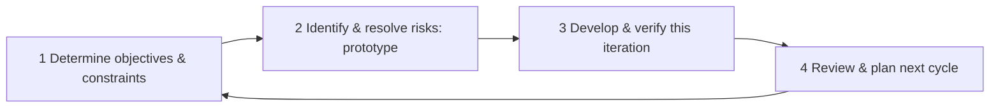

# SD-02 Software Process Models

> [!info] Topic card
> **Unit:** U1 · **Time:** 3 h · **Case:** [[SD-CASE LabBook Running Case Study]] · Project-management view of the same topic: [[PM-02 Project Lifecycles, Process Groups and Methodologies]], [[PM-16 Agile, Scrum and Hybrid Delivery]]

## 1. Learning objectives
1. **Describe** the waterfall, V-model, incremental, iterative/prototyping, spiral, and agile (Scrum, Kanban, XP) process models.
2. **Compare** them on how they handle requirement change, risk, feedback and documentation.
3. **Select** and **justify** a process for a given project context.
4. **Explain** DevOps and continuous integration/delivery as process practices.
5. **Recognise** misuses of process models (e.g. "agile" as an excuse for no planning).

## 2. Why it matters
The same team with the same skills can succeed or fail depending on *how* they organise work. A safety-critical system with fixed regulations needs different handling from a student app whose users don't yet know what they want. Exams frequently ask you to compare models and recommend one with reasons.

## 3. Prerequisites
[[SD-01 Software Engineering Fundamentals]] (lifecycle activities).

## 4. Intuition
Every process model answers one question: **when do we find out we were wrong?**
- **Waterfall:** at the end, so it suits problems where you're unlikely to be wrong (stable, well-understood requirements).
- **Iterative and agile models:** every few weeks, so they suit problems where you'll certainly be wrong about something.
- **Spiral:** wherever the biggest risk is, so you tackle that first.

## 5. Rigorous explanation

### 5.1 Plan-driven models
- **Waterfall:** sequential phases (requirements → design → implementation → testing → deployment → maintenance), each completed and signed off before the next. Royce's 1970 paper, often cited as its origin, actually warned against the pure one-pass version and recommended feedback.
  - *Strengths:* clear milestones and documentation; easy to manage contractually.
  - *Weaknesses:* late feedback; costly change; integration risk at the end.
- **V-model:** waterfall with each development phase paired with a test level: requirements ↔ acceptance testing, system design ↔ system testing, architecture ↔ integration testing, module design ↔ unit testing. It emphasises planning verification early. Common in regulated domains.

### 5.2 Incremental and iterative models
- **Incremental:** deliver the system in usable pieces (increment 1: booking; increment 2: notifications; increment 3: reports). Each increment goes through the full lifecycle.
- **Iterative / prototyping:** build a version, get feedback, refine. **Throwaway prototypes** explore requirements and are discarded. **Evolutionary prototypes** grow into the product.
- **Spiral (Boehm, 1988):** repeated cycles of four activities: determine objectives; identify and resolve risks (often with prototypes); develop and test; plan the next iteration. It's **risk-driven**: each cycle tackles the biggest open risk.
- **Unified Process (RUP):** iterative, with phases (inception, elaboration, construction, transition), use-case-driven and architecture-centric.

### 5.3 Agile
The **Agile Manifesto** (2001) values:
- individuals and interactions over processes and tools;
- working software over comprehensive documentation;
- customer collaboration over contract negotiation;
- responding to change over following a plan.

The items on the right still have value; the manifesto says the items on the left are valued more. Some agile frameworks:
- **Scrum:** fixed-length **sprints** (1–4 weeks).
  - *Roles:* product owner, scrum master, developers.
  - *Artefacts:* product backlog, sprint backlog, increment.
  - *Events:* sprint planning, daily scrum, sprint review, retrospective.
  - The *Definition of Done* sets the quality bar.
- **Kanban:** continuous flow, visualised on a board, with **work-in-progress (WIP) limits**. It measures lead time and throughput.
- **XP (Extreme Programming):** engineering practices such as test-driven development, pair programming, continuous integration, refactoring, small releases and simple design.

### 5.4 DevOps and CI/CD
- **Continuous integration:** every change is merged frequently and automatically built and tested.
- **Continuous delivery:** every passing build is releasable. **Continuous deployment** goes further and releases automatically.
- **DevOps:** development and operations share responsibility for delivery and running the service, with automation, monitoring and fast feedback.

These practices complement any iterative model.

### 5.5 Choosing a model
Factors to weigh:
- requirement stability and clarity;
- risk and novelty (technical, market);
- regulation, safety and documentation needs;
- customer availability for feedback;
- team size, experience and co-location;
- contract type (fixed price vs time and materials);
- the need for early value delivery.

Many real projects are **hybrids**, e.g. plan-driven requirements and architecture, then agile construction sprints.

## 6. Terminology
| Term | Meaning |
|---|---|
| Phase gate | A sign-off point before the next phase starts |
| Increment | A usable slice of the system delivered in one cycle |
| Iteration | A cycle of building and refining |
| Sprint | A Scrum time-box (1–4 weeks) producing an increment |
| Product backlog | An ordered list of everything that might be built |
| Definition of Done | The shared quality criteria an increment must meet |
| WIP limit | The maximum number of items allowed in a Kanban column |
| Velocity | The amount of backlog completed per sprint (team-specific; not a cross-team metric) |

## 7. Step-by-step: selecting a process
1. List the project's characteristics (the factors in 5.5).
2. Rate each factor: does it favour plan-driven or adaptive work?
3. Identify the **dominant risk** (unclear requirements, new technology, regulation, deadline).
4. Pick the model, or a hybrid, that addresses that risk best.
5. State the consequences: what you gain, what you give up, and how you'll compensate (e.g. agile plus a light architecture document for maintainers).

## 8. Diagram: the spiral model as a cycle

## 9. Worked examples

### Example 1 (basic): match the model
| Situation | Model | Why |
|---|---|---|
| Firmware for a medical infusion pump, strict regulator | V-model / plan-driven | Traceable verification required; requirements fixed by regulation |
| A start-up app, unsure what users want | Agile (Scrum) with prototypes | Fast feedback to discover requirements |
| An IT help-desk team handling a stream of small changes | Kanban | Continuous flow, varied item sizes |
| A new payment integration using an unfamiliar API | Spiral, or a prototype first | Retire technical risk early |

### Example 2 (intermediate): a process for LabBook
**Characteristics:**
- Requirements are partly clear (booking, overlap), partly uncertain (quota policy, how lecturers reserve labs).
- Users are on campus and available.
- A 4-person student team, one semester.
- No regulation, but an end-of-semester demo deadline.

**Choice:** Scrum with 2-week sprints, plus an initial "sprint 0" for the architecture and environment setup.
- Sprint 1: book and cancel workstations (the core value).
- Sprint 2: rules and quota, validated with students.
- Sprint 3: notifications and reports.
- Sprint 4: hardening and the demo.

**Compensations:** a lightweight design document and ADRs for future maintainers; CI running the tests on every push.

### Example 3 (challenging): a fixed-price contract
A government agency issues a fixed-price, fixed-scope tender for an inventory system with documented requirements, but its users have never used such a system before. A pure waterfall risks delivering exactly what was specified, but not what's needed. Pure agile clashes with fixed scope.

**Hybrid answer:**
1. A short paid **discovery and prototype phase** to validate the requirements.
2. Then a fixed-price contract for the revised scope, delivered **incrementally** with acceptance at each increment.
3. A **change-control process** with a budgeted change reserve ([[PM-14 Procurement and Change Management]]).

## 10. Application: your Final Year Project
Most FYPs suit an **iterative/incremental** approach: an early prototype for supervisor feedback (validation), then increments, with a plan-driven proposal and report structure on top. Record your choice and the reasons in your methodology chapter ([[FYP-05 Research Paradigms and Methodology]]).

## 11. Common mistakes
| Mistake | Fix |
|---|---|
| "Waterfall = bad, agile = good" | Each fits different contexts; justify your choice by the project's characteristics |
| Agile without engineering discipline | Tests, CI, a Definition of Done, refactoring |
| Agile = no documentation | Document what's needed (architecture, decisions, APIs), not everything |
| Comparing teams by velocity | Velocity is a team's own planning aid |
| Calling a 6-month "sprint" agile | Short time-boxes with feedback are the point |
| Choosing a model by habit | Use the factors in 5.5 |

## 12. Comparison of models
| Model | Change tolerance | Early value | Risk handling | Documentation | Best for |
|---|---|---|---|---|---|
| Waterfall | Low | Late | Late discovery | Heavy | Stable, well-understood requirements |
| V-model | Low | Late | Early test planning | Heavy | Regulated, safety-critical |
| Incremental | Medium | Early | Per increment | Medium | Clear core, phased delivery |
| Spiral | High | Medium | Explicit, risk-driven | Medium–heavy | Large, high-risk |
| Scrum | High | Early | Short feedback loops | Light, as needed | Uncertain requirements, engaged customers |
| Kanban | High | Continuous | Flow metrics | Light | Ongoing streams of work |

## 13. Practice
**L1** 1. Name the four Scrum events. 2. What does each side of the V-model pair together?

**L2** 3. Give two strengths and two weaknesses of waterfall. 4. Explain the difference between incremental and iterative development.

**L3** 5. Recommend a process for an exam-results portal that must be live for results day in 10 weeks, and justify it. 6. Describe what CI adds to Scrum.

**L4** 7. A team claims to be agile but has no tests, no Definition of Done and 6-week sprints with no demos. Diagnose the problems and recommend changes. 8. Compare the spiral model and Scrum in how they handle risk.

**L5** 9. Write a one-page process proposal for the hostel maintenance system (4 developers, 1 semester, a warden available weekly), with model, cadence, roles, artefacts, quality gates, and how you'll handle a mid-semester change of requirements.

## 14. Hints
> [!tip]- Hints
> 3: integration and feedback. 4: delivering pieces vs refining the whole. 5: a fixed deadline and high stakes, so short sprints, early release candidates, a freeze before the date. 8: explicit risk analysis per cycle vs empirical feedback per sprint.

## 15. Worked solutions
> [!success]- Solutions 1–2
> 1. Sprint planning, daily scrum, sprint review, sprint retrospective (all held within the sprint). 2. Requirements ↔ acceptance testing; system specification ↔ system testing; architectural design ↔ integration testing; detailed/module design ↔ unit testing.

> [!success]- Solution 3
> **Strengths:** clear phases and milestones (easy to plan and contract); thorough documentation (helps audits and handovers). **Weaknesses:** working software appears late, so requirement errors surface late; change is expensive; integration problems arrive all at once near the end.

> [!success]- Solution 4
> **Incremental:** the system is built and delivered in **slices**, each adding features (booking, then notifications, then reports). **Iterative:** the **same** parts are revisited and improved in cycles (a booking screen v1 → v2 → v3 after feedback). Most agile approaches are both.

> [!success]- Solution 5
> **Scrum with 1-week sprints** (more feedback before the fixed date):
> - Weeks 1–6: features by priority (view own results first, then the lecturer upload, then statistics).
> - Weeks 7–8: load and security testing, and a release candidate.
> - Week 9: a feature freeze and a results-day rehearsal with realistic data volumes.
> - Week 10: buffer and go-live.
>
> **Why:** the fixed date and high visibility mean value must be delivered and risks found early. The freeze protects stability.

> [!success]- Solution 6
> CI integrates every change frequently, and automatically builds and runs the tests. In Scrum, that means the increment is **always potentially releasable**, integration problems show up within hours rather than at sprint end, and the Definition of Done ("all tests pass in CI") is checked automatically.

> [!success]- Solution 7
> **Problems:**
> - Sprints are too long, so feedback comes late.
> - No demos means no stakeholder validation.
> - No tests or Definition of Done means quality is unknown and debt piles up.
>
> **Recommendations:**
> - 2-week sprints with sprint reviews, where users see working software.
> - A Definition of Done: code reviewed, tests written and passing in CI, documentation updated.
> - Retrospectives that track improvement actions.

> [!success]- Solution 8
> **Spiral:** risk is managed **explicitly and analytically**. Each cycle begins by identifying the largest risks and resolving them (prototypes, simulations) before committing to development. **Scrum:** risk is managed **empirically**. Short sprints deliver working increments, and reviews and retrospectives expose problems quickly; risks aren't necessarily analysed formally. Spiral suits large, high-risk projects where analysis pays off; Scrum suits uncertain requirements where fast feedback is cheapest.

> [!success]- Solution 9 (outline)
> **Model:** Scrum, with 2-week sprints. **Roles:** the product owner is a team member acting as proxy for the warden, who joins the reviews; the scrum master rotates. **Artefacts:** a product backlog (user stories with acceptance criteria), sprint backlogs, a burndown chart, and a Definition of Done (reviewed, tested in CI, documented). **Quality gates:** CI tests plus a security checklist before each release. **Change:** new requirements go into the backlog and are re-prioritised at the next sprint planning; the sprint in progress is protected unless the product owner cancels it. Scope trade-offs are agreed with the supervisor and recorded.

## 16. Self-test (pass ≥ 4/5)
1. Which model is explicitly risk-driven? 2. What's a WIP limit? 3. Which manifesto value concerns change? 4. What does continuous delivery mean? 5. Why is the V-model popular in regulated industries?
> [!success]- Answers
> 1. Spiral. 2. A cap on the number of items in a Kanban stage, which keeps work flowing. 3. "Responding to change over following a plan". 4. Every change that passes the automated pipeline is releasable at any time. 5. It pairs every specification level with a planned test level, giving traceable verification evidence.

## 17. Flashcards
#flashcards/software-design
Waterfall main weakness?::Late feedback and expensive change; integration risk at the end.
V-model?::Each development phase is paired with a test level (requirements ↔ acceptance testing, etc.).
Spiral model's distinctive feature?::Risk-driven cycles: objectives, risk resolution, development, planning.
Scrum roles?::Product owner, scrum master, developers.
Kanban core practices?::Visualise the work, limit WIP, manage flow.
Incremental vs iterative?::Delivering slices vs refining the same parts in cycles.
CI?::Merging frequently, with an automated build and tests on every change.

## 18. Blank-page recall
Draw the comparison table, and argue for one model each for: a medical device, a start-up app, an IT help desk.

## 19. Revision summary
- Plan-driven (waterfall, V-model) suits stable, regulated work; adaptive models (iterative, spiral, agile) suit uncertainty.
- Spiral = risk-driven. Scrum = time-boxed sprints with roles, events and artefacts. Kanban = flow with WIP limits. XP = engineering practices.
- CI/CD and DevOps support fast, safe delivery under any iterative model.
- Choose by context; hybrids are normal. Always justify your choice.

## 20. Links
Prev: [[SD-01 Software Engineering Fundamentals]] · Next: [[SD-03 Requirements Engineering]] · Related: [[PM-02 Project Lifecycles, Process Groups and Methodologies]], [[PM-16 Agile, Scrum and Hybrid Delivery]], [[FYP-05 Research Paradigms and Methodology]]

## 21. Sources
- Royce, W. W., "Managing the development of large software systems", *Proceedings of IEEE WESCON*, 1970, pp. 1–9.
- Boehm, B. W., "A spiral model of software development and enhancement", *Computer*, 21(5), 1988, pp. 61–72.
- Beck, K. et al., *Manifesto for Agile Software Development*, 2001: https://agilemanifesto.org/
- Schwaber, K. & Sutherland, J., *The Scrum Guide*, November 2020: https://scrumguides.org/
- Sommerville, I., *Software Engineering*, 10th ed., Pearson, 2016, chapters 2–3. *(A widely used textbook. It is not your prescribed text unless your module descriptor says so.)*
- *(Not checked online during the build, because there was no network access.)*

## 22. Mastery checklist
- [ ] I can describe each model and draw the V-model and the spiral
- [ ] I can recommend and justify a model for a given scenario
- [ ] I can explain Scrum roles, events and artefacts, and CI/CD
- [ ] Reviews scheduled
