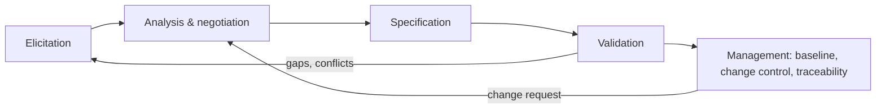

# SD-03 Requirements Engineering

> [!info] Topic card
> **Unit:** U2 · **Time:** 4 h · **Code:** `requirement_smells` in `code/sd_tools.py` (a heuristic checker for vague or ambiguous wording), tested in `tests/test_sd_tools.py`. The outputs below are real. · **Case:** [[SD-CASE LabBook Running Case Study]]

## 1. Learning objectives
1. **Describe** the requirements engineering activities: elicitation, analysis, specification, validation, management.
2. **Choose** elicitation techniques (interviews, observation, workshops, questionnaires, prototypes, document analysis) for a context.
3. **Write** functional and non-functional requirements that are unambiguous, verifiable, atomic and traceable.
4. **Prioritise** requirements (MoSCoW) and **handle** conflicts between stakeholders.
5. **Structure** a software requirements specification (SRS), and **validate** it through reviews and prototypes.

## 2. Why it matters
If you build the wrong thing, perfect code doesn't help. Requirement errors are among the most expensive defects, because everything downstream (design, code, tests, documentation) is built on them. Clear requirements are also what you, your supervisor and your client agree on, and what your tests verify.

## 3. Prerequisites
[[SD-01 Software Engineering Fundamentals]] (FR vs NFR, verification vs validation) · [[SD-02 Software Process Models]] · Logic from [[DM-01 Propositions, Connectives and Truth Tables]] helps when writing precise conditions.

## 4. Intuition
A requirement is a **promise you can check**. "The system should be fast" is a wish. "The availability page loads within 2 s for 95% of requests at 300 concurrent users" is a promise someone can test, and that engineers can design for. Requirements engineering turns wishes into checkable promises that the stakeholders agree on.

## 5. Rigorous explanation

### 5.1 Activities
1. **Elicitation:** discover needs from stakeholders, documents and existing systems.
2. **Analysis:** clarify, model, find conflicts and gaps, negotiate, prioritise.
3. **Specification:** write them down in an agreed form (an SRS, user stories, use cases).
4. **Validation:** check that they reflect real needs (reviews, prototypes, walkthroughs, acceptance criteria).
5. **Management:** baseline them, control changes, maintain traceability ([[SD-04 Use Cases, User Stories and Traceability]]).

### 5.2 Elicitation techniques
| Technique | Good for | Limits |
|---|---|---|
| Interviews (structured or semi-structured) | Depth, individual goals | Time-consuming; people describe their ideals, not reality |
| Observation / job shadowing | Tacit knowledge, real workflows | Observer effect; takes time |
| Workshops (e.g. JAD) | Resolving conflicts, shared understanding | Dominant voices; needs facilitation |
| Questionnaires | Many users, quantitative preferences | Shallow; the questions shape the answers |
| Prototypes / mock-ups | Validating UI and workflow ideas | Users may think it's finished |
| Document and system analysis | Rules, forms, current data | Documents may be outdated |

Use several techniques: **triangulation** reveals the gap between what people say and what they do.

### 5.3 Types of requirements
- **Business requirements:** organisational goals ("reduce lab-booking disputes by 80%").
- **User requirements:** what users need to accomplish (stories, use cases).
- **Functional requirements (FR):** system behaviour ("the system shall …").
- **Non-functional requirements (NFR):** quality attributes and constraints. Performance, security, usability, reliability, maintainability, legal/regulatory, platform.
- **Constraints:** imposed design choices ("must run on the university's existing Linux servers").
- **Domain rules:** "Students may book at most 10 hours per Monday–Sunday week."

### 5.4 Qualities of a good requirement
A good requirement is (in the spirit of ISO/IEC/IEEE 29148):
- **necessary:** someone needs it;
- **unambiguous:** one interpretation;
- **verifiable:** testable or measurable;
- **atomic/singular:** one requirement per statement;
- **feasible;**
- **consistent:** it doesn't conflict with others;
- **traceable:** it has an ID, a source and links;
- **implementation-free:** it states *what*, not *how*, unless it's a constraint.

Conventions: use "shall" for mandatory requirements; avoid vague terms ("user-friendly", "fast", "secure" without criteria); state the actor, the action, the object and the conditions.

### 5.5 Prioritisation and conflict
- **MoSCoW:** **M**ust have, **S**hould have, **C**ould have, **W**on't have (this time).
- Other methods: Kano analysis, value vs cost, pairwise comparison.
- **Conflicts:** e.g. lecturers want to reserve whole labs during peak student hours, while students want access. Resolve them through stakeholder negotiation and documented decisions, escalating to the product owner or the department head.

### 5.6 The SRS
A typical structure (adapted from ISO/IEC/IEEE 29148):
1. Introduction: purpose, scope, definitions, references.
2. Overall description: product perspective, user classes, operating environment, constraints, assumptions.
3. Specific requirements: functional (grouped by feature or use case), external interfaces, NFRs.
4. Appendices: models, glossary.
5. Change history.

In agile projects, the same content lives in a product backlog with acceptance criteria, plus a short living document for the NFRs and constraints.

## 6. Terminology
| Term | Meaning |
|---|---|
| Elicitation | Discovering requirements from sources |
| SRS | Software requirements specification |
| Baseline | An agreed version, after which changes go through change control |
| Acceptance criteria | Conditions that must be true for a requirement or story to be accepted |
| Requirements creep | Uncontrolled growth of scope |
| Tacit knowledge | Knowledge people use but don't articulate |
| Triangulation | Combining techniques to cross-check findings |

## 7. Step-by-step: from interview notes to requirements
Interview note from a technician: *"Students keep booking PC 3 even though it's broken, and then they complain to me."*
1. **Extract the need:** broken workstations shouldn't be bookable; technicians need to mark them.
2. **Write the requirements:**
   - FR-05: "The system shall reject bookings for workstations marked out of service."
   - FR-05a: "The system shall allow a technician to mark a workstation in or out of service."
3. **Add the acceptance criteria:**
   - Given LAB1-03 is out of service, when a student books it, then the booking is refused with the message "LAB1-03 is out of service".
   - Existing future bookings on a newly broken workstation are reported to the technician (this raises a new question: should they be cancelled automatically? Ask!).
4. **Check the quality:** `requirement_smells` reports `[]` for FR-05.
5. **Prioritise:** Must (it prevents real conflicts). **Trace:** source = the technician interview of 3 March. Implementation: `rules.WorkstationInService`. Test: `test_cli` (the out-of-service case).

## 8. Diagram: requirements engineering cycle

## 9. Worked examples

### Example 1 (basic): find the smells (real output of `requirement_smells`)
| Requirement | Reported smells |
|---|---|
| "The system should be user-friendly and fast." | vague term 'user-friendly'; vague term 'fast'; weak/optional wording 'should'; no 'shall'/'must' |
| "The system shall notify users and shall log all changes." | more than one 'shall' (split into separate requirements); universal quantifier without a measurable condition |
| "Bookings must be confirmed within `TBD` seconds." | unresolved placeholder (`TBD`) |
| "The system shall be secure." | vague term 'secure' |
| "The system shall allow a student to book a workstation for a slot of 30 to 240 minutes." | none |

The checker is a **heuristic**: it can't judge whether a requirement is *necessary* or *feasible*. Human review is still required.

### Example 2 (intermediate): rewriting NFRs
| Weak | Rewritten |
|---|---|
| "The system shall be fast." | "NFR-P1: The availability page shall load in ≤ 2 s for 95% of requests with 300 concurrent users on the production configuration." |
| "The system shall be secure." | "NFR-S1: Only users authenticated through the university identity provider shall access LabBook." "NFR-S2: Every booking state change shall be recorded with user, time and old/new state, and the records retained for 1 year." |
| "The system shall be easy to use." | "NFR-U1: 80% of first-time student users shall complete a booking within 60 s without help (usability test, n ≥ 10)." |

### Example 3 (challenging): resolving a conflict
- Lecturers: "I need to reserve all of Lab 1 every Tuesday 08:00–12:00 for practicals."
- Students: "We can't find free computers in the week before deadlines."
- Analysis: reservations would remove 4 peak hours a week, and data shows that the deadline weeks are weeks 7 and 14.
- **Negotiated requirement:** "FR-12: A lecturer shall be able to reserve a lab for a recurring weekly session approved by the head of department. In weeks flagged as deadline weeks, at most 50% of a lab's workstations may be reserved."
- Record the decision, its rationale and who approved it.

## 10. Application: LabBook requirements
The requirement table in [[SD-CASE LabBook Running Case Study]] §3 follows these rules: IDs, "shall"-style intent, traceability to code, and NFRs with clear criteria. Exercise: run every LabBook requirement through `requirement_smells` and fix any it flags.

## 11. Common mistakes
| Mistake | Fix |
|---|---|
| Writing solutions ("use MySQL") as requirements | State the need; record real constraints separately |
| Vague adjectives | Measurable criteria with context |
| Several requirements in one sentence | One "shall" per requirement |
| Only interviewing managers | Include actual users; observe them |
| Treating the SRS as final | Validate, baseline, and manage changes |
| Missing NFRs until late | Elicit quality attributes early (SD-01 §7) |

## 12. Comparison: SRS vs user stories
| | SRS | User stories + backlog |
|---|---|---|
| Form | A formal document with numbered requirements | Short stories plus acceptance criteria |
| Strength | Completeness, contracts, audits | Conversation, flexibility, prioritisation |
| Weakness | Can go stale; heavy | NFRs and constraints get lost |
| Best for | Plan-driven, regulated, outsourced work | Agile teams with engaged users |

## 13. Practice
**L1** 1. List the five RE activities. 2. Give the MoSCoW categories.

**L2** 3. Classify: "Passwords stored with Argon2id" · "A student can cancel their own booking" · "The system runs on Ubuntu 24.04 servers" · "Reduce booking disputes by 80%". 4. Name two elicitation techniques for discovering tacit knowledge.

**L3** 5. Rewrite three weak requirements for the hostel maintenance system so that `requirement_smells` reports nothing, and they're genuinely testable. 6. Write acceptance criteria (Given/When/Then) for FR-04, the weekly quota.

**L4** 7. Plan the elicitation for an exam-results portal: stakeholders, techniques per stakeholder, and how you'll validate. 8. Two requirements conflict: "Results shall be visible immediately after upload" and "Results shall be released only after the board of examiners approves them". Resolve them.

**L5** 9. Write a 2-page SRS extract for LabBook's lab-reservation feature (exercise 2 in the case study): scope, user classes, 6 FRs, 4 NFRs, assumptions, and a validation plan.

## 14. Hints
> [!tip]- Hints
> 3: business, user/functional, NFR, constraint. 4: observation, prototyping. 6: the boundary cases are exactly 10 h, 10.5 h, and next week. 8: separate *uploaded* from *published* states.

## 15. Worked solutions
> [!success]- Solutions 1–2
> 1. Elicitation, analysis, specification, validation, management. 2. Must have, Should have, Could have, Won't have (this time).

> [!success]- Solution 3
> - "Passwords stored with Argon2id": an NFR (security). It could be a design constraint if the institution mandates it.
> - "A student can cancel their own booking": a functional/user requirement.
> - "The system runs on Ubuntu 24.04 servers": a constraint (operating environment).
> - "Reduce booking disputes by 80%": a business requirement (a goal, measured outside the software).

> [!success]- Solution 4
> Observation/job shadowing (watch how wardens actually assign jobs) and prototyping (users react to a mock-up and reveal unstated expectations). Also acceptable: contextual inquiry, apprenticing.

> [!success]- Solution 5 (sample)
> - "The system shall allow a student to submit a maintenance request with a category, room number and a description of 10–500 characters."
> - "The system shall display a student's own requests, newest first, within 2 seconds for 95% of page loads at 200 concurrent users."
> - "The system shall send the student an email within 5 minutes when their request's status changes."
>
> (Check each with `requirement_smells`. "Within 2 seconds for 95%" passes.)

> [!success]- Solution 6
> - Given a student with 8 h of active bookings in the week of Mon 2 March, when they book 2 h on Wed 4 March, then the booking is confirmed (exactly 10 h).
> - Given the same 8 h, when they book 3 h on Wed 4 March, then it is refused with "weekly-quota: 11 h exceeds 10 h per week".
> - Given the same 8 h, when they book 4 h on Mon 9 March, then it is confirmed (a new week).
> - Given a cancelled 4 h booking that week, it doesn't count towards the quota.
> - Given a lecturer, the quota doesn't apply.
>
> These match `test_weekly_quota_students_only`.

> [!success]- Solution 7 (outline)
> **Stakeholders:**
> - students: a questionnaire (many of them), plus 2 focus groups;
> - lecturers: interviews, plus observation of current mark entry;
> - the examinations office: a workshop on approval rules and the results-release policy;
> - ICT: interviews on identity, hosting and security;
> - the registrar's policy documents: document analysis.
>
> **Validation:** a clickable prototype reviewed by each group; an SRS review meeting with sign-off from the examinations officer; acceptance criteria for every Must requirement.

> [!success]- Solution 8
> Introduce two states: **uploaded** (visible to lecturers and the exams office for checking) and **published** (visible to students). The revised requirements:
> - "Results shall be visible to the uploading lecturer and the examinations office immediately after upload."
> - "Results shall become visible to students only after an examinations officer records the board of examiners' approval."
>
> This removes the conflict by clarifying *visible to whom* and *when*.

> [!success]- Solution 9 (outline)
> **Scope:** lecturers reserve whole labs for recurring sessions. **User classes:** lecturers, the head of department (approver), technicians, students (affected). **FRs:**
> 1. Request a recurring reservation.
> 2. Approval by the head of department.
> 3. Conflict detection with existing bookings.
> 4. A 50% cap in deadline weeks.
> 5. Notification to affected students.
> 6. Cancellation of a single occurrence.
>
> **NFRs:** all reservations audited; a conflict report generated within 5 s; affected students notified within 10 minutes; only approved lecturers have the role. **Assumptions:** the timetable is published 2 weeks before the semester. **Validation:** a walkthrough with 2 lecturers, the head of department and a student representative, plus a prototype.

## 16. Self-test (pass ≥ 4/5)
1. What makes a requirement verifiable? 2. Why avoid two "shall"s in one requirement? 3. Name a technique for many users. 4. What does "baseline" mean? 5. Is "use PostgreSQL" a requirement?
> [!success]- Answers
> 1. There's an objective test or measurement that determines whether it's met. 2. Each needs its own ID, priority, test and status; combined, they can be partly met. 3. Questionnaires. 4. An agreed version that's then changed only through change control. 5. Only if it's a genuine imposed constraint; otherwise it's a design decision.

## 17. Flashcards
#flashcards/software-design
Five RE activities?::Elicitation, analysis, specification, validation, management.
Good requirement qualities?::Necessary, unambiguous, verifiable, atomic, feasible, consistent, traceable, implementation-free.
MoSCoW?::Must, Should, Could, Won't (this time).
FR vs NFR?::What the system does vs how well, or under which constraints.
Why triangulate elicitation?::What people say differs from what they do; several techniques reveal the gaps.
Acceptance criteria format?::Given (context), When (action), Then (observable outcome).

## 18. Blank-page recall
Write the elicitation-techniques table and rewrite three vague NFRs from memory.

## 19. Revision summary
- RE = elicitation, analysis, specification, validation, management.
- Use several elicitation techniques; validate with real users and prototypes.
- Good requirements are atomic, unambiguous, verifiable and traceable; use "shall", avoid vague terms.
- Prioritise with MoSCoW; resolve conflicts explicitly and record the decisions.
- SRS for plan-driven work; backlog plus acceptance criteria for agile, but don't lose the NFRs.

## 20. Links
Prev: [[SD-02 Software Process Models]] · Next: [[SD-04 Use Cases, User Stories and Traceability]] · Related: [[FYP-06 Requirements Gathering, Stakeholder and Feasibility Analysis]], [[PM-04 Scope Management, Requirements Traceability and WBS]], [[CS-02 Threat Modeling and Security Requirements]], [[X-01 Logic and Sets in Python and Requirements]]

## 21. Sources
- ISO/IEC/IEEE 29148:2018, *Systems and software engineering: Life cycle processes: Requirements engineering*.
- Wiegers, K. & Beatty, J., *Software Requirements*, 3rd ed., Microsoft Press, 2013.
- Sommerville, I., *Software Engineering*, 10th ed., Pearson, 2016, chapter 4.
- IREB, *CPRE Foundation Level Syllabus* (International Requirements Engineering Board; check the current version).
- *(Not checked online during the build, because there was no network access.)*

## 22. Mastery checklist
- [ ] I can choose elicitation techniques and justify them
- [ ] I write atomic, verifiable requirements with acceptance criteria
- [ ] I can prioritise and resolve conflicts
- [ ] I can outline an SRS · reviews scheduled
