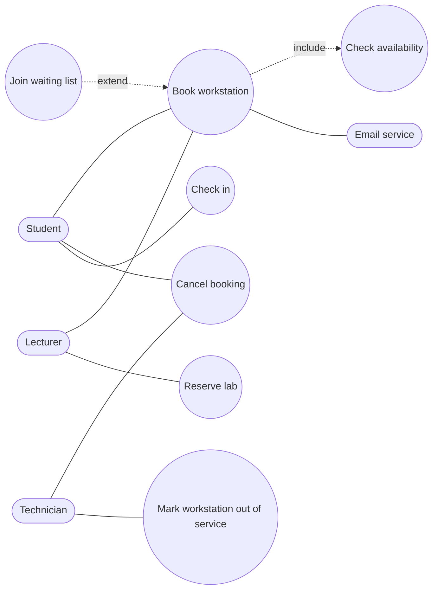

# SD-04 Use Cases, User Stories and Traceability

> [!info] Topic card
> **Unit:** U2 · **Time:** 4 h · **Code:** `trace_gaps` in `code/sd_tools.py`, and the LabBook traceability matrix *as a test* in `code/tests/test_traceability.py` (passing). · **Case:** [[SD-CASE LabBook Running Case Study]]

## 1. Learning objectives
1. **Identify** actors and use cases, and **draw** a use-case diagram with «include» and «extend» relationships.
2. **Write** a fully dressed use case: preconditions, main success scenario, extensions, postconditions.
3. **Write** user stories that meet INVEST, with Given/When/Then acceptance criteria.
4. **Build** and **use** a traceability matrix (requirement ↔ design ↔ code ↔ test) to find gaps and assess the impact of changes.
5. **Choose** between use cases and user stories for a context.

## 2. Why it matters
Use cases and stories turn requirements into **scenarios people recognise**, which makes them easy to validate with users. Traceability connects each requirement to the code and tests that satisfy it. That's how you prove completeness to a supervisor or client, and how you judge what a change will affect.

## 3. Prerequisites
[[SD-03 Requirements Engineering]].

## 4. Intuition
- A **use case** is a short play script: who wants what, and what happens step by step, including when things go wrong.
- A **user story** is a promise to have a conversation: "As a student, I want to book a PC so that I can finish my assignment." The details come out in the conversation and the acceptance criteria.
- **Traceability** is the thread through the maze: pull on any requirement, and you find its design, code and tests.

## 5. Rigorous explanation

### 5.1 Use-case modelling
- **Actor:** a role outside the system that interacts with it (a person, an external system, time). Actors are roles, not individuals: Amina is a *Student*.
- **Use case:** a goal-oriented interaction that delivers observable value to an actor. Name it verb + noun: "Book workstation".
- **System boundary:** a box separating the system from its actors.
- **«include»:** a base use case *always* uses another (e.g. Book workstation «include» Check availability). Use it for shared, mandatory steps.
- **«extend»:** an optional or conditional behaviour added to a base use case at an extension point (e.g. Join waiting list «extend» Book workstation, when the slot is full). The arrow points **from** the extending use case **to** the base.
- **Generalisation:** between actors (Lecturer and Student both specialise University User) or between use cases.

Common errors: modelling functions or screens as use cases ("Click button"); putting the database in as an actor; drawing a process flowchart with use cases.

### 5.2 Fully dressed use case (Cockburn style)
Fields: name, ID, primary actor, stakeholders and interests, preconditions, trigger, **main success scenario** (numbered steps), **extensions** (alternative and failure flows, numbered by the step they branch from, e.g. 4a), postconditions (success guarantee), and business rules referenced.

### 5.3 User stories
- Format: *As a* ⟨role⟩, *I want* ⟨capability⟩, *so that* ⟨benefit⟩.
- **INVEST:** Independent, Negotiable, Valuable, Estimable, Small, Testable.
- **Acceptance criteria:** Given ⟨context⟩, When ⟨action⟩, Then ⟨outcome⟩. These are the basis for acceptance tests.
- **Epics** are large stories that are split (by workflow step, by data variation, by rule, or into the simplest happy path first).
- NFRs can be written as constraints on stories, or as items in the Definition of Done.

### 5.4 Traceability
- **Forward traceability:** requirement → design → code → tests. Is every requirement implemented and tested?
- **Backward traceability:** test or code → requirement. Is every piece of work justified? Is there gold-plating?
- **A requirements traceability matrix (RTM)** lists the links; it can be a spreadsheet, tool links, or code.
- **Uses:**
  - completeness checks;
  - **impact analysis** (if FR-04 changes, which code and tests change?);
  - audits and acceptance;
  - regression test selection.

## 6. Terminology
| Term | Meaning |
|---|---|
| Actor | An external role interacting with the system |
| Primary / supporting actor | The actor with the goal / an actor that helps (e.g. the email service) |
| Main success scenario | The typical path to the goal |
| Extension | An alternative or failure path from a step |
| «include» / «extend» | Mandatory shared behaviour / optional conditional behaviour |
| INVEST | The quality criteria for user stories |
| RTM | Requirements traceability matrix |
| Gold-plating | Work that no requirement asked for |

## 7. Step-by-step: from requirement to a traced test
1. Pick FR-04 (the weekly quota).
2. Find the use case: UC-01 Book workstation, extension 4b (quota exceeded).
3. Write a story with acceptance criteria (SD-03 Solution 6).
4. Implement it: `rules.WeeklyQuota`.
5. Test it: `test_weekly_quota_students_only`.
6. Record the link in the RTM (`LINKS["FR-04"]` in `tests/test_traceability.py`).
7. Run `pytest`. The traceability test fails if a requirement has no test, a link names a missing test, or a test has no requirement.

## 8. Diagram: LabBook use cases
Mermaid has no native use-case diagram, so this is a flowchart approximation. In exams, use standard notation: stick figures, ovals, and a system box.

*Text version: Student books, cancels and checks in. Lecturer books and reserves labs. Technician cancels and marks workstations out of service. Book workstation always includes Check availability, and may be extended by Join waiting list. The email service is a supporting actor.*

## 9. Worked examples

### Example 1 (basic): fully dressed UC-01 Book workstation
| Field | Content |
|---|---|
| Primary actor | Student (also Lecturer) |
| Stakeholders | Student: get a PC; Technician: no bookings on broken PCs; Department: fair use |
| Preconditions | The user is authenticated |
| Trigger | The user chooses a workstation and a time slot |
| Main success scenario | 1. The user selects a lab and a date. 2. The system shows availability («include» Check availability). 3. The user selects a workstation and a slot. 4. The system validates the rules (FR-02 to FR-05, FR-09). 5. The system confirms the booking and records it. 6. The system notifies the user (FR-08). |
| Extensions | 4a. Overlap: the system shows the conflict, and the user picks another slot or joins the waiting list (UC-07). 4b. Quota exceeded: the system shows the hours used, and the use case ends. 4c. Out of service: the system shows other workstations. 4d. Outside opening hours: the system shows the opening hours. 6a. Notification fails: the booking remains confirmed and the failure is logged (NFR-04). |
| Postconditions | The booking is CONFIRMED and audited (NFR-01) |

In the code, these steps are `BookingService.book`, and extensions 4a–4d are the `RuleViolation`s raised by the rules.

### Example 2 (intermediate): INVEST check and splitting
Story: "As a lecturer, I want to manage lab reservations so that practicals run smoothly."
- **Not Small:** "manage" hides create, change, cancel and approve.
- **Not Testable:** what does "smoothly" mean?

Split it:
1. "As a lecturer, I want to request a weekly reservation of a whole lab for one semester, so that my practical sessions have guaranteed seats." AC: Given Lab 1 is free on Tuesdays 08:00–12:00, when I request it for weeks 1–14, then a pending request is created and the head of department is notified.
2. "As head of department, I want to approve or reject reservation requests, so that student access stays fair."
3. "As a lecturer, I want to cancel one occurrence, so that students can use the lab when my session is cancelled."

### Example 3 (challenging): using traceability to find a gap (real result)
Running `trace_gaps` on the first version of the LabBook matrix (FR-01 to FR-08, NFR-01 to NFR-04) reported:
```text
{'untested_requirements': [], 'unknown_tests': [], 'links_to_unknown_requirements': [],
 'tests_without_requirement': ['test_service_with_fake_rules_is_easy_to_test', 'test_timeslot_validation_and_overlap']}
```
Backward traceability exposed **two tests with no requirement**. Investigation showed:
- `test_timeslot_validation_and_overlap` checks a real business rule (slots must end after they start and last at most 8 hours) that nobody had written down. It became **FR-09**.
- `test_service_with_fake_rules_is_easy_to_test` verifies a design quality. It became **NFR-05** (testability).

After the update, `test_traceability.py` asserts that all four gap lists are empty, and it passes. Lesson: tests without requirements usually mean **missing requirements**, not useless tests.

## 10. Application: impact analysis
Change request: "Quota becomes 2 hours per *day* in deadline weeks."
- RTM lookup for FR-04: `rules.WeeklyQuota`, `test_weekly_quota_students_only`, the SD-03 acceptance criteria, UC-01 extension 4b.
- Impact:
  - add a new rule class (thanks to NFR-02, no change to the service);
  - a new deadline-week calendar (a data dependency);
  - new tests;
  - update UC-01 4b, the user help text, and the FR-04 wording;
  - get approval from the head of department.

## 11. Common mistakes
| Mistake | Fix |
|---|---|
| Use cases for single clicks or screens | Use cases are user goals with value |
| Arrows in the wrong direction for «extend» | The extending use case points to the base |
| Overusing «include» for every step | Use it only for shared, reusable behaviour |
| Stories without a "so that" | The benefit drives prioritisation and design |
| Untestable acceptance criteria ("works well") | Observable Given/When/Then outcomes |
| An RTM built once and never updated | Keep it in version control, or check it in CI |

## 12. Comparison: use cases vs user stories
| | Use case | User story |
|---|---|---|
| Detail | Full scenario, including extensions | A short placeholder plus acceptance criteria |
| Strength | Covers failure paths systematically | Small, prioritisable, conversational |
| Weakness | Heavy to write and maintain | Edge cases get missed unless the AC are thorough |
| Typical use | Plan-driven work, complex flows, contracts | Agile backlogs |
| Combine? | Yes: stories for planning, use cases for the complex flows |

## 13. Practice
**L1** 1. What's an actor? Is "the database" an actor? 2. What does INVEST stand for?

**L2** 3. Draw the use-case diagram for the hostel maintenance system (student, warden, technician, email service). 4. Write three user stories for LabBook technicians, each with one acceptance criterion.

**L3** 5. Write fully dressed UC-02 Cancel booking (extensions: not the owner; already checked in; already cancelled). 6. Explain the difference between «include» and «extend» with a non-LabBook example.

**L4** 7. Build an RTM for the hostel system's first 6 requirements, linking them to the components and test names you would write. 8. Using the LabBook RTM, analyse the impact of "Bookings may span midnight for 24-hour labs".

**L5** 9. Extend `test_traceability.py` with requirements for the waiting-list feature (case-study exercise 1), implement the feature with tests, and show the traceability test passing.

## 14. Hints
> [!tip]- Hints
> 1: is it outside the system, and does it interact? 5: compare with `BookingService.cancel` and `InvalidTransition`. 6: ATM: Withdraw «include» Authenticate; Withdraw «extend» Print receipt. 8: FR-03, `OpeningHours`, `TimeSlot`, `WeeklyQuota` (week boundaries), tests.

## 15. Worked solutions
> [!success]- Solutions 1–2
> 1. A role outside the system that interacts with it to achieve goals, or that supports it. The system's *own* database is part of the system, so it isn't an actor. An *external* system (e.g. the university's student records system) can be. 2. Independent, Negotiable, Valuable, Estimable, Small, Testable.

> [!success]- Solution 4 (sample)
> 1. "As a technician, I want to mark a workstation out of service, so that students can't book a broken PC." AC: Given LAB1-02 is in service, when I mark it out of service, then new bookings for it are refused.
> 2. "As a technician, I want to cancel any booking, so that I can free a PC for urgent maintenance." AC: Given Amina's confirmed booking, when I cancel it, then it's CANCELLED and Amina is notified ("by u-juma").
> 3. "As a technician, I want to see today's bookings per lab, so that I can plan maintenance." AC: Given 3 bookings in Lab 1 today, when I open the Lab 1 view, then I see all 3, in time order.

> [!success]- Solution 5
> **Primary actor:** the booker, or a technician. **Precondition:** the booking exists. **Main scenario:** 1. The actor selects a booking. 2. The system checks the permission (booker or technician). 3. The system checks the state allows cancellation (REQUESTED or CONFIRMED). 4. The system sets it to CANCELLED, records it, and notifies the booker. **Extensions:** 2a. Not the owner and not a technician: refused (`PermissionDenied`). 3a. Already CHECKED_IN: refused (`InvalidTransition`); the user is told to ask a technician to end the session. 3b. Already CANCELLED: refused (`InvalidTransition`). **Postcondition:** the booking is CANCELLED and the slot is free.

> [!success]- Solution 6
> **«include»:** behaviour the base *always* performs and that's factored out for reuse. For example, at an ATM, "Withdraw cash" «include» "Authenticate customer". **«extend»:** optional behaviour inserted under a condition. For example, "Print receipt" «extend» "Withdraw cash", if the customer asks for one. Include = mandatory and reused; extend = conditional, and the base is complete without it.

> [!success]- Solution 8
> - **Requirements:** FR-03 (single day) must change. FR-04's week boundaries need a rule for slots crossing Sunday→Monday (which week counts them?). FR-09 (8 h max) stays.
> - **Code:** `OpeningHours` (the single-day check), and a new 24-hour-lab attribute on `Workstation`/lab. `WeeklyQuota` (attributing hours to weeks). `TimeSlot` is unaffected.
> - **Tests:** update `test_opening_hours`; new tests for midnight-crossing slots and the quota at the week boundary.
> - **Docs:** UC-01 extension 4d, help text.
> - **Risk:** overlap logic already uses full datetimes, so it's safe. Confirm this with a test.

> [!success]- Solution 9 (guidance)
> Add, for example, "FR-10: When a booking is cancelled, the first user on the slot's waiting list shall be offered it" and "FR-11: Offers expire after 15 minutes". Implement a `WaitingList` subscriber to `booking.cancelled` (Observer, [[SD-12 Behavioral Design Patterns]]), write tests, and add `LINKS` entries. The traceability test fails until every new requirement has a test and every new test a requirement.

## 16. Self-test (pass ≥ 4/5)
1. Which direction does the «extend» arrow point? 2. What does an extension numbered "4a" mean? 3. What does backward traceability detect? 4. Which INVEST letter does "manage reservations" fail most? 5. Give one use of an RTM in a change request.
> [!success]- Answers
> 1. From the extending use case to the base use case. 2. An alternative path branching from step 4 of the main scenario. 3. Work without a requirement: gold-plating, or missing requirements. 4. Small (and Testable). 5. Impact analysis: finding the affected design, code and tests.

## 17. Flashcards
#flashcards/software-design
Use case vs user story?::A full goal scenario with extensions vs a short "As a…, I want…, so that…" plus acceptance criteria.
«include»?::The base use case always uses the included behaviour.
«extend»?::Optional behaviour added to a base use case under a condition; the arrow points to the base.
INVEST?::Independent, Negotiable, Valuable, Estimable, Small, Testable.
Forward vs backward traceability?::Requirement → design/code/test vs test/code → requirement.
What did backward tracing reveal in LabBook?::Two tests without requirements, which became FR-09 and NFR-05.

## 18. Blank-page recall
Draw the LabBook use-case diagram and write UC-01's main scenario and extensions from memory.

## 19. Revision summary
- Actors are external roles; use cases are valuable goals; «include» = mandatory shared behaviour, «extend» = conditional.
- Fully dressed use cases list preconditions, the main scenario, extensions and postconditions.
- Stories: As a / I want / so that, INVEST, Given/When/Then acceptance criteria; split epics.
- Traceability, forward and backward, gives completeness, impact analysis and audit. Keep it automated if you can.

## 20. Links
Prev: [[SD-03 Requirements Engineering]] · Next: [[SD-05 Software Architecture and Architectural Styles]] · Related: [[PM-04 Scope Management, Requirements Traceability and WBS]], [[SD-14 Software Testing, Verification and Validation]], [[FYP-06 Requirements Gathering, Stakeholder and Feasibility Analysis]]

## 21. Sources
- Cockburn, A., *Writing Effective Use Cases*, Addison-Wesley, 2001.
- Cohn, M., *User Stories Applied: For Agile Software Development*, Addison-Wesley, 2004.
- Wake, B., "INVEST in Good Stories, and SMART Tasks", blog post, 2003 (the origin of the INVEST acronym).
- OMG, *Unified Modeling Language (UML) Specification*, Version 2.5.1, 2017 (use-case diagrams).
- *(Not checked online during the build, because there was no network access.)*

## 22. Mastery checklist
- [ ] I can draw correct use-case diagrams with «include»/«extend»
- [ ] I can write a fully dressed use case and INVEST stories with acceptance criteria
- [ ] I can build an RTM and use it for gap and impact analysis
- [ ] Reviews scheduled
