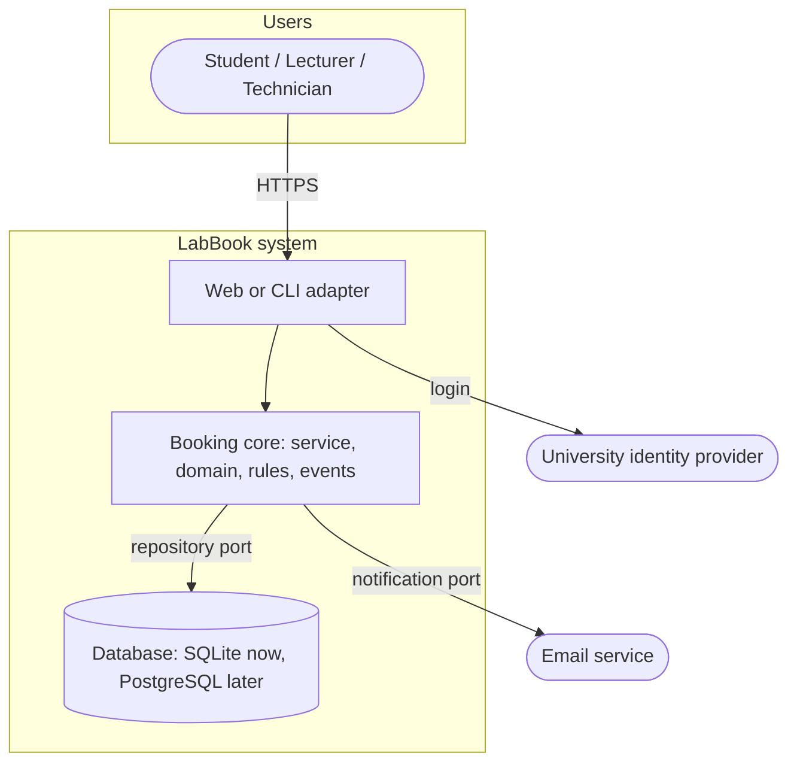

# SD-05 Software Architecture and Architectural Styles

> [!info] Topic card
> **Unit:** U3 · **Time:** 4 h · **Case:** LabBook's layered, ports-and-adapters design in `code/labbook/` ([[SD-CASE LabBook Running Case Study]] §4)

## 1. Learning objectives
1. **Define** software architecture, and **explain** why it's driven by quality attributes more than by functions.
2. **Describe** the main styles: layered, client–server, MVC, pipe-and-filter, event-driven, hexagonal (ports and adapters), microservices, modular monolith. Give the strengths and weaknesses of each.
3. **Document** an architecture with views (context, containers, components: the C4 model) and **architecture decision records** (ADRs).
4. **Evaluate** candidate architectures against quality-attribute scenarios.
5. **Justify** LabBook's architecture, and **identify** when it should change.

## 2. Why it matters
Architecture decisions are the expensive ones to reverse: how the system is split, where data lives, how the parts communicate. They decide whether the system can scale, be secured, be tested, and be changed by a team. Many failed systems had working code organised in an architecture that couldn't meet their quality needs.

## 3. Prerequisites
[[SD-01 Software Engineering Fundamentals]] (quality attributes) · [[SD-04 Use Cases, User Stories and Traceability]] · [[CS-09 Network Security and Secure Communication]] helps for deployment views.

## 4. Intuition
Architecture is the **floor plan** of the software. Functions are like furniture: you can rearrange them. Walls, plumbing and load-bearing columns (component boundaries, data stores, communication paths) are hard to move later. Choose them according to how the building must perform (quality attributes), not according to today's furniture.

## 5. Rigorous explanation

### 5.1 What architecture is
The fundamental structures of a system: its **elements**, their **relationships**, and the **properties** of both, plus the principles that guide its design and evolution (in the spirit of ISO/IEC/IEEE 42010). In practice, architecture is **the set of decisions that are costly to change**.

**Quality-attribute scenarios** make requirements precise for architecture:
- source;
- stimulus;
- environment;
- artefact;
- response;
- response measure.

For example: "300 students (source) open availability (stimulus) at 08:00 on a deadline day (environment). The availability service (artefact) returns the page (response) within 2 s for 95% of requests (measure)."

### 5.2 Styles
| Style | Idea | Strengths | Weaknesses |
|---|---|---|---|
| **Layered** | Presentation → application → domain → infrastructure; each layer uses only the one below | Separation of concerns, easy to understand | Change can ripple through layers; risk of "pass-through" layers |
| **Client–server** | Clients request services from a central server | Central control and data | The server is a bottleneck and a single point of failure |
| **MVC** | Model (data/rules), view (display), controller (input) | Separates UI from logic; several views of one model | Controllers can become bloated |
| **Pipe-and-filter** | Data flows through independent transformation steps | Reuse, parallelism, easy recombination | Poor for interactive work; data-format coupling |
| **Event-driven** (publish/subscribe) | Components emit and react to events | Loose coupling, extensibility | Harder to trace flows; eventual consistency |
| **Hexagonal / ports and adapters** | The core domain defines *ports* (interfaces); *adapters* implement them for the UI, databases and external services | Testable core; technology can be swapped | More interfaces and indirection |
| **Microservices** | Independently deployable services, each owning its data | Independent scaling and deployment; team autonomy | Distributed-system complexity, network failures, operations cost |
| **Modular monolith** | One deployable unit with strictly separated internal modules | Simple operations, clear boundaries | It's still one deployment; boundaries need discipline |

### 5.3 Documenting architecture
- **C4 model** (Brown):
  - **Context:** the system and its users and external systems;
  - **Containers:** deployable units (web app, database, worker);
  - **Components:** the parts inside a container;
  - **Code:** optional.
- **Views:** logical (structure), process (runtime), deployment (hardware/network), development (code organisation): the "4+1" views of Kruchten, plus scenarios.
- **ADRs:** short records (context, decision, status, consequences), one per significant decision, kept with the code.

### 5.4 Choosing and evaluating
1. List the key quality-attribute scenarios.
2. Propose candidate styles.
3. Walk each scenario through each candidate: what happens, and what does it cost?
4. Identify **trade-offs** and **risks**. (ATAM, the Architecture Tradeoff Analysis Method, formalises this.)
5. Decide, record an ADR, and revisit when the drivers change.

### 5.5 Microservices: when *not* to use them
They're attractive, but they suit large organisations with many independent teams, independent scaling needs and mature DevOps. For a small team, one university system or a student project, they usually add network failures, deployment complexity and data-consistency problems without corresponding benefit. Start with a **modular monolith** and extract a service only when there's a concrete driver.

## 6. Terminology
| Term | Meaning |
|---|---|
| Architecture style | A named, reusable pattern of structure and interaction |
| Quality-attribute scenario | A testable statement of a quality requirement for architecture |
| Port / adapter | An interface defined by the core / an implementation connecting it to a technology |
| Container (C4) | A separately deployable or runnable unit |
| ADR | Architecture decision record |
| Single point of failure | A component whose failure stops the whole system |
| Eventual consistency | Data converges over time instead of being instantly consistent |

## 7. Step-by-step: LabBook's architecture decision
1. **Drivers:** maintainability (NFR-02, NFR-03), testability (NFR-05), reliability (no double booking; NFR-04), a small team, a one-semester timeline, the university servers.
2. **Candidates:** a single-file script, a layered/hexagonal modular monolith, microservices (booking, notification, reporting).
3. **Scenarios:**
   - "Add a weekend rule": hexagonal → a new rule class; microservices → change and redeploy the booking service; script → edit the god function.
   - "Swap SQLite for PostgreSQL": hexagonal → a new repository adapter.
   - "The notification service is down": an event bus with isolated subscribers keeps booking working.
4. **Decision:** a hexagonal **modular monolith** (ADR-001 below).

## 8. Diagram: LabBook C4 container view

*Text version: users reach LabBook through a web or CLI adapter, which calls the booking core. The core reaches the database and the email service only through ports (interfaces). Login goes through the university identity provider.*

## 9. Worked examples

### Example 1 (basic): name the style
| Description | Style |
|---|---|
| Compiler: lexer → parser → optimiser → code generator | Pipe-and-filter |
| A web shop with separate cart, payments and catalogue services, each with its own database | Microservices |
| A Django app with models, templates and views | MVC (Django calls it MTV) |
| Booking emits "booking.cancelled"; the waiting list and email react | Event-driven (publish/subscribe) |

### Example 2 (intermediate): ADR-001 for LabBook
```text
ADR-001: Hexagonal modular monolith for LabBook
Status: Accepted (2026-02-20)
Context: Small team, one semester, single university deployment. Rules change often (NFR-02);
         storage may move from SQLite to PostgreSQL (NFR-03); booking must survive email failures (NFR-04).
Decision: One deployable Python application. Domain + rules + service form the core; the repository
          and notifications are ports with adapters; app.py is the composition root.
Consequences: + core testable without a database or email (fast tests); + adapters swappable.
              - more interfaces than a script; - one deployment unit (all-or-nothing releases).
              Revisit if separate teams or independent scaling needs appear.
```
The code follows it: `service.py` imports the `BookingRepository` *protocol*, never SQLite directly. Tests swap in the in-memory adapter, and `test_repository_contract` runs the same contract against both adapters.

### Example 3 (challenging): evaluating microservices for LabBook
Scenario: "On a deadline day, 300 users book within 10 minutes."
- **Monolith:** one process handles the load easily, because the scale is small. The bottleneck is the database write rate for bookings, which is trivial at this size.
- **Microservices:** booking calls availability and notification over the network. The added latency and failure modes need retries, timeouts and distributed consistency for the overlap check (two services racing), and deployment needs containers and orchestration.

**Verdict:** microservices add risk to the most important quality, no double booking, and give no scaling benefit at this size. **Rejected**, and recorded in the ADR's alternatives section.

## 10. Application: FYP technical architecture
For your FYP proposal ([[FYP-08 Technical Architecture and Design Planning]]):
- a C4 context and container diagram;
- three quality-attribute scenarios;
- the chosen style with one rejected alternative;
- one or two ADRs.

Supervisors look for *justification*, not fashionable technology.

## 11. Common mistakes
| Mistake | Fix |
|---|---|
| Choosing microservices by default | Start modular-monolith; extract services for concrete drivers |
| Architecture diagrams without a legend | Label the element types, arrows and protocols |
| Layers that call upward or skip layers | Enforce the dependency direction (use import checks) |
| Decisions only in people's heads | ADRs in the repository |
| Designing around one function | Design around the quality-attribute scenarios |
| Domain logic in the UI or database layer | Keep business rules in the core |

## 12. Comparison: layered vs hexagonal vs microservices
| | Layered | Hexagonal | Microservices |
|---|---|---|---|
| Dependency direction | Top → down | Adapters → core (inward) | Services ↔ services over the network |
| Testability of business logic | Medium (depends on the lower layers) | High (core is isolated) | High per service; integration testing is hard |
| Operational complexity | Low | Low | High |
| Fits | Most business apps | Apps with changing technology or important rules | Large organisations, independent scaling |

## 13. Practice
**L1** 1. Define architecture in one sentence. 2. Name the four C4 levels.

**L2** 3. Write a quality-attribute scenario for LabBook availability. 4. Give one strength and one weakness each of pipe-and-filter and event-driven styles.

**L3** 5. Draw a C4 container diagram for the hostel maintenance system. 6. Write ADR-002 for LabBook: "Use an in-process event bus rather than a message broker".

**L4** 7. Evaluate layered vs hexagonal for an exam-results portal against three scenarios. 8. Explain how LabBook's architecture supports NFR-03, and what would break it.

**L5** 9. LabBook will be adopted by 12 universities, each wanting their own rules and branding, with central hosting. Propose an architecture evolution (multi-tenancy, configuration, deployment), with ADRs and the trade-offs.

## 14. Hints
> [!tip]- Hints
> 3: source, stimulus, environment, artefact, response, measure. 6: weigh simplicity against durability and crash recovery. 8: what if `service.py` imported `sqlite3`? 9: a per-tenant rule set (Strategy), tenant IDs in the data, configuration rather than forks.

## 15. Worked solutions
> [!success]- Solutions 1–2
> 1. The fundamental structure of a system (its elements, relationships and governing principles), which embodies the decisions that are costly to change. 2. Context, Containers, Components, Code.

> [!success]- Solution 3
> Source: a student. Stimulus: requests availability for Lab 1 today. Environment: a deadline day, with 300 concurrent users. Artefact: the availability endpoint and the database. Response: returns the free slots. Measure: within 2 s for 95% of requests, with no errors.

> [!success]- Solution 4
> **Pipe-and-filter:** + filters can be reused and recombined, or run in parallel; − poor for interactive, stateful applications, and every filter depends on the agreed data format. **Event-driven:** + publishers don't know their subscribers, so features are easy to add; − the control flow is hard to follow and debug, and event ordering and delivery guarantees need care.

> [!success]- Solution 6
> ```text
> ADR-002: In-process event bus for notifications and audit
> Status: Accepted
> Context: Notifications and audit must not block or break bookings (NFR-04). Single deployment, small load.
> Decision: Use labbook.events.EventBus (synchronous, in-process, subscribers isolated with try/except).
> Alternatives: message broker (RabbitMQ / Redis streams): durable, async; rejected for operational cost now.
> Consequences: + simple, testable, no infrastructure. - events lost if the process crashes mid-publish;
>               - slow subscribers slow the request. Revisit when emails must be guaranteed (outbox table
>               + background worker) or load grows.
> ```

> [!success]- Solution 8
> `BookingService` depends only on the `BookingRepository` protocol. `app.py` chooses `InMemoryBookingRepository` or `SqliteBookingRepository`, and the same contract test runs on both. Adding a `PostgresBookingRepository` that passes the contract test needs **no** change to the service. It would break if the service imported `sqlite3`, used SQL directly, depended on SQLite-specific behaviour (e.g. the type affinity of `lastrowid`), or if domain objects contained database code.

> [!success]- Solution 9 (outline)
> **Evolution:**
> - **multi-tenant** modular monolith, with a `tenant_id` on every record and enforced in every repository query;
> - per-tenant **rule configuration**, building each tenant's `RuleSet` from configuration (Strategy and Composite already support this);
> - branding through templates and configuration;
> - tenant-aware authentication: each university's identity provider via SAML/OIDC.
>
> **Deployment:** containerised, with horizontal scaling behind a load balancer, a managed PostgreSQL with row-level security, and a message queue for notifications (an outbox pattern).
>
> **ADRs:**
> - ADR-003, multi-tenancy by a shared schema with tenant IDs (vs a database per tenant);
> - ADR-004, configuration-driven rules;
> - ADR-005, an outbox plus a worker for notifications.
>
> **Trade-offs:** shared schema = cheaper, but tenant isolation depends on correct queries (mitigated by tests and row-level security); a database per tenant = stronger isolation at higher operating cost.

## 16. Self-test (pass ≥ 4/5)
1. Which style isolates the domain behind ports? 2. Name two costs of microservices. 3. What does an ADR record? 4. What drives architecture most: functions or quality attributes? 5. What's a modular monolith?
> [!success]- Answers
> 1. Hexagonal (ports and adapters). 2. Network failures and latency, distributed data consistency, and operational complexity (any two). 3. The context, the decision, its status and its consequences (often the alternatives too). 4. Quality attributes. 5. A single deployable application divided into strictly separated internal modules.

## 17. Flashcards
#flashcards/software-design
Architecture?::The fundamental structures of a system and the decisions that are costly to change.
Layered style rule?::Each layer depends only on the layer(s) below it.
Hexagonal architecture?::The core defines ports (interfaces); adapters implement them for the UI, database and external services.
When not to use microservices?::Small teams, a single deployment, no independent scaling needs, immature DevOps.
C4 levels?::Context, Containers, Components, Code.
Quality-attribute scenario parts?::Source, stimulus, environment, artefact, response, response measure.

## 18. Blank-page recall
Draw LabBook's container diagram and write ADR-001 from memory.

## 19. Revision summary
- Architecture = costly-to-change structure, driven by quality-attribute scenarios.
- Know the styles and their trade-offs: layered, client–server, MVC, pipe-and-filter, event-driven, hexagonal, microservices, modular monolith.
- Document with C4 views and ADRs; evaluate candidates by walking the scenarios through them.
- LabBook: a hexagonal modular monolith. The ports make it testable and its technology swappable; microservices were rejected.

## 20. Links
Prev: [[SD-04 Use Cases, User Stories and Traceability]] · Next: [[SD-06 Modular Design, Cohesion and Coupling]] · Related: [[FYP-08 Technical Architecture and Design Planning]], [[X-03 Security Requirements in Software Architecture]], [[SD-17 Secure and Reliable Software Design]]

## 21. Sources
- Bass, L., Clements, P. & Kazman, R., *Software Architecture in Practice*, 4th ed., Addison-Wesley, 2021.
- ISO/IEC/IEEE 42010:2022, *Software, systems and enterprise: Architecture description*.
- Kruchten, P., "The 4+1 View Model of Architecture", *IEEE Software*, 12(6), 1995, pp. 42–50.
- Brown, S., *The C4 model for visualising software architecture*: https://c4model.com/
- Cockburn, A., "Hexagonal architecture" (ports and adapters), 2005, alistair.cockburn.us.
- Nygard, M., "Documenting Architecture Decisions", 2011 (the ADR format), cognitect.com blog.
- *(Not checked online during the build, because there was no network access.)*

## 22. Mastery checklist
- [ ] I can describe each style with strengths and weaknesses
- [ ] I can write quality-attribute scenarios and ADRs
- [ ] I can draw C4 context and container diagrams
- [ ] I can justify LabBook's architecture and say when microservices would fit · reviews scheduled
