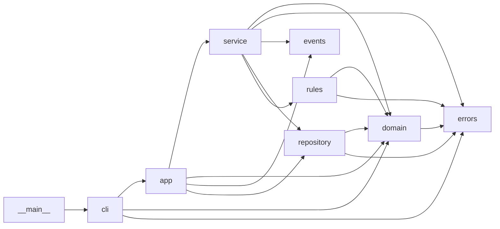

# SD-06 Modular Design, Cohesion and Coupling

> [!info] Topic card
> **Unit:** U3 · **Time:** 4 h · **Code:** `import_graph`, `instability` and `has_cycle` in `code/sd_tools.py`, and the **architecture dependency test** `test_labbook_dependency_rules` (passing). Every metric below was computed from the real LabBook source.

## 1. Learning objectives
1. **Explain** modularity, information hiding and separation of concerns, and why they reduce the cost of change.
2. **Classify** cohesion (coincidental → functional) and coupling (content → data/message) with examples.
3. **Measure** dependencies (fan-in, fan-out, instability) and **detect** cycles.
4. **Decompose** a system into modules with clear responsibilities and interfaces.
5. **Enforce** dependency rules automatically with tests.

## 2. Why it matters
Most of the cost of software is in changing it. If a change to the quota rule forces edits in the UI, the SQL and the email code, every change is slow and risky. Good modularity puts each likely change in one place, behind a stable interface. Cohesion and coupling are the vocabulary examiners and code reviewers use to discuss this.

## 3. Prerequisites
[[SD-05 Software Architecture and Architectural Styles]] · [[PY-13 Modules, Packages, Imports and Virtual Environments]] · Graphs from [[DM-15 Graphs, Representations, Paths and Connectivity]] (dependency graphs, cycles).

## 4. Intuition
- **Cohesion:** does everything in this module belong together? A toolbox drawer holding only screwdrivers is cohesive. A "miscellaneous" drawer isn't.
- **Coupling:** how much does this module need to know about others? Two rooms connected by one labelled door are loosely coupled. Rooms with shared wiring, plumbing and missing walls are tightly coupled.

Aim for **high cohesion, low coupling**.

## 5. Rigorous explanation

### 5.1 Principles
- **Modularity:** divide the system into units that can be understood, developed and tested separately.
- **Information hiding (Parnas, 1972):** each module hides a **design decision likely to change** (a data format, an algorithm, a storage technology) behind an interface. Decompose by secrets, not by processing steps.
- **Separation of concerns:** different concerns (UI, rules, persistence, notification) in different modules.
- **Abstraction and interfaces:** callers depend on *what* a module does, not *how*.

### 5.2 Cohesion levels (worst → best)
| Level | Elements grouped because… | Example |
|---|---|---|
| Coincidental | No meaningful relationship | `utils.py` with dates, emails and SQL |
| Logical | Same category of action, chosen by a flag | `do_output(kind)` that prints, emails or writes a file |
| Temporal | Run at the same time | `startup()` that loads configuration, opens the database and clears caches |
| Procedural | Steps in one procedure | Validate-then-save in one function |
| Communicational | Operate on the same data | A report on the bookings table |
| Sequential | The output of one is the input to the next | parse → validate → compute |
| Functional | All contribute to one well-defined task | `rules.WeeklyQuota` |

### 5.3 Coupling types (worst → best)
| Type | Meaning | Example |
|---|---|---|
| Content | One module modifies or relies on another's internals | Reaching into `_rows` of a repository |
| Common (global) | Shared global data | The flawed god class's global `DB` and `SENT` |
| External | Shared external format or device | Two modules parsing the same file layout |
| Control | Passing a flag that controls the other's logic | `do_booking(..., fmt="html")` |
| Stamp | Passing a whole structure when part is needed | Passing the whole user record to read the email address |
| Data | Passing only the needed data | `check(booking, user, ws, existing)` |
| Message | Communication through interfaces or events only | `bus.publish(Event(...))` |

### 5.4 Dependency metrics
For module $m$ in a dependency graph:
- **Fan-out / efferent coupling** $C_e$: the modules $m$ depends on.
- **Fan-in / afferent coupling** $C_a$: the modules that depend on $m$.
- **Instability** $I = C_e / (C_a + C_e)$ (Martin). $I = 0$: stable (many depend on it, it depends on few), so it must be hard to change, and is ideally abstract. $I = 1$: unstable (it depends on others and nothing depends on it), which is fine for UI and composition code.
- **Stable dependencies principle:** depend in the direction of stability.
- **Acyclic dependencies principle:** no cycles between modules. A cycle means the modules can't be understood, tested or released separately.

## 6. Terminology
| Term | Meaning |
|---|---|
| Module | A unit of decomposition (file, package, class, service) with an interface |
| Interface | What a module offers and requires, visible to others |
| Cohesion | How closely a module's elements belong together |
| Coupling | The degree of interdependence between modules |
| Information hiding | Hiding changeable design decisions behind interfaces |
| Fan-in / fan-out | The number of dependants / dependencies |
| Instability (I) | Ce / (Ca + Ce) |

## 7. Step-by-step: decomposing by likely changes
1. List the decisions likely to change: rules (often), storage (once), notification channel (email → SMS), UI (CLI → web), time handling (time zones later).
2. Give each decision its own module, with an interface that hides it:
   - `rules.py`, behind `BookingRule`;
   - `repository.py`, behind `BookingRepository`;
   - `events.py`, behind `EventBus`;
   - `cli.py`, an adapter;
   - `domain.TimeSlot`, encapsulating time logic.
3. Put orchestration in a thin `service.py` that depends only on the interfaces.
4. Point the dependencies inwards, and check that there are no cycles.
5. **Automate the rule:** `test_labbook_dependency_rules` fails if, for example, `domain.py` ever imports `service.py`.

## 8. Diagram: LabBook module dependencies (from `import_graph`)

*Text version: arrows show imports. All arrows point from outer modules (cli, app, service) towards inner ones (domain, errors). There are no cycles (`has_cycle` returns False).*

## 9. Worked examples

### Example 1 (basic): classify cohesion and coupling
| Code | Classification |
|---|---|
| `def startup(): load_config(); open_db(); clear_cache()` | Temporal cohesion |
| `def report(kind): if kind == "pdf": ... elif kind == "csv": ...` | Logical cohesion; callers use control coupling |
| `notify(user)`, which reads only `user.email` | Stamp coupling: pass `email` instead, or accept it as a deliberate convenience |
| `WeeklyQuota.check(...)` | Functional cohesion, data coupling |

### Example 2 (intermediate): LabBook's real metrics
`instability(import_graph("labbook", "labbook"))` gives (Ca, Ce, I):

| Module | Ca | Ce | I | Reading |
|---|---|---|---|---|
| errors | 5 | 0 | 0.00 | Maximally stable; changing it affects 5 modules, so keep it minimal |
| events | 2 | 0 | 0.00 | Stable, self-contained |
| domain | 5 | 1 | 0.17 | Stable core: everyone depends on it, and it depends only on errors |
| repository | 2 | 2 | 0.50 | Mid |
| rules | 1 | 2 | 0.67 | Fairly unstable; new rules are added here, which is fine |
| cli | 1 | 3 | 0.75 | Unstable adapter: expected |
| app | 1 | 4 | 0.80 | Composition root: expected |
| service | 1 | 5 | 0.83 | Orchestrator: expected |
| \_\_main\_\_ | 0 | 1 | 1.00 | Entry point |

The dependencies flow towards stability (service at I = 0.83 depends on domain at I = 0.17), satisfying the stable-dependencies principle, and `has_cycle` is False.

### Example 3 (challenging): the god class, measured
`cyclomatic_complexity` reports **14** for `LabManager.do_booking` (from SD-03's tool), against a maximum of **3** for any method in `BookingService`. The god class shows:
- **coincidental/procedural cohesion:** parsing, rules, SQL, email and formatting all in one method;
- **common coupling:** the global `DB` and `SENT`;
- **control coupling:** the `fmt` and `send` flags.

Its refactoring into LabBook's modules is clinic case F1 ([[SD Flawed Design Clinic]]).

## 10. Application: hostel maintenance system modules
Proposed modules, each hiding one secret:
- `requests_domain` (the request lifecycle rules);
- `assignment_policy` (how technicians are chosen; likely to change);
- `storage` (SQLite now);
- `notify` (email/SMS);
- `web` (Flask/HTML);
- `reports`.

Then write a dependency test like LabBook's from day 1. Compare with [[PRJ-PY-05 Hostel Maintenance System]].

## 11. Common mistakes
| Mistake | Fix |
|---|---|
| `utils.py` / `helpers.py` dumping grounds | Name modules after their responsibility |
| Decomposing by processing steps (input, process, output) | Decompose by the decisions likely to change |
| Passing flags to choose behaviour | Separate functions or strategies |
| Shared mutable globals | Pass dependencies explicitly |
| Circular imports "fixed" by local imports | Remove the cycle: move the shared concept down, or invert the dependency |
| "Low coupling" meaning no dependencies at all | Some coupling is necessary; make it explicit, minimal and directed |

## 12. Comparison: cohesion vs coupling
| | Cohesion | Coupling |
|---|---|---|
| Scope | Inside one module | Between modules |
| Goal | High | Low |
| Best level | Functional | Data / message |
| Worst level | Coincidental | Content |
| Test question | "Can I describe this module in one sentence without 'and'?" | "If I change this module, how many others must change?" |

## 13. Practice
**L1** 1. Define information hiding. 2. Order these coupling types from worst to best: data, content, control, common.

**L2** 3. Compute Ca, Ce and I for a module imported by 3 modules that imports 1. 4. Classify the cohesion of a `reports.py` that contains only functions over the bookings table.

**L3** 5. Draw the dependency graph for the flawed god class's module and LabBook's, and compare them. 6. Explain why `errors.py` having I = 0 is a responsibility and not just a good score.

**L4** 7. A developer adds `from .service import BookingService` to `rules.py` to look up users. What breaks? Propose a better design. 8. Evaluate the stamp coupling in `rules.check(booking, user, ws, existing)`: is passing whole objects justified?

**L5** 9. Write a dependency test for your FYP or the hostel system that enforces your layer rules, then deliberately break the rule to confirm the test fails.

## 14. Hints
> [!tip]- Hints
> 3: Ca = 3, Ce = 1. 6: many dependants. 7: a cycle (service imports rules); pass the data in instead. 8: rules need several fields, and the objects are immutable value carriers.

## 15. Worked solutions
> [!success]- Solutions 1–2
> 1. Hiding each design decision that's likely to change inside one module, behind an interface, so that changing the decision affects only that module. 2. Content (worst) → common → control → data (best).

> [!success]- Solution 3
> Ca = 3, Ce = 1, so I = 1 / (3 + 1) = **0.25** (fairly stable).

> [!success]- Solution 4
> **Communicational** cohesion: the elements are grouped because they operate on the same data. It's acceptable, but if the reports serve unrelated purposes, splitting them by purpose moves towards functional cohesion.

> [!success]- Solution 6
> Five modules depend on `errors.py`, so any change to it (renaming `RuleViolation`, changing its constructor) ripples to all five. Stability means it *must* change rarely. Keep it small, abstract, and treat it as a public contract with backwards-compatible evolution.

> [!success]- Solution 7
> It creates a **cycle**: service → rules → service. Python may fail with a circular-import error depending on the import order, and the modules can no longer be tested independently. `test_labbook_dependency_rules` (and `has_cycle`) would fail. **Better:** the rule receives what it needs as parameters (the user is already passed in), or depends on a small `UserLookup` protocol defined in the domain layer, implemented by the directory and injected by the composition root.

> [!success]- Solution 8
> It's technically stamp coupling, but justified. Different rules need different fields (role for the quota, `in_service` and `has_gpu` from the workstation, `slot` and `ws_id` from the booking). Passing small, immutable domain objects keeps one uniform `BookingRule` interface (Strategy), which is worth more than minimal parameters. The coupling is to **stable domain types** (domain I = 0.17), not to volatile modules.

> [!success]- Solution 9 (guidance)
> Copy the `import_graph` pattern. Assert `not has_cycle(g)`, and for each inner module, assert that it imports no outer module. Run the test, then add a forbidden import, see the test fail with a clear message, and revert. Put the test in CI.

## 16. Self-test (pass ≥ 4/5)
1. What's the best cohesion level? 2. Which coupling does a global variable create? 3. What does I = 1 mean? 4. Why are dependency cycles harmful? 5. What does Parnas say to decompose by?
> [!success]- Answers
> 1. Functional. 2. Common coupling. 3. The module depends on others and nothing depends on it (unstable, and free to change). 4. The modules can't be understood, tested, built or released separately, and changes ripple around the cycle. 5. Design decisions likely to change (secrets), not processing steps.

## 17. Flashcards
#flashcards/software-design
Cohesion levels worst to best?::Coincidental, logical, temporal, procedural, communicational, sequential, functional.
Coupling types worst to best?::Content, common, external, control, stamp, data, message.
Information hiding?::Hide changeable design decisions behind stable interfaces (Parnas, 1972).
Instability metric?::I = Ce / (Ca + Ce).
Acyclic dependencies principle?::Module dependencies must form no cycles.
Control coupling example?::Passing a flag that selects the callee's behaviour (e.g. fmt="html").

## 18. Blank-page recall
Write both ladders (cohesion and coupling) with one LabBook or god-class example each.

## 19. Revision summary
- Modularity + information hiding + separation of concerns make change cheap.
- Aim for high cohesion (functional) and low coupling (data/message); avoid globals and control flags.
- Measure with fan-in/fan-out and instability; keep the dependencies acyclic and pointing towards stable modules.
- Enforce the rules with automated tests (LabBook's dependency test).

## 20. Links
Prev: [[SD-05 Software Architecture and Architectural Styles]] · Next: [[SD-07 UML Class Diagrams]] · Related: [[SD-10 SOLID Principles]], [[SD-15 Refactoring, Technical Debt, Code Review and Quality]], [[DM-15 Graphs, Representations, Paths and Connectivity]], [[SD Flawed Design Clinic]]

## 21. Sources
- Parnas, D. L., "On the criteria to be used in decomposing systems into modules", *Communications of the ACM*, 15(12), 1972, pp. 1053–1058.
- Stevens, W. P., Myers, G. J. & Constantine, L. L., "Structured design", *IBM Systems Journal*, 13(2), 1974, pp. 115–139 (cohesion and coupling).
- Martin, R. C., *Agile Software Development: Principles, Patterns, and Practices*, Prentice Hall, 2002 (stability and instability metrics, acyclic dependencies).
- *(Not checked online during the build, because there was no network access.)*

## 22. Mastery checklist
- [ ] I can classify cohesion and coupling in code
- [ ] I can compute fan-in, fan-out and instability, and detect cycles
- [ ] I can decompose by likely changes and enforce the layers with a test
- [ ] Reviews scheduled
